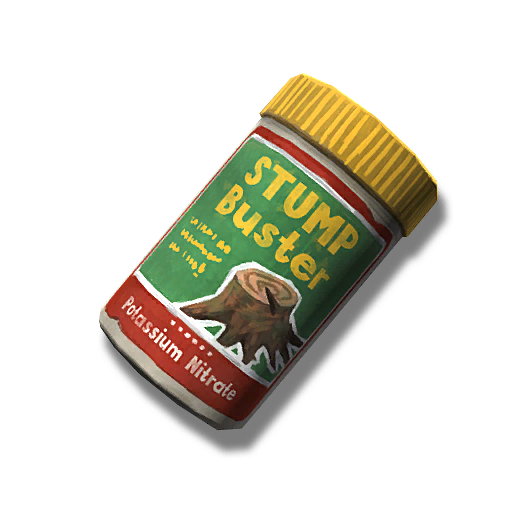

# Stump Remover

**Contents**

- [Overview](#Overview)
- [Spawn points](#Spawn_points)
- [Products](#Products)
- [Trivia](#Trivia)

<table class="infobox">
<caption>Stump Remover</caption>
<colgroup>
<col style="width: 50%" />
<col style="width: 50%" />
</colgroup>
<tbody>
<tr>
<td colspan="2"><figure>

<figcaption>Stump_Remover_icon.png</figcaption>
</figure></td>
</tr>
<tr>
<td colspan="2" class="section">
<strong>General</strong>
</td>
</tr>
<tr>
<td>
Item Type
</td>
<td>
Material|-
</td>
</tr>
<tr>
<td>
Renewable
</td>
<td>
Yes (very rare <a href="./Beachcombing.md" class="wikilink" title="Beachcombing">Beachcombing</a>)
</td>
</tr>
<tr>
<td colspan="2" class="section">
<strong>Statistics</strong>
</td>
</tr>
<tr>
<td>
Weight
</td>
<td>
0.75 kg(1.65 lbs)
</td>
</tr>
</tbody>
</table>

<table>
<colgroup>
<col style="width: 33%" />
<col style="width: 33%" />
<col style="width: 33%" />
</colgroup>
<tbody>
<tr>
<td style="vertical-align: top; font-size: 3em; color: #5d5980; padding-right: 10px">
“
</td>
<td>
An herbicide, this chemical can also be used to Craft Gunpowder.

&#10;

In-game descripton

</td>
<td style="vertical-align: bottom; font-size: 3em; color: #5d5980; padding-left: 10px">
”
</td>
</tr>
</tbody>
</table>

**Stump Remover** is a crafting material for <a href="./Gunsmithing.md" class="wikilink" title="Gunsmithing">Gunsmithing</a> in *The Long Dark*.

## Overview

Stump Remover is used to craft <a href="./Can%20of%20Gunpowder.md" class="wikilink" title="Can of Gunpowder">Can of Gunpowder</a>, a resource for <a href="./Gunsmithing.md" class="wikilink" title="Gunsmithing">Gunsmithing</a>. This may only be done at the <a href="./Ammunition%20Work%20Bench.md" class="wikilink" title="Ammunition Workbench">Ammunition Workbench</a> in <a href="./Bleak%20Inlet.md" class="wikilink" title="Bleak Inlet">Bleak Inlet</a> or at <a href="./Blackrock%20Prison.md" class="wikilink" title="Blackrock Prison">Blackrock Prison</a>. Bottles of Stump Remover can be found in residential or agricultural sites on <a href="./Great%20Bear%20Island.md" class="wikilink" title="Great Bear Island">Great Bear Island</a>.

0.10 kg of gunpowder may also be used as an accelerant for <a href="./Fire%20Starting.md" class="wikilink" title="starting fires">starting fires</a>, or used for crafting <a href="./Noisemaker.md" class="wikilink" title="Noisemakers">Noisemakers</a>. This gives stump remover a use on Interloper difficulty, despite firearms not being present.

## Spawn points

Some observed spawn points include:

**<a href="./Bleak%20Inlet.md" class="wikilink" title="Bleak Inlet">Bleak Inlet</a>**

- Outside <a href="./Cabin.md" class="wikilink" title="Cabin">Cabin</a> near the Lower Raven Falls
- <a href="./Pensive%20Lookout.md" class="wikilink" title="Pensive Lookout">Pensive Lookout</a> (Stairs)
- <a href="./Last%20Resort%20Cannery.md" class="wikilink" title="Last Resort Cannery">Last Resort Cannery</a> Workshop

**<a href="./Broken%20Railroad.md" class="wikilink" title="Broken Railroad">Broken Railroad</a>**

- <a href="./Maintenance%20Yard.md" class="wikilink" title="Maintenance Shed">Maintenance Shed</a>

**<a href="./Coastal%20Highway.md" class="wikilink" title="Coastal Highway">Coastal Highway</a>**

- In a house in the southwest part of <a href="./Coastal%20Townsite.md" class="wikilink" title="Coastal Townsite">Coastal Townsite</a> on the floor, to the right after you go in the front door.
- Inside a cabin northwest of <a href="./The%20Tooth.md" class="wikilink" title="the Tooth">the Tooth</a> .
- Inside a trailer northwest of the <a href="./Fishing%20Camp.md" class="wikilink" title="Fishing Camp">Fishing Camp</a> .

**<a href="./Mystery%20Lake%20%28region%29.md" class="wikilink" title="Mystery Lake">Mystery Lake</a>**

- <a href="./Lake%20Cabins.md" class="wikilink" title="Lake Cabins">Lake Cabins</a> (southernmost)
- Trailer (<a href="./Logging%20Camp.md" class="wikilink" title="Logging Camp">Logging Camp</a>)

**<a href="./Mountain%20Town.md" class="wikilink" title="Mountain Town">Mountain Town</a>**

- <a href="./Orca%20Gas%20Station.md" class="wikilink" title="Orca Gas Station">Orca Gas Station</a> Convenience Store
- <a href="./Milton%20House%20%28Grey%20Mother%27s%29.md" class="wikilink" title="Milton House (Grey Mother&#39;s)">Milton House (Grey Mother's)</a>
- <a href="./Trailer%20%28Mountain%20Town%20Region%29.md" class="wikilink" title="Trailer (Mountain Town Region)">Trailer (Mountain Town Region)</a>
- <a href="./Paradise%20Meadows%20Farm.md" class="wikilink" title="Paradise Meadows Farm">Paradise Meadows Farm</a>

**<a href="./Pleasant%20Valley.md" class="wikilink" title="Pleasant Valley">Pleasant Valley</a>**

- <a href="./Thomson%27s%20Crossing.md" class="wikilink" title="Thomson&#39;s Crossing">Thomson's Crossing</a> Rural Store
- <a href="./Skeeter%27s%20Ridge.md" class="wikilink" title="Skeeter&#39;s Ridge">Skeeter's Ridge</a> Basement
- <a href="./Prepper%20Cache.md" class="wikilink" title="Prepper cache">Prepper cache</a> (Clothing)

**<a href="./Blackrock.md" class="wikilink" title="Blackrock">Blackrock</a>**

- <a href="./Blackrock%20Prison.md" class="wikilink" title="Blackrock Prison">Blackrock Prison</a>
  - Inside Wardens office
  - Inside Guard Barracks
  - In a open top crate on a shelf inside the workbench shed

## Products

## Trivia

- Stump Remover is branded as the product "Stump Buster", with potassium nitrate as an active ingredient.
- Potassium Nitrate is used to accelerate the decomposition of wood, and is used to rot stumps to ease removal.
- The Errant Pilgrim update introduced <a href="./Gunsmithing.md" class="wikilink" title="Gunsmithing">Gunsmithing</a>.

**Lua execution error in Module:Navbox function navbox**

