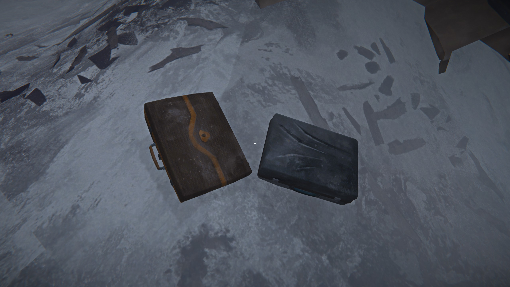
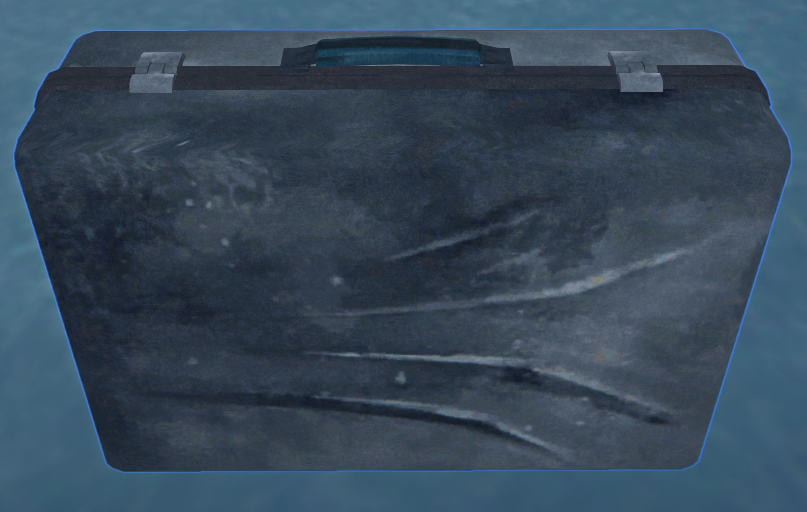
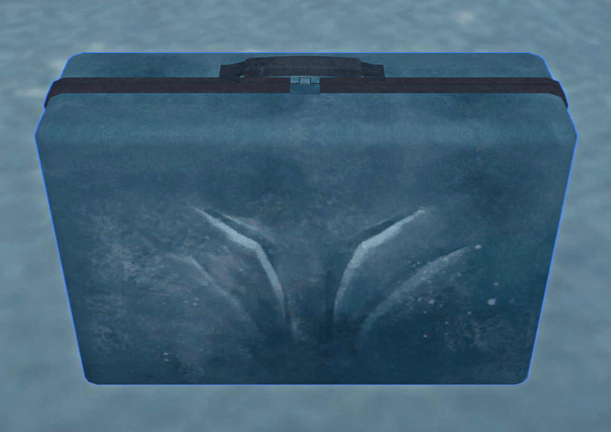
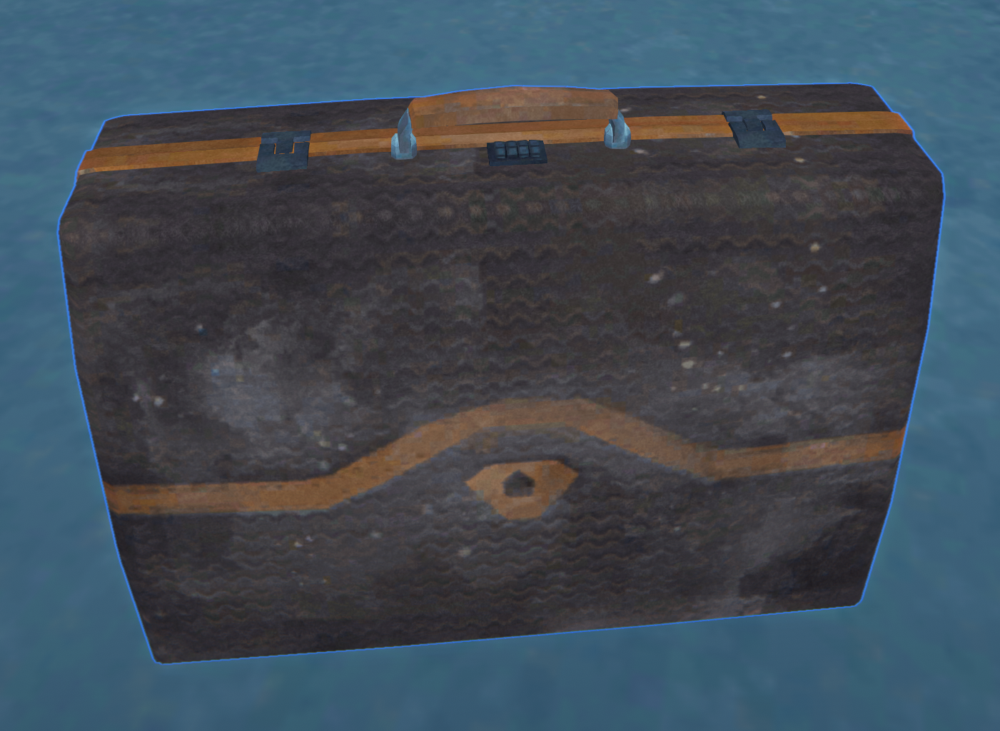

# Suitcase

**Contents**

- [Loot](#loot)
- [exploit](#exploit)
- [trivia](#trivia)
- [Gallery](#gallery)

**Suitcase**

| Property | Details |
| --- | --- |
|  |  / *Suitcase.jpg* |
| Release | 1.60 |
| Story item | Yes |
| **Container** |  |
| Capacity | 20.00 kg(44 lbs) |

A **Suitcase** is a storage item found in various locations across the Island. They come in various colors (blue, brown, red, orange). Clothing is the main item that can be looted from Suitcases. They can often be found at the [Crash Site (Pleasant Valley)](./Crash%20Site%20%28Pleasant%20Valley%29.md) and [Terminal](./Terminal.md) in [Forsaken Airfield](./Forsaken%20Airfield.md), as well as inside a few cabins across the Island in the Far Territory. They are also found near [Plane Crashes](./Plane%20Crashes.md).

## Loot

**Head:** [Baseball Cap](./Baseball%20Cap.md), [Cotton Scarf](./Cotton%20Scarf.md), [Cotton Toque](./Cotton%20Toque.md), [Wool Toque](./Wool%20Toque.md).

**Torso Outer:** [Sport Vest](./Sport%20Vest.md), [Down Vest](./Down%20Vest.md), [Light Shell](./Light%20Shell.md), [Simple Parka](./Simple%20Parka.md).

**Torso Inner:** [Dress Shirt](./Dress%20Shirt.md), [Hoodie](./Hoodie.md), [Plaid Shirt](./Plaid%20Shirt.md), [Hockey Jersey](./Hockey%20Jersey.md), [Thin Wool Sweater](./Thin%20Wool%20Sweater.md), [Wool Shirt](./Wool%20Shirt.md), [Thick Wool Sweater](./Thick%20Wool%20Sweater.md), [Hockey Jersey](./Hockey%20Jersey.md)

**Hands:** [Fleece Mittens](./Fleece%20Mittens.md), [Wool Mittens](./Wool%20Mittens.md).

**Legs Outer:** [Jeans](./Jeans.md), [Cargo Pants](./Cargo%20Pants.md).

**Legs Inner:** [Thermal Underwear](./Thermal%20Underwear.md), [Wool Longjohns](./Wool%20Longjohns.md).

**Feet Inner:** [Sports Socks](./Sports%20Socks.md), [Wool Socks](./Wool%20Socks.md)

**Feet Outer:** [Leather Shoes](./Leather%20Shoes.md), [Running Shoes](./Running%20Shoes.md)

**FastFilm:** [FastFilm-500](./FastFilm-500.md), [FastFilm-500BW](./FastFilm-500BW.md), [FastFilm-500SPA](./FastFilm-500SPA.md)

## exploit

from: [https://www.reddit.com/r/thelongdark/comments/1hwkmra/the\_magic\_suitcase\_glitch\_aka\_infinite\_cloth/](https://www.reddit.com/r/thelongdark/comments/1hwkmra/the_magic_suitcase_glitch_aka_infinite_cloth/)[¹](#fn1)

1. place suitcases indoors, loot if available
2. pick up suitcases
3. leave building
4. enter building
5. quit to menu
6. reload save
7. Repeat

note: In practice, this exploit works for 3 things.

1. getting FastFilm for the camera, safely and renewable
2. getting mid-tire clothing (which could work for misery or interloper since there is one in homesteader's respite in Ash Canyon and being in an interior, even though the loot is reduced, following the rules of those modes), or to equip yourself quickly if you appear near a place with suitcases
3. getting cured leather and cloth to mend clothes and trade with the trader

## trivia

You can use the "keep construction mode out of customizable areas" bug/exploit to get air crash suitcases, or places like the terminal at Forsaken Airfield, to get more if you want to do the exploit or simply want to use them as a container.

## Gallery

| Column 1 | Column 2 | Column 3 | Column 4 |
| --- | --- | --- | --- |
|  / *Navy\_Suitcase.png* |  / *Blue\_Suitcase.png* |  / *Red\_Suitcase.png* |  / *Grandmas\_Flower\_Suitcase.png* |
|  / *Tan\_Suitcase.png* |  / *Dark\_Brown\_Suitcase.png* |  |  |

**Lua execution error in Module:Navbox function navbox** [ru:Чемодан](ru:%D0%A7%D0%B5%D0%BC%D0%BE%D0%B4%D0%B0%D0%BD)

## Notes

---

1. [https://www.reddit.com/r/thelongdark/comments/1hwkmra/the\_magic\_suitcase\_glitch\_aka\_infinite\_cloth/](https://www.reddit.com/r/thelongdark/comments/1hwkmra/the_magic_suitcase_glitch_aka_infinite_cloth/)[↩︎](#fnref1)
