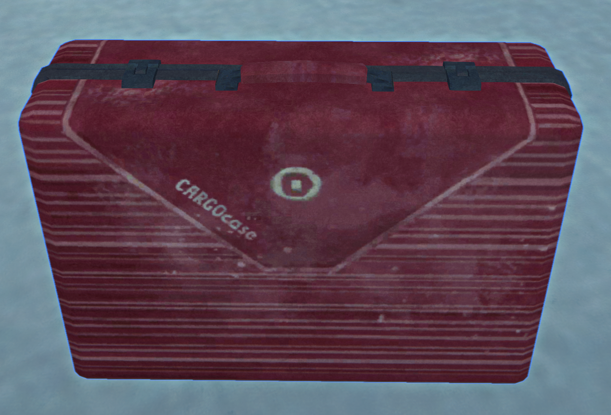
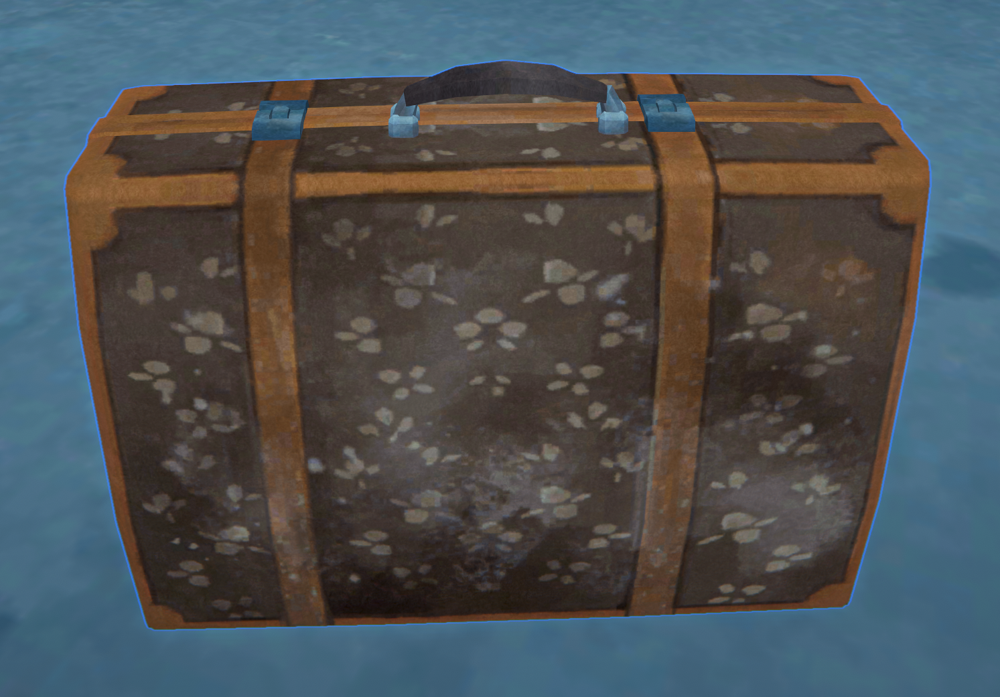
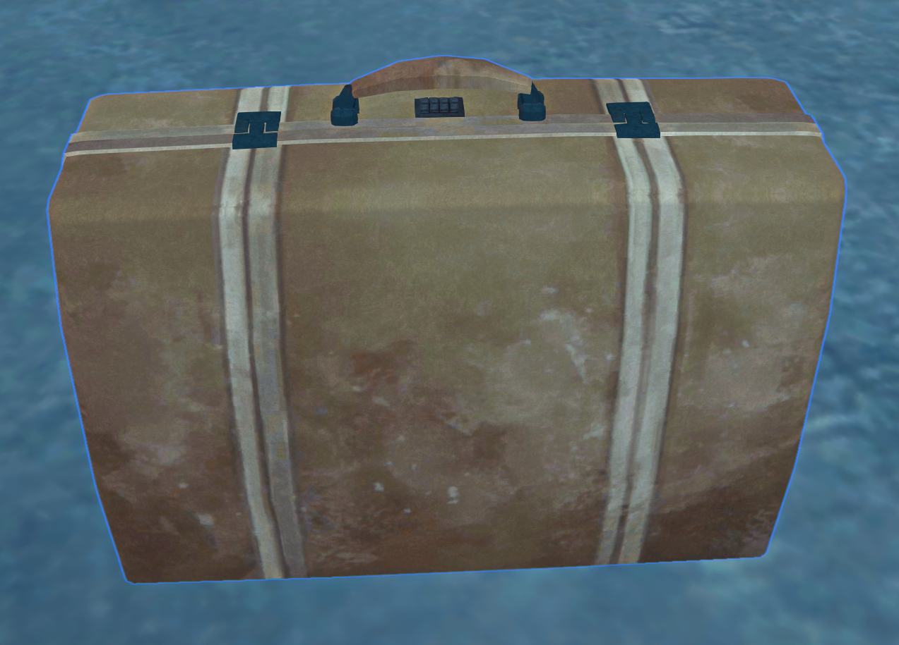

# Suitcase

**Contents**

- [Loot](#Loot)
- [exploit](#exploit)
- [trivia](#trivia)
- [Gallery](#Gallery)

<table class="infobox">
<caption>Suitcase</caption>
<colgroup>
<col style="width: 50%" />
<col style="width: 50%" />
</colgroup>
<tbody>
<tr>
<td colspan="2"><figure>
[Missing image: Suitcase.jpg]
<figcaption>Suitcase.jpg</figcaption>
</figure></td>
</tr>
<tr>
<td>
Release
</td>
<td>
1.60
</td>
</tr>
<tr>
<td>
Story item
</td>
<td>
Yes
</td>
</tr>
<tr>
<td colspan="2" class="section">
<strong>Container</strong>
</td>
</tr>
<tr>
<td>
Capacity
</td>
<td>
20.00 kg(44 lbs)
</td>
</tr>
</tbody>
</table>

A **Suitcase** is a storage item found in various locations across the Island. They come in various colors (blue, brown, red, orange). Clothing is the main item that can be looted from Suitcases. They can often be found at the <a href="./Crash%20Site%20%28Pleasant%20Valley%29.md" class="wikilink" title="Crash Site (Pleasant Valley)">Crash Site (Pleasant Valley)</a> and <a href="./Terminal.md" class="wikilink" title="Terminal">Terminal</a> in <a href="./Forsaken%20Airfield.md" class="wikilink" title="Forsaken Airfield">Forsaken Airfield</a>, as well as inside a few cabins across the Island in the Far Territory. They are also found near <a href="./Plane%20Crashes.md" class="wikilink" title="Plane Crashes">Plane Crashes</a>.

## Loot

**Head:** <a href="./Baseball%20Cap.md" class="wikilink" title="Baseball Cap">Baseball Cap</a>, <a href="./Cotton%20Scarf.md" class="wikilink" title="Cotton Scarf">Cotton Scarf</a>, <a href="./Cotton%20Toque.md" class="wikilink" title="Cotton Toque">Cotton Toque</a>, <a href="./Wool%20Toque.md" class="wikilink" title="Wool Toque">Wool Toque</a>.

**Torso Outer:** <a href="./Sport%20Vest.md" class="wikilink" title="Sport Vest">Sport Vest</a>, <a href="./Down%20Vest.md" class="wikilink" title="Down Vest">Down Vest</a>, <a href="./Light%20Shell.md" class="wikilink" title="Light Shell">Light Shell</a>, <a href="./Simple%20Parka.md" class="wikilink" title="Simple Parka">Simple Parka</a>.

**Torso Inner:** <a href="./Dress%20Shirt.md" class="wikilink" title="Dress Shirt">Dress Shirt</a>, <a href="./Hoodie.md" class="wikilink" title="Hoodie">Hoodie</a>, <a href="./Plaid%20Shirt.md" class="wikilink" title="Plaid Shirt">Plaid Shirt</a>, <a href="./Hockey%20Jersey.md" class="wikilink" title="Hockey Jersey">Hockey Jersey</a>, <a href="./Thin%20Wool%20Sweater.md" class="wikilink" title="Thin Wool Sweater">Thin Wool Sweater</a>, <a href="./Wool%20Shirt.md" class="wikilink" title="Wool Shirt">Wool Shirt</a>, <a href="./Thick%20Wool%20Sweater.md" class="wikilink" title="Thick Wool Sweater">Thick Wool Sweater</a>, <a href="./Hockey%20Jersey.md" class="wikilink" title="Hockey Jersey">Hockey Jersey</a>

**Hands:** <a href="./Fleece%20Mittens.md" class="wikilink" title="Fleece Mittens">Fleece Mittens</a>, <a href="./Wool%20Mittens.md" class="wikilink" title="Wool Mittens">Wool Mittens</a>.

**Legs Outer:** <a href="./Jeans.md" class="wikilink" title="Jeans">Jeans</a>, <a href="./Cargo%20Pants.md" class="wikilink" title="Cargo Pants">Cargo Pants</a>.

**Legs Inner:** <a href="./Thermal%20Underwear.md" class="wikilink" title="Thermal Underwear">Thermal Underwear</a>, <a href="./Wool%20Longjohns.md" class="wikilink" title="Wool Longjohns">Wool Longjohns</a>.

**Feet Inner:** <a href="./Sports%20Socks.md" class="wikilink" title="Sports Socks">Sports Socks</a>, <a href="./Wool%20Socks.md" class="wikilink" title="Wool Socks">Wool Socks</a>

**Feet Outer:** <a href="./Leather%20Shoes.md" class="wikilink" title="Leather Shoes">Leather Shoes</a>, <a href="./Running%20Shoes.md" class="wikilink" title="Running Shoes">Running Shoes</a>

**FastFilm:** <a href="./FastFilm-500.md" class="wikilink" title="FastFilm-500">FastFilm-500</a>, <a href="./FastFilm-500BW.md" class="wikilink" title="FastFilm-500BW">FastFilm-500BW</a>, <a href="./FastFilm-500SPA.md" class="wikilink" title="FastFilm-500SPA">FastFilm-500SPA</a>

## exploit

from: <https://www.reddit.com/r/thelongdark/comments/1hwkmra/the_magic_suitcase_glitch_aka_infinite_cloth/>[^1]

1.  place suitcases indoors, loot if available
2.  pick up suitcases
3.  leave building
4.  enter building
5.  quit to menu
6.  reload save
7.  Repeat

note: In practice, this exploit works for 3 things.

1.  getting FastFilm for the camera, safely and renewable
2.  getting mid-tire clothing (which could work for misery or interloper since there is one in homesteader's respite in Ash Canyon and being in an interior, even though the loot is reduced, following the rules of those modes), or to equip yourself quickly if you appear near a place with suitcases
3.  getting cured leather and cloth to mend clothes and trade with the trader

## trivia

You can use the "keep construction mode out of customizable areas" bug/exploit to get air crash suitcases, or places like the terminal at Forsaken Airfield, to get more if you want to do the exploit or simply want to use them as a container.

## Gallery

<table class="gallery">
<colgroup>
<col style="width: 25%" />
<col style="width: 25%" />
<col style="width: 25%" />
<col style="width: 25%" />
</colgroup>
<tbody>
<tr>
<td><figure>

<figcaption>Navy_Suitcase.png</figcaption>
</figure></td>
<td><figure>

<figcaption>Blue_Suitcase.png</figcaption>
</figure></td>
<td><figure>

<figcaption>Red_Suitcase.png</figcaption>
</figure></td>
<td><figure>

<figcaption>Grandmas_Flower_Suitcase.png</figcaption>
</figure></td>
</tr>
<tr>
<td><figure>

<figcaption>Tan_Suitcase.png</figcaption>
</figure></td>
<td><figure>

<figcaption>Dark_Brown_Suitcase.png</figcaption>
</figure></td>
<td></td>
<td></td>
</tr>
</tbody>
</table>

**Lua execution error in Module:Navbox function navbox** <a href="ru:%D0%A7%D0%B5%D0%BC%D0%BE%D0%B4%D0%B0%D0%BD" class="wikilink" title="ru:Чемодан">ru:Чемодан</a>

## Notes

[^1]: <https://www.reddit.com/r/thelongdark/comments/1hwkmra/the_magic_suitcase_glitch_aka_infinite_cloth/>
