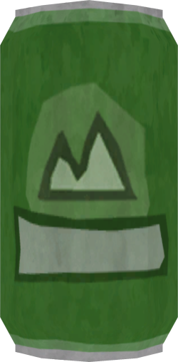

# Summit Soda

**Categories:** Food And Drink, Pages with update history · **Source:** [Fandom](https://thelongdark.fandom.com/wiki/Summit_Soda)

**Contents**

- [Overview](#overview)
- [Trivia](#trivia)
- [Gallery](#gallery)
- [Update history](#update-history)

**Summit Soda**

[Summit Soda icon](../assets/Summit_Soda_icon.png)

**Release:** [22 September 2014](./The%20Long%20Dark%20%E2%80%94%20Early%20Access%20Changelog.md#0.117)

**Wintermute:** No

**Renewable:** Yes (rare [Beachcombing](./Beachcombing.md))

**Properties**

**Item type:** [Food And Drink](./Food%20And%20Drink.md)

**Stackable:** No

**Examine:** Sweet carbonated drink. Full of high-fructose corn syrup.

**Values**

**Calories:** 250 kcal

**Hydration:** 30%

**Weight:** 0.25 kg (0.55 lbs)

**Advanced data**

**Item key:** GAMEPLAY\_SummitSoda

**Summit Soda** is a packaged [food](./Food%20And%20Drink.md) item in [_The Long Dark_](./The%20Long%20Dark.md).

## Overview

It can be consumed to restore 250 [calories](./Hunger.md) as well as 30% [hydration](./Thirst.md), the equivalent of 0.20 litres of [water](./Water%20%28Potable%29.md). They are found commonly inside all types of structures, [Vehicles](./Vehicle.md), and on [frozen corpses](./Frozen%20Corpse.md).

There are two other kinds of soda: [Orange Soda](./Orange%20Soda.md) and [Stacy's Grape Soda](./Stacy%27s%20Grape%20Soda.md). All three types of soda share the same calories and hydration.

Summit Soda never causes [Food Poisoning](./Food%20Poisoning.md).

## Trivia

- Summit Soda is packaged as a product named "_Summit Soda"_, possibly a reference to [Timberwolf Mountain](./Timberwolf%20Mountain.md) or the real-life brand "Mountain Dew."
- It could also be similar to the lemon-lime flavored "Sprite" due to its green can coloration.
- Despite being statistically identical to other Sodas, only Summit Soda will spawn on [Interloper Mode](./Survival%20Mode.md).
- The ingredients on the back list: "Carbonated Water, High Fructose Corn Syrup, Natural Flavours."

## Gallery

## Update history

- UPDATE **22 September 2014 ([Update](./The%20Long%20Dark%20%E2%80%94%20Early%20Access%20Changelog.md#0.117)):**
  - Added to game.
