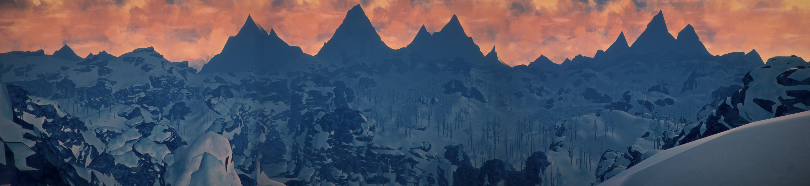
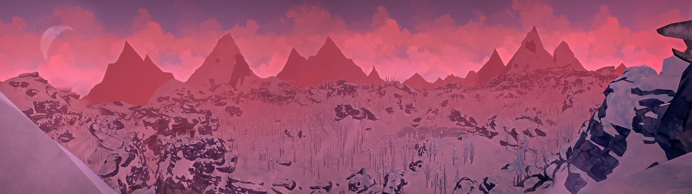

# Summit

**Categories:** Locations, Locations in Timberwolf Mountain, Outdoor locations, Sheltered locations · **Source:** [Fandom](https://thelongdark.fandom.com/wiki/Summit)

**Contents**

- [Overview](#overview)
- [Access from Crystal Lake](#access-from-crystal-lake)
- [Tips while climbing](#tips-while-climbing)
- [Gallery](#gallery)
- [Trivia](#trivia)

**Summit**

[Tail section and wing2](../assets/Tail_section_and_wing2.jpg)

**Location**

[Summit Location](../assets/Summit_Location.png)

**Region:** [Timberwolf Mountain](./Timberwolf%20Mountain.md)

**General**

**Type:** Outdoors

<!-- #Overview -->
​

<!-- #overview -->
## Overview

The Summit contains two other locations of [Timberwolf Mountain](./Timberwolf%20Mountain.md). They are:

- [Tail Section](./Tail%20Section.md)
- [Wing (Summit)](./Wing%20%28Summit%29.md)

Additionally, there is a small [cave](./Warm%20Cave.md) located near the end of the rope climb leading up to the summit.

<!-- #access_from_crystal_lake -->
​

<!-- #Access_from_Crystal_Lake -->
​

<!-- #Access_from_crystal_lake -->
​

<!-- #Access_From_Crystal_Lake -->
​

<!-- #access-from-crystal-lake -->
## Access from Crystal Lake

One way to reach the summit is:

1. From [Mountaineer's Hut](./Mountaineer%27s%20Hut.md), travel to [Deer Clearing](./Deer%20Clearing.md): requires at least 1 rope climb (via the cave system or [Echo Ravine](./Echo%20Ravine.md))
2. At [Deer Clearing](./Deer%20Clearing.md) climb to [Secluded Shelf](./Secluded%20Shelf.md) and enter to the cave system ("Cave B" to "Cave A" on the map linked above), a section of tunnel requires crouching to pass through: this is the exit.
3. Exit the cave, turn right and continue to the longest rope climb before the summit. There are two ledges to rest at along the way.

<!-- #tips_while_climbing -->
​

<!-- #Tips_while_climbing -->
​

<!-- #Tips_While_Climbing -->
​

<!-- #tips-while-climbing -->
### Tips while climbing

- Minimize weight. Being encumbered slows movement and makes climbing impossible.
- Climbing ropes drain stamina and fatigue rapidly. Rest before climbing at ledges mid-climb to recover [fatigue](./Fatigue.md), or by consuming [coffee](./Cup%20of%20Coffee.md), [Go! Energy Drink](./Go!%20Energy%20Drink.md), or [Emergency Stims](./Emergency%20Stim.md) (last resort).
- [Blizzards](./Weather.md) are dangerous. Take shelter in caves and keep warm with a [campfire](./Fire.md) while waiting for weather to clear.

It is possible to reach the Summit on day one of a playthrough, depending on the spawn. Because of the multiple required rope climbs, it may be advantageous to prepare for the trip by accumulating coffee and bringing a light source for spelunking.

[Mountaineering Ropes](./Mountaineering%20Rope.md) are not necessary on the return trip to the [mountaineer's hut](./Mountaineer%27s%20Hut.md), but make the trip easier and grant fast access to [Eric's falls](./Eric%27s%20Falls.md) and another [Cargo Container](./Cargo%20Container.md) full of tin cans of [food](./Food%20And%20Drink.md) (normally, there are three ropes that always spawned: two at the summit or [Tail Section](./Tail%20Section.md), and one in the mountaineer's hut). An alternative and risky but very fast way to descend is to [carefully walk down](./Mountain%20Goating.md) the side of the mountain slope facing [Crystal Lake](./Crystal%20Lake.md).

<!-- #Gallery -->
​

<!-- #gallery -->
## Gallery

<!-- #Trivia -->
​

<!-- #trivia -->
## Trivia

- [Timberwolves](./Timberwolf.md) were ironically absent from "Timberwolf" Mountain until December 2024.
  - This region was also introduced long before Timberwolves were implemented into the game.
- Contrary to popular belief, but not a canonical measurement: Timberwolf Mountain's summit is not the highest accessible point in-game. Screenshot measurements reveal its altitude to be 505 meters above sea level in [Coastal Highway](./Coastal%20Highway.md).
  - This is lower than [Peak Cave](./Peak%20Cave.md) in [Hushed River Valley](./Hushed%20River%20Valley.md), which is 590 meters above sea level in [Bleak Inlet](./Bleak%20Inlet.md).
  - The southern entrance of the [cave](./Cave%20%28Mountain%20Town%20location%29.md) in [Mountain Town](./Mountain%20Town.md) is higher still, at 612 meters.
  - Also, the [Wolf's Jaw Overlook](./Wolf%27s%20Jaw%20Overlook.md) in [Ash Canyon](./Ash%20Canyon.md) is very likely to be higher than the Summit.

[ru:Вершина](https://ru.wikipedia.org/wiki/%D0%92%D0%B5%D1%80%D1%88%D0%B8%D0%BD%D0%B0)
