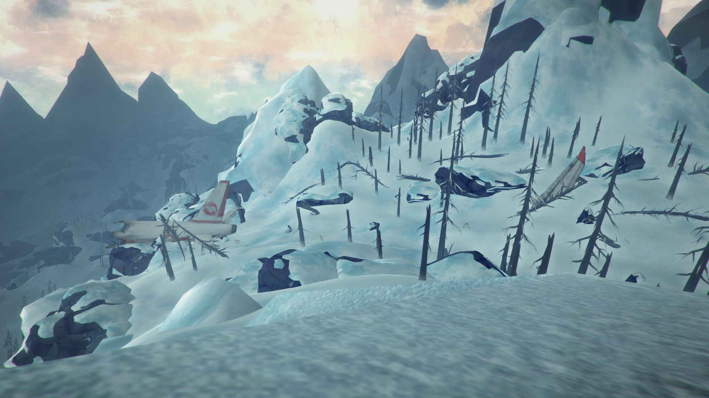
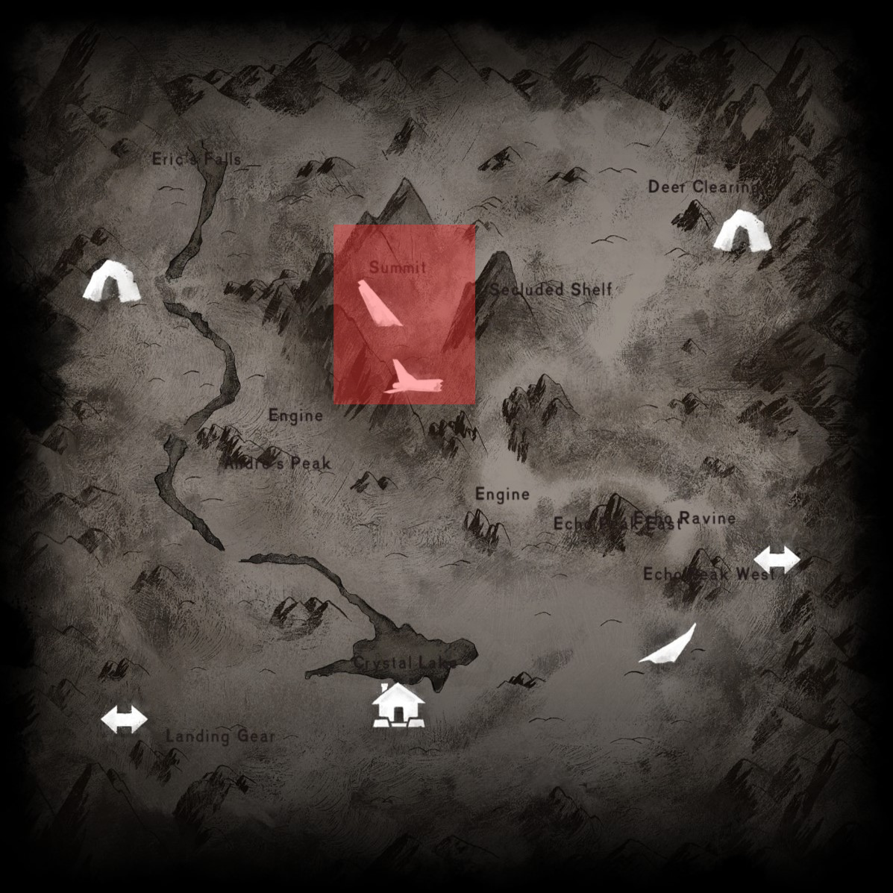

# Summit

**Summit**

| Property | Details |
| --- | --- |
|  |  / *tail\_section\_and\_wing2.jpg* |
| **Location** |  |
|  |  / *Summit\_Location.png* |
| Region | [Timberwolf Mountain](./Timberwolf%20Mountain.md)\|- |
| **General** |  |
| Type | Outdoors\|- |
