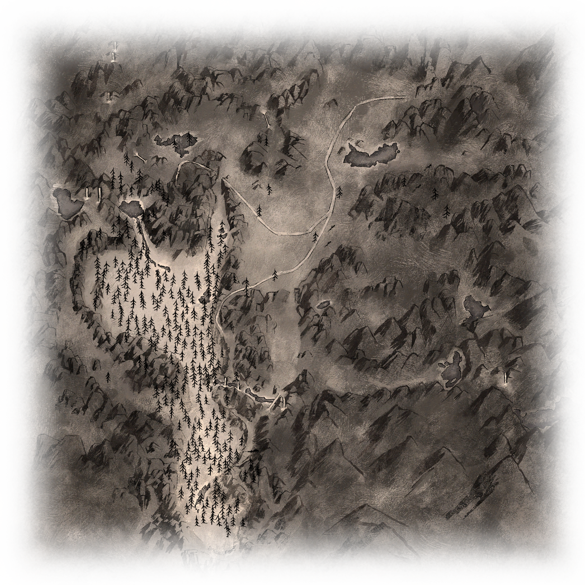
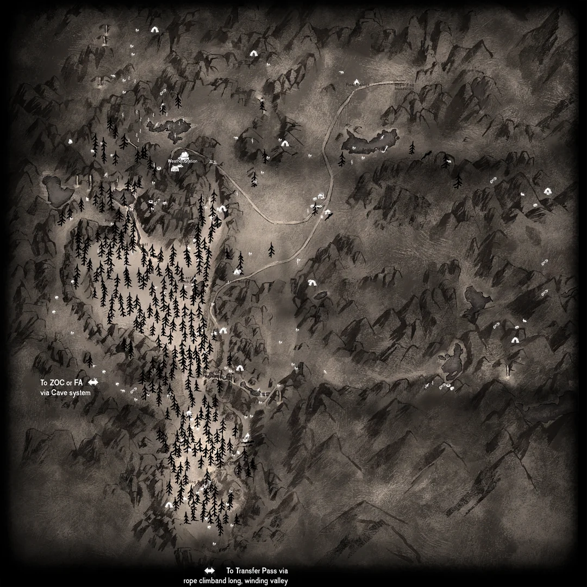
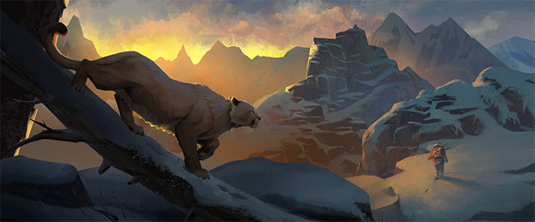

# Sundered Pass

**Contents**

- [Overview](#Overview)
- [Survivability](#Survivability)
- [Description](#Description)
- [Woodland](#Woodland)
- [Alpine Plateau](#Alpine_Plateau)
- [Eastern Mountain Trail](#Eastern_Mountain_Trail)
- [Locations](#Locations)
- [Maps](#Maps)
- [Notes](#Notes)
- [Gallery](#Gallery)

<table class="infobox">
<caption>Sundered Pass</caption>
<colgroup>
<col style="width: 50%" />
<col style="width: 50%" />
</colgroup>
<tbody>
<tr>
<td colspan="2"><figure>
[Missing image: Sundered_Pass.jpg]
<figcaption>Sundered_Pass.jpg</figcaption>
</figure></td>
</tr>
<tr>
<td colspan="2" class="section">
<strong>Location on <a href="./Great%20Bear%20Island.md" class="wikilink" title="Great Bear Island">Great Bear Island</a></strong>
</td>
</tr>
<tr>
<td colspan="2"><figure>
[Missing image: Sundered_Pass_Location.png]
<figcaption>Sundered_Pass_Location.png</figcaption>
</figure></td>
</tr>
<tr>
<td colspan="2"><figure>

<figcaption>Sundered_Pass_In-game_Map.png</figcaption>
</figure></td>
</tr>
<tr>
<td colspan="2" class="section">
<strong>Details</strong>
</td>
</tr>
<tr>
<td>
Description
</td>
<td>
A rather large avalanche prone mountainous region that gets colder as one climbs.
</td>
</tr>
<tr>
<td>
Connecting Regions
</td>
<td>
<a href="./Transfer%20Pass.md" class="wikilink" title="Transfer Pass">Transfer Pass</a> <a href="./Forsaken%20Airfield.md" class="wikilink" title="Forsaken Airfield">Forsaken Airfield</a> or <a href="./Zone%20of%20Contamination.md" class="wikilink" title="Zone of Contamination">Zone of Contamination</a> (Through Transition Cave)
</td>
</tr>
<tr>
<td>
TFTFT paid content
</td>
<td>
Yes
</td>
</tr>
<tr>
<td>
Difficulty
</td>
<td>
Advanced
</td>
</tr>
<tr>
<td>
Interloper Region Spawn
</td>
<td>
No
</td>
</tr>
<tr>
<td>
Locations
</td>
<td>
25
</td>
</tr>
<tr>
<td>
Date Added
</td>
<td>
June 24, 2024
</td>
</tr>
</tbody>
</table>

<table>
<colgroup>
<col style="width: 33%" />
<col style="width: 33%" />
<col style="width: 33%" />
</colgroup>
<tbody>
<tr>
<td width="40px"><figure>
[Missing image: Ptarmigan_icon.png]
<figcaption>Ptarmigan_icon.png</figcaption>
</figure></td>
<td>
<strong>DLC-Exclusive content.</strong> 

This content requires the <a href="./Tales%20from%20the%20Far%20Territory.md" class="wikilink" title="Tales from the Far Territory">Tales from the Far Territory</a> addon to be installed before it can be seen or used in regular gameplay.

</td>
<td>
|}

<table>
<colgroup>
<col style="width: 33%" />
<col style="width: 33%" />
<col style="width: 33%" />
</colgroup>
<tbody>
<tr>
<td style="vertical-align: top; font-size: 3em; color: #5d5980; padding-right: 10px">
“
</td>
<td>
Steep climbs and some of the rockiest terrain to be found on Great Bear Island hide a remote installation that holds secrets to the Island's dark history. Beware.

&#10;

Official Hinterland Description

</td>
<td style="vertical-align: bottom; font-size: 3em; color: #5d5980; padding-left: 10px">
”
</td>
</tr>
</tbody>
</table>
<table>
<colgroup>
<col style="width: 33%" />
<col style="width: 33%" />
<col style="width: 33%" />
</colgroup>
<tbody>
<tr>
<td style="vertical-align: top; font-size: 3em; color: #5d5980; padding-right: 10px">
“
</td>
<td>
For advanced players. Once a favoured destination for far Territory climbers, it's become an isolated Region devastated by extreme avalanche activity. 
Beyond the lower elevations and treeline, minimal shelters are available. Only the most-prepared survivors can expect a successful journey through its snowy fields and up its high ridgelines. 
Connects to Forsaken Airfield, Zone of Contamination, and Transfer Pass.

&#10;

In-game Description

</td>
<td style="vertical-align: bottom; font-size: 3em; color: #5d5980; padding-left: 10px">
”
</td>
</tr>
</tbody>
</table>

<strong>Sundered Pass</strong> is the 16th <a href="./Region.md" class="wikilink" title="Region">Region</a> added to <em><a href="./The%20Long%20Dark.md" class="wikilink" title="The Long Dark">The Long Dark</a></em>, released in Part 5 of the <a href="./Tales%20from%20the%20Far%20Territory.md" class="wikilink" title="Tales from the Far Territory">Tales from the Far Territory</a> expansion. A cold and hostile mountainous region, it connects with <a href="./Transfer%20Pass.md" class="wikilink" title="Transfer Pass">Transfer Pass</a>, <a href="./Forsaken%20Airfield.md" class="wikilink" title="Forsaken Airfield">Forsaken Airfield</a>, and <a href="./Zone%20of%20Contamination.md" class="wikilink" title="Zone of Contamination">Zone of Contamination</a>, with a sign pointing motorists to a road (likely to the <a href="./Weather%20Station.md" class="wikilink" title="Weather Station">Weather Station</a>) leading to a collapsed tunnel in Transfer Pass (though it must be bypassed via <a href="./Rope%20Climbing.md" class="wikilink" title="Rope Climbing">Rope Climbing</a>).

<h2 id="Overview">Overview</h2>

Sundered Pass is vertical and mountainous region of open meadows and narrow valleys. With steep terrain, extreme cold, and abundant <a href="./Timberwolf.md" class="wikilink" title="timberwolf packs">timberwolf packs</a> with few shelters, it is one of the most challenging regions to stay within for long periods of time. A network of A-frame cabins for hikers dots the eastern highlands along the main road, with many structures destroyed by avalanches or seismic activity. The map itself is very Oval shaped, however a large section of mountain to the east of the map is accessible. The region is the centerpiece of the <a href="./Last%20Horizon.md" class="wikilink" title="Last Horizon">Last Horizon</a> Tale.

It features the coldest weather on Great Bear Island, gradually decreasing in temperature the higher in altitude one climbs, and contains the most timberwolf packs. It also contains other wildlife including: <a href="./Bear.md" class="wikilink" title="black bear">black bear</a>, <a href="./Wolf.md" class="wikilink" title="wolves">wolves</a>, <a href="./Moose.md" class="wikilink" title="moose">moose</a>, <a href="./Deer.md" class="wikilink" title="deer">deer</a>, <a href="./Rabbit.md" class="wikilink" title="rabbits">rabbits</a>, <a href="./Cougar.md" class="wikilink" title="cougars">cougars</a> and <a href="./Ptarmigan.md" class="wikilink" title="ptarmigan">ptarmigan</a>. There is a single <a href="./Fishing%20Hut.md" class="wikilink" title="Fishing Hut">Fishing Hut</a> in the region at <a href="./Ambler%27s%20Lake.md" class="wikilink" title="Ambler&#39;s Lake">Ambler's Lake</a>.

The region features frequent <a href="./Weather.md" class="wikilink" title="blizzards, aurora and glimmer fog">blizzards, aurora and glimmer fog</a>.

Sundered Pass connects with:

<ul>
<li><a href="./Transfer%20Pass.md" class="wikilink" title="Transfer Pass">Transfer Pass</a> via rope climb and long, winding valley</li>
<li><a href="./Forsaken%20Airfield.md" class="wikilink" title="Forsaken Airfield">Forsaken Airfield</a> or <a href="./Zone%20of%20Contamination.md" class="wikilink" title="Zone of Contamination">Zone of Contamination</a> via a cave network</li>
</ul>
<h2 id="Survivability">Survivability</h2>

Sundered Pass is extremely harsh and difficult to survive in: featuring extreme weather and abundant hostile wildlife, particularly on harder <a href="./Survival%20Mode.md" class="wikilink" title="survival modes">survival modes</a>. It is by far the coldest region (-20*C to -40*C on Interloper even with best-in-slot gear), <a href="./Feels%20Like.md" class="wikilink" title="dropping in temperature">dropping in temperature</a> further as altitude increases up the steep mountain roads.

The region is infamous for its high number of <a href="./Timberwolf.md" class="wikilink" title="timberwolves">timberwolves</a>, with some players reporting seeing more than ten timberwolves in a pack at a time, with at least six separate packs on the upper mountain. Extreme caution should be taken when traversing the region, especially in the north-northeast highlands from <a href="./Final%20Refuge.md" class="wikilink" title="Final Refuge">Final Refuge</a> to <a href="./Placid%20Notch.md" class="wikilink" title="Placid Notch">Placid Notch</a>.

Little fuel can be scavenged in much of the region, especially the avalanche-ridden northeast, unless the player goes <a href="./Ice%20Fishing.md" class="wikilink" title="Ice Fishing">Ice Fishing</a>.

A bear resides near Final Refuge.

A possible moose location is north of Weather Station, in a small marsh below, or near <a href="./Ambler%27s%20Lake.md" class="wikilink" title="Ambler&#39;s Lake">Ambler's Lake</a>.

<h2 id="Description">Description</h2>

Sundered Pass can be divided into three major regions: the lower-altitude woodland, the alpine plateau, and a mountain trail to the east of the map. It is possible to go between the two by following a trail on the region's western side, or by following the road in the central and eastern side of the region via <a href="./Lotte%27s%20Rest.md" class="wikilink" title="Lotte&#39;s Rest">Lotte's Rest</a>.

<h3 id="Woodland">Woodland</h3>

The woodland consists of a large, forested valley. It offers good <a href="./Deer.md" class="wikilink" title="deer">deer</a> and <a href="./Rabbit.md" class="wikilink" title="rabbit">rabbit</a> hunting opportunities, as well as lots of natural resources and firewood to forage. Free-form <a href="./Ice%20Fishing.md" class="wikilink" title="Ice Fishing">Ice Fishing</a> can be practiced at the small lakes near <a href="./Seedling%20Spring.md" class="wikilink" title="Seedling Spring">Seedling Spring</a> or <a href="./Giant%27s%20Thumbprint.md" class="wikilink" title="Giant&#39;s Thumbprint">Giant's Thumbprint</a>. Other noteworthy landmarks include large waterfalls near <a href="./Ogre%27s%20Teardrop.md" class="wikilink" title="Ogre&#39;s Teardrop">Ogre's Teardrop</a> and just northeast of the house, as well as the brook near <a href="./Juniper%20Runoff.md" class="wikilink" title="Juniper Runoff">Juniper Runoff</a>.

While there are a few <a href="./Wolf.md" class="wikilink" title="wolves">wolves</a> in the forest, there's no <a href="./Timberwolf.md" class="wikilink" title="timberwolves">timberwolves</a> or <a href="./Bear.md" class="wikilink" title="bears">bears</a> to think about. The forested valley is also home for <a href="./Cougar.md" class="wikilink" title="cougars">cougars</a>. Most players who are staying in this area for any length of time will likely end up using the <a href="./Last%20Lonely%20House.md" class="wikilink" title="Last Lonely House">Last Lonely House</a> as a <a href="./Safehouse.md" class="wikilink" title="safe house">safe house</a>, as it offers good shelter. Accessing the entirety of the house requires a <a href="./An%20Old%20House%20Key.md" class="wikilink" title="key">key</a>, that can be found during the <a href="./Last%20Horizon.md" class="wikilink" title="Last Horizon">Last Horizon</a> tale. If an unexpected blizzard pops up, there's a cave north of <a href="./Giant%27s%20Thumbprint.md" class="wikilink" title="Giant&#39;s Thumbprint">Giant's Thumbprint</a> as well as south of the Last Lonely House.

<h3 id="Alpine_Plateau">Alpine Plateau</h3>

This area is large, very open, and cold, with limited resources to forage, and limited hunting. The greatest hazard of this area is the multiple large roaming <a href="./Timberwolf.md" class="wikilink" title="Timberwolf">Timberwolf</a> packs, making it almost impossible to visit this region without a weapon. One <a href="./Bear.md" class="wikilink" title="Bear">Bear</a> can spawn a short distance west of <a href="./Final%20Refuge.md" class="wikilink" title="Final Refuge">Final Refuge</a>, and a <a href="./Moose.md" class="wikilink" title="Moose">Moose</a> can be found on a pond not far from the <a href="./Weather%20Station.md" class="wikilink" title="Weather Station">Weather Station</a>.

Due to the lack of trees, finding firewood in this area can be difficult. Visiting the abandoned mine at <a href="./Reluctant%20Shortcut.md" class="wikilink" title="Reluctant Shortcut">Reluctant Shortcut</a> (up a short root climb) can provide <a href="./Coal.md" class="wikilink" title="coal">coal</a>, helping to alleviate the cold somewhat. If the player is unwilling to eat the timberwolves, food may also be somewhat of an issue, owing to the limited numbers of <a href="./Deer.md" class="wikilink" title="deer">deer</a>. Fishing at <a href="./Ambler%27s%20Lake.md" class="wikilink" title="Ambler&#39;s Lake">Ambler's Lake</a> can help provide a sustainable food source.

Those who are willing to brave the cold and timberwolves have several <a href="./Safehouse.md" class="wikilink" title="safe house">safe house</a> options. The <a href="./Weather%20Station.md" class="wikilink" title="Weather Station">Weather Station</a> offers a good view and is the only timberwolf-safe option, but it's really cold and has few resources in the immediate area. <a href="./Placid%20Notch.md" class="wikilink" title="Placid Notch">Placid Notch</a> (Refuge Cabin B) offers shelter, a stove, and a bed relatively near a deer spawn, though it can be a bit cramped. <a href="./Final%20Refuge.md" class="wikilink" title="Final Refuge">Final Refuge</a> (Refuge Cabin C) is similar to the previous one, but is closer to <a href="./Ambler%27s%20Lake.md" class="wikilink" title="Ambler&#39;s Lake">Ambler's Lake</a> and the abandoned coal mine. The partially buried cabin at <a href="./Old%20Settlement.md" class="wikilink" title="Old Settlement">Old Settlement</a> is the largest shelter and offers a good place from which to hunt timberwolves, but doesn't have an indoor fireplace.

<h3 id="Eastern_Mountain_Trail">Eastern Mountain Trail</h3>

This begins just east of <a href="./Ambler%27s%20Lake.md" class="wikilink" title="Ambler&#39;s Lake">Ambler's Lake</a> at a very long <a href="./Rope%20Climbing.md" class="wikilink" title="climb">climb</a>. It then follows a long, narrow, intricate system of trails, rope climbs, and boardwalks to get to <a href="./High%20Peak%20Plateau.md" class="wikilink" title="High Peak Plateau">High Peak Plateau</a> as part of <a href="./Last%20Horizon.md" class="wikilink" title="Last Horizon">Last Horizon</a>. Returning to the road near <a href="./Lotte%27s%20Rest.md" class="wikilink" title="Lotte&#39;s Rest">Lotte's Rest</a> involves another rope climb. With limited shelter and resources along this route, most players will likely only travel through here as part of the Tale, as there are few resources in the mountain that hardly constitute a second return trip.

<h2 id="Locations">Locations</h2>

There are a number of locations in the Sundered Pass, including:{| class="" style="background-color:transparent; color:inherit; width:100%;"
</td>
</tr>
<tr>
<td><ul>
<li><a href="./Abandoned%20Mine.md" class="wikilink" title="Abandoned Mine">Abandoned Mine</a> (2 entrances)</li>
<li><a href="./Ambler%27s%20Lake.md" class="wikilink" title="Ambler&#39;s Lake">Ambler's Lake</a></li>
<li><a href="./Baneful%20Bridge.md" class="wikilink" title="Baneful Bridge">Baneful Bridge</a></li>
<li><a href="./Bolt%20Chopper%27s%20Haven.md" class="wikilink" title="Bolt Chopper&#39;s Haven">Bolt Chopper's Haven</a></li>
<li><a href="./Cascading%20Gap.md" class="wikilink" title="Cascading Gap">Cascading Gap</a></li>
<li><a href="./Final%20Refuge.md" class="wikilink" title="Final Refuge">Final Refuge</a></li>
<li><a href="./Giant%27s%20Thumbprint.md" class="wikilink" title="Giant&#39;s Thumbprint">Giant's Thumbprint</a></li>
<li><a href="./Idle%20Hideout.md" class="wikilink" title="Idle Hideout">Idle Hideout</a></li>
<li><a href="./Juniper%20Runoff.md" class="wikilink" title="Juniper Runoff">Juniper Runoff</a></li>
<li><a href="./Last%20Lonely%20House.md" class="wikilink" title="Last Lonely House">Last Lonely House</a></li>
<li><a href="./Lotte%27s%20Rest.md" class="wikilink" title="Lotte&#39;s Rest">Lotte's Rest</a></li>
<li><a href="./Miserable%20Haunt.md" class="wikilink" title="Miserable Haunt">Miserable Haunt</a></li>
<li><a href="./Ogre%27s%20Teardrop.md" class="wikilink" title="Ogre&#39;s Teardrop">Ogre's Teardrop</a></li>
<li><a href="./Placid%20Notch.md" class="wikilink" title="Placid Notch">Placid Notch</a></li>
</ul></td>
<td data-valign="top" style="width: 50%"><ul>
<li><a href="./Prayerful%20Window.md" class="wikilink" title="Prayerful Window">Prayerful Window</a></li>
<li><a href="./Unyielding%20Inundation.md" class="wikilink" title="Unyielding Inundation">Unyielding Inundation</a></li>
<li><a href="./Roamer%27s%20Cave.md" class="wikilink" title="Roamer&#39;s Cave">Roamer's Cave</a></li>
<li><a href="./Route%20One%20Waterfall.md" class="wikilink" title="Route One Waterfall">Route One Waterfall</a></li>
<li><a href="./Reluctant%20Shortcut.md" class="wikilink" title="Reluctant Shortcut">Reluctant Shortcut</a></li>
<li><a href="./Second%20Pillar.md" class="wikilink" title="Second Pillar">Second Pillar</a></li>
<li><a href="./Weather%20Station.md" class="wikilink" title="Weather Station">Weather Station</a></li>
<li><a href="./Perilous%20Crossing.md" class="wikilink" title="Perilous Crossing">Perilous Crossing</a></li>
<li><a href="./Station%20Bunkhouse.md" class="wikilink" title="Station Bunkhouse">Station Bunkhouse</a></li>
<li><a href="./Seedling%20Spring.md" class="wikilink" title="Seedling Spring">Seedling Spring</a></li>
<li>To Transfer Pass (Transition to <a href="./Transfer%20Pass.md" class="wikilink" title="Transfer Pass">Transfer Pass</a>)</li>
<li>To Cave System (Transition Cave to <a href="./Forsaken%20Airfield.md" class="wikilink" title="Forsaken Airfield">Forsaken Airfield</a>/<a href="./Zone%20of%20Contamination.md" class="wikilink" title="Zone of Contamination">Zone of Contamination</a>)</li>
</ul></td>
<td></td>
</tr>
</tbody>
</table>

There are also a few other unmarked locations:

- 4 entrance Cave system between <a href="./Prayerful%20Window.md" class="wikilink" title="Prayerful Window">Prayerful Window</a>, <a href="./Idle%20Hideout.md" class="wikilink" title="Idle Hideout">Idle Hideout</a>, <a href="./Route%20One%20Waterfall.md" class="wikilink" title="Route One Waterfall">Route One Waterfall</a> and <a href="./Cascading%20Gap.md" class="wikilink" title="Cascading Gap">Cascading Gap</a>
- <a href="./High%20Peak%20Plateau.md" class="wikilink" title="High Peak Plateau">High Peak Plateau</a>
- <a href="./Station%20Bunkhouse.md" class="wikilink" title="Station Bunkhouse">Station Bunkhouse</a>
- A Crashed Airplane in the mountains past Abandoned Mine
- <a href="./Old%20Settlement.md" class="wikilink" title="Old Settlement">Old Settlement</a>
  - <a href="./Basement%20%28Sundered%20Pass%29.md" class="wikilink" title="Basement (Sundered Pass)">Basement (Sundered Pass)</a>
  - <a href="./Cabin%20%28Sundered%20Pass%29.md" class="wikilink" title="Cabin (Sundered Pass)">Cabin (Sundered Pass)</a>

## Maps

<table class="gallery">
<colgroup>
<col style="width: 25%" />
<col style="width: 25%" />
<col style="width: 25%" />
<col style="width: 25%" />
</colgroup>
<tbody>
<tr>
<td><figure>
[Missing image: SP_map_default.png]
<figcaption>A detailed map of Sundered pass v2.35 (contains spoilers)</figcaption>
</figure></td>
<td><figure>
[Missing image: SP_map_loper.png]
<figcaption>A detailed map of Sundered Pass v2.35 (Interloper/Misery edition, contains spoilers)</figcaption>
</figure></td>
<td><figure>
[Missing image: Sundered_Pass_Surveyed.jpg]
<figcaption>In-game Charcoal Map</figcaption>
</figure></td>
<td><figure>

<figcaption>Full map reveal with icons</figcaption>
</figure></td>
</tr>
<tr>
<td><figure>
[Missing image: Transition_cave_map_03_v1.jpg]
<figcaption>Map of the transition cave connecting Forsaken Airfield, Zone of Contamination and Sundered Pass</figcaption>
</figure></td>
<td></td>
<td></td>
<td></td>
</tr>
</tbody>
</table>

## Notes

## Gallery

<table class="gallery">
<colgroup>
<col style="width: 25%" />
<col style="width: 25%" />
<col style="width: 25%" />
<col style="width: 25%" />
</colgroup>
<tbody>
<tr>
<td><figure>
[Missing image: Mountain_Pass_Concept_Art.jpg]
<figcaption>Concept art for Mountain Pass</figcaption>
</figure></td>
<td><figure>
[Missing image: Sundered_Pass.jpg]
<figcaption>The same location in game</figcaption>
</figure></td>
<td><figure>
[Missing image: Mountain_Pass_Weather_Station_concept_art.jpg]
<figcaption>Concept art of a Weather Station</figcaption>
</figure></td>
<td><figure>
[Missing image: Transfer_Pass_Sign.jpg]
<figcaption>The faded sign in Transfer Pass leading motorists to the Mountain Pass tunnel</figcaption>
</figure></td>
</tr>
<tr>
<td><figure>

<figcaption>Sunderedpass_mapselect.png</figcaption>
</figure></td>
<td><figure>

<figcaption>A cougar stalking a survivor in the Pass, with the <a href="./Weather%20Station.md" class="wikilink" title="Weather Station">Weather Station</a> on the mountain.</figcaption>
</figure></td>
<td><figure>
[Missing image: Collapsed_Tunnel_Transfer_Pass.jpg]
<figcaption>The tunnel in Transfer Pass leading to Sundered Pass</figcaption>
</figure></td>
<td><figure>
[Missing image: Collapsed_Tunnel_Sundered_Pass.jpg]
<figcaption>The other side of the collapsed tunnel in Sundered Pass</figcaption>
</figure></td>
</tr>
<tr>
<td><figure>
[Missing image: Main_Menu_Weather_Station.jpg]
<figcaption>The Weather Station in the Main Menu</figcaption>
</figure></td>
<td><figure>
[Missing image: Sundered_pass.png]
<figcaption>The overview over the Sundered Pass from the vista near the crashed airplane</figcaption>
</figure></td>
<td></td>
<td></td>
</tr>
</tbody>
</table>

**Lua execution error in Module:Navbox function navboxLua execution error in Module:Navbox function navbox** <a href="ru:%D0%9E%D1%82%D1%80%D0%B5%D0%B7%D0%B0%D0%BD%D0%BD%D1%8B%D0%B9_%D0%BF%D0%B5%D1%80%D0%B5%D0%B2%D0%B0%D0%BB" class="wikilink" title="ru:Отрезанный перевал">ru:Отрезанный перевал</a>

