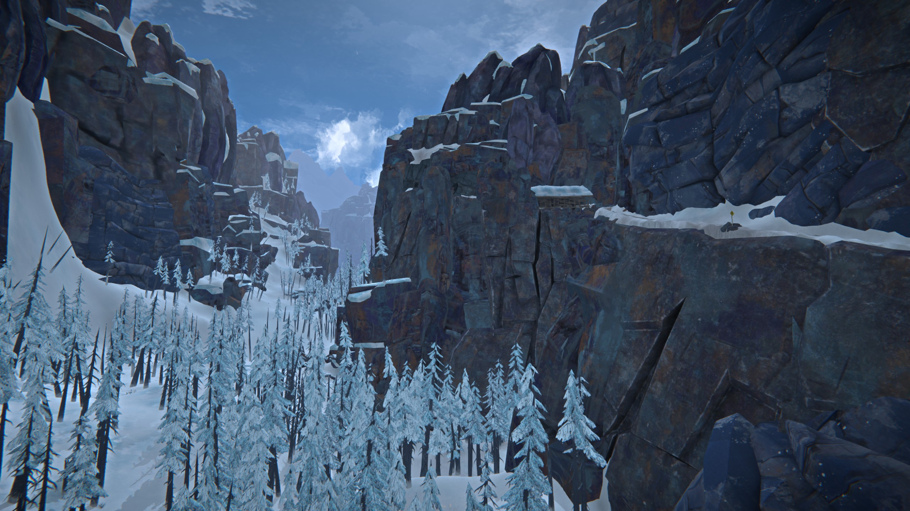
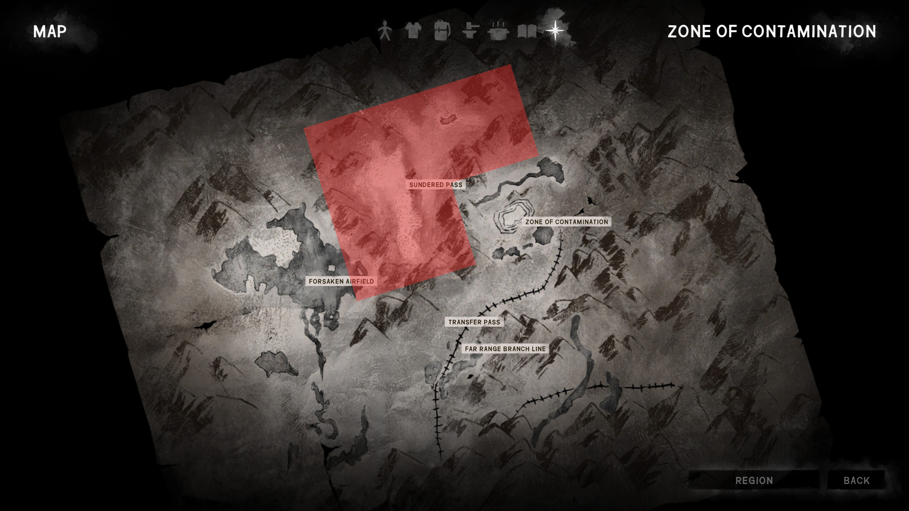
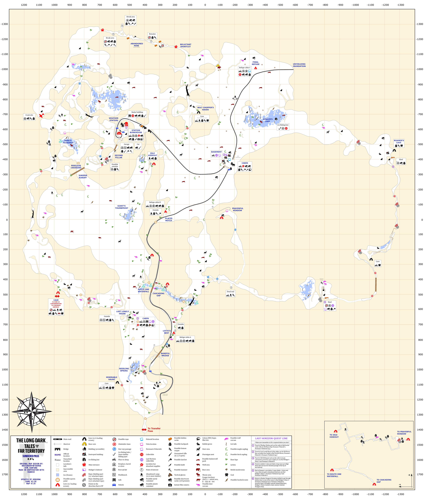
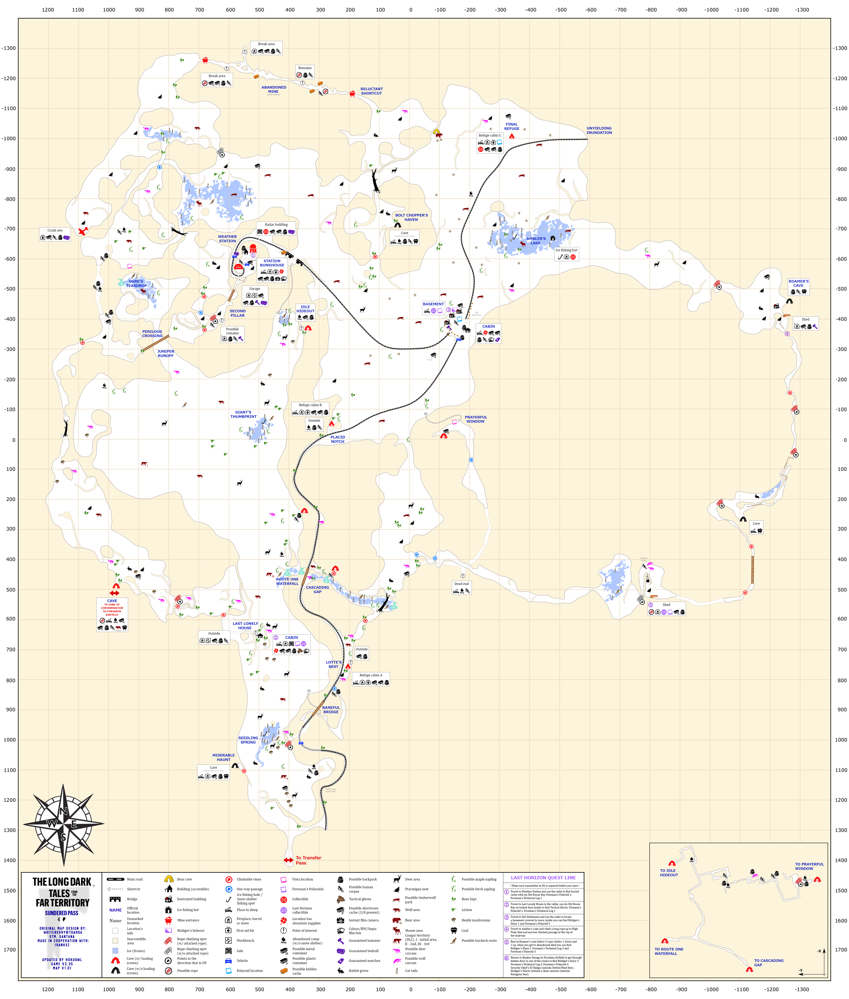
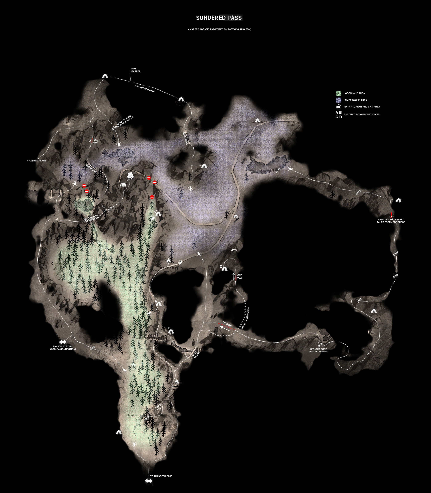
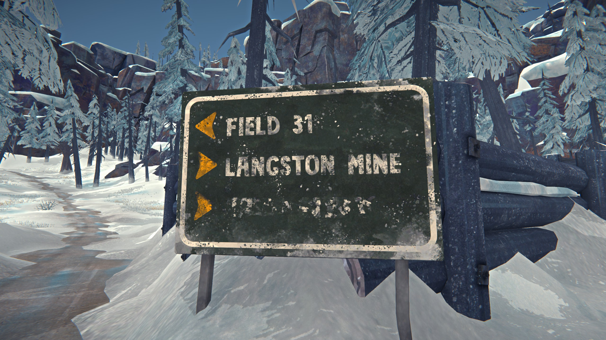
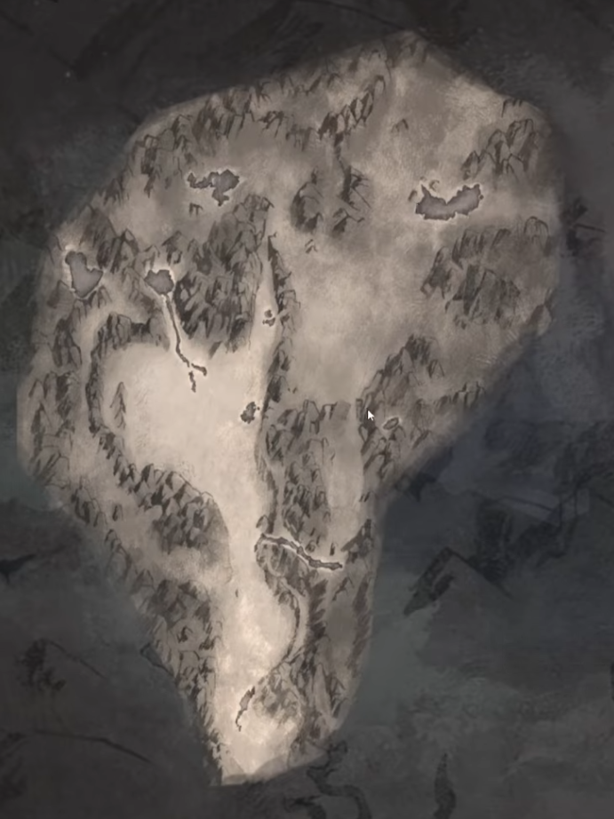
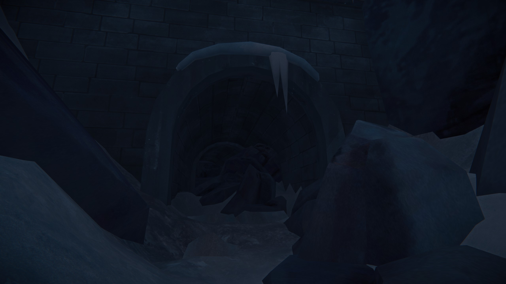
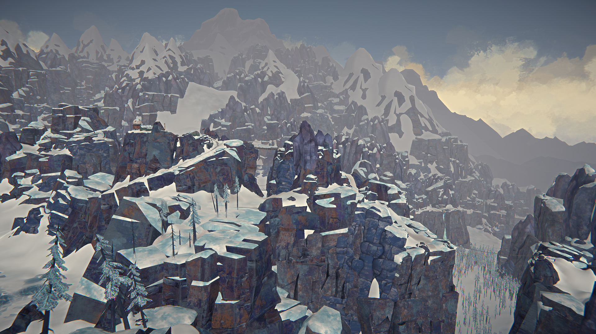

# Sundered Pass

**Categories:** DLC Content, Regions · **Source:** [Fandom](https://thelongdark.fandom.com/wiki/Sundered_Pass)

**Contents**

- [Overview](#overview)
- [Survivability](#survivability)
- [Description](#description)
- [Woodland](#woodland)
- [Alpine Plateau](#alpine-plateau)
- [Eastern Mountain Trail](#eastern-mountain-trail)
- [Locations](#locations)
- [Maps](#maps)
- [Notes](#notes)
- [Gallery](#gallery)

**Sundered Pass**

_Sundered\_Pass.jpg_

**Location on [Great Bear Island](./Great%20Bear%20Island.md)**

_Sundered\_Pass\_Location.png_

_Sundered\_Pass\_In-game\_Map.png_

**Details**

**Description:** A rather large avalanche prone mountainous region that gets colder as one climbs.

**Connecting Regions:** [Transfer Pass](./Transfer%20Pass.md) [Forsaken Airfield](./Forsaken%20Airfield.md) or [Zone of Contamination](./Zone%20of%20Contamination.md) (Through Transition Cave)

**TFTFT paid content:** Yes

**Difficulty:** Advanced

**Interloper Region Spawn:** No

**Locations:** 25

**Date Added:** June 24, 2024

_Ptarmigan\_icon.png_

**DLC-Exclusive content.** / This content requires the [Tales from the Far Territory](./Tales%20from%20the%20Far%20Territory.md) addon to be installed before it can be seen or used in regular gameplay.

 / > “**Steep climbs and some of the rockiest terrain to be found on Great Bear Island hide a remote installation that holds secrets to the Island's dark history. Beware.**” / > / > — Official Hinterland Description / > “**For advanced players. Once a favoured destination for far Territory climbers, it's become an isolated Region devastated by extreme avalanche activity. / Beyond the lower elevations and treeline, minimal shelters are available. Only the most-prepared survivors can expect a successful journey through its snowy fields and up its high ridgelines. / Connects to Forsaken Airfield, Zone of Contamination, and Transfer Pass.**” / > / > — In-game Description / **Sundered Pass** is the 16th [Region](./Region.md) added to _[The Long Dark](./The%20Long%20Dark.md)_, released in Part 5 of the [Tales from the Far Territory](./Tales%20from%20the%20Far%20Territory.md) expansion. A cold and hostile mountainous region, it connects with [Transfer Pass](./Transfer%20Pass.md), [Forsaken Airfield](./Forsaken%20Airfield.md), and [Zone of Contamination](./Zone%20of%20Contamination.md), with a sign pointing motorists to a road (likely to the [Weather Station](./Weather%20Station.md)) leading to a collapsed tunnel in Transfer Pass (though it must be bypassed via [Rope Climbing](./Rope%20Climbing.md)). / ## Overview / Sundered Pass is vertical and mountainous region of open meadows and narrow valleys. With steep terrain, extreme cold, and abundant [timberwolf packs](./Timberwolf.md) with few shelters, it is one of the most challenging regions to stay within for long periods of time. A network of A-frame cabins for hikers dots the eastern highlands along the main road, with many structures destroyed by avalanches or seismic activity. The map itself is very Oval shaped, however a large section of mountain to the east of the map is accessible. The region is the centerpiece of the [Last Horizon](./Last%20Horizon.md) Tale. / It features the coldest weather on Great Bear Island, gradually decreasing in temperature the higher in altitude one climbs, and contains the most timberwolf packs. It also contains other wildlife including: [black bear](./Bear.md), [wolves](./Wolf.md), [moose](./Moose.md), [deer](./Deer.md), [rabbits](./Rabbit.md), [cougars](./Cougar.md) and [ptarmigan](./Ptarmigan.md). There is a single [Fishing Hut](./Fishing%20Hut.md) in the region at [Ambler's Lake](./Ambler%27s%20Lake.md). / The region features frequent [blizzards, aurora and glimmer fog](./Weather.md). / Sundered Pass connects with: / - [Transfer Pass](./Transfer%20Pass.md) via rope climb and long, winding valley / - [Forsaken Airfield](./Forsaken%20Airfield.md) or [Zone of Contamination](./Zone%20of%20Contamination.md) via a cave network / ## Survivability / Sundered Pass is extremely harsh and difficult to survive in: featuring extreme weather and abundant hostile wildlife, particularly on harder [survival modes](./Survival%20Mode.md). It is by far the coldest region (-20\*C to -40\*C on Interloper even with best-in-slot gear), [dropping in temperature](./Feels%20Like.md) further as altitude increases up the steep mountain roads. / The region is infamous for its high number of [timberwolves](./Timberwolf.md), with some players reporting seeing more than ten timberwolves in a pack at a time, with at least six separate packs on the upper mountain. Extreme caution should be taken when traversing the region, especially in the north-northeast highlands from [Final Refuge](./Final%20Refuge.md) to [Placid Notch](./Placid%20Notch.md). / Little fuel can be scavenged in much of the region, especially the avalanche-ridden northeast, unless the player goes [Ice Fishing](./Ice%20Fishing.md). / A bear resides near Final Refuge. / A possible moose location is north of Weather Station, in a small marsh below, or near [Ambler's Lake](./Ambler%27s%20Lake.md). / ## Description / Sundered Pass can be divided into three major regions: the lower-altitude woodland, the alpine plateau, and a mountain trail to the east of the map. It is possible to go between the two by following a trail on the region's western side, or by following the road in the central and eastern side of the region via [Lotte's Rest](./Lotte%27s%20Rest.md). / ### Woodland / The woodland consists of a large, forested valley. It offers good [deer](./Deer.md) and [rabbit](./Rabbit.md) hunting opportunities, as well as lots of natural resources and firewood to forage. Free-form [Ice Fishing](./Ice%20Fishing.md) can be practiced at the small lakes near [Seedling Spring](./Seedling%20Spring.md) or [Giant's Thumbprint](./Giant%27s%20Thumbprint.md). Other noteworthy landmarks include large waterfalls near [Ogre's Teardrop](./Ogre%27s%20Teardrop.md) and just northeast of the house, as well as the brook near [Juniper Runoff](./Juniper%20Runoff.md). / While there are a few [wolves](./Wolf.md) in the forest, there's no [timberwolves](./Timberwolf.md) or [bears](./Bear.md) to think about. The forested valley is also home for [cougars](./Cougar.md). Most players who are staying in this area for any length of time will likely end up using the [Last Lonely House](./Last%20Lonely%20House.md) as a [safe house](./Safehouse.md), as it offers good shelter. Accessing the entirety of the house requires a [key](./An%20Old%20House%20Key.md), that can be found during the [Last Horizon](./Last%20Horizon.md) tale. If an unexpected blizzard pops up, there's a cave north of [Giant's Thumbprint](./Giant%27s%20Thumbprint.md) as well as south of the Last Lonely House. / ### Alpine Plateau / This area is large, very open, and cold, with limited resources to forage, and limited hunting. The greatest hazard of this area is the multiple large roaming [Timberwolf](./Timberwolf.md) packs, making it almost impossible to visit this region without a weapon. One [Bear](./Bear.md) can spawn a short distance west of [Final Refuge](./Final%20Refuge.md), and a [Moose](./Moose.md) can be found on a pond not far from the [Weather Station](./Weather%20Station.md). / Due to the lack of trees, finding firewood in this area can be difficult. Visiting the abandoned mine at [Reluctant Shortcut](./Reluctant%20Shortcut.md) (up a short root climb) can provide [coal](./Coal.md), helping to alleviate the cold somewhat. If the player is unwilling to eat the timberwolves, food may also be somewhat of an issue, owing to the limited numbers of [deer](./Deer.md). Fishing at [Ambler's Lake](./Ambler%27s%20Lake.md) can help provide a sustainable food source. / Those who are willing to brave the cold and timberwolves have several [safe house](./Safehouse.md) options. The [Weather Station](./Weather%20Station.md) offers a good view and is the only timberwolf-safe option, but it's really cold and has few resources in the immediate area. [Placid Notch](./Placid%20Notch.md) (Refuge Cabin B) offers shelter, a stove, and a bed relatively near a deer spawn, though it can be a bit cramped. [Final Refuge](./Final%20Refuge.md) (Refuge Cabin C) is similar to the previous one, but is closer to [Ambler's Lake](./Ambler%27s%20Lake.md) and the abandoned coal mine. The partially buried cabin at [Old Settlement](./Old%20Settlement.md) is the largest shelter and offers a good place from which to hunt timberwolves, but doesn't have an indoor fireplace. / ### Eastern Mountain Trail / This begins just east of [Ambler's Lake](./Ambler%27s%20Lake.md) at a very long [climb](./Rope%20Climbing.md). It then follows a long, narrow, intricate system of trails, rope climbs, and boardwalks to get to [High Peak Plateau](./High%20Peak%20Plateau.md) as part of [Last Horizon](./Last%20Horizon.md). Returning to the road near [Lotte's Rest](./Lotte%27s%20Rest.md) involves another rope climb. With limited shelter and resources along this route, most players will likely only travel through here as part of the Tale, as there are few resources in the mountain that hardly constitute a second return trip. / ## Locations / There are a number of locations in the Sundered Pass, including:

**- [Abandoned Mine](./Abandoned%20Mine.md) (2 entrances) / - [Ambler's Lake](./Ambler%27s%20Lake.md) / - [Baneful Bridge](./Baneful%20Bridge.md) / - [Bolt Chopper's Haven](./Bolt%20Chopper%27s%20Haven.md) / - [Cascading Gap](./Cascading%20Gap.md) / - [Final Refuge](./Final%20Refuge.md) / - [Giant's Thumbprint](./Giant%27s%20Thumbprint.md) / - [Idle Hideout](./Idle%20Hideout.md) / - [Juniper Runoff](./Juniper%20Runoff.md) / - [Last Lonely House](./Last%20Lonely%20House.md) / - [Lotte's Rest](./Lotte%27s%20Rest.md) / - [Miserable Haunt](./Miserable%20Haunt.md) / - [Ogre's Teardrop](./Ogre%27s%20Teardrop.md) / - [Placid Notch](./Placid%20Notch.md):** - [Prayerful Window](./Prayerful%20Window.md) / - [Unyielding Inundation](./Unyielding%20Inundation.md) / - [Roamer's Cave](./Roamer%27s%20Cave.md) / - [Route One Waterfall](./Route%20One%20Waterfall.md) / - [Reluctant Shortcut](./Reluctant%20Shortcut.md) / - [Second Pillar](./Second%20Pillar.md) / - [Weather Station](./Weather%20Station.md) / - [Perilous Crossing](./Perilous%20Crossing.md) / - [Station Bunkhouse](./Station%20Bunkhouse.md) / - [Seedling Spring](./Seedling%20Spring.md) / - To Transfer Pass (Transition to [Transfer Pass](./Transfer%20Pass.md)) / - To Cave System (Transition Cave to [Forsaken Airfield](./Forsaken%20Airfield.md)/[Zone of Contamination](./Zone%20of%20Contamination.md))

There are also a few other unmarked locations:

- 4 entrance Cave system between [Prayerful Window](./Prayerful%20Window.md), [Idle Hideout](./Idle%20Hideout.md), [Route One Waterfall](./Route%20One%20Waterfall.md) and [Cascading Gap](./Cascading%20Gap.md)
- [High Peak Plateau](./High%20Peak%20Plateau.md)
- [Station Bunkhouse](./Station%20Bunkhouse.md)
- A Crashed Airplane in the mountains past Abandoned Mine
- [Old Settlement](./Old%20Settlement.md)
  - [Basement (Sundered Pass)](./Basement%20%28Sundered%20Pass%29.md)
  - [Cabin (Sundered Pass)](./Cabin%20%28Sundered%20Pass%29.md)

## Maps

_A detailed map of Sundered pass v2.35 (contains spoilers)_

_A detailed map of Sundered Pass v2.35 (Interloper/Misery edition, contains spoilers)_

_In-game Charcoal Map_

_Full map reveal with icons_

_Map of the transition cave connecting Forsaken Airfield, Zone of Contamination and Sundered Pass_

## Notes

## Gallery

_Concept art for Mountain Pass_

_The same location in game_

_Concept art of a Weather Station_

_The faded sign in Transfer Pass leading motorists to the Mountain Pass tunnel_

_Sunderedpass\_mapselect.png_

_A cougar stalking a survivor in the Pass, with the [Weather Station](./Weather%20Station.md) on the mountain._

_The tunnel in Transfer Pass leading to Sundered Pass_

_The other side of the collapsed tunnel in Sundered Pass_

_The Weather Station in the Main Menu_

_The overview over the Sundered Pass from the vista near the crashed airplane_
