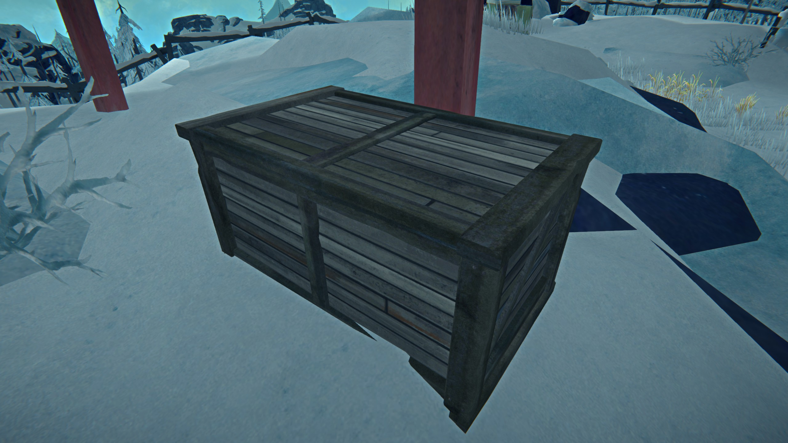

# Supply Bin

**Categories:** Interactable Objects · **Source:** [Fandom](https://thelongdark.fandom.com/wiki/Supply_Bin)

**Contents**

- [Locations](#locations)
- [Forestry Lookouts](#forestry-lookouts)
- [Radio Towers](#radio-towers)
- [Mines](#mines)

**Supply Bin**

| Property | Details |
| --- | --- |
|  |  / _Supply\_Bin.jpg_ |
| Story item | Yes |
| **Container** |  |
| Capacity | 30.00 kg(66 lbs) |

A **Supply Bin** is a storage container often found near Radio Towers, Forestry Lookouts, and certain Mines. They can contain Fuel items such as [Coal](./Coal.md), [Cedar Firewood](./Cedar%20Firewood.md), [Fir Firewood](./Fir%20Firewood.md), or [Charcoal](./Charcoal.md). The one at [Muskeg Overlook](./Muskeg%20Overlook.md) contains a [Car Battery](./Car%20Battery.md) for the nearby [Transmitter](./Transmitters.md).

## Locations

### Forestry Lookouts

- [Abandoned Lookout](./Abandoned%20Lookout.md)
- [Forestry Lookout](./Forestry%20Lookout.md)
- [Destroyed Lookout](./Destroyed%20Lookout.md)
- [Pensive Lookout](./Pensive%20Lookout.md)

### Radio Towers

- [Radio Tower](./Radio%20Tower.md)
- [Shortwave Tower](./Shortwave%20Tower.md)
- [Shortwave Tower West](./Shortwave%20Tower%20West.md)
- [Signal Hill](./Signal%20Hill.md)
- [Echo One Radio Tower](./Echo%20One%20Radio%20Tower.md)

### Mines

- [Langston Mine](./Langston%20Mine.md)
- [Last Prospect](./Last%20Prospect.md)
