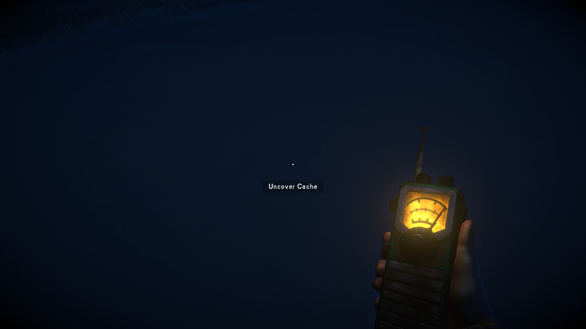
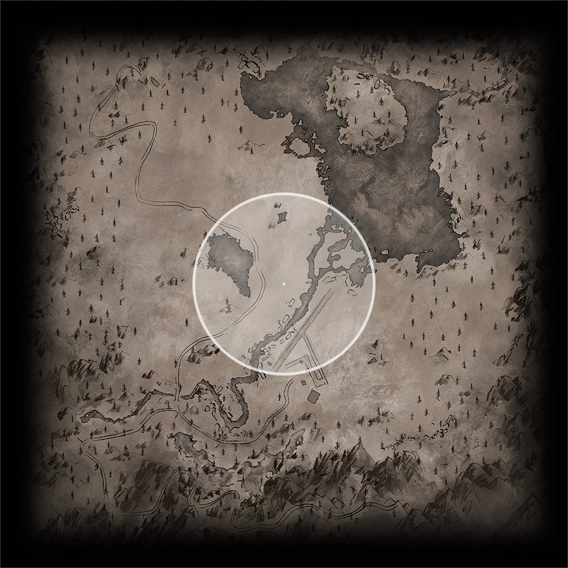

# Supply Cache

**Categories:** DLC Content, Interactable Objects, Interactable objects · **Source:** [Fandom](https://thelongdark.fandom.com/wiki/Supply_Cache)

**Contents**

- [Overview](#overview)
- [Caches linked to the Forsaken Airfield Transmitter](#caches-linked-to-the-forsaken-airfield-transmitter)
- [Forsaken Airfield (4)](#forsaken-airfield-4)
- [Zone of Contamination (2)](#zone-of-contamination-2)
- [Sundered Pass (3)](#sundered-pass-3)
- [Caches linked to the Forlorn Muskeg Transmitter](#caches-linked-to-the-forlorn-muskeg-transmitter)
- [Broken Railroad (1)](#broken-railroad-1)
- [Forlorn Muskeg (3)](#forlorn-muskeg-3)
- [Bleak Inlet (2)](#bleak-inlet-2)
- [Caches Linked to the Mountain Town Transmitter](#caches-linked-to-the-mountain-town-transmitter)
- [Mountain Town (2)](#mountain-town-2)
- [Hushed River Valley (3)](#hushed-river-valley-3)
- [Caches Linked to the Pleasant Valley Transmitter](#caches-linked-to-the-pleasant-valley-transmitter)
- [Mystery Lake (3)](#mystery-lake-3)
- [Pleasant Valley (3)](#pleasant-valley-3)
- [Caches Linked to the Desolation Point Transmitter](#caches-linked-to-the-desolation-point-transmitter)
- [Coastal Highway (3)](#coastal-highway-3)
- [Desolation Point (1)](#desolation-point-1)
- [Caches Linked to the Blackrock Transmitter](#caches-linked-to-the-blackrock-transmitter)
- [Ash Canyon (2)](#ash-canyon-2)
- [Blackrock (2)](#blackrock-2)
- [Timberwolf Mountain (2)](#timberwolf-mountain-2)
- [Map Coordinates](#map-coordinates)
- [Trivia](#trivia)
- [References](#references)

**Supply Cache**

| Property | Details |
| --- | --- |
|  | [Transponder Cache](../assets/Transponder_Cache.jpg) |
| Story item | No |
| **Container** |  |
| Capacity | 30.00 kg(66 lbs) |

[Ptarmigan icon](../assets/Ptarmigan_icon.png)

**DLC-Exclusive content.**; This content requires the [Tales from the Far Territory](./Tales%20from%20the%20Far%20Territory.md) addon to be installed before it can be seen or used in regular gameplay.

## Overview

**Supply Caches** (also called **Transponder Caches**) are small cylindrical shaped containers or strongboxes buried under the snow that the player can locate and uncover with the use of the [Handheld Shortwave Radio](./Handheld%20Shortwave%20Radio.md).

These caches contain useful loot such as tools, weapons, ammunition, medicine, clothing (including the [technical balaclava](./Technical%20Balaclava.md)) and food._The message that appears close to the cache_There are 1-4 caches per region, and none in the transition zones. The total number of caches per region is not random, with 31 caches in the game as of 2023-09-10.

Supply caches will spawn in one of four patterns, based on which of the four [loot tables](./Loot%20Table.md) is supplying your game.

Once found and uncovered, the location of the cache shows up once the survivor updates their map. this means that they could be effectively used as storage, up to 30 kg._Range of transponder on the cache setting, credit to u/Tolkfan_In order to find a supply cache, the associated [Transmitter](./Transmitters.md) needs to be fixed. Note there are two transmitters (Desolation Point, Blackrock) which are not part of the [Signal Void](./Signal%20Void.md) quest. Repairing them is necessary to find their associated caches - for example, to find any caches in Coastal Highway you must first fix the transmitter in Desolation Point.

## Caches linked to the Forsaken Airfield Transmitter

[Source](https://www.youtube.com/watch?v=5a_5Uu82SrA&list=PLj0PiwRqk8B6PjJCXhmblHGB6nxiCPQJP&index=2)

### [Forsaken Airfield](./Forsaken%20Airfield.md) (4)

- Guaranteed: NE of [Fallow Dugout](./Fallow%20Dugout.md), near crashed Helicopter
- Guaranteed: NW of [Spotter's Blind](./Spotter%27s%20Blind.md), east of main runway
- Loot Table 1: Between [Mindful Cabin](./Mindful%20Cabin.md) and [Island Cottage](./Island%20Cottage.md), SW of the western [fishing hut](./Fishing%20Hut.md)
- Loot Table 1: On the road to the airfield, SE of the river bridge
- Loot Table 2: SW of [Brittle Cave](./Brittle%20Cave.md), NE of the eastern [fishing hut](./Fishing%20Hut.md)
- Loot Table 2: NE of [Final Approach](./Final%20Approach.md), NW of the [hunter's blind](./Hunter%27s%20Blinds.md)
- Loot Table 3: on [Drift Island](./Drift%20Island.md), SE of [Island Cottage](./Island%20Cottage.md)
- Loot Table 3: SW of [Final Approach](./Final%20Approach.md), west of [Surveyor's Memory](./Surveyor%27s%20Memory.md)
- Loot Table 4: West of [Mindful Cabin](./Mindful%20Cabin.md), NW corner of map
- Loot Table 4: Between [Final Approach](./Final%20Approach.md) and [Island Cottage](./Island%20Cottage.md), north of the [hunter's blind](./Hunter%27s%20Blinds.md)

### [Zone of Contamination](./Zone%20of%20Contamination.md) (2)

- Loot Table 1 and 2: Near of [Overladen Pond](./Overladen%20Pond.md), in a [Chemical Hazard](./Chemical%20Hazard.md) area
- Loot Table 3 and 4: South of [Overladen Pond](./Overladen%20Pond.md), in a [Chemical Hazard](./Chemical%20Hazard.md) area
- Loot Table 1: Near [Desperate Elevation](./Desperate%20Elevation.md)
- Loot Table 2: Between [Idle Camp](./Idle%20Camp.md) and [Harrowed Residence](./Harrowed%20Residence.md)
- Loot Table 3: SW of [Unquenched Extraction](./Unquenched%20Extraction.md), across tree bridge (deer area)
- Loot Table 4: At [Turbulent Pasture](./Turbulent%20Pasture.md)

### [Sundered Pass](./Sundered%20Pass.md) (3)

- Loot Table 1 and 3: south of [Seedling Spring](./Seedling%20Spring.md)
- Loot Table 1 and 3: southern west of Snowed Cabin
- Loot Table 2 and 4: NW of [Perilous Crossing](./Perilous%20Crossing.md) bridge (upper level)
- Loot Table 2 and 4: east of [Forsaken Airfield](./Forsaken%20Airfield.md)/[Zone of Contamination](./Zone%20of%20Contamination.md) Cave System
- Loot Table 1: north of [Final Refuge](./Final%20Refuge.md)
- Loot Table 2: east of [Cascading Gap](./Cascading%20Gap.md)
- Loot Table 3: underneath rope at northern west
- Loot Table 4: NW of [Roamer's Cave](./Roamer%27s%20Cave.md)

## Caches linked to the Forlorn Muskeg Transmitter

[Source](https://www.youtube.com/watch?v=QHjZiSxMeUM&list=PLj0PiwRqk8B6PjJCXhmblHGB6nxiCPQJP&index=3)

### [Broken Railroad](./Broken%20Railroad.md) (1)

- Loot Table 1: around the Locomotive engine
- Loot Table 2: south of Maintenance Shed
- Loot Table 3: near the Hunting Lodge
- Loot Table 4: NW of Maintenance Shed

### [Forlorn Muskeg](./Forlorn%20Muskeg.md) (3)

- Guaranteed: near Muskeg Overlook
- Loot Tables 1 and 3: near the center of the map
- Loot Tables 2 and 4: north of Bunkhouses
- Loot Table 1: near cave north of Poacher's Camp
- Loot Table 2: Hat Creek
- Loot Table 3: in the NE
- Loot Table 4: Marsh Ridge

### [Bleak Inlet](./Bleak%20Inlet.md) (2)

- Loot Tables 1 and 3: near the northern Hunter's Blind
- Loot Tables 2 and 4: near the Ravine entrance
- Loot Table 1: south of Raven Falls cabin
- Loot Table 2: SE corner
- Loot Table 3: Fallen Lighthouse
- Loot Table 4: Cannery Trailers

## Caches Linked to the Mountain Town Transmitter

[Source](https://www.youtube.com/watch?v=ZijznZ3v76Q&list=PLj0PiwRqk8B6PjJCXhmblHGB6nxiCPQJP&index=5)

### [Mountain Town](./Mountain%20Town.md) (2)

- Loot Tables 1 and 3: near the Plane Crash pond
- Loot Tables 2 and 4: by the Crashed Prison Transport Bus
- Loot Table 1: West of Orca Gas Station
- Loot Table 2: Spruce Falls Bridge
- Loot Table 3: near the Church
- Loot Table 4: near the pond south of the cave to HRV

### [Hushed River Valley](./Hushed%20River%20Valley.md) (3)

- Guaranteed: Lonely Cave
- Loot Tables 1 and 2: NW cave
- Loot Tables 3 and 4: Landslide
- Loot Table 1: Many Falls Vista
- Loot Table 2: Monolith Lake
- Loot Table 3: north of Hushed River, between the ice caves on the west side
- Loot Table 4: Quarrelling Falls

## Caches Linked to the Pleasant Valley Transmitter

[Source](https://www.youtube.com/watch?v=SBSV-1L-A0Y&list=PLj0PiwRqk8B6PjJCXhmblHGB6nxiCPQJP&index=4)

### [Mystery Lake](./Mystery%20Lake%20%28region%29.md) (3)

- Guaranteed: underneath Forestry Lookout
- Loot Tables 1 and 4: NE of Logging Camp
- Loot Tables 2 and 3: near Alan's Cave
- Loot Table 1: south of Camp Office
- Loot Table 2: Clearcut
- Loot Table 3: near the cabin in between Unnamed Pond and the Clearcut
- Loot Table 4: Deadfall area

### [Pleasant Valley](./Pleasant%20Valley.md) (3)

- Loot Tables 1 and 4: Point of Disagreement
- Loot Tables 2 and 3: the birch forest near the Barn
- Loot Table 1: near Hilltop Cave
- Loot Table 1: Contemplation Bridge
- Loot Table 2: near cave to Winding River
- Loot Table 2: SE corner
- Loot Table 3: Pensive Pond
- Loot Table 3: southwest of crash site
- Loot Table 4: north of the township
- Loot Table 4: north of the Farmstead

## Caches Linked to the Desolation Point Transmitter

[Source](https://www.youtube.com/watch?v=6ddnKZpscgM&list=PLj0PiwRqk8B6PjJCXhmblHGB6nxiCPQJP&index=6)

Note these caches require fixing the Desolation Point [Transmitter](./Transmitters.md), which is not required for the [Signal Void](./Signal%20Void.md) quest.

### [Coastal Highway](./Coastal%20Highway.md) (3)

- Guaranteed: south of Coastal Townsite, OR at a plane crash site SE of coastal townsite
- Loot Tables 1 and 2: Abandoned Lookout
- Loot Tables 3 and 4: Cabin NW of The Tooth
- Loot Table 1: Bear Creek Campground
- Loot Table 2: NW of Fishing Camp
- Loot Table 3: Misanthrope's Homestead
- Loot Table 4: eastern tip of Jackrabbit Island

### [Desolation Point](./Desolation%20Point.md) (1)

- Loot Table 1: Little Island
- Loot Table 2: on one of the small islands west of the Lighthouse
- Loot Table 3: near Broken Bridge
- Loot Table 4: near Stone Church

## Caches Linked to the Blackrock Transmitter

[Source](https://www.youtube.com/watch?v=q1gCysfC-Ac&list=PLj0PiwRqk8B6PjJCXhmblHGB6nxiCPQJP&index=7)

Note these caches require fixing the Blackrock [Transmitter](./Transmitters.md), which is not required for the [Signal Void](./Signal%20Void.md) quest.

### [Ash Canyon](./Ash%20Canyon.md) (2)

- Loot Tables 1 and 3: Bitter Marsh
- Loot Tables 2 and 4: Pillar's Footrest
- Loot Table 1: Stone Shelf Cave
- Loot Table 2: north of Angler's Den
- Loot Table 3: Runaway Bridge
- Loot Table 4: Miner's Folly

### [Blackrock](./Blackrock.md) (2)

- Loot Tables 1 and 2: NW of Bricklayer's Retreat
- Loot Tables 3 and 4: SW of Power Plant
- Loot Table 1: near Creek Bed Cave
- Loot Table 2: east of Substation
- Loot Table 3: Whistling Perch
- Loot Table 4: Cook's Farm

### [Timberwolf Mountain](./Timberwolf%20Mountain.md) (2)

- Loot Tables 1 and 2: north of the tree trunk bridge across Echo Ravine
- Loot Tables 3 and 4: Crystal Lake
- Loot Table 1: SW corner of map
- Loot Table 2: south of cave to Blackrock
- Loot Table 3: NE corner of map
- Loot Table 4: near cave to Ash Canyon

## Map Coordinates

[Source](https://thelongdark.fandom.com/wiki/User:Nanavern) (from version 2.40)

| Region — X | Coordinates — Y | Coordinates — Loot Table | [Pilgrim](./Pilgrim.md), [Voyageur](./Voyageur.md), [Stalker](./Stalker.md) — Type | [Pilgrim](./Pilgrim.md), [Voyageur](./Voyageur.md), [Stalker](./Stalker.md) — Loot Table | [Interloper](./Interloper.md), [Misery](./Misery.md) — Type | [Interloper](./Interloper.md), [Misery](./Misery.md) |
| --- | --- | --- | --- | --- | --- | --- |
| [Ash Canyon](./Ash%20Canyon.md) | -564.85 | 153.98 | 1 | Tools | 1 | Craft |
| [Ash Canyon](./Ash%20Canyon.md) | 4.46 | 467.16 | 2 | Clothes | 2 | Craft |
| [Ash Canyon](./Ash%20Canyon.md) | -172.49 | -21 | 3 | Food | 3 | Craft |
| [Ash Canyon](./Ash%20Canyon.md) | 344.18 | 727.75 | 4 | Ammo | 4 | Craft |
| [Ash Canyon](./Ash%20Canyon.md) | 741.39 | -463.08 | 1, 3 | Generic | 1, 3 | Empty |
| [Ash Canyon](./Ash%20Canyon.md) | -149.98 | -685.92 | 2, 4 | Generic | 2, 4 | Empty |
| [Blackrock](./Blackrock.md) | -978.33 | -322.82 | 1 | Flares | 1 | Tools |
| [Blackrock](./Blackrock.md) | -289.37 | -426.68 | 2 | Tools | 2 | Tools |
| [Blackrock](./Blackrock.md) | 782.13 | 348.42 | 3 | Clothes | 3 | Tools |
| [Blackrock](./Blackrock.md) | 343.04 | -359.48 | 4 | Ammo | 4 | Tools |
| [Blackrock](./Blackrock.md) | 670.28 | 174.38 | 1, 2 | Generic | 1, 2 | Empty |
| [Blackrock](./Blackrock.md) | -585.87 | 249.32 | 3, 4 | Generic | 3, 4 | Empty |
| [Bleak Inlet](./Bleak%20Inlet.md) | 642.15 | 215.4 | 1 | Ammo | 1 | Flares |
| [Bleak Inlet](./Bleak%20Inlet.md) | 407.72 | -513.67 | 2 | Flares | 2 | Flares |
| [Bleak Inlet](./Bleak%20Inlet.md) | 214.38 | -794.65 | 3 | Tools | 3 | Flares |
| [Bleak Inlet](./Bleak%20Inlet.md) | -690.71 | -459.17 | 4 | Clothes | 4 | Flares |
| [Bleak Inlet](./Bleak%20Inlet.md) | -413.97 | 643.06 | 1, 3 | Generic | 1, 3 | Empty |
| [Bleak Inlet](./Bleak%20Inlet.md) | 90.82 | 552.43 | 2, 4 | Generic | 2, 4 | Empty |
| [Broken Railroad](./Broken%20Railroad.md) | 673.7 | 986.44 | 1 | Flares | 1 | Clothes |
| [Broken Railroad](./Broken%20Railroad.md) | 727.17 | 527.51 | 2 | Ammo | 2 | Clothes |
| [Broken Railroad](./Broken%20Railroad.md) | -71.33 | 695.41 | 3 | Clothes | 3 | Clothes |
| [Broken Railroad](./Broken%20Railroad.md) | 444.71 | 421.44 | 4 | Food | 4 | Clothes |
| [Coastal Highway](./Coastal%20Highway.md) | 1063.27 | 373.75 | permanent | CrashBox | permanent | CrashBox |
| [Coastal Highway](./Coastal%20Highway.md) | -1081.41 | 800.46 | 1 | Ammo | 1 | Flares |
| [Coastal Highway](./Coastal%20Highway.md) | -945.55 | 759.52 | 2 | Food | 2 | Flares |
| [Coastal Highway](./Coastal%20Highway.md) | 373.91 | 186.92 | 3 | Tools | 3 | Flares |
| [Coastal Highway](./Coastal%20Highway.md) | -76.27 | 322.23 | 4 | Flares | 4 | Flares |
| [Coastal Highway](./Coastal%20Highway.md) | 406.55 | 1175.63 | 1, 2 | Generic | 1, 2 | Empty |
| [Coastal Highway](./Coastal%20Highway.md) | -538.23 | 1117.05 | 3, 4 | Generic | 3, 4 | Empty |
| [Desolation Point](./Desolation%20Point.md) | 1120.46 | 902.63 | 1 | Clothes | 1 | Clothes |
| [Desolation Point](./Desolation%20Point.md) | 524.82 | 827.77 | 2 | Ammo | 2 | Clothes |
| [Desolation Point](./Desolation%20Point.md) | 1054.01 | 1485.1 | 3 | Flares | 3 | Clothes |
| [Desolation Point](./Desolation%20Point.md) | 637.35 | 1028.21 | 4 | Food | 4 | Clothes |
| [Forlorn Muskeg](./Forlorn%20Muskeg.md) | 1604.54 | 299.22 | permanent | CrashBox | permanent | CrashBox |
| [Forlorn Muskeg](./Forlorn%20Muskeg.md) | 1211 | 1523.92 | 1 | Food | 1 | Food |
| [Forlorn Muskeg](./Forlorn%20Muskeg.md) | 602.08 | 1121.38 | 2 | Clothes | 2 | Food |
| [Forlorn Muskeg](./Forlorn%20Muskeg.md) | 1378.28 | 1260.07 | 3 | Flares | 3 | Food |
| [Forlorn Muskeg](./Forlorn%20Muskeg.md) | 72.89 | 1392.22 | 4 | Ammo | 4 | Food |
| [Forlorn Muskeg](./Forlorn%20Muskeg.md) | 703.27 | 531.36 | 1, 3 | Generic | 1, 3 | Empty |
| [Forlorn Muskeg](./Forlorn%20Muskeg.md) | 785.75 | 219.61 | 2, 4 | Generic | 2, 4 | Empty |
| [Forsaken Airfield](./Forsaken%20Airfield.md) | 382.5 | -197.51 | permanent | Flares | permanent | Basic |
| [Forsaken Airfield](./Forsaken%20Airfield.md) | 1269.48 | 420.88 | permanent | CrashBox | permanent | CrashBox |
| [Forsaken Airfield](./Forsaken%20Airfield.md) | -476.91 | -740.31 | 1 | Tools | 1 | Flares |
| [Forsaken Airfield](./Forsaken%20Airfield.md) | -297.58 | 868.38 | 1 | Clothes | 1 | Food |
| [Forsaken Airfield](./Forsaken%20Airfield.md) | -321.22 | 605.35 | 2 | Tools | 2 | Flares |
| [Forsaken Airfield](./Forsaken%20Airfield.md) | 1000.65 | 1151.3 | 2 | Clothes | 2 | Food |
| [Forsaken Airfield](./Forsaken%20Airfield.md) | -941.55 | 8.4 | 3 | Food | 3 | Food |
| [Forsaken Airfield](./Forsaken%20Airfield.md) | 481.77 | 846.44 | 3 | Ammo | 3 | Flares |
| [Forsaken Airfield](./Forsaken%20Airfield.md) | -1089.64 | 1126.32 | 4 | Ammo | 4 | Flares |
| [Forsaken Airfield](./Forsaken%20Airfield.md) | -98.53 | 713.53 | 4 | Food | 4 | Food |
| [Hushed River Valley](./Hushed%20River%20Valley.md) | 346.55 | 439.2 | permanent | CrashBox | permanent | CrashBox |
| [Hushed River Valley](./Hushed%20River%20Valley.md) | 1024.81 | 889.05 | 1 | Clothes | 1 | Tools |
| [Hushed River Valley](./Hushed%20River%20Valley.md) | 1275.18 | 1514.32 | 2 | Tools | 2 | Tools |
| [Hushed River Valley](./Hushed%20River%20Valley.md) | 484.77 | 1228.1 | 3 | Food | 3 | Tools |
| [Hushed River Valley](./Hushed%20River%20Valley.md) | 1008.63 | 1687.8 | 4 | Flares | 4 | Tools |
| [Hushed River Valley](./Hushed%20River%20Valley.md) | 305.14 | 1501.55 | 1, 2 | Generic | 1, 2 | Empty |
| [Hushed River Valley](./Hushed%20River%20Valley.md) | 1628.4 | 1038.08 | 3, 4 | Generic | 3, 4 | Empty |
| [Mountain Town](./Mountain%20Town.md) | 886.13 | 1311.72 | 1 | Clothes | 1 | Clothes |
| [Mountain Town](./Mountain%20Town.md) | 1890.52 | 2070.73 | 2 | Flares | 2 | Clothes |
| [Mountain Town](./Mountain%20Town.md) | 598.67 | 2004.83 | 3 | Ammo | 3 | Clothes |
| [Mountain Town](./Mountain%20Town.md) | 1138.92 | 2117.85 | 4 | Tools | 4 | Clothes |
| [Mountain Town](./Mountain%20Town.md) | 1797.5 | 1653.51 | 1, 3 | Generic | 1, 3 | Empty |
| [Mountain Town](./Mountain%20Town.md) | 1265.68 | 1212.58 | 2, 4 | Generic | 2, 4 | Empty |
| [Mystery Lake](./Mystery%20Lake%20%28region%29.md) | 804.13 | 946.9 | permanent | CrashBox | permanent | CrashBox |
| [Mystery Lake](./Mystery%20Lake%20%28region%29.md) | 871.91 | 228.68 | 1 | Tools | 1 | Craft |
| [Mystery Lake](./Mystery%20Lake%20%28region%29.md) | 214.63 | 1362.96 | 2 | Food | N/A | N/A |
| [Mystery Lake](./Mystery%20Lake%20%28region%29.md) | 57.06 | 1036.46 | 3 | Ammo | 3 | Craft |
| [Mystery Lake](./Mystery%20Lake%20%28region%29.md) | 289.62 | 422.29 | 4 | Clothes | 2, 4 | Craft |
| [Mystery Lake](./Mystery%20Lake%20%28region%29.md) | 1252.08 | 1600.64 | 1, 4 | Generic | 1, 4 | Empty |
| [Mystery Lake](./Mystery%20Lake%20%28region%29.md) | 1675.37 | 874.83 | 2, 3 | Generic | 2, 3 | Empty |
| [Pleasant Valley](./Pleasant%20Valley.md) | 2004.07 | 1548.76 | 1 | Ammo | 1 | Craft |
| [Pleasant Valley](./Pleasant%20Valley.md) | 2349.2 | 417.85 | 1 | Food | 1 | Food |
| [Pleasant Valley](./Pleasant%20Valley.md) | 2323.53 | 919.69 | 2 | Food | 2 | Food |
| [Pleasant Valley](./Pleasant%20Valley.md) | 2551.29 | 2569.19 | 2 | Ammo | 2 | Craft |
| [Pleasant Valley](./Pleasant%20Valley.md) | 625.93 | 1277.89 | 3 | Flares | 3 | Craft |
| [Pleasant Valley](./Pleasant%20Valley.md) | 2556.58 | 1533.44 | 3 | Clothes | 3 | Food |
| [Pleasant Valley](./Pleasant%20Valley.md) | 1135.37 | 1182.15 | 4 | Flares | 4 | Craft |
| [Pleasant Valley](./Pleasant%20Valley.md) | 2066.13 | 1933.59 | 4 | Clothes | 4 | Food |
| [Pleasant Valley](./Pleasant%20Valley.md) | 778.94 | 2363.25 | 1, 4 | Generic | 1, 4 | Empty |
| [Pleasant Valley](./Pleasant%20Valley.md) | 1538.44 | 2108.81 | 2, 3 | Generic | 2, 3 | Empty |
| [Sundered Pass](./Sundered%20Pass.md) | -328.63 | -1075.23 | 1 | Ammo | 1 | Empty |
| [Sundered Pass](./Sundered%20Pass.md) | 8.3 | 457.7 | 2 | Clothes | 2 | Food |
| [Sundered Pass](./Sundered%20Pass.md) | 507.71 | -894.9 | 3 | Tools | 3 | Flares |
| [Sundered Pass](./Sundered%20Pass.md) | -1192.14 | -543.49 | 4 | Generic | 4 | Food |
| [Sundered Pass](./Sundered%20Pass.md) | -76.82 | -275.02 | 1, 3 | Clothes | 1, 3 | Flares |
| [Sundered Pass](./Sundered%20Pass.md) | 410.94 | 1173.25 | 1, 3 | Ammo | 1, 3 | Food |
| [Sundered Pass](./Sundered%20Pass.md) | 910.36 | 443.18 | 2, 4 | Tools | 2, 4 | Empty |
| [Sundered Pass](./Sundered%20Pass.md) | 1004.95 | -400.04 | 2, 4 | Food | 2, 4 | Food |
| [Timberwolf Mountain](./Timberwolf%20Mountain.md) | 584.85 | 88.36 | 1 | Food | 1 | Food |
| [Timberwolf Mountain](./Timberwolf%20Mountain.md) | 323.39 | 1130.8 | 2 | Flares | 2 | Food |
| [Timberwolf Mountain](./Timberwolf%20Mountain.md) | 1263.69 | 1720.65 | 3 | Ammo | 3 | Food |
| [Timberwolf Mountain](./Timberwolf%20Mountain.md) | 1637.89 | 1464.35 | 4 | Tools | 4 | Food |
| [Timberwolf Mountain](./Timberwolf%20Mountain.md) | 1771.27 | 850.72 | 1, 2 | Generic | 1, 2 | Empty |
| [Timberwolf Mountain](./Timberwolf%20Mountain.md) | 676.39 | 564.68 | 3, 4 | Generic | 3, 4 | Empty |
| [Zone of Contamination](./Zone%20of%20Contamination.md) | -687.19 | -830.17 | 1 | Food | 1 | Food |
| [Zone of Contamination](./Zone%20of%20Contamination.md) | 683.97 | 385.27 | 2 | Ammo | 2 | Food |
| [Zone of Contamination](./Zone%20of%20Contamination.md) | -817.43 | 309.49 | 3 | Flares | 3 | Food |
| [Zone of Contamination](./Zone%20of%20Contamination.md) | 77.25 | 567.34 | 4 | Clothes | 4 | Food |
| [Zone of Contamination](./Zone%20of%20Contamination.md) | 88.15 | -313.64 | 1, 2 | Generic | 1, 2 | Empty |
| [Zone of Contamination](./Zone%20of%20Contamination.md) | 62.4 | -414.45 | 3, 4 | Generic | 3, 4 | Empty |

## Trivia

An empty, opened Supply Cache can be found in the [Basement (Sundered Pass)](./Basement%20%28Sundered%20Pass%29.md) of the [Old Settlement](./Old%20Settlement.md). This may have been used by [Dr. Rüdiger](./Dr.%20R%C3%BCdiger.md) long ago.

## References

1. Bashrobe, 2023. [The Long Dark - Shortwave Bunkers and Caches](https://youtube.com/playlist?list=PLj0PiwRqk8B6PjJCXhmblHGB6nxiCPQJP).
