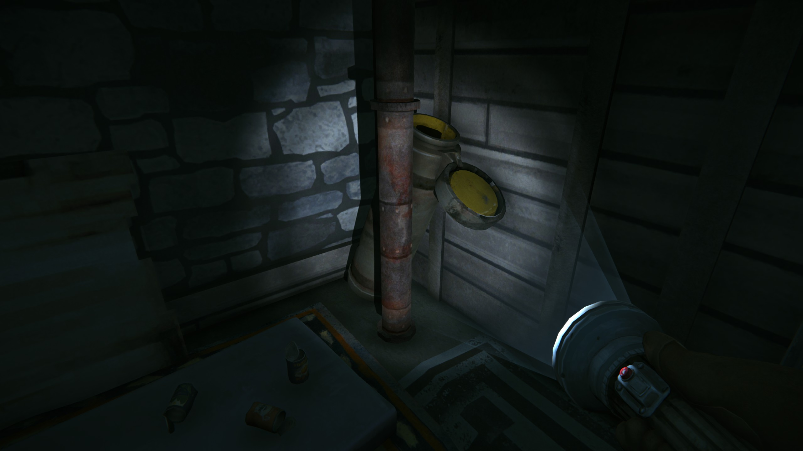

# Supply Cache

**Categories:** DLC Content, Interactable objects, Interactable Objects · **Source:** [Fandom](https://thelongdark.fandom.com/wiki/Supply_Cache)

**Contents**

- [Overview](#overview)
- [Caches linked to the Forsaken Airfield Transmitter](#caches-linked-to-the-forsaken-airfield-transmitter)
- [Forsaken Airfield (4)](#forsaken-airfield-4)
- [Zone of Contamination (2)](#zone-of-contamination-2)
- [Sundered Pass (3)](#sundered-pass-3)
- [Caches linked to the Forlorn Muskeg Transmitter](#caches-linked-to-the-forlorn-muskeg-transmitter)
- [Broken Railroad (1)](#broken-railroad-1)
- [Forlorn Muskeg (3)](#forlorn-muskeg-3)
- [Bleak Inlet (2)](#bleak-inlet-2)
- [Caches Linked to the Mountain Town Transmitter](#caches-linked-to-the-mountain-town-transmitter)
- [Mountain Town (2)](#mountain-town-2)
- [Hushed River Valley (3)](#hushed-river-valley-3)
- [Caches Linked to the Pleasant Valley Transmitter](#caches-linked-to-the-pleasant-valley-transmitter)
- [Mystery Lake (3)](#mystery-lake-3)
- [Pleasant Valley (3)](#pleasant-valley-3)
- [Caches Linked to the Desolation Point Transmitter](#caches-linked-to-the-desolation-point-transmitter)
- [Coastal Highway (3)](#coastal-highway-3)
- [Desolation Point (1)](#desolation-point-1)
- [Caches Linked to the Blackrock Transmitter](#caches-linked-to-the-blackrock-transmitter)
- [Ash Canyon (2)](#ash-canyon-2)
- [Blackrock (2)](#blackrock-2)
- [Timberwolf Mountain (2)](#timberwolf-mountain-2)
- [Map Coordinates](#map-coordinates)
- [Trivia](#trivia)
- [References](#references)

**Supply Cache**

_Transponder\_Cache.jpg_

**Story item:** No

**Container**

**Capacity:** 30.00 kg(66 lbs)

_Ptarmigan\_icon.png_

**DLC-Exclusive content.** / This content requires the [Tales from the Far Territory](./Tales%20from%20the%20Far%20Territory.md) addon to be installed before it can be seen or used in regular gameplay.

Region

Coordinates

[Pilgrim](./Pilgrim.md), [Voyageur](./Voyageur.md), [Stalker](./Stalker.md)

[Interloper](./Interloper.md), [Misery](./Misery.md)

X

Y

Loot Table

Type

Loot Table

Type

[Ash Canyon](./Ash%20Canyon.md)

-564.85

153.98

1

Tools

1

Craft

4.46

467.16

2

Clothes

2

Craft

-172.49

-21

3

Food

3

Craft

344.18

727.75

4

Ammo

4

Craft

741.39

-463.08

1, 3

Generic

1, 3

Empty

-149.98

-685.92

2, 4

Generic

2, 4

Empty

[Blackrock](./Blackrock.md)

-978.33

-322.82

1

Flares

1

Tools

-289.37

-426.68

2

Tools

2

Tools

782.13

348.42

3

Clothes

3

Tools

343.04

-359.48

4

Ammo

4

Tools

670.28

174.38

1, 2

Generic

1, 2

Empty

-585.87

249.32

3, 4

Generic

3, 4

Empty

[Bleak Inlet](./Bleak%20Inlet.md)

642.15

215.4

1

Ammo

1

Flares

407.72

-513.67

2

Flares

2

Flares

214.38

-794.65

3

Tools

3

Flares

-690.71

-459.17

4

Clothes

4

Flares

-413.97

643.06

1, 3

Generic

1, 3

Empty

90.82

552.43

2, 4

Generic

2, 4

Empty

[Broken Railroad](./Broken%20Railroad.md)

673.7

986.44

1

Flares

1

Clothes

727.17

527.51

2

Ammo

2

Clothes

-71.33

695.41

3

Clothes

3

Clothes

444.71

421.44

4

Food

4

Clothes

[Coastal Highway](./Coastal%20Highway.md)

1063.27

373.75

permanent

CrashBox

permanent

CrashBox

-1081.41

800.46

1

Ammo

1

Flares

-945.55

759.52

2

Food

2

Flares

373.91

186.92

3

Tools

3

Flares

-76.27

322.23

4

Flares

4

Flares

406.55

1175.63

1, 2

Generic

1, 2

Empty

-538.23

1117.05

3, 4

Generic

3, 4

Empty

[Desolation Point](./Desolation%20Point.md)

1120.46

902.63

1

Clothes

1

Clothes

524.82

827.77

2

Ammo

2

Clothes

1054.01

1485.1

3

Flares

3

Clothes

637.35

1028.21

4

Food

4

Clothes

[Forlorn Muskeg](./Forlorn%20Muskeg.md)

1604.54

299.22

permanent

CrashBox

permanent

CrashBox

1211

1523.92

1

Food

1

Food

602.08

1121.38

2

Clothes

2

Food

1378.28

1260.07

3

Flares

3

Food

72.89

1392.22

4

Ammo

4

Food

703.27

531.36

1, 3

Generic

1, 3

Empty

785.75

219.61

2, 4

Generic

2, 4

Empty

[Forsaken Airfield](./Forsaken%20Airfield.md)

382.5

-197.51

permanent

Flares

permanent

Basic

1269.48

420.88

permanent

CrashBox

permanent

CrashBox

-476.91

-740.31

1

Tools

1

Flares

-297.58

868.38

1

Clothes

1

Food

-321.22

605.35

2

Tools

2

Flares

1000.65

1151.3

2

Clothes

2

Food

-941.55

8.4

3

Food

3

Food

481.77

846.44

3

Ammo

3

Flares

-1089.64

1126.32

4

Ammo

4

Flares

-98.53

713.53

4

Food

4

Food

[Hushed River Valley](./Hushed%20River%20Valley.md)

346.55

439.2

permanent

CrashBox

permanent

CrashBox

1024.81

889.05

1

Clothes

1

Tools

1275.18

1514.32

2

Tools

2

Tools

484.77

1228.1

3

Food

3

Tools

1008.63

1687.8

4

Flares

4

Tools

305.14

1501.55

1, 2

Generic

1, 2

Empty

1628.4

1038.08

3, 4

Generic

3, 4

Empty

[Mountain Town](./Mountain%20Town.md)

886.13

1311.72

1

Clothes

1

Clothes

1890.52

2070.73

2

Flares

2

Clothes

598.67

2004.83

3

Ammo

3

Clothes

1138.92

2117.85

4

Tools

4

Clothes

1797.5

1653.51

1, 3

Generic

1, 3

Empty

1265.68

1212.58

2, 4

Generic

2, 4

Empty

[Mystery Lake](./Mystery%20Lake%20%28region%29.md)

804.13

946.9

permanent

CrashBox

permanent

CrashBox

871.91

228.68

1

Tools

1

Craft

214.63

1362.96

2

Food

N/A

N/A

57.06

1036.46

3

Ammo

3

Craft

289.62

422.29

4

Clothes

2, 4

Craft

1252.08

1600.64

1, 4

Generic

1, 4

Empty

1675.37

874.83

2, 3

Generic

2, 3

Empty

[Pleasant Valley](./Pleasant%20Valley.md)

2004.07

1548.76

1

Ammo

1

Craft

2349.2

417.85

1

Food

1

Food

2323.53

919.69

2

Food

2

Food

2551.29

2569.19

2

Ammo

2

Craft

625.93

1277.89

3

Flares

3

Craft

2556.58

1533.44

3

Clothes

3

Food

1135.37

1182.15

4

Flares

4

Craft

2066.13

1933.59

4

Clothes

4

Food

778.94

2363.25

1, 4

Generic

1, 4

Empty

1538.44

2108.81

2, 3

Generic

2, 3

Empty

[Sundered Pass](./Sundered%20Pass.md)

-328.63

-1075.23

1

Ammo

1

Empty

8.3

457.7

2

Clothes

2

Food

507.71

-894.9

3

Tools

3

Flares

-1192.14

-543.49

4

Generic

4

Food

-76.82

-275.02

1, 3

Clothes

1, 3

Flares

410.94

1173.25

1, 3

Ammo

1, 3

Food

910.36

443.18

2, 4

Tools

2, 4

Empty

1004.95

-400.04

2, 4

Food

2, 4

Food

[Timberwolf Mountain](./Timberwolf%20Mountain.md)

584.85

88.36

1

Food

1

Food

323.39

1130.8

2

Flares

2

Food

1263.69

1720.65

3

Ammo

3

Food

1637.89

1464.35

4

Tools

4

Food

1771.27

850.72

1, 2

Generic

1, 2

Empty

676.39

564.68

3, 4

Generic

3, 4

Empty

[Zone of Contamination](./Zone%20of%20Contamination.md)

-687.19

-830.17

1

Food

1

Food

683.97

385.27

2

Ammo

2

Food

-817.43

309.49

3

Flares

3

Food

77.25

567.34

4

Clothes

4

Food

88.15

-313.64

1, 2

Generic

1, 2

Empty

62.4

-414.45

3, 4

Generic

3, 4

Empty

_The empty Supply Cache in the Basement._
