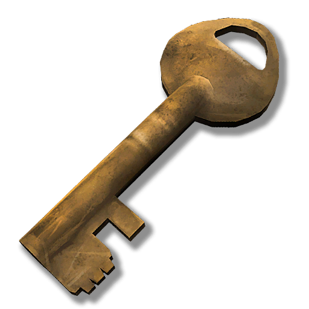

# Supply Room Key

<table class="infobox">
<caption>Supply Room Key</caption>
<colgroup>
<col style="width: 50%" />
<col style="width: 50%" />
</colgroup>
<tbody>
<tr>
<td colspan="2"><figure>

<figcaption>Supply_Room_Key_icon.png</figcaption>
</figure></td>
</tr>
<tr>
<td>
Release
</td>
<td>
<a href="./The%20Long%20Dark%20%E2%80%94%20Changelog.md#2.52" class="wikilink" title="31 March 2026">31 March 2026</a>
</td>
</tr>
<tr>
<td>
Wintermute
</td>
<td>
<a href="./Episode%205%20-%20The%20Light%20At%20The%20End%20Of%20All%20Things.md" class="wikilink" title="Episode 5: The Light At The End Of All Things">Episode 5: The Light At The End Of All Things</a>
</td>
</tr>
<tr>
<td colspan="2" class="section">
<strong>Properties</strong>
</td>
</tr>
<tr>
<td>
Item type
</td>
<td>
<a href="./Collectibles.md" class="wikilink" title="Collectibles">Collectibles</a>|-
</td>
</tr>
<tr>
<td>
Stackable
</td>
<td>
No
</td>
</tr>
<tr>
<td>
Examine
</td>
<td>
Opens the Supply Room.
</td>
</tr>
<tr>
<td colspan="2" class="section">
<strong>Values</strong>
</td>
</tr>
<tr>
<td>
Weight
</td>
<td>
0.00 kg (0 lbs)
</td>
</tr>
<tr>
<td colspan="2" class="section">
<strong>Actions</strong>
</td>
</tr>
<tr>
<td>
Backpack
</td>
<td>
Examine
</td>
</tr>
<tr>
<td>
On ground
</td>
<td>
Take It, Read Text, Leave It
</td>
</tr>
</tbody>
</table>

**Supply Room Key** is a <a href="./Collectibles.md" class="wikilink" title="Collectibles">Collectibles</a> found in <a href="./Episode%205%20-%20The%20Light%20At%20The%20End%20Of%20All%20Things.md" class="wikilink" title="Episode 5">Episode 5</a> of the <a href="./Wintermute.md" class="wikilink" title="Wintermute">Wintermute</a> story. It is found during the main mission <a href="./High%20Energy.md" class="wikilink" title="High Energy">High Energy</a>, when <a href="./Jace.md" class="wikilink" title="Jace">Jace</a> gives it to <a href="./Will%20Mackenzie.md" class="wikilink" title="Will Mackenzie">Will Mackenzie</a> just before he leaves to go to the <a href="./Suzuki%20Geothermal%20Region.md" class="wikilink" title="Suzuki Geothermal Region">Suzuki Geothermal Region</a>.

The key opens a door (labeled supply room above it) right before exiting the facility into the parking lot outside.

Inside are high grade, warm clothing, plenty of food and drink, several <a href="./Heat%20Pack.md" class="wikilink" title="Heat Packs">Heat Packs</a>, <a href="./Crampons.md" class="wikilink" title="Crampons">Crampons</a>, a <a href="./Technical%20Backpack.md" class="wikilink" title="Technical Backpack">Technical Backpack</a>, a <a href="./Medical%20Locker.md" class="wikilink" title="Medical Locker">Medical Locker</a>, several regular <a href="./Locker.md" class="wikilink" title="Lockers">Lockers</a> filled with supplies, 3 <a href="./Noisemaker.md" class="wikilink" title="Noisemakers">Noisemakers</a>, and a <a href="./Shotgun.md" class="wikilink" title="Shotgun">Shotgun</a> with 23 rounds of ammunition.

## Update history

\* UPDATE **31 March 2026 (<a href="./The%20Long%20Dark%20%E2%80%94%20Changelog.md#2.52" class="wikilink" title="Update">Update</a>):**

- - Added to game.

**Lua execution error in Module:Navbox function navbox**

