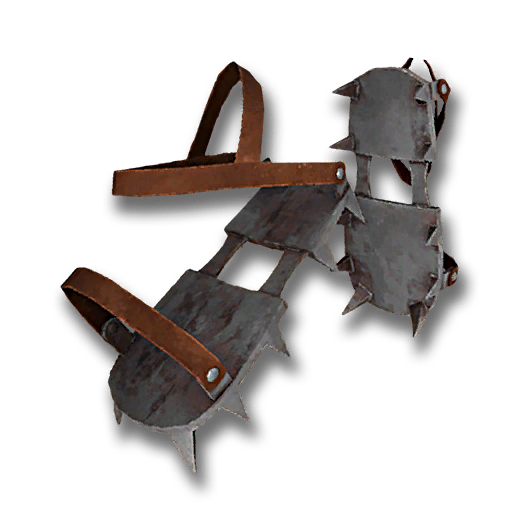

# Sure Footing

<table class="infobox">
<caption>Sure Footing</caption>
<colgroup>
<col style="width: 50%" />
<col style="width: 50%" />
</colgroup>
<tbody>
<tr>
<td colspan="2"><figure>
[Missing image: Sure_Footing_icon.png]
<figcaption>Sure_Footing_icon.png</figcaption>
</figure></td>
</tr>
<tr>
<td>
Release
</td>
<td>
<a href="./The%20Long%20Dark%20%E2%80%94%20Changelog.md#1.89" class="wikilink" title="9 December 2020">9 December 2020</a>
</td>
</tr>
<tr>
<td>
Update
</td>
<td>
1.89
</td>
</tr>
<tr>
<td colspan="2" class="section">
<strong>Properties</strong>
</td>
</tr>
<tr>
<td>
Category
</td>
<td>
<a href="./Afflictions.md" class="wikilink" title="Afflictions">Afflictions</a>
</td>
</tr>
<tr>
<td>
Description
</td>
<td>
The Crampons' steel spikes give you better traction in icy terrain. They make rope climbing easier, Sprains less frequent, and Weak Ice more forgiving.
</td>
</tr>
<tr>
<td>
Caused By
</td>
<td>
Worn <a href="./Clothing.md" class="wikilink" title="Clothing">Clothing</a>
</td>
</tr>
<tr>
<td>
Effect
</td>
<td>
Positive
</td>
</tr>
<tr>
<td>
Type
</td>
<td>
Benefit
</td>
</tr>
<tr>
<td>
Benefit Duration
</td>
<td>
Until 
 <a href="./Crampons.md" class="wikilink" title="Crampons">Crampons</a> 
or 
 <a href="./Improvised%20Crampons.md" class="wikilink" title="Improvised Crampons">Improvised Crampons</a> are taken off or ruined
</td>
</tr>
<tr>
<td colspan="2" class="section">
<strong>Advanced Data</strong>
</td>
</tr>
<tr>
<td>
Item Key
</td>
<td>
GAMEPLAY_CramponsBenefit
</td>
</tr>
</tbody>
</table>

<table>
<colgroup>
<col style="width: 33%" />
<col style="width: 33%" />
<col style="width: 33%" />
</colgroup>
<tbody>
<tr>
<td style="vertical-align: top; font-size: 3em; color: #5d5980; padding-right: 10px">
“
</td>
<td>
The Crampons' steel spikes give you better traction in icy terrain. They make rope climbing easier, Sprains less frequent, and Weak Ice more forgiving.

&#10;

In-game Description

</td>
<td style="vertical-align: bottom; font-size: 3em; color: #5d5980; padding-left: 10px">
”
</td>
</tr>
</tbody>
</table>

**Sure Footing** is a positive <a href="./Afflictions.md" class="wikilink" title="Affliction">Affliction</a> obtained when wearing <a href="./Crampons.md" class="wikilink" title="Crampons">Crampons</a> or <a href="./Improvised%20Crampons.md" class="wikilink" title="Improvised Crampons">Improvised Crampons</a> in the <a href="./Clothing.md#Accessories" class="wikilink" title="accessories">accessories</a> slot. The effect remains in effect as long as the accessory remains equipped. If the player's footwear (shoes and 2 socks slots) are removed (whether by the player or their footwear is ruined) then their Crampons will automatically be removed, removing the affliction.

## Causes

Sure Footing is received when wearing any of the following items:

|  | Clothing |
|----|----|
| **Template:iconlink plain** | <a href="./Crampons.md" class="wikilink" title="Crampons">Crampons</a> |
| **Template:iconlink plain** | <a href="./Improvised%20Crampons.md" class="wikilink" title="Improvised Crampons">Improvised Crampons</a> |

## Effects

This affliction causes the following effects:

|  | Effect | Accessory |
|----|----|----|
| <a href="./Crampons.md" class="wikilink" title="Crampons">Crampons</a> | <a href="./Improvised%20Crampons.md" class="wikilink" title="Improvised Crampons">Improvised Crampons</a> |  |
| **Template:iconlink plain** | <a href="./Sprain%20Risk.md" class="wikilink" title="Sprain Risk">Sprain Risk</a> reduction | 50% |
| **Template:iconlink plain** | <a href="./Stamina.md" class="wikilink" title="Stamina">Stamina</a> decrease while <a href="./Rope%20Climbing.md" class="wikilink" title="Rope Climbing">Rope Climbing</a> | 60 per second |
| **Template:iconlink plain** | <a href="./Weak%20Ice.md" class="wikilink" title="Weak Ice">Weak Ice</a> time increase | 1 second |

## Update history

- HOTFIX **6 April 2022 (<a href="./The%20Long%20Dark%20%E2%80%94%20Changelog.md#1.93" class="wikilink" title="Update">Update</a>):**
  - \[General\] Equipping an item in the left accessory slot, while the Crampons are equipped will no longer remove the Sure Footing buff.
- HOTFIX **10 December 2020 (<a href="./The%20Long%20Dark%20%E2%80%94%20Changelog.md#1.90" class="wikilink" title="Update">Update</a>):**
  - \[General\] Equipping an item in the left accessory slot, while the Crampons are equipped will no longer remove the Sure Footing buff.
- UPDATE **9 December 2020 (<a href="./The%20Long%20Dark%20%E2%80%94%20Changelog.md#1.89" class="wikilink" title="Update">Update</a>):**
  - Added to game

**Lua execution error in Module:Navbox function navbox**

