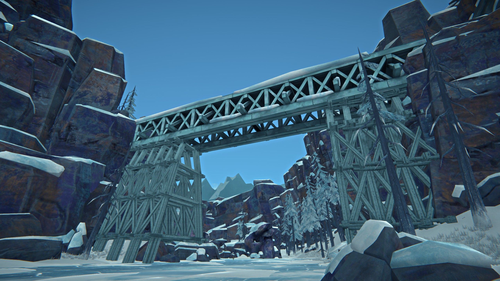

# Surfeit Trestle

**Surfeit Trestle**

| Property | Details |
| --- | --- |
|  |  / *Surfeit\_Trestle.jpg* |
| **Location** |  |
|  |  / *Surfeit\_Trestle\_Location.png* |
| Region | [Far Range Branch Line](./Far%20Range%20Branch%20Line.md)\|- |
| **General** |  |
|  | Has no shelter\|} **Surfeit Trestle** is a a location in [Far Range Branch Line](./Far%20Range%20Branch%20Line.md). / ## Overview / Surfeit Trestle is a railway viaduct that is part of the [Trans-Island Railway Line](./Trans-Island%20Railway%20Line.md) and leads to [Transfer Pass](./Transfer%20Pass.md). Across the trestle is an abandoned passenger rail car and a rock from which a [Mountaineering Rope](./Mountaineering%20Rope.md) can be deployed, and one such rope can be found nearby inside the rail car. The trestle's railway is blocked by a [rockfall landslide](./Foundered%20Track.md) and requires the player to use the rope leading down the to the bottom of a deep ravine to access [Platelayer's Shortcut](./Platelayer%27s%20Shortcut.md) in order to bypass it. / ## Trivia / Surfeit is defined as being an excessive amount of something, being a fitting name for a bridge that literally bridges Lower Great Bear with the vast mineral and material riches of the Far Territory as part of the Trans-Island Railway Line.**Lua execution error in Module:Navbox function navbox** |
