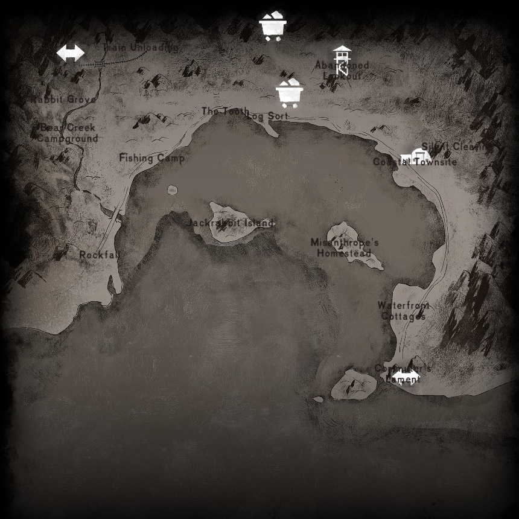
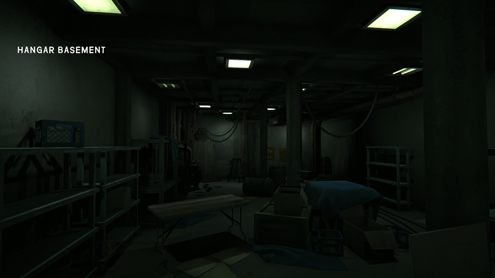

# Surveyed Locations

**Source:** [Fandom](https://thelongdark.fandom.com/wiki/Surveyed_Locations)

**Contents**

- [Overview](#overview)
- [Unmarked Locations](#unmarked-locations)
- [Faithful Cartographer](#faithful-cartographer)
- [Current List of Surveyed Locations](#current-list-of-surveyed-locations)
- [Ash Canyon - 20 Locations](#ash-canyon---20-locations)
- [Bleak Inlet - 17 Locations](#bleak-inlet---17-locations)
- [Broken Railroad - 8 Locations](#broken-railroad---8-locations)
- [Coastal Highway - 18 Locations](#coastal-highway---18-locations)
- [Crumbling Highway - 5 Locations](#crumbling-highway---5-locations)
- [Desolation Point - 11 Locations](#desolation-point---11-locations)
- [Forlorn Muskeg - 14 Locations](#forlorn-muskeg---14-locations)
- [Hushed River Valley - 24 Locations](#hushed-river-valley---24-locations)
- [Mountain Town - 23 Locations](#mountain-town---23-locations)
- [Mystery Lake - 22 Locations](#mystery-lake---22-locations)
- [Pleasant Valley - 26 Locations](#pleasant-valley---26-locations)
- [The Ravine - 5 Locations](#the-ravine---5-locations)
- [Timberwolf Mountain - 20 Locations](#timberwolf-mountain---20-locations)
- [Winding River - 2 Locations](#winding-river---2-locations)

_An example of all the named locations and major icons in Coastal Highway._
> __Surveyed locations in Survival Mode according to Regions discovered.
> Locations required for the Faithful Cartographer Achievement.__
>
>
> — In-game description

**Surveyed Locations** are a [Collectibles](./Collectibles.md) found in [Survival Mode](./Survival%20Mode.md) related solely to keeping track of and unlocking the [Faithful Cartographer](./Faithful%20Cartographer.md) achievement.

As of the Part 4 Tales from the Far Territory update, there are currently 215 locations that can be discovered and surveyed on Great Bear Island for the achievement.

[Blackrock](./Blackrock.md) and any regions located in the [Tales from the Far Territory](./Tales%20from%20the%20Far%20Territory.md) **are currently not** in Surveyed Locations.

## Overview

This Collectible is a checklist of all named locations that can be surveyed within the game, conveniently located in the [Journal](./Journal.md) menu under the Collectibles tab. Undiscovered places will be hidden in the menu by default, but using the "force reveal" button will make them show, not affecting the achievement. _An example of the text that appears in the top left corner when finding a named location. Hangar Basement is also an example of an unmarked location, as it does not appear on the map._ Occasionally while exploring, a message will appear in the top left corner of the screen denoting the current area you have discovered is a Named Location. These locations can be either marked or unmarked on the [Map](./Map.md) after surveying the area with [Charcoal](./Charcoal.md). Named locations appear as major building icons, region transition barriers, or as black text on the Map. Surveying a named location will have it be recorded in the Surveyed Locations tab in the Collections submenu of the [Journal](./Journal.md).

Discovered locations will be recorded separately in the Stats menu and will not appear until surveyed.

### Unmarked Locations

Not all named locations appear on the map when surveyed, yet they will still appear in the Surveyed Locations tab.

Regions that are primarily filled with unmarked locations include [Far Range Branch Line](./Far%20Range%20Branch%20Line.md) and [Keeper's Pass South](./Keeper%27s%20Pass%20South.md), with a few other unmarked locations being present in other regions. Indoor named locations will also not appear in the Surveyed Locations collections (such as [Hangar Basement](./Hangar%20Basement.md)), as it is impossible to survey indoors (though entire buildings can be surveyed from outside, such as [Main Hangar](./Main%20Hangar.md)).

## Faithful Cartographer

The [Faithful Cartographer](./Faithful%20Cartographer.md) achievement requires all named locations in Survival Mode to be surveyed and appear on the map.

- **_The most reliable way to get a proper survey is to survey as soon as the location pops on to your screen_**
- Burn all fires for 1hr + to get at least 1 [charcoal](./Charcoal.md)
- Take charcoal from every campfire, fire barrel, stove, etc you find
- Triple check map &amp; surveyed locations list in-game
- _Time moves while surveying (~20mins), make sure it's safe!_

## Current List of Surveyed Locations

Note\* Some locations from each Region are missing on this list, as the Surveyed Locations tab only records **SPECIFIC** marked named locations. Region transition icons are listed as part of the named locations list in the collections and are recorded as such. Some of these locations appear out of order alphabetically, but they are recorded as seen in Surveyed Locations collections.

### [Ash Canyon](./Ash%20Canyon.md) - 20 Locations

| --- | --- |
| - [Angler's Den](./Angler%27s%20Den.md) - [Bitter Marsh](./Bitter%20Marsh.md) - [Broad Falls](./Broad%20Falls.md) - [Climber's Cave](./Climber%27s%20Cave.md) - [Fire Overlook](./Fire%20Overlook.md) - [Foreman's Retreat](./Foreman%27s%20Retreat.md) - [Gold Mine](./Gold%20Mine.md) - [High Meadow](./High%20Meadow.md) - [Homesteader's Respite](./Homesteader%27s%20Respite.md) - [Long Falls](./Long%20Falls.md) | - [Pillar's Footrest](./Pillar%27s%20Footrest.md) - [Miner's Folly](./Miner%27s%20Folly.md) - [Mining Camp](./Mining%20Camp.md) - [Narrow Falls Cave](./Narrow%20Falls%20Cave.md) - [Runaway Bridge](./Runaway%20Bridge.md) - [Shattered Cove](./Shattered%20Cove.md) - [Stone Shelf Cave](./Stone%20Shelf%20Cave.md) - To Cave System (Cave Region Transition to [Timberwolf Mountain](./Timberwolf%20Mountain.md)) - To Timberwolf Mountain (Region Transition to [Timberwolf Mountain](./Timberwolf%20Mountain.md)) - [Wolf's Jaw Overlook](./Wolf%27s%20Jaw%20Overlook.md) |

### [Bleak Inlet](./Bleak%20Inlet.md) - 17 Locations

| --- | --- |
| - [Cannery Worker Residences](./Cannery%20Worker%20Residences.md) - [Coastal Highway Terminus](./Coastal%20Highway%20Terminus.md) - [Echo One Radio Tower](./Echo%20One%20Radio%20Tower.md) - [Fallen Lighthouse](./Fallen%20Lighthouse.md) - [Frozen Delta](./Frozen%20Delta.md) - [Landslide](./Landslide%20%28Bleak%20Inlet%29.md) - [Last Resort Cannery](./Last%20Resort%20Cannery.md) - [Long Bridge](./Long%20Bridge.md) - [Lower Raven Falls](./Lower%20Raven%20Falls.md) | - [Pensive Lookout](./Pensive%20Lookout.md) - [Raven Crossing](./Raven%20Crossing.md) - [Ravine's End Waterfall](./Ravine%27s%20End%20Waterfall.md) - Summit at Ravine's End - To Cave System (Region Transition to [Forlorn Muskeg](./Forlorn%20Muskeg.md)) - To Ravine (Region Transition to [The Ravine](./The%20Ravine.md)) - [Washed Out Trailers](./Washed%20Out%20Trailers.md) - [Workshop](./Workshop.md) |

### [Broken Railroad](./Broken%20Railroad.md) - 8 Locations

- [Hunter's Blind](./Hunter%27s%20Blind.md)
- [Hunting Lodge](./Hunting%20Lodge.md)
- [Landslide](./Landslide.md)
- [Locomotive Engine](./Locomotive%20Engine.md)
- [Rickety Foot Bridge](./Rickety%20Foot%20Bridge.md)
- To Forlorn Muskeg (Transition to [Forlorn Muskeg](./Forlorn%20Muskeg.md))
- [Broken Bridge](./Broken%20Bridge%20%28Broken%20Railroad%20location%29.md)
- [Maintenance Shed](./Maintenance%20Yard.md)

### [Coastal Highway](./Coastal%20Highway.md) - 18 Locations

| --- | --- |
| - [Abandoned Lookout](./Abandoned%20Lookout.md) - [Bear Creek Campground](./Bear%20Creek%20Campground.md) - [Coastal Townsite](./Coastal%20Townsite.md) - [Commuter's Lament](./Commuter%27s%20Lament.md) - [Fishing Camp](./Fishing%20Camp.md) - [Jackrabbit Island](./Jackrabbit%20Island.md) - [Log Sort](./Log%20Sort.md) - [Misanthrope's Homestead](./Misanthrope%27s%20Homestead.md) - [Quonset Garage](./Quonset%20Garage.md) | - [Rabbit Grove](./Rabbit%20Grove.md) - [Rockfall](./Rockfall.md) - [Silent Clearing](./Silent%20Clearing.md) - [The Tooth](./The%20Tooth.md) - To Abandoned Mine (Transition to [Cinder Hills Coal Mine](./Cinder%20Hills%20Coal%20Mine.md)) - To Crumbling Highway (Transition to [Crumbling Highway](./Crumbling%20Highway.md)) - To Ravine (Transition to [The Ravine](./The%20Ravine.md)) - [Train Unloading](./Train%20Unloading.md) - [Waterfront Cottages](./Waterfront%20Cottages.md) |

### [Crumbling Highway](./Crumbling%20Highway.md) - 5 Locations

- [Road Collapse](./Road%20Collapse.md)
- [Abandoned Harris Home](./Abandoned%20Harris%20Home.md)
- [The Arch](./The%20Arch%20%28Old%20Island%20Connector%20location%29.md)
- To Coastal Highway (Transition to [Coastal Highway](./Coastal%20Highway.md))
- To No. 3 Coal Mine (Transition to [Abandoned Mine No. 3](./No.%203%20Coal%20Mine.md))

### [Desolation Point](./Desolation%20Point.md) - 11 Locations

| --- | --- |
| - [Blocked Highway](./Blocked%20Highway.md) - [Broken Bridge (Desolation Point location)](./Broken%20Bridge%20%28Desolation%20Point%20location%29.md) - [Hibernia Processing](./Hibernia%20Processing.md) - [Katie's Secluded Corner](./Katie%27s%20Secluded%20Corner.md) - [Little Island](./Little%20Island.md) | - [Lonely Lighthouse](./Lonely%20Lighthouse.md) - [Matt's Truck](./Matt%27s%20Truck.md) - [Stone Church](./Stone%20Church.md) - [The Riken](./The%20Riken.md) - To No. 3 Coal Mine (Region Transition to [Abandoned Mine No. 3](./No.%203%20Coal%20Mine.md)) - [Waterfall](./Waterfall.md) |

### [Forlorn Muskeg](./Forlorn%20Muskeg.md) - 14 Locations

| --- | --- |
| - [Bunkhouses](./Bunkhouses.md) - [Hat Creek](./Hat%20Creek.md) - [Marsh Ridge](./Marsh%20Ridge.md) - [Muskeg Overlook](./Muskeg%20Overlook.md) - [Old Spence Family Homestead](./Old%20Spence%20Family%20Homestead.md) - [Poacher's Camp](./Poacher%27s%20Camp.md) - [Shortwave Tower (North)](./Shortwave%20Tower.md) | - [Shortwave Tower West](./Shortwave%20Tower%20West.md) - Shortwave Tower (Muskeg Overlook) - To Broken Railway (Transition to [Broken Railroad](./Broken%20Railroad.md)) - To Cave System (Transition to [Bleak Inlet](./Bleak%20Inlet.md)) - To Mountain Town (Milton) (Transition to [Mountain Town](./Mountain%20Town.md)) - To Mystery Lake (Transition to [Mystery Lake](./Mystery%20Lake%20%28disambiguation%29.md)) - [Waterfall (Forlorn Muskeg)](./Waterfall%20%28Forlorn%20Muskeg%29.md) |

### [Hushed River Valley](./Hushed%20River%20Valley.md) - 24 Locations

| --- | --- |
| - [Banner Falls](./Banner%20Falls.md) - [Cloudtop Falls](./Cloudtop%20Falls.md) - [Hushed River](./Hushed%20River.md) - [Lake Cave](./Lake%20Cave.md) - [Landslide](./Landslide%20%28Hushed%20River%20Valley%29.md) - [Little Bear and Cub Falls](./Little%20Bear%20and%20Cub%20Falls.md) - [Lonely Cave](./Lonely%20Cave.md) - [Long Shot Falls](./Long%20Shot%20Falls.md) - [Mammoth Falls](./Mammoth%20Falls.md) - [Many Falls Vista](./Many%20Falls%20Vista.md) - [Monolith Lake](./Monolith%20Lake.md) - [Moose Overlook](./Moose%20Overlook.md) | - [Mysterious Signal Fire](./Mysterious%20Signal%20Fire.md) - [Offset Falls](./Offset%20Falls.md) - [Peak Cave](./Peak%20Cave.md) - [Pensive Vista](./Pensive%20Vista.md) - [Quarreling Falls](./Quarrelling%20Falls.md) - [Reclusive Falls](./Reclusive%20Falls.md) - [Stairsteps Lake](./Stairsteps%20Lake.md) - To Cave System (Transition to [Mountain Town](./Mountain%20Town.md)) - [Twin Sisters Falls](./Twin%20Sisters%20Falls.md) - [Valley Cave](./Valley%20Cave.md) - [Valley View Point](./Valley%20View%20Point.md) - [Watchful Falls](./Watchful%20Falls.md) |

### [Mountain Town](./Mountain%20Town.md) - 23 Locations

| --- | --- |
| - [Cave (Mountain Town location)](./Cave%20%28Mountain%20Town%20location%29.md) - Crashed Plane ([Mackenzie's Crashed Plane](./Mackenzie%27s%20Crashed%20Plane.md)) - [Crashed Prison Transport Bus](./Crashed%20Prison%20Transport%20Bus.md) - [Graveyard](./Graveyard.md) - [Hermit's Cabin](./Hermit%27s%20Cabin.md) - [Milton Basin](./Milton%20Basin.md) - [Milton Park](./Milton%20Park.md) - [Old Schoolhouse](./Old%20Schoolhouse.md) - [Orca Gas Station](./Orca%20Gas%20Station.md) - [Paradise Meadows Farm](./Paradise%20Meadows%20Farm.md) - [Picnic Area](./Picnic%20Area.md) - [Radio Tower](./Radio%20Tower.md) | - [Rocky Refuge](./Rocky%20Refuge.md) - [Spruce Falls Bridge](./Spruce%20Falls%20Bridge.md) - [St. Christopher's Church](./St.%20Christopher%27s%20Church.md) - [The Arch](./The%20Arch%20%28Mountain%20Town%20location%29.md) - To Cave System (Region Transition to [Hushed River Valley](./Hushed%20River%20Valley.md)) - To Cave System (Region Transition to [Mystery Lake (region)](./Mystery%20Lake%20%28region%29.md)) - To Forlorn Muskeg (Region Transitions to [Forlorn Muskeg](./Forlorn%20Muskeg.md)) - Town of Milton ([Milton](./Milton.md)) - [Wood Lot](./Wood%20Lot.md) - [Wood Lot](./Wood%20Lot.md) 3 separate Wood Lots - [Wood Lot](./Wood%20Lot.md) |

### [Mystery Lake](./Mystery%20Lake%20%28region%29.md) - 22 Locations

| --- | --- |
| - [Alan's Cave](./Alan%27s%20Cave.md) - [Camp Office](./Camp%20Office.md) - [Carter Hydro Dam](./Carter%20Hydro%20Dam.md) - [Clearcut](./Clearcut.md) - [Dave's Quiet Clearing](./Dave%27s%20Quiet%20Clearing.md) - [Deadfall Area](./Deadfall%20Area.md) - [Derailment](./Derailment.md) - [Destroyed Lookout](./Destroyed%20Lookout.md) - [Forestry Lookout](./Forestry%20Lookout.md) - [Frozen Creek](./Frozen%20Creek.md) - [Ice Fishing Huts](./Ice%20Fishing%20Huts.md) | - [Lake Overlook](./Lake%20Overlook.md) - [Lake Trail](./Lake%20Trail.md) - [Logging Camp](./Logging%20Camp.md) - [Max's Last Stand](./Max%27s%20Last%20Stand.md) - [Rail Tunnel](./Rail%20Tunnel.md) - To Cave System (Transition to [Mountain Town](./Mountain%20Town.md)) - To Forlorn Muskeg (Transition to [Forlorn Muskeg](./Forlorn%20Muskeg.md)) - To Ravine (Transition to [The Ravine](./The%20Ravine.md)) - [Train Loading Area](./Train%20Loading%20Area.md) - [Trapper's Homestead](./Trapper%27s%20Homestead.md) - [Unnamed Pond](./Unnamed%20Pond.md) |

### [Pleasant Valley](./Pleasant%20Valley.md) - 26 Locations

| --- | --- |
| - [Barn (Molly's)](./Barn%20%28Molly%27s%29.md) - [Burned Ridge Cave](./Burned%20Ridge%20Cave.md) - [Cascading Falls](./Cascading%20Falls.md) - [Community Hall](./Community%20Hall.md) - [Contemplation Bridge](./Contemplation%20Bridge.md) - [Derelict Cabins](./Derelict%20Cabins.md) - [End of the Road](./End%20of%20the%20Road.md) - [Heartbreak Bridge](./Heartbreak%20Bridge.md) - [Hilltop Cave](./Hilltop%20Cave.md) - [Lonely Homestead](./Lonely%20Homestead.md) - [Long Curve](./Long%20Curve.md) - [Lower Falls](./Lower%20Falls.md) | - [Misty Falls Picnic Area](./Misty%20Falls%20Picnic%20Area.md) - [Pensive Pond](./Pensive%20Pond.md) - [Picnic Spot](./Picnic%20Spot.md) - [Point of Disagreement](./Point%20of%20Disagreement.md) - [Signal Hill](./Signal%20Hill.md) - [Skeeter's Ridge](./Skeeter%27s%20Ridge.md) - [Thomson's Crossing](./Thomson%27s%20Crossing.md) - [Three Strikes Farmstead](./Three%20Strikes%20Farmstead.md) - To Abandoned Mine (Transition to [Cinder Hills Coal Mine](./Cinder%20Hills%20Coal%20Mine.md)) - To Cave System (Transition to [Winding River](./Winding%20River.md)) - To Keeper's Pass South (Transition to [Keeper's Pass South](./Keeper%27s%20Pass%20South.md)) - To Timberwolf Mountain (Transition to [Timberwolf Mountain](./Timberwolf%20Mountain.md)) - [Upper Falls](./Upper%20Falls.md) |

### [The Ravine](./The%20Ravine.md) - 5 Locations

- [Raven Falls Trestle](./Raven%20Falls%20Trestle.md)
- [Ravine Basin](./Ravine%20Basin.md)
- To Bleak Inlet (Transition to [Bleak Inlet](./Bleak%20Inlet.md))
- To Coastal Highway (Transition to [Coastal Highway](./Coastal%20Highway.md))
- To Mystery Lake (Transition to [Mystery Lake](./Mystery%20Lake%20%28region%29.md))

### [Timberwolf Mountain](./Timberwolf%20Mountain.md) - 20 Locations

| --- | --- |
| - [Andre's Peak](./Andre%27s%20Peak.md) - [Crystal Lake](./Crystal%20Lake.md) - [Deer Clearing](./Deer%20Clearing.md) - [Echo Peak East](./Echo%20Peak%20East.md) - [Echo Peak West](./Echo%20Peak%20West.md) - [Echo Ravine](./Echo%20Ravine.md) - [Engine (West)](./Engine%20%28West%29.md) (West of mountain) - [Engine (East)](./Engine%20%28East%29.md) (East of mountain) - [Eric's Falls](./Eric%27s%20Falls.md) - [Landing Gear](./Landing%20Gear.md) | - [Mountaineer's Hut](./Mountaineer%27s%20Hut.md) - [Secluded Shelf](./Secluded%20Shelf.md) - [Summit](./Summit.md) - [Tail Section](./Tail%20Section.md) - To Ash Canyon (Transition to [Ash Canyon](./Ash%20Canyon.md)) - To Cave System (Transition Cave to [Ash Canyon](./Ash%20Canyon.md)) - To Cave System (Transition Cave to [Blackrock](./Blackrock.md)) - To Pleasant Valley (Transition to [Pleasant Valley](./Pleasant%20Valley.md)) - [Wing](./Wing.md) (Plane wing near [Forest Cave (Timberwolf Mountain location)](./Forest%20Cave%20%28Timberwolf%20Mountain%20location%29.md) - [Wing (Summit)](./Wing%20%28Summit%29.md) (Plane wing at Summit) |

### [Winding River](./Winding%20River.md) - 2 Locations

- Carter Hydro Dam (Transition to [Carter Hydro Dam](./Carter%20Hydro%20Dam.md))
- To Cave System (Transition to [Pleasant Valley](./Pleasant%20Valley.md))
