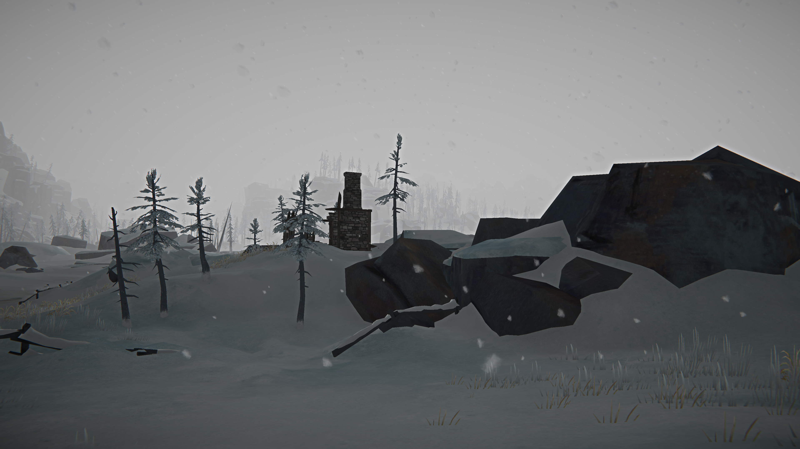

# Surveyor's Memory

<table class="infobox">
<caption>Surveyor's Memory</caption>
<colgroup>
<col style="width: 50%" />
<col style="width: 50%" />
</colgroup>
<tbody>
<tr>
<td colspan="2"><figure>

<figcaption>Screen_90db8986-f54b-4fe3-aaeb-2254c5171b56_hi.png</figcaption>
</figure></td>
</tr>
<tr>
<td colspan="2" class="section">
<strong>Location</strong>
</td>
</tr>
<tr>
<td colspan="2"><figure>
[Missing image: Surveyor's_Memory_Location.png]
<figcaption>Surveyor's_Memory_Location.png</figcaption>
</figure></td>
</tr>
<tr>
<td>
Region
</td>
<td>
<a href="./Forsaken%20Airfield.md" class="wikilink" title="Forsaken Airfield">Forsaken Airfield</a>|-
</td>
</tr>
<tr>
<td>
Description
</td>
<td>
The ruins of an old house
</td>
</tr>
<tr>
<td colspan="2" class="section">
<strong>General</strong>
</td>
</tr>
<tr>
<td>
Type
</td>
<td>
Landmark|-
</td>
</tr>
<tr>
<td><figure>

<figcaption>bed_icon.png</figcaption>
</figure></td>
<td></td>
</tr>
<tr>
<td></td>
<td>
Has no shelter|}

<strong>Surveyor's Memory</strong> are the ruins of a small cottage. The <a href="./Fireplace.md" class="wikilink" title="Fireplace">Fireplace</a>, chimney, and a few walls that act as wind breaks for temporary shelter are the only notable remnants left of this building. It is not recommended to linger here for long, due to the lack of shelter resulting in exposure to the elements.

The ruins provide a clear overlook of the nearby pond and <a href="./Final%20Approach.md" class="wikilink" title="Final Approach">Final Approach</a> crash site on clear days. The pond can be used as a place for <a href="./Ice%20Fishing.md" class="wikilink" title="Ice Fishing">Ice Fishing</a> with Free Form holes.

<h2 id="Gallery">Gallery</h2>

<strong>Lua execution error in Module:Navbox function navbox</strong> <a href="ru:%D0%92%D0%BE%D1%81%D0%BF%D0%BE%D0%BC%D0%B8%D0%BD%D0%B0%D0%BD%D0%B8%D0%B5_%D0%B8%D0%BD%D1%81%D0%BF%D0%B5%D0%BA%D1%82%D0%BE%D1%80%D0%B0" class="wikilink" title="ru:Воспоминание инспектора">ru:Воспоминание инспектора</a>
</td>
</tr>
</tbody>
</table>

