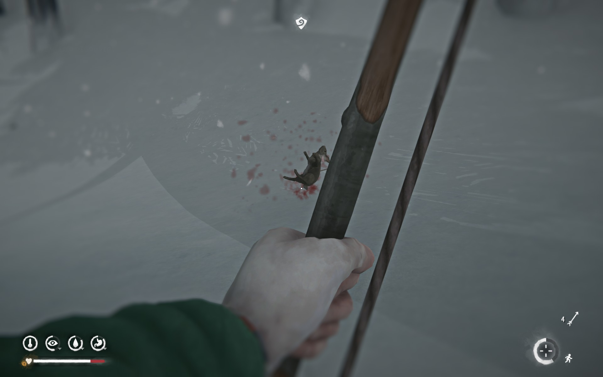
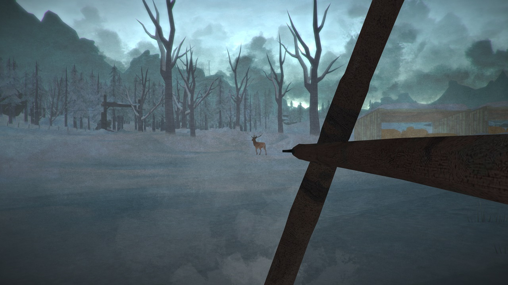

# Survival Bow

**Categories:** Craftable tools, Tools · **Source:** [Fandom](https://thelongdark.fandom.com/wiki/Survival_Bow)

**Contents**

- [Overview](#overview)
- [Mechanics](#mechanics)
- [Hunting](#hunting)
- [Bleed-out time](#bleed-out-time)
- [Crafting](#crafting)
- [Locations](#locations)
- [Desolation Point](#desolation-point)
- [Mystery Lake](#mystery-lake)
- [Pleasant Valley](#pleasant-valley)
- [Forlorn Muskeg](#forlorn-muskeg)
- [Broken Railroad](#broken-railroad)
- [Hushed River Valley](#hushed-river-valley)
- [Tips](#tips)
- [Gallery](#gallery)

**Survival Bow**

| Property | Details |
| --- | --- |
|  |  / _Survival\_Bow\_icon.png_ |
| **General** |  |
| Item Type | Item |
| Wintermute | No |
| Renewable | Yes |
| **Statistics** |  |
| Weight | 0.50 kg(1.1 lbs) |
| Harvest | _Unharvestable_ |
| Repair | _Unrepairable_ |

> “__A simple, improvised bow, suitable for hunting small game.__”
>
> — In-game description

_This article is about the normal Bow. For variants, see [Woodwright's Bow](./Woodwright%27s%20Bow.md), [Sport Bow](./Sport%20Bow.md) and [Bushcraft Bow](./Bushcraft%20Bow.md)._

The **Survival Bow** is a maple self-backed longbow that shoots [Simple Arrows](./Simple%20Arrow.md), [Fire Hardened Arrows](./Fire%20Hardened%20Arrow.md), and [Manufactured Arrows](./Manufactured%20Arrow.md) at targets such as [Wildlife](./Wildlife.md). Hitting a living target with a fired arrow provides experience to the [Archery](./Archery.md) skill.

## Overview

The Survival Bow is an effective ranged weapon and hunting tool. It features unique advantages and disadvantages from other weapons, such as the [Hunting Rifle](./Hunting%20Rifle.md). The Survival Bow is the primary weapon in Interloper mode, considering the limited availability of [Distress Pistols](./Distress%20Pistol.md) and its [ammunition](./Flare%20Shell.md), and the limited utility of [Stones](./Stone.md).

Arrows travel slower than bullets and at a steep arc, making their accuracy more difficult, especially at long ranges, and also making it more effective for offense than defense. However, the Survival Bow can be very effective at stopping a charging [Wolf](./Wolf.md), if the player waits until the last moment to shoot.

- Bows are much lighter than firearms, but their ammunition is heavier.
- Arrows cause heavier bleeding than bullets, but lower chances of a critical hit.
- Arrows may be retrievable after being fired; however, the arrow loses some condition each time it lands (with hard surfaces causing more damage to the arrow).
- Bow condition degrades 2% per shot and cannot be repaired. New bow and arrows may be crafted, and all materials to craft bows/arrows is renewable (see: [Beachcombing](./Beachcombing.md)).
- Bows can shoot around 42.5 times before risking breakage below 15% condition. Upon reaching archery skill level 4 the amount of guaranteed uses before breaking risk doubles to 85.

The only time when the Rifle is objectively better is when fighting Moose or Cougar. Because neither do not bleed, the Bow's more effective bleed-out is rendered useless; making the Rifle's higher critical hit chance superior.

## Mechanics

To fire a Survival Bow, it must first be carried and wielded (1) with at least 1 [Simple Arrow](./Simple%20Arrow.md) or [Fire Hardened Arrow](./Fire%20Hardened%20Arrow.md) in the player's inventory. Wielding it will cause an arrow to be loaded. To fire the bow, it must first be drawn (LMB), and then released (RMB). Left-clicking twice will cause the bow to lower again, as it will if the Stamina meter is depleted (which drains constantly, when the bow is drawn).

The bow requires practice to use effectively, but also becomes easier to handle at higher levels of Archery:

- _Draw speed:_ It's slower than aiming the rifle.
- _Horizontal sway:_ When drawn, the bow will sway from left to right affecting the arrow's flight accordingly. When it tilts to the right or left, the arrow will fly a bit to the right or left of the center of your aim. The sway increases if the player is tired.
- _Vertical targeting:_ Arrow flight trajectory forms an arc, following in-game physics, similar to the real world. Farther targets will require aiming higher.
- _Arrow flight speed:_ Arrows fly much slower than bullets, so take a target's movement into consideration.
- _Usability:_ The bow, unlike the rifle, cannot be fired while crouched unless one's Archery skill is Level 5.
- _Ammo Type:_ Unlike other weapons, the Survival Bow's arrows can be switched between 3 types of Arrows by pressing the Reload key:
  - [Simple Arrow](./Simple%20Arrow.md) - The most basic arrow type, they deal moderate damage and are strong enough to kill every animal.
  - [Fire Hardened Arrow](./Fire%20Hardened%20Arrow.md) - Improvised arrows created in an active Fire, these arrows are very brittle and only damage [Rabbits](./Rabbit.md) and [Ptarmigan](./Ptarmigan.md). Attacking medium or large animals with these arrows instantly breaks them but still awards Archery Skill experience.
  - [Manufactured Arrow](./Manufactured%20Arrow.md) - A very rare arrow type that can only be acquired from the [Trader](./Trader.md). These arrows deal more damage and are the most durable arrow type, but cannot be repaired once destroyed.

Drawing a loaded bow will cause the player's view to zoom, enabling the bow to be used as a weak optic or pointing tool.

## Hunting

_Main article: [Hunting](./Hunting.md)_The Survival Bow is a crafted tool which fires Simple Arrows. Arrows may kill animals instantly with a critical hit, they more commonly cause bleeding wounds that drain the animal's health over time. When hunting it is wise to consider the weather, time of day, and ability to track a wounded animal as it flees. Arrows may be retrieved from the ground or an animal's carcass by left-clicking on it.

### Bleed-out time

Each species of animal takes a specific amount of time to bleed out, as follows:

| Zone Hit | [Bear](./Bear.md) | [Deer](./Deer.md) | [Wolf](./Wolf.md) | [Rabbit](./Rabbit.md) |
| --- | --- | --- | --- | --- |
| Head | 45 minutes | Instant | Instant | Instant |
| Chest | 120 minutes | 25 minutes | 40 minutes | Instant |
| Hind | 240 minutes | 40 minutes | 45 minutes | Instant |
| Foot | 240 minutes | 120 minutes | 60 minutes | Instant |

[Rabbits](./Rabbit.md) and [Ptarmigan](./Ptarmigan.md) die instantly when hit by an arrow. [Moose](./Moose.md) and [Cougar](./Cougar.md) do not bleed out.

Note: The bleed-out time diminishes with higher levels of the [Archery](./Archery.md) survival skill.

## Crafting

**Survival Bow**

| Property | Details |
| --- | --- |
|  | - |
|  | - |
|  | 300 minutes (5 hour 0 minutes) |
| **Requirements** |  |
| Facility | **Template:iconlink** |
| **Materials** |  |
| **Template:iconlink plain** |  |
| Item | [Cured Maple Sapling](./Cured%20Maple%20Sapling.md) |
| Quantity | 1 |
| **Template:iconlink plain** |  |
|  | [Cured Gut](./Cured%20Gut.md) |
|  | 2 |

## Locations

The survival bow can randomly spawn in the game world (excluding Interloper) on different playthroughs. Some observed spawn points include:

### [Desolation Point](./Desolation%20Point.md)

- On the edge of a glade in [Katie's Secluded Corner](./Katie%27s%20Secluded%20Corner.md)

### [Mystery Lake](./Mystery%20Lake%20%28region%29.md)

- In the hut at the [Unnamed Pond](./Unnamed%20Pond.md)
- Next to the corpse at [Max's Last Stand](./Max%27s%20Last%20Stand.md)
- Next to a corpse in a clearing north of the cabin that is north of unnamed pond. (Post refresh).
- Next to a corpse in the [Lake Overlook](./Lake%20Overlook.md) cave.

### [Pleasant Valley](./Pleasant%20Valley.md)

- [Misty Falls Picnic Area](./Misty%20Falls%20Picnic%20Area.md), the cave which is an indoor area with arrows and bedroll

### [Forlorn Muskeg](./Forlorn%20Muskeg.md)

- By a corpse on the [Marsh Ridge](./Marsh%20Ridge.md).
- In the [High Blind](./High%20Blind.md)

### [Broken Railroad](./Broken%20Railroad.md)

- Near the [Hunting Lodge](./Hunting%20Lodge.md), by the corpse close to the fallen trees.
- Near the crashed Train next to a deer carcass

### [Hushed River Valley](./Hushed%20River%20Valley.md)

- Next to a frozen corpse inside an ice room, in the [Ice Cave](./Ice%20Cave.md) containing waterfalls.
- At an abandoned camp north of [Cloudtop Falls](./Cloudtop%20Falls.md).
- In an unnamed cave near the northern edge of the map, somewhat west of [Mammoth Falls](./Mammoth%20Falls.md).
- Next to a frozen corpse at [Moose Overlook](./Moose%20Overlook.md).

## Tips

- The Survival Bow cannot be used with a [Sprained Wrist](./Sprained%20Wrist.md).
- To choose which arrow is loaded into the bow, use the R key.
- Moose require a maximum of 5 arrows to be killed.
- Crafting Simple Arrows for hunting Rabbits are effective at quickly increasing Archery skill.
- Arrows are less likely to cause a critical wound than bullets.
- Arrows cause more bleeding than bullets, causing a shorter bleed-out time.

## Gallery

_Old Survival Bow model_

[es:Arco de supervivencia](es:Arco_de_supervivencia) [ru:Лук для выживания](ru:%D0%9B%D1%83%D0%BA_%D0%B4%D0%BB%D1%8F_%D0%B2%D1%8B%D0%B6%D0%B8%D0%B2%D0%B0%D0%BD%D0%B8%D1%8F)
