# Survival Menu

**Categories:** Gameplay · **Source:** [Fandom](https://thelongdark.fandom.com/wiki/Survival_Menu)

**Contents**

- [Status](#status)
- [Clothing](#clothing)
- [Backpack](#backpack)
- [Crafting](#crafting)
- [Recipe Book](#recipe-book)
- [Tales Objectives](#tales-objectives)
- [Journal](#journal)
- [Survival Mode](#survival-mode)
- [Wintermute](#wintermute)
- [Map](#map)
- [Missions](#missions)
- [Trust](#trust)
- [Gallery](#gallery)

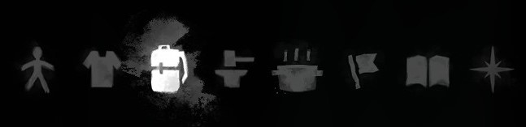

_For the HUD, see [Survival Overlay](./Survival%20Overlay.md)._

The **Survival Menu** is the primary menu within [_The Long Dark_](./The%20Long%20Dark.md) that is used to display your current condition, clothing, items, crafting, journal, and map. The menu is displayed across the entire screen, but the game does not pause while it is open.

With standard key bindings on PC, there are several ways to open the game menu. From the [Radial Menu](./Radial%20Menu.md), clicking the central icon will take you to the Status screen. Otherwise, the default key bindings to bring up these menus are:

- **F** will bring up the Status screen
- **C** will open [Clothing](./Clothing.md)
- **I** will open the [Backpack](./Backpack.md)
- **J** will open the [Journal](./Journal.md)
- **M** will open the [Map](./Map.md)
- **K** will open [Crafting](./Crafting.md)
- **G** will open [Cooking](./Cooking.md#Frontier_Comforts_Recipes)

<!-- #Status -->
​

<!-- #status -->
## Status

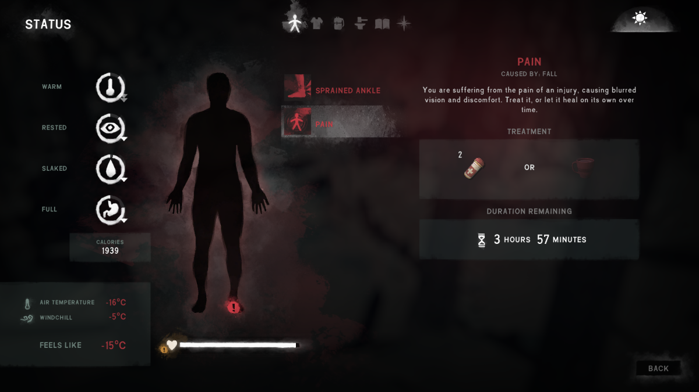 Shown as a stick figure of a human in the menu, the Status screen displays your current condition, any injuries or illnesses you have, and the time of day.

Along the left you can see your [Warmth](./Warmth.md), [Fatigue](./Fatigue.md), [Thirst](./Thirst.md), and [Hunger](./Hunger.md) meters, as well as your current stored calories. The Calorie Store number is how many calories the player currently possesses, and is directly linked to the Hunger bar. When the Hunger bar is 100% full, max stored calories will be 2500, with the opposite being 0 calories at 0% Hunger bar.

In the bottom left of the screen, the current air temperature and wind chill are displayed, as well as what temperature it feels like to you ([Feels Like](./Feels%20Like.md)). Feels Like is the exact effective temperature that determines the increase (or decrease) for the player's Warmth bar. When the Feels Like temperature is above 0°C (32°F), the player's Warmth will be heading in the positive direction. When it is below that temperature, the player will notice the opposite happening.

In the center of the screen you will see any [Afflictions](./Afflictions.md) you currently have, as well as your health [Condition](./Condition.md). The Time of Day graphic is displayed in the top right of the screen.

<!-- #Clothing -->
​

<!-- #clothing -->
## Clothing

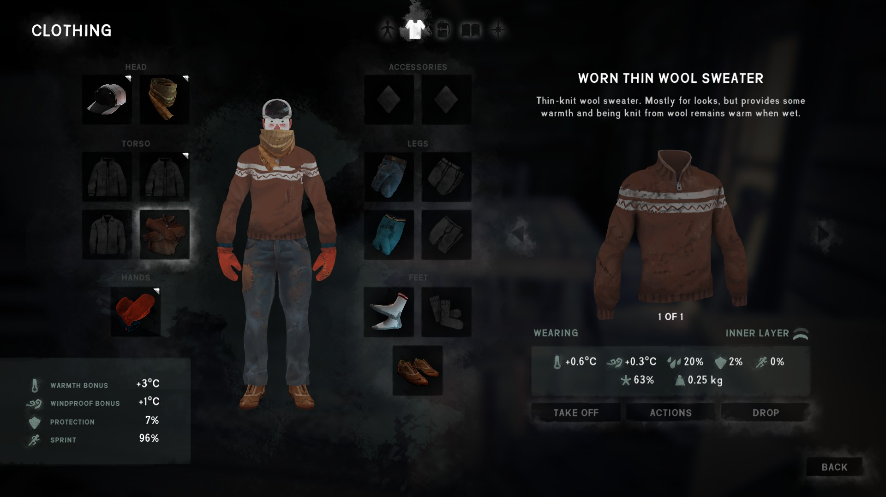 Shown as a T-shirt icon in the menu, the [Clothing](./Clothing.md) screen allows you to see what clothes you are currently wearing on each part of your body, as well as to compare and select other clothes items you are carrying. The bottom left of the screen shows you the bonuses from your current set of worn clothing, while the right of the screen shows you the statistics of the selected item. Clothing can be harvested or repaired from this menu or from the Backpack menu.

<!-- #Backpack -->
​

<!-- #backpack -->
## Backpack

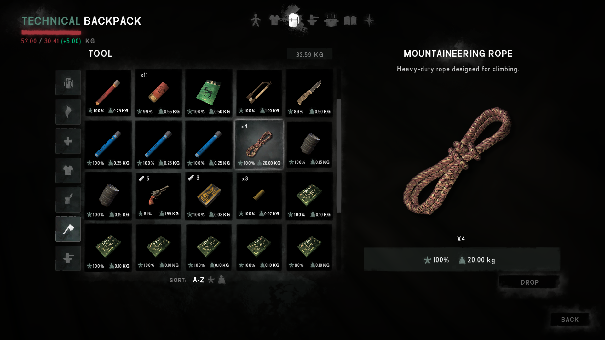 Shown as a backpack icon in the menu, the Backpack displays all the items you currently have. You can view **All** items at once, or you can view them by category:

- [Fire Starting](./Fire.md)
- [First Aid](./First%20Aid.md)
- [Clothing](./Clothing.md)
- [Food and Drink](./Food%20And%20Drink.md)
- Tools
- Materials
- [Decorations](./Decorations.md)

Some items will be displayed in more than one category. Items can be sorted alphabetically, by condition, or by weight by looking in the bottom middle of the screen. Carried items can be consumed, repaired, harvested, or dropped from this menu.

The total weight of your backpack and your [Encumbrance](./Encumbrance.md) is displayed in the top left of the screen. Green means you are un-encumbered, while red means you are over your carry weight. Increased or decreased Carry Weight is shown in parenthesis next to total Carry Weight. Finding the [Technical Backpack](./Technical%20Backpack.md) will rename this menu to Technical Backpack.

<!-- #Crafting -->
​

<!-- #crafting -->
## Crafting

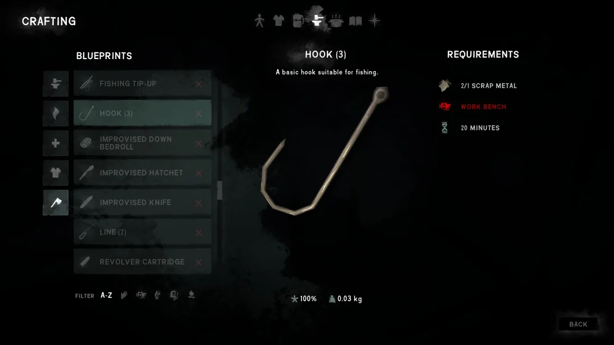 Shown as a hammer and anvil icon in the menu, the Crafting screen shows you the current blueprints you have for crafting items and allows you to craft items.

_For more detailed information, see [Crafting](./Crafting.md)_

On the left of the screen are tabs that allow you to view blueprints by category. By default it will show **All** blueprints, but they can be filtered to only show:

- [Fire Starting](./Fire.md)
- [First Aid](./First%20Aid.md)
- [Clothing](./Clothing.md)
- Tools

Below the blueprints are 6 submenus allowing you to filter for specific creation methods for items. By default it will show **All** blueprint creation methods but can be changed to only show items that can be crafted at:

- Anywhere (shows only items that can be crafted anywhere)
- [Work Bench](./Work%20Bench.md)
- [Forge](./Forge.md)
- [Ammunition Work Bench](./Ammunition%20Work%20Bench.md)
- [Active Fire](./Fire.md) ([Fire Hardened Arrow](./Fire%20Hardened%20Arrow.md))
- [Furniture Workbench](./Furniture%20Workbench.md)

Some items in Wintermute require finding their blueprints in order to craft, and are usually unlocked when progressing through the story and completing side missions. Other Blueprints are not available in Wintermute at all.

Survival Mode has all blueprints unlocked from the start except for the [Noisemaker](./Noisemaker.md) blueprint, which is unlocked when one is found in game.

The **K** key will access this menu.

<!-- #recipe_book -->
​

<!-- #Recipe_Book -->
​

<!-- #Recipe_book -->
​

<!-- #recipe-book -->
## Recipe Book

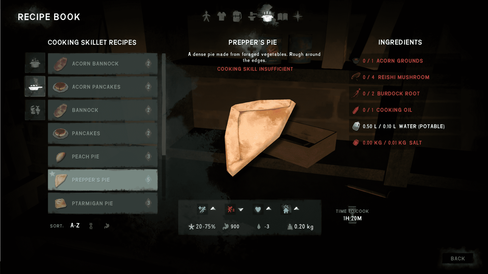 _This menu will not appear unless the [Tales from the Far Territory](./Tales%20from%20the%20Far%20Territory.md) addon is purchased._

Shown as a cooking pot icon in the menu, the Recipe Book menu is used show the various [Cooking](./Cooking.md) Recipes that the player can use as part of the Frontier Cooking update. Because Recipes require multiple ingredients and are not simply 1 item cooking items, this menu is used to track all ingredients used to make each Recipe. Some Recipes contain a white star next to them, and will be unlocked when the player finds their specific Recipe when searching the island. Recipes cannot be created by hand from this menu like Crafting, and instead require an active [Fire](./Fire.md) source.

_For more detailed information, see [Cooking](./Cooking.md#Frontier_Cooking_Recipes)_

There are currently 3 submenus to choose from on the left side of the screen:

- [Cooking Pot](./Cooking%20Pot.md) Recipes
- [Cooking Skillet](./Cooking%20Skillet.md) Recipes
- No Tool Recipes

Items can be sorted alphabetically, by preparation times, or by calorie amounts by looking in the bottom left of the screen. Ingredients needed to create recipes are shown on the right side. The overall condition, calories, hydration, and weight are shown in the bottom middle, as well as any [Afflictions](./Afflictions.md) that this Recipe will boost or remove. Some Recipes can add or remove positive Afflictions, while others can add or remove harmful ones.

**G** hotkey to access this menu.

<!-- #tales_objectives -->
​

<!-- #Tales_Objectives -->
​

<!-- #Tales_objectives -->
​

<!-- #tales-objectives -->
## Tales Objectives

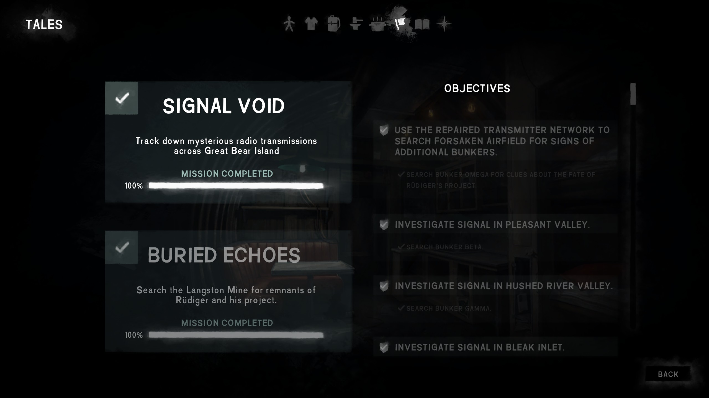 _This menu will not appear unless the [Tales from the Far Territory](./Tales%20from%20the%20Far%20Territory.md) addon is purchased and at least 1 Tale is activated_

Shown as a flag icon, this menu is used to track the objectives required to complete the 3 [Tales](./Tales.md). It functions similarly to the Missions menu in Wintermute, and can select each individual Tale once it is unlocked.

There J is the hotkey to access this menu.

<!-- #Journal -->
​

<!-- #journal -->
## Journal

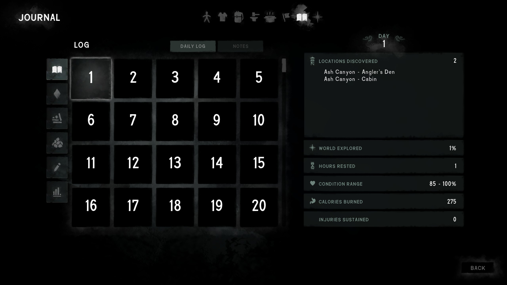 Shown as an open book icon in the menu, the Journal is different for Wintermute and Survival Mode, but contains mostly the same information.

<!-- #survival_mode -->
​

<!-- #Survival_Mode -->
​

<!-- #Survival_mode -->
​

<!-- #survival-mode -->
### Survival Mode

_For more detailed information, see [Journal](./Journal.md)_

In Survival Mode, the Journal is contains six submenus: Log, Skills, Collections, Rock Caches, General Notes, and Stats

- Log provides a day by day overview of each day played on the current sandbox.
- Skills provides details about current skill levels (primary skills only), perks of those levels, and progress to the next skill level within the current sandbox. Note that this menu scrolls down to reveal additional skills, depending on display settings.
- The Collections submenu keeps track of any [Notes](./Notes.md) that are found within the game.
- The Rock Cache submenu contains a list of all [Rock Caches](./Rock%20Cache.md), subdivided by [Region](./Region.md), that have been created in the current sandbox. Note that there is a limit of five (5) rock caches per region.
- The General Notes submenu contains a single "notepad" where players can jot down notes. While this is marginally useful to remember storage cache locations or directions, it is currently not possible to make more than one "thread" or organize notes in any way other than manual editing, thereby limiting it's utility compared to a simple (off-game) word processor.
- The [Almanac](./Almanac.md) menu is unique to the [Challenge](./Challenge.md) [Whiteout](./Whiteout.md), and is used to track when major blizzards appear on certain days.
- The Tales submenu is missing when a player begins a run of Survival Mode, but appears in the Journal Menu when a player triggers a corresponding Tale. This submenu simply takes you to the Tales menu, and is used to keep track of a list of completed/uncompleted objectives related to any Tale.
- The Stats submenu contains detailed stats about each playthrough, and compares those stats with the player's all-time high scores, subdivided by difficulty level.

<!-- #Wintermute -->
​

<!-- #wintermute -->
### Wintermute

In [Wintermute](./Wintermute.md), the Journal menu is divided into 3 submenus, which can be selected by clicking on the corresponding icon on the left of the screen.

**"[What I Know](./What%20I%20Know.md)"** contains 4 submenus related to all information gathered about the game world's settings, characters, and items, and is divided into:

- People
- Places
- Things
- Actions

**"Collections"** contains all [Collectibles](./Collectibles.md) found throughout your journey and these can be viewed and inspected at any time.

**"General Notes"** gives you a notepad to type any notes you want to make whilst playing.

<!-- #Map -->
​

<!-- #map -->
## Map

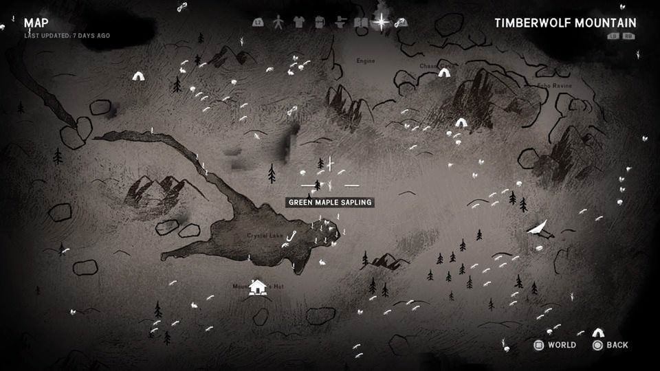 Shown as a shining star icon, the [Map](./Map.md) displays the current map you are on, as well as any other maps you have found or made. You can view any other maps you have by clicking the arrows under the region name in the top right corner. By default, opening the map will always show the map of the current [Region](./Region.md) they are in.

In Wintermute, all maps are fully revealed and will show the player's current position and facing position (represented by an arrow) and will show icons that represent any main or side mission objectives.

In Survival Mode, players must draw the map themselves using [Charcoal](./Charcoal.md). The player's position is never shown, and so they must pinpoint their current position via surveyed landmarks on the map related to their surroundings. Text in the top left corner of the screen tells you how long ago you last updated the currently selected region map (in in-game time). A 'World' button at the bottom right of the screen allows you to switch from the region map to a world map of eother Lower Great Bear or the Far Territory sections of [Great Bear Island](./Great%20Bear%20Island.md).

<!-- #Missions -->
​

<!-- #missions -->
## Missions

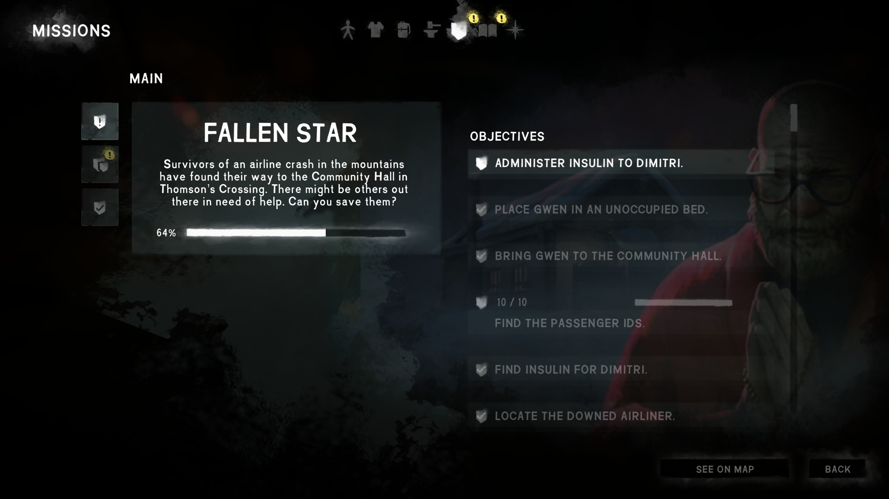 _This menu only appears in Wintermute_

Represented by a shield icon, the Missions menu records all information relevant to your objectives while in Wintermute. It functions similarly to the Tales menu, but with 3 submenus: Main for main missions, Side for side missions, and Completed for all completed missions.

<!-- #Trust -->
​

<!-- #trust -->
## Trust

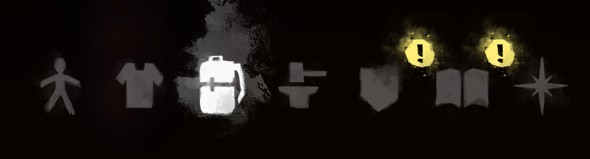_The Survival Menu icons for Wintermute._ 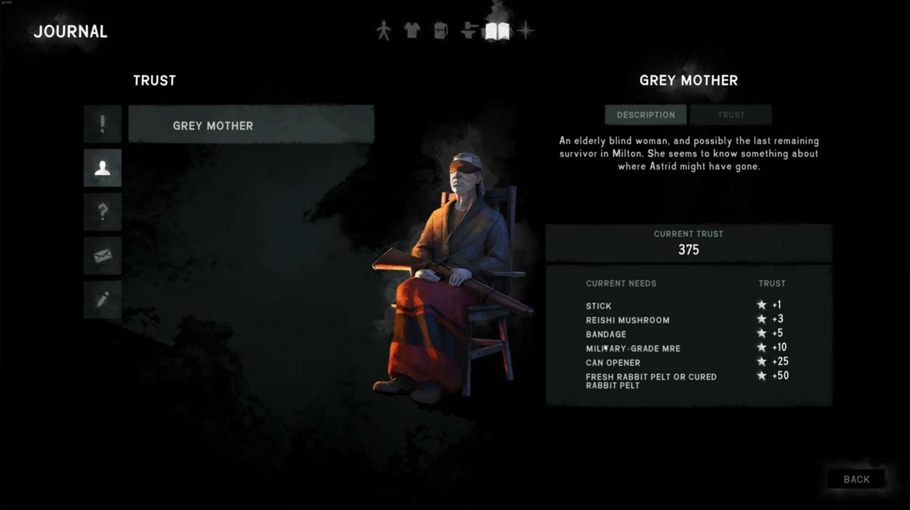 The original release of Wintermute's Episode 1 and 2 featured a menu for Trust in the Journal menu.

Trust would have shown you the character who you are currently attempting to gain the trust of ([Grey Mother](./Grey%20Mother.md) or [Jeremiah](./Jeremiah.md)), and had two separate sections 'Description' and 'Trust' which respectively displayed the current needs and Trust rewards of the character in question. Maxing out Trust with a character would lead to more world building information and possible side missions. To date, this is [Cut/Discontinued Content](./Cut%20%E2%80%94%20Discontinued%20Content.md).

<!-- #Gallery -->
​

<!-- #gallery -->
## Gallery

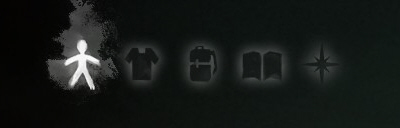

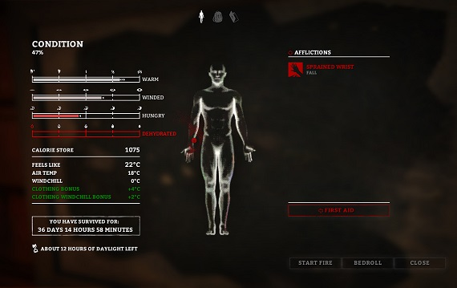

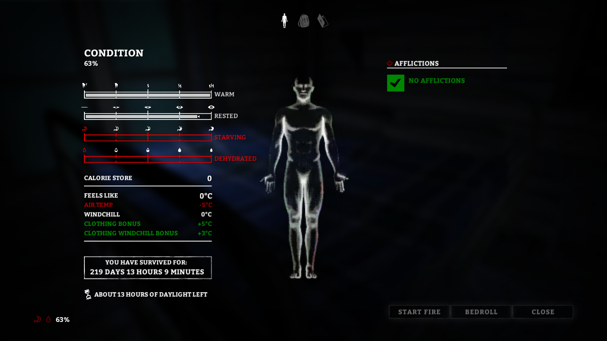
