# Survival Mode

**Contents**

- [Experience](#Experience)
- [Pilgrim](#Pilgrim)
- [Voyageur](#Voyageur)
- [Stalker](#Stalker)
- [Interloper](#Interloper)
- [Misery](#Misery)
- [Custom](#Custom)
- [Choose Region](#Choose_Region)
- [Character Sex](#Character_Sex)
- [Start](#Start)
- [Opening Quotes](#Opening_Quotes)
- [Differences from Wintermute](#Differences_from_Wintermute)
- [Achievements](#Achievements)
- [Trivia](#Trivia)
- [Gallery](#Gallery)

<table>
<colgroup>
<col style="width: 33%" />
<col style="width: 33%" />
<col style="width: 33%" />
</colgroup>
<tbody>
<tr>
<td style="vertical-align: top; font-size: 3em; color: #5d5980; padding-right: 10px">
“
</td>
<td>
A mysterious geomagnetic storm has brought your plane crashing down into the Northern Canadian wilderness. 
How long can you survive?

&#10;

Opening screen background

</td>
<td style="vertical-align: bottom; font-size: 3em; color: #5d5980; padding-left: 10px">
”
</td>
</tr>
</tbody>
</table>

**Survival Mode** is the sandbox survival portion of *<a href="./The%20Long%20Dark.md" class="wikilink" title="The Long Dark">The Long Dark</a>*.

During Survival Mode, the player may travel freely between all <a href="./Region.md" class="wikilink" title="Regions">Regions</a> of <a href="./Great%20Bear%20Island.md" class="wikilink" title="Great Bear Island">Great Bear Island</a>, with the narrative created by their own actions and ability to survive. Survival Mode is a semi-permadeath experience; once the player <a href="./Condition.md#Death" class="wikilink" title="dies">dies</a>, the player can <a href="./Cheat%20Death.md" class="wikilink" title="Cheat Death">Cheat Death</a> or choose to not continue (the later resulting in the save being wiped and it cannot be reloaded).

Players who purchase the <a href="./Tales%20from%20the%20Far%20Territory.md" class="wikilink" title="Tales from the Far Territory">Tales from the Far Territory</a> Expansion will have access to unique content in Survival Mode, such as more tools, more Wildlife, and new Regions.

## Experience

The choice of Experience dictates how harshly the world will treat the player throughout their journey in *The Long Dark*.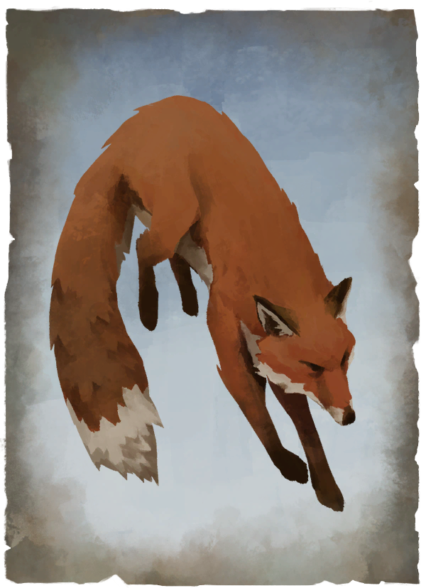

### Pilgrim

|  |  |  |
|----|----|----|
| “ | Wander the quiet apocalypse to chronicle the passing of an age. This is the poetry of survival. | ” |

<a href="./Pilgrim.md" class="wikilink" title="Pilgrim">Pilgrim</a> is the easiest experience available in survival. Ideal for exploration and learning about the Island and the game mechanics in a low-stress environment. This mode is the standard "easy" difficulty setting.

- For new or experienced players most interested in pensive Exploration.
- Most survival elements tuned to be very forgiving.
- Wildlife will not attack unless provoked.
- Allows for 5 active <a href="./Feats.md" class="wikilink" title="Feats">Feats</a>.

<figure class="thumb">

</figure>

### Voyageur

|  |  |  |
|----|----|----|
| “ | Equal parts hunter and hunted, your struggle to survive will eventually lead to mastering the elements. | ” |

An experience that balances exploration with a challenge, <a href="./Voyageur.md" class="wikilink" title="Voyageur">Voyageur</a> is the standard "normal" difficulty setting, and is the same difficulty as Wintermute Experiences.

- For new or experienced players looking for a balance between Exploration and Survival.
- Wildlife is sparse, but can seek you out.
- Survival elements are challenging but resources are plentiful.
- Allows for 4 active <a href="./Feats.md" class="wikilink" title="Feats">Feats</a>.

<figure class="thumb">
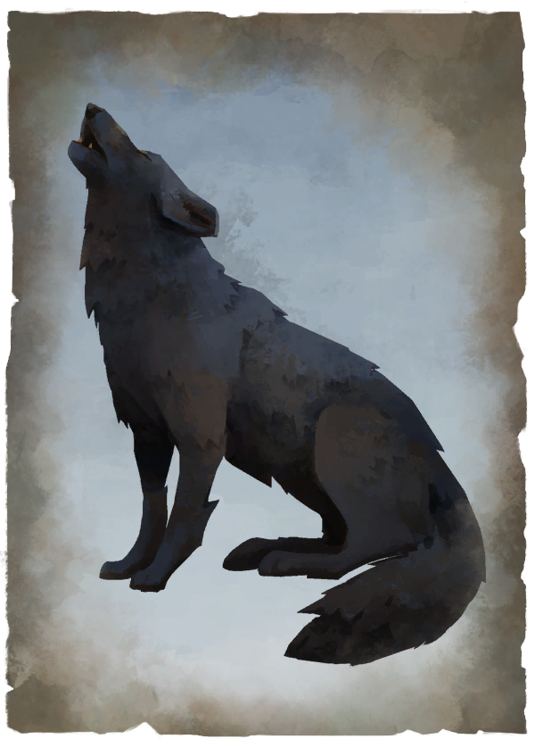
</figure>

### Stalker

|  |  |  |
|----|----|----|
| “ | Your demise awaits behind every hilltop, shelter, and tree. Only the strong survive. | ” |

A punishing survival challenge. <a href="./Stalker.md" class="wikilink" title="Stalker">Stalker</a> features numerous aggressive <a href="./Wolf.md" class="wikilink" title="Wolves">Wolves</a> and <a href="./Timberwolf.md" class="wikilink" title="Timberwolves">Timberwolves</a>. This is the standard "hard" difficulty setting.

- For veteran Players looking for a punishingly challenging Survival experience.
- Hostile wildlife is common, and will hunt you down.
- All survival elements are tuned to be particularly challenging.
- Allows for 3 active <a href="./Feats.md" class="wikilink" title="Feats">Feats</a>.

<figure class="thumb">
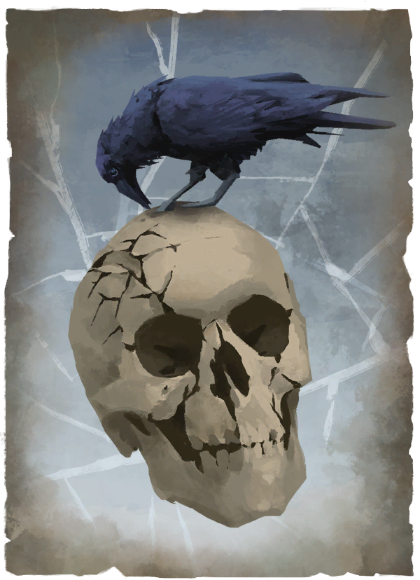
</figure>

### Interloper

|  |  |  |
|----|----|----|
| “ | You are not part of Mother Nature's plan, and you will bear the full force of her wrath. The true test of Human VS Nature. | ” |

A punishing survival experience. <a href="./Interloper.md" class="wikilink" title="Interloper">Interloper</a> lets you know that you are an unwelcome guest in this cold, hostile world. Best suited for expert players looking for the ultimate survival challenge. This is the standard "expert" difficulty setting, with multiple handicaps present to make the game even harder than normal.

- For expert players looking for the ultimate wilderness Survival challenge.
- You start with the most minimal resources, and have to craft everything you need to survive.
- The world becomes more hostile the longer you survive.
- Allows for 2 active <a href="./Feats.md" class="wikilink" title="Feats">Feats</a>.

<figure class="thumb">
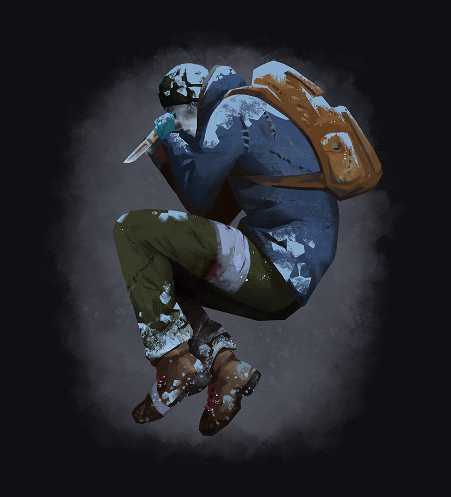
</figure>

### Misery

|     |                                                   |     |
|-----|---------------------------------------------------|-----|
| “   | Cited text | ”   |

<a href="./Misery.md" class="wikilink" title="Misery">Misery</a> takes Interloper and ratchets up the difficulty by adding six new Afflictions that are applied over time. Intended for Interloper players looking for a new level of challenge. You will not survive for very long. This is the standard "impossible" difficulty.

- For expert players looking for a unique and devastating Survival challenge beyond Interloper.
- You start with the most minimal resources in an already harsh and hostile world on the brink.
- At timed intervals, you gradually succumb to permanent, unavoidable Afflictions unique to Misery.
- No active <a href="./Feats.md" class="wikilink" title="Feats">Feats</a> allowed.

<figure class="thumb">
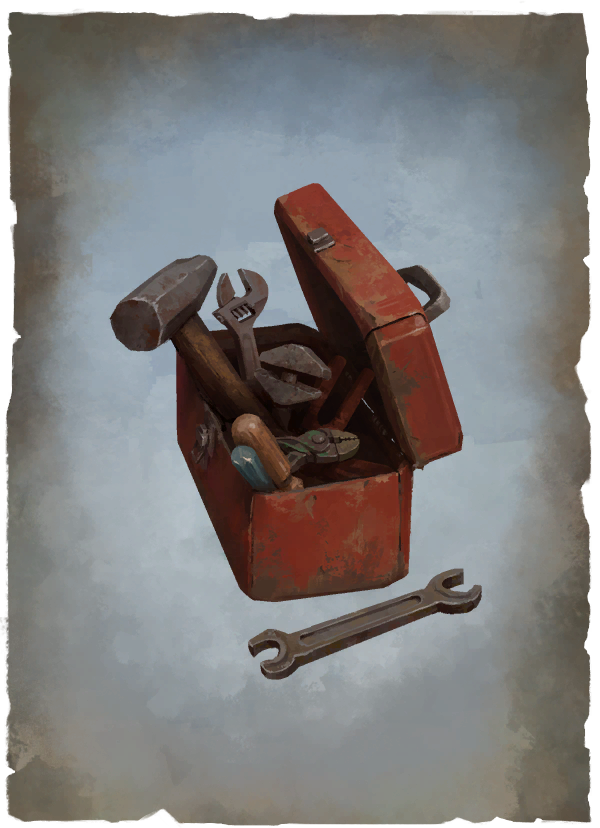
</figure>

### Custom

|  |  |  |
|----|----|----|
| “ | Use our custom toolbox to craft a unique experience between Survival and Exploration - an experience all your own. | ” |

For players lookingfor create their own Experience, separate from the standard Survival Mode difficulties, <a href="./Custom.md" class="wikilink" title="Custom">Custom</a> is the Experience for them. Players can create a custom Experience here, with over 50 different variables which can be adjusted to their liking.

- For players looking for a unique experience separate from standard Survival Mode.
- Adjust variables including Wildlife spawns, Resource availability, and Weather.
- Give your Custom Experience Mode settings to fellow survivors using a special shareable code.
- Allows up to 5 active <a href="./Feats.md" class="wikilink" title="Feats">Feats</a>.
- NOTE: No Feats progression will occur in Custom Experience Mode.

## Choose Region

**Template:main** The player may select any region they want as their starting point. The player also has the option to randomize their starting region. Each region is unique, has different advantages and drawbacks, and are all interconnected.

If the Interloper Experience is selected, then the starting region will be randomly chosen. On Interloper, you will not spawn in Mystery Lake or Coastal Highway, and the number of possible spawn locations is limited.

Note that some regions are locked and cannot be selected to start a game in when first playing *The Long Dark*. They will always unlock in the menu selection screen for a future playthrough when the player travels there in-game for the first time.

## Character Sex

May choose between a male or female survivor. The only differences are the character's voice, first person arms and hands, and the paper doll shown in the <a href="./Clothing.md" class="wikilink" title="Clothing">Clothing</a> screen. The survivors use the same first person model, paper doll in the clothing screen, and voice as <a href="./Astrid%20Greenwood.md" class="wikilink" title="Astrid Greenwood">Astrid Greenwood</a> and <a href="./Will%20Mackenzie.md" class="wikilink" title="Will Mackenzie">Will Mackenzie</a> from Wintermute, minus their wedding bands.

<table class="gallery">
<colgroup>
<col style="width: 50%" />
<col style="width: 50%" />
</colgroup>
<tbody>
<tr>
<td><figure>
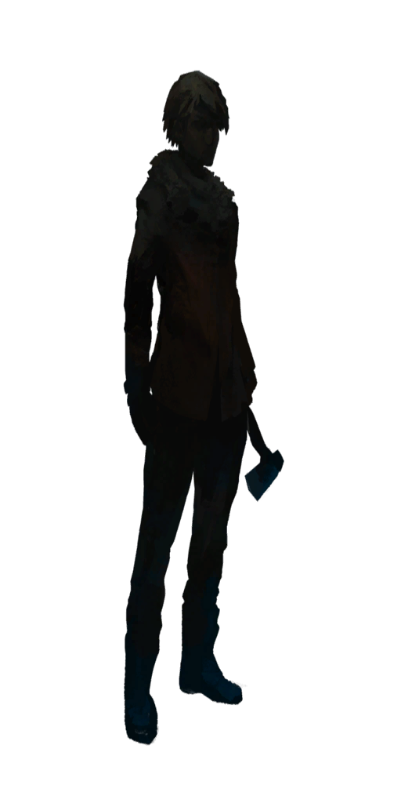
<figcaption>The female survivor silhouette</figcaption>
</figure></td>
<td><figure>
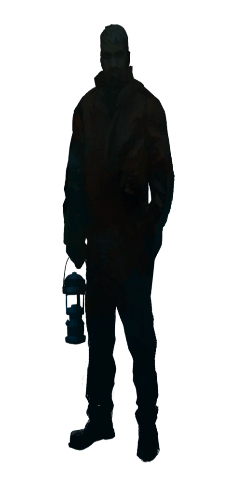
<figcaption>The male survivor silhouette</figcaption>
</figure></td>
</tr>
</tbody>
</table>

## Start

Every Survival Mode session begins with the same opening text: you are a survivor of a plane crash after a <a href="./First%20Flare.md" class="wikilink" title="mysterious geomagnetic storm">mysterious geomagnetic storm</a> has grounded your vessel. A randomly generated real world quote regarding survival will be displayed on the screen and then the player is able to start playing shortly after.

The survivor is alone, not dressed for the cold, and carries only a meager amount of supplies. The player must find food and shelter before nightfall, when the temperatures drop. The amount of supplies one starts with is dependent on the experience mode selected.

Depending on the sandbox difficulty, the players may either find themselves inside a house or outside in the cold. On harder difficulties, it may already be dusk or night time, and in some cases bad weather may move in quickly.

## Opening Quotes

Below is a list of survival quotes when first beginning Survival Mode.

- "Life is an error-making and an error-correcting process, and nature in marking man's papers will grade him for wisdom as measured both by survival and by the quality of life of those who survive." - Jones Salk
- "Extinction is the rule. Survival is the exception." - Carl Sagan
- "He is at home with his solitude as the note reverberating inside a bell." - Peter Heller, The Dog Stars
- "He knelt among the shadows and felt his isolation bitterly. They were savages it was true; but they were human." - William Golding, Lord of the Flies
- "It is hard to adapt to chaos, but it can be done. I am living proof of that: It can be done" - Kurt Vonnegut, Breakfast of Champions
- "No lists of things to be done. The day providential to itself. The hour. There is no later. This is later. All things of grace and beauty such that one holds them to one's heart have a common provenance in pain. Their birth in grief and ashes." - Cormac McCarthy, The Road
- "It is not the strongest of species that survives, nor the most intelligent that survives. It is the one that is the most adaptable to change." - Charles Darwin
- "No one can tell what goes on between the person you were and the person you become. No one can chart that blue and lonely section of hell. There are no maps of the change. You just come out the other side." - Stephen King, The Stand
- "Extraordinary people survive under the most terrible circumstances and they become more extraordinary because of it." - Robertson Davies
- "What am I living for and what am I dying for are the same question." - Margaret Atwood
- "Sometimes even to live is an act of courage." - Seneca
- "On a long enough time line, the survival rate for everyone drops to zero." - Chuck Palahniuk
- "You know, I once read an interesting book which said that, uh, most people lost in the wilds, they, they die of shame. Yeah, see, they die of shame. 'What did I do wrong? How could I have gotten myself into this?' And so they sit there and they... die. Because they didn't do the one thing that would save their lives. Thinking." - David Mamet, The Edge
- "The foraging for food and water, the struggle for life in a world without masters, housed in a body that man had made dependent on himself." - Richard Matheson, I Am Legend
- "I went to the woods because I wished to live deliberately, to front only the essential facts of life, and see if I could not learn what it had to teach, and not, when I came to die, discover that I had not lived. I did not wish to live what was not life, living is so dear; nor did I wish to practice resignation, unless it was quite necessary. I wanted to live deep and suck out all the marrow of life, to live so sturdily and Spartan-like as to put to rout all that was not life, to cut a broad swath and shave close, to drive life into a corner, and reduce it to its lowest terms." - Henry David Thoreau, Walden

## Differences from <a href="./Wintermute.md" class="wikilink" title="Wintermute">Wintermute</a>

Some items, locations, and even events found within the Wintermute Story mode are different within Survival Mode, suggesting an alternate timeline of events has unfolded. A list of notable changes include:

1.  Despite <a href="./A%20Note%20Left%20Behind.md" class="wikilink" title="notes">notes</a> being found throughout the world suggesting possible survivor activity, no human NPCs can be found. (not counting dead bodies that can be found or the <a href="./Mysterious%20Signal%20Fire.md" class="wikilink" title="signal fires">signal fires</a> in <a href="./Hushed%20River%20Valley.md" class="wikilink" title="Hushed River Valley">Hushed River Valley</a>).
2.  All areas of the game world can be freely explored with no restrictions.
3.  There is far less player dialogue. There are no scripted events.
4.  Certain tools, clothing, and story related quest items cannot be found within Survival Mode.
5.  It can be assumed that the player character you choose when starting Survival Mode is either <a href="./Astrid%20Greenwood.md" class="wikilink" title="Astrid">Astrid</a> or <a href="./Will%20Mackenzie.md" class="wikilink" title="Mackenzie">Mackenzie</a>, as they share the same voice and appearance as their story counterparts and their backstory involves having their plane crash land on <a href="./Great%20Bear%20Island.md" class="wikilink" title="Great Bear Island">Great Bear Island</a> after a <a href="./First%20Flare.md" class="wikilink" title="mysterious geomagnetic storm">mysterious geomagnetic storm</a>. Will's <a href="./Mackenzie%27s%20Crashed%20Plane.md" class="wikilink" title="crashed plane">crashed plane</a> can also be found not far from <a href="./Milton.md" class="wikilink" title="Milton">Milton</a>.
6.  <a href="./Grey%20Mother.md" class="wikilink" title="Grey Mother">Grey Mother</a> is missing and her <a href="./Milton%20House%20%28Grey%20Mother%27s%29.md" class="wikilink" title="home">home</a> has been ransacked, with her blanket and rocking chair still present but tipped over. She is presumed to have been burned alive in the <a href="./Old%20Schoolhouse.md" class="wikilink" title="school house">school house</a> along with the other inhabitants of <a href="./Milton.md" class="wikilink" title="Milton">Milton</a> after the <a href="./Convicts.md" class="wikilink" title="convict riot">convict riot</a> that resulted from the <a href="./Crashed%20Prison%20Transport%20Bus.md" class="wikilink" title="crashed prison bus">crashed prison bus</a>.
7.  <a href="./Paradise%20Meadows%20Farm.md" class="wikilink" title="Paradise Meadows Farm">Paradise Meadows Farm</a> often contains a <a href="./Martin%20Barker.md" class="wikilink" title="corpse">corpse</a> inside the toolshed. The inside of the farmhouse also contains evidence of a <a href="./Hobbs.md" class="wikilink" title="struggle">struggle</a>.
8.  <a href="./Methuselah.md" class="wikilink" title="Methuselah">Methuselah</a> cannot be found anywhere.
9.  The <a href="./Trapper%27s%20Homestead.md" class="wikilink" title="Trapper&#39;s Homestead">Trapper's Homestead</a> lies dormant, with <a href="./Jeremiah.md" class="wikilink" title="Jeremiah">Jeremiah</a> presumably being killed by the <a href="./Old%20Bear.md" class="wikilink" title="Old Bear">Old Bear</a> since no <a href="./Will%20Mackenzie.md" class="wikilink" title="help">help</a> arrived for him.
10. The <a href="./Forest%20Talkers.md" class="wikilink" title="Forest Talkers">Forest Talkers</a> and any trace of their activities are entirely absent from Survival Mode, including their <a href="./Forest%20Talker%20Supply%20Caches.md" class="wikilink" title="supply caches">supply caches</a>, though occasionally their backpacks can be found.
11. The <a href="./Pleasant%20Valley%20Farmstead.md" class="wikilink" title="Pleasant Valley Farmstead">Pleasant Valley Farmstead</a> is unoccupied, with neither <a href="./Molly.md" class="wikilink" title="Molly">Molly</a> nor her <a href="./Molly%27s%20Husband.md" class="wikilink" title="husband&#39;s">husband's</a> remains anywhere to be found. The nearby <a href="./Barn%20%28Molly%27s%29.md" class="wikilink" title="barn">barn</a> has a <a href="./Timberwolf.md" class="wikilink" title="Timberwolf">Timberwolf</a> sized hole in the doors, but no dead wolf.
12. The <a href="./Community%20Hall.md" class="wikilink" title="Community Hall">Community Hall</a> at <a href="./Thomson%27s%20Crossing.md" class="wikilink" title="Thomson&#39;s Crossing">Thomson's Crossing</a> is empty and <a href="./Father%20Thomas.md" class="wikilink" title="Father Thomas">Father Thomas</a> is missing. Subsequently, this resulted in the makeshift triage center never being made, as there is no lite bonfire in front of the hall to guide the plane <a href="./Crash%20Survivor.md" class="wikilink" title="Crash Survivors">Crash Survivors</a> to the town.
13. The <a href="./Blackrock%20Prison.md" class="wikilink" title="Blackrock Prison">Blackrock Prison</a> lies in ruins after a catastrophic explosion, with <a href="./Mathis.md" class="wikilink" title="all">all</a> <a href="./Heller.md" class="wikilink" title="known">known</a> <a href="./Vachon.md" class="wikilink" title="prisoners">prisoners</a> and <a href="./Franklin.md" class="wikilink" title="on-site workers">on-site workers</a> having presumably perished inside. <a href="./Jace.md" class="wikilink" title="Jace">Jace</a> is also missing.

## Achievements

- 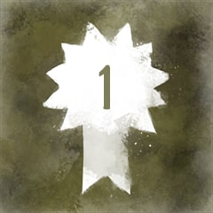 <a href="./The%20First%20of%20Many.md" class="wikilink" title="The First of Many">The First of Many</a>
- 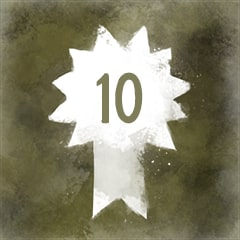 <a href="./You%20Made%20It!.md" class="wikilink" title="You Made It!">You Made It!</a>
-  <a href="./Ready%20for%20when%20the%20SHTF!.md" class="wikilink" title="Ready for when the SHTF!">Ready for when the SHTF!</a>
- 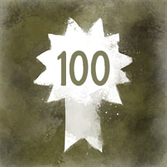 <a href="./Centurion.md" class="wikilink" title="Centurion">Centurion</a>
- 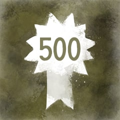 <a href="./The%20Will%20to%20Live.md" class="wikilink" title="The Will to Live">The Will to Live</a>
- 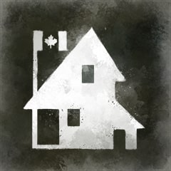 <a href="./Exploration%20Game.md" class="wikilink" title="Exploration Game">Exploration Game</a>
-  <a href="./Waste%20Not%2C%20Want%20Not.md" class="wikilink" title="Waste Not, Want Not">Waste Not, Want Not</a>
-  <a href="./Night%20Walker.md" class="wikilink" title="Night Walker">Night Walker</a>
- 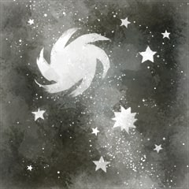 <a href="./Beneath%20a%20Starry%20Sky.md" class="wikilink" title="Beneath a Starry Sky">Beneath a Starry Sky</a>
- 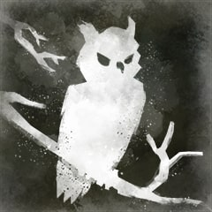 <a href="./Silent%20Hunter.md" class="wikilink" title="Silent Hunter">Silent Hunter</a>
-  <a href="./Pacifist.md" class="wikilink" title="Pacifist">Pacifist</a>
- 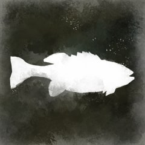 <a href="./It%20was%20THIS%20Big!.md" class="wikilink" title="It was THIS Big!">It was THIS Big!</a>
-  <a href="./Wrapped%20in%20Furs.md" class="wikilink" title="Wrapped in Furs">Wrapped in Furs</a>
-  <a href="./Living%20Off%20the%20Land.md" class="wikilink" title="Living Off the Land">Living Off the Land</a>
- 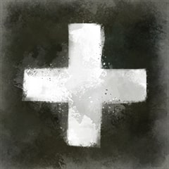 <a href="./Natural%20Healer.md" class="wikilink" title="Natural Healer">Natural Healer</a>
- 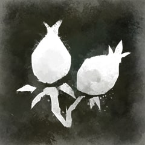 <a href="./Happy%20Harvester.md" class="wikilink" title="Happy Harvester">Happy Harvester</a>
- 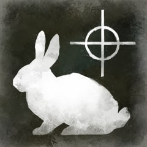 <a href="./Stone-Age%20Sniper.md" class="wikilink" title="Stone-Age Sniper">Stone-Age Sniper</a>
- 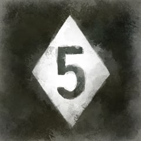 <a href="./Skilled%20Survivor.md" class="wikilink" title="Skilled Survivor">Skilled Survivor</a>
- 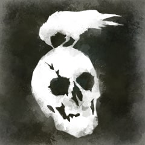 <a href="./Face%20the%20Impossible.md" class="wikilink" title="Face the Impossible">Face the Impossible</a>
-  <a href="./Don%27t%20Starve.md" class="wikilink" title="Don&#39;t Starve">Don't Starve</a>
- 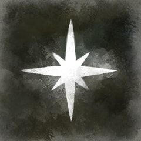 <a href="./Faithful%20Cartographer.md" class="wikilink" title="Faithful Cartographer">Faithful Cartographer</a>
- 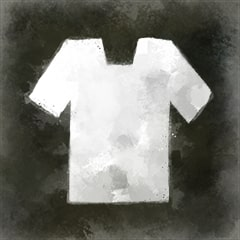 <a href="./Resolute%20Outfitter.md" class="wikilink" title="Resolute Outfitter">Resolute Outfitter</a>
- 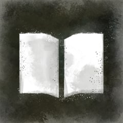 <a href="./Penitent%20Scholar.md" class="wikilink" title="Penitent Scholar">Penitent Scholar</a>
-  <a href="./Timberwolf%20Mountain%20%28Achievement%29.md" class="wikilink" title="Timberwolf Mountain (Achievement)">Timberwolf Mountain (Achievement)</a>
-  <a href="./Desolation%20Point%20%28Achievement%29.md" class="wikilink" title="Desolation Point (Achievement)">Desolation Point (Achievement)</a>
- 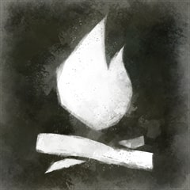 <a href="./Deep%20Forest.md" class="wikilink" title="Deep Forest">Deep Forest</a>
- 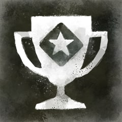 <a href="./Challenge%20Mastery.md" class="wikilink" title="Challenge Mastery">Challenge Mastery</a>
- 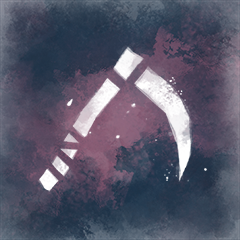 <a href="./Something%20Wicked.md" class="wikilink" title="Something Wicked">Something Wicked</a>
-  <a href="./Expert%20Angler.md" class="wikilink" title="Expert Angler">Expert Angler</a>
-  <a href="./Broken%20Body%20%28Achievement%29.md" class="wikilink" title="Broken Body (Achievement)">Broken Body (Achievement)</a>
- 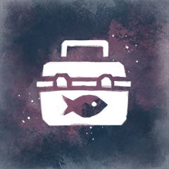 <a href="./Tackle%20Box.md" class="wikilink" title="Tackle Box">Tackle Box</a>
- 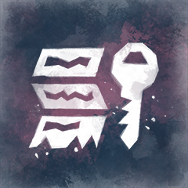 <a href="./Thanks%20for%20the%20Memories.md" class="wikilink" title="Thanks for the Memories">Thanks for the Memories</a>
-  <a href="./Hot%20Shot.md" class="wikilink" title="Hot Shot">Hot Shot</a>
- 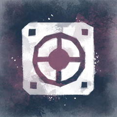 <a href="./Down%20Below.md" class="wikilink" title="Down Below">Down Below</a>

## Trivia

- Although Survival Mode is intended to be a permadeath experience, some players back up game saves periodically so that if they die, they can load the backed-up save and continue, even with Cheat Death enabled. This practice is called "save scumming."

## Gallery

<table class="gallery">
<colgroup>
<col style="width: 25%" />
<col style="width: 25%" />
<col style="width: 25%" />
<col style="width: 25%" />
</colgroup>
<tbody>
<tr>
<td><figure>
[Missing image: Custom_Toolbox_v162.jpg]
<figcaption>Mode preset</figcaption>
</figure></td>
<td><figure>
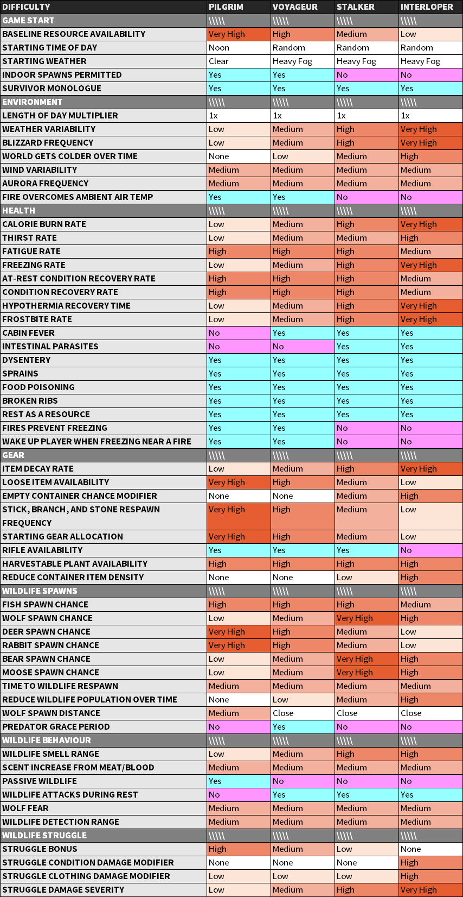
<figcaption>Custom Toolbox v.1.62</figcaption>
</figure></td>
<td><figure>
[Missing image: Pilgrim_icon_old.png]
<figcaption>Pilgrim Icon old</figcaption>
</figure></td>
<td><figure>
[Missing image: Pilgrim_title_card.png]
<figcaption>ditto</figcaption>
</figure></td>
</tr>
<tr>
<td><figure>
[Missing image: Voyageur_icon_old.png]
<figcaption>Voyageur icon old</figcaption>
</figure></td>
<td><figure>
[Missing image: Voyageur_title_card.png]
<figcaption>ditto</figcaption>
</figure></td>
<td><figure>
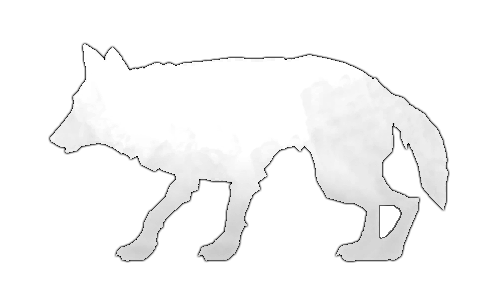
<figcaption>stalker icon old</figcaption>
</figure></td>
<td><figure>
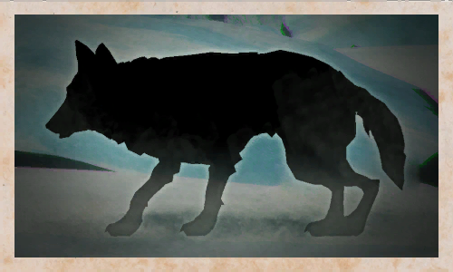
<figcaption>ditto</figcaption>
</figure></td>
</tr>
<tr>
<td><figure>

<figcaption>Interloper icon old</figcaption>
</figure></td>
<td><figure>
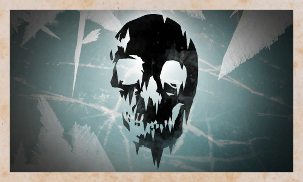
<figcaption>ditto</figcaption>
</figure></td>
<td></td>
<td></td>
</tr>
</tbody>
</table>

References

**Lua execution error in Module:Navbox function navbox** <a href="ru:%D0%A3%D1%80%D0%BE%D0%B2%D0%BD%D0%B8_%D1%81%D0%BB%D0%BE%D0%B6%D0%BD%D0%BE%D1%81%D1%82%D0%B8" class="wikilink" title="ru:Уровни сложности">ru:Уровни сложности</a> <a href="es:Modo_Supervivencia" class="wikilink" title="es:Modo Supervivencia">es:Modo Supervivencia</a> <a href="fr:Mode_Survie" class="wikilink" title="fr:Mode Survie">fr:Mode Survie</a>

