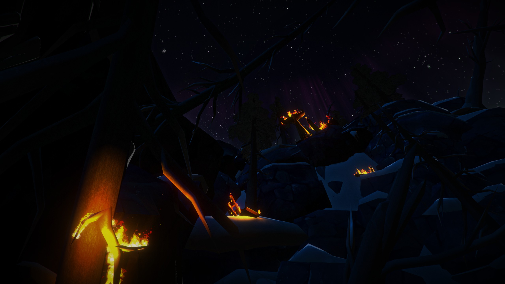

# Survival Of The Fittest/Transcript

**Contents**

- [Intro](#intro)
- [Day 1](#day-1)
- [Day 2](#day-2)
- [Day 3](#day-3)
- [Day 4](#day-4)
- [Day 5](#day-5)

**Survival Of The Fittest/Transcript**

| Property | Details |
| --- | --- |
|  |  / *Survival\_Of\_The\_Fittest.jpg* |
| Episode | [Episode 1](./Episode%201%20-%20Do%20Not%20Go%20Gentle.md)\|- |
| Previous | None |
| Current | Survival Of The Fittest/Transcript |
| Next | [Echoes Of Astrid/Transcript](./Echoes%20Of%20Astrid%20%E2%80%94%20Transcript.md) |
| Region | [Mountain Town](./Mountain%20Town.md) |
| Characters | [Will Mackenzie](./Will%20Mackenzie.md) / [Astrid Greenwood](./Astrid%20Greenwood.md) |

This is the transcript for Chapter 1 [Survival Of The Fittest](./Survival%20Of%20The%20Fittest.md) for Predux [Episode 1: Do Not Go Gentle](./Episode%201%20-%20Do%20Not%20Go%20Gentle.md).

## Intro

*The game begins with the sound of a man grunting in pain and gasping for air, and then the noise of a beating heart, and a person's vision slowly coming to as they blink back into consciousness. The ambient electrical wail of an [Aurora](./Aurora.md) plays overhead as the camera shifts to reveal trees, fire, smoke, and wreckage of a crashed plane as he closes his eyes.*

[Astrid Greenwood](./Astrid%20Greenwood.md): "Mackenzie! Mackenzie!"

*A steady heartbeat is heard*

Astrid Greenwood: "Don't let this new world break you."

HINTERLAND PRESENTS

*The survivor begins to get up after opening his eyes, before the man cries out:*

[Will Mackenzie](./Will%20Mackenzie.md): "...Astrid? Astrid!"

*The man gets up, and notices a piece of metal lodged in his left hand, hesitating before deciding to pull it out.*

The player must manually remove the shard at this point as part of a quick time event.

*The process is slow, and is not without consequence, as the man's cries of pain ring out during the pulling. After the [Scrap Metal Shard](./Scrap%20Metal%20Shard.md) is pulled out.*

THE LONG DARK

## Day 1

Mackenzie: "I need to find some shelter from this wind."

CHAPTER ONE

SURVIVAL OF THE FITTEST

*The player can take control of the man, as the names of the developers appear in the top left occasionally. The pilot moves slowly due to his [Plane Crash Injuries](./Plane%20Crash%20Injuries.md). Moving towards a cave, the man finds a [First Aid Kit](./First%20Aid%20Kit.md) and takes the contents out, prompting tutorial messages*

> “**Study Your Treatments and Learn to Triage  
 There are many ways to die in the wilderness. Medical treatments -- man-made or harvested from the natural world -- will save your life. Use the Status screen to check on your health. Apply a Treatment using the First Aid Radial menu. You can also use Treatments from your Pack menu.**”
>
> — What I Know description

> “**The Key to Survival  
 Preparation and self-control are vital to your survival. Check your Controls menu if you're unsure of how to do something. This could save your life.**”
>
> — What I Know description

*After he patches his hand with a [Bandage](./Bandage.md). The bandage can be seen on his hand for the rest of the mission if he hold something up (like matches). He moves to the cave and another tutorial message play during this time.*{| style="margin:auto" | style="vertical-align:top; font-size:3em; color:#5d5980; padding-right:10px" |“ | **Fire Provides Heat, Water, Food, Protection  
 Use the Campfire option in the Radial Menu. You'll need all the fixings: a Firestarter, Tinder, and Fuel. Accelerant speeds up the process. Fuel types impact burn time and heat production. An active fire, along with a Can or Pot, can be used to Cook or Boil Water, as well as keep you from freezing to death.**

What I Know description

| style="vertical-align:bottom; font-size:3em; color:#5d5980; padding-left:10px" |” |} *As the player wanders around looking for supplies to start the fire, the man looks around and take note of his surroundings*

Mackenzie: "Guess I'm stuck inside some kind of ravine."

*If the player walks into any of the burning fires*

Mackenzie: *Yells* "Climbing into the fire...not a good idea."

*Once the player starts a fire successfully*

Mackenzie: "That's all I have in me. Need to lay down before I fall down."

*The man passes out for the night*

## Day 2

The man wakes up the next morning. *The various fires from the night before have all but died down, with only vapors of smoke rising from the wreckage.*

Mackenzie: "So thirsty. Gotta be a way to melt some snow."

*Another tutorial message appears*{| style="margin:auto" | style="vertical-align:top; font-size:3em; color:#5d5980; padding-right:10px" |“ | **Status is Your Early Warning System  
 When you bring up the Quick Stats or the Radial Menu, you'll get a preview of your Current Condition, as well as information about how Cold, Tired, Hungary, and Thirsty you are. Any time one of these status indicators is empty and red, this means you're losing Condition. Lose all your Condition, and you'll die.**

What I Know description

| style="vertical-align:bottom; font-size:3em; color:#5d5980; padding-left:10px" |” |} *As the player leaves the cave*

Mackenzie: "I might be stuck here awhile. Better see what I can use."

*As the player approaches some green [Crates](./Crate.md) and a [Metal Container](./Metal%20Container.md)*

Mackenzie: "Looks like debris from the crash site above."

*The player can break these tools down for supplies, and returns to the cave to start melting snow into water, then drinks the water and eats some food to keep his strength up.*

Mackenzie: "Shit...that cut smarts. Better make sure it doesn't get infected."

*An [Infection Risk](./Infection%20Risk.md) appears, and the man uses [Antiseptic](./Antiseptic.md) on his bandaged hand*

Mackenzie: "I don't feel so good. I need to rest up."

*The man sleeps for the day*

## Day 3

*When the pilot next wakes up the following day, a massive blizzard is developing outside*

Mackenzie: "The weather's turning bad. I'm going to need a good long fire to keep from freezing to death."

*As the man exits the cave, more Crates have fallen from above, some containing many Books. As the man gathers firewood*

Mackenzie: "It's getting colder. If I don't have enough firewood to last the night...I might not make it."

*The man breaks down branches, finds sticks, and finds enough firewood to keep a fire going for 9 hours*

Mackenzie: "Fire looks good. Now to warm up before I freeze to death..."

*The pilot warms himself up fully by the fire*

Mackenzie: "That should last me through the night. So...tired..."

## Day 4

*As the man wakes up from the night, about 1 hour of fuel remains in the fire*

Mackenzie: "Thought that storm would never end. I need to find some food."

*Another tutorial message appears on the screen*

> “**Your Ears Are Your Best Survival Tool  
 Pay attention to your surroundings and you might glean information that's important for your survival. For example, a murder of Crows circling up ahead might suggest an animal carcass -- or even a human corpse -- might be nearby!**”
>
> — What I Know description

*As the pilot leaves the cave, he notices a large tree that has fallen since he crashed*

Mackenzie: "That was a hell of a storm last night. Blew that tree clean over."

*As he carefully climbs up the tree, Crows circle over the remains of a Deer Carcass, his [Parka](./Mackenzie%27s%20Parka.md) and a backpack next to a Hardcase. As the man approaches the Hardcase*

Mackenzie: "Astrid's pack."

*The man then picks up the Hardcase, eyeing the lock before taking it.*

Mackenzie: "Hmm...locked."

*He puts it away, and a flashback cutscene plays.*

*A hangar is shown during a light snowstorm, the same man from the crash is playing Solitaire in his boredom until a phone rings*

Mackenzie: "Jackrabbit Remote Transport. Mackenzie Speaking."

The man hears a voice on the other side and reacts to it

Mackenzie: "Woah woah...slow down, Maureen. What are you talking about?"

*The office door slowly opens.*

Mackenzie: "It's ok, Maureen. I've got it from here."

*Mackenzie hangs the phone up and a woman slowly walks in.*

Mackenzie: "Uhh..."

[Astrid](./Astrid%20Greenwood.md): "Hello Will."

Mackenzie: "Wha...What are you doing here?"

Astrid: "Been awhile, I know."

Mackenzie: "Yeah...years. I haven't heard from you...since..."

Astrid: "I know. I know. And I wouldn't be here if it weren't important."

*The woman places a Hardcase on the office table.*

Mackenzie: "Well...what brings you...I mean...Are you sick?"

Astrid: "No, not me. But I need to get to someone who is."

*Will scratches the back of his head.*

Mackenzie: "Right. So you're still a doctor."

Astrid: "Yes. I'm still a doctor."

Mackenzie: "I thought that after...Why are you here?"

Astrid: "I need your help. There's an isolated community in the Norther part of Great Bear. Someone there is very sick and..."

Mackenzie: "Great Bear? There's nothing there anymore. Not since..."

Astrid: "I know...but, I have to get there."

Mackenzie: "Still trying to save the world, huh?"

Astrid: "Somebody has to."

Mackenzie: "What's that supposed to mean?"

Astrid: "Mackenzie. Will. I didn't come here to fight about the past. I need a pilot to take me somewhere remote. Someone who won't ask too many questions. Someone I can trust."

Mackenzie: "Wait...questions? Astrid. Are you in trouble?"

Astrid: "Are you going to help me or not?"

*Mackenzie eyes the Hardcase*

Mackenzie: "What's in the case?"

Astrid: "See there's that thing about no questions, remember."

Mackenzie: "What's in the case, Astrid?"

Astrid: "No. Questions."

Mackenzie: "Look. The weather out there is bad. BAD. And it's getting worse. You walk in here after...years. I could have been dead. You could have been. Then you show up, and you want me to risk my life flying you into the middle of the great northern nowhere, to deliver you and some mystery case to some remote wilderness outpost. All because you walked in here and asked me to?"

Astrid: "Yes."

Mackenzie: "Astrid. You can't bring him back."

Astrid: "This isn't about that."

Mackenzie: "I know how hard it's been..."

Astrid: "No, you don't know Mackenzie. You don't know, anything."

Mackenzie: "You don't think I feel it too?"

Astrid: "Are you gonna take me or not? The longer I wait the worse it'll get."

*Mackenzie silently stares down Astrid.*

Astrid: "Dammit, I don't have time for this..."

*Astrid takes the Hardcase off the table, turns her back on Mackenzie, and begins to walk out.*

Mackenzie: "Wait...the worse what will get? Why do I have a feeling you're not talking about the weather?"

Astrid: "Because I'm not."

*Mackenzie shakes his head in disappointment.*

Mackenzie: "Throw your bags in the plane. I'll get started on pre-flight. Better buckle up tight because it's going to be a rough ride..."

*The cutscene ends with an outside shot of the Jackrabbit Hangar, before fading to black and then fading back to the present in the ravine.*

Mackenzie: "Whatever's in this case, Astrid was willing to die for it. I hope she hasn't already died for it."

*The man turns to pick up his Parka out of the snow, and a tutorial message appears*{| style="margin:auto" | style="vertical-align:top; font-size:3em; color:#5d5980; padding-right:10px" |“ | **Clothing Is Armour Against Cold  
 Out in the wilderness, clothing is like armour against the elements. Wear layers to stay warm. An remember, wind is your enemy! Clothing offers different protection from cold and windchill. Your clothes can get wet from blowing snow or if you fall into water, which makes them ineffective and increases your risk of hypothermia or even frostbite. Keep your clothes as dry as you can! finally, clothing can protect you from physical injuries as from falling or tangling with wildlife. Balance all these factors against the weight and mobility cost of your combined clothing.**

What I Know description

| style="vertical-align:bottom; font-size:3em; color:#5d5980; padding-left:10px" |” |} *The man notices a [Rock Climb](./Rock%20Climb.md)*

Mackenzie: "I could probably climb that."

*He tries to climb up it, but loses his grip and falls, getting a [Sprained Ankle](./Sprained%20Ankle.md) for his efforts.* *Another tutorial message appears*{| style="margin:auto" | style="vertical-align:top; font-size:3em; color:#5d5980; padding-right:10px" |“ | **Mother Nature's Painkiller  
 Sometimes Mother Nature is your pharmacist. Craft Rose-hips into a preparation that can be boiled in water to produce a tea with pain-relieving properties. Keep your eyes open for other natural remedies.**

What I Know description

| style="vertical-align:bottom; font-size:3em; color:#5d5980; padding-left:10px" |” |} *Mackenzie finds several Rose Hip Bushes and picks the buds. The man then finally approaches the Deer Carcass and begins to cut it up for all of its meat.*

Mackenzie: "This carcass could save my life. This doesn't look too good, but what choice do I have?"

*Then a tutorial message appears when finished*

> “**Everything You Eat, Can Kill You  
 When starving, you may feel desperate enough to take your chances, but in general eating raw meat is a bad idea. Cook it to avoid getting Food Poisoning, or Parasites. Cooked meat also lasts longer, and attracts fewer predators.**”
>
> — What I Know description

*Slowly limping his way back over the fallen tree to the still active cave, he prepares some [Rose Hip Tea](./Rose%20Hip%20Tea.md), cooks the Venison, and eats it all.*

Mackenzie: "May as well rest up. No telling what tomorrow will bring."

## Day 5

Mackenzie: "I feel stronger today. I think I can climb out of here now."

*Note, subtitles say "*I think I can make that climb now."

*A tutorial message appears*{| style="margin:auto" | style="vertical-align:top; font-size:3em; color:#5d5980; padding-right:10px" |“ | **What You Know Can Save You  
 As you learn things about the world -- either through your own actions, or through interacting with people -- you unlock Knowledge about People, Places, Things, and Actions. Deeper Knowledge can be revealed when you gain the Trust of other survivors you meet. This Knowledge is tracked in your Journal, for future reference.**

What I Know description

| style="vertical-align:bottom; font-size:3em; color:#5d5980; padding-left:10px" |” |} *The man, now healed of his Plane Crash Injuries, makes his way up the fallen tree and to the Rock Climb*

Mackenzie: "Only one way to go - - up."

*He climbs up and continues to climb more Rock Climbs*

Mackenzie: "I think I'm gonna make it."

*He spots one final Rock Climb*

Mackenzie: "Getting near the top!"

*After the final climb:*

Mackenzie: "Finally...made it."

*Mackenzie walks around a bend and comes across his crashed plane*

Mackenzie: "I sure hope Astrid's not in there."

*A flashback cutscene plays, showing what happened after the pilot and his passenger took off from the Hangar*

*The floatplane engine whirs as it flies over a forest high above [Great Bear Island](./Great%20Bear%20Island.md). The camera switches to Mackenzie operating the controls with him and Astrid both wearing communication headsets.*

Astrid (COM): "I see you're still wearing it."

Mackenzie (COM): "Hmm? Wearing what?"

Astrid (COM): "Your ring. Our ring."

Mackenzie (COM): "Oh...yeah. I mean...I just forgot to take it off."

Astrid (COM): "I wear mine too."

Mackenzie (COM): "Why?"

Astrid (COM): "Memories, I guess."

Mackenzie (COM): "I thought you wanted to forget."

Astrid (COM): "Not all of it."

Mackenzie (COM): "Look...I should have looked for you."

Astrid (COM): "It's ok. I've kept busy. I've moved on."

Mackenzie (COM): "You sure? Because this all seems pretty familiar. You still working with that researcher? Dr...what's his name."

Astrid (COM): "No...I'm, not working at the Centre anymore."

Mackenzie (COM): "Well, then where?"

Astrid (COM): "I'm working on my own. Freelance, you could say."

Mackenzie (COM): "Freelance doctor? That sounds...legit."

Astrid (COM): "I don't question your life choices, Mackenzie. Plenty of things you could be doing besides hanging out in your dad's old plane...and drinking in the daytime..."

Mackenzie (COM): "Hey...we had a lot of good times in this plane. And it's under control."

*Astrid puts her hands up.*

Astrid (COM): "I know. OK. I know. I'm not here to fight. Really."

Mackenzie (COM): "Hmph."

*A short silence fills the air before Mackenzie breaks it.*

Mackenzie (COM): "I think about him all the time, you know."

Astrid (COM): "I know you do."

Mackenzie (COM): "What I did. The choice I made. I did it for us you know."

Astrid (COM): "You don't have to...let's not..."

*A green light slowly fills up the edges of the cockpit, unnoticed by Mackenzie.*

Mackenzie (COM): "No, it's important that you hear this. There's things I need to say..."

*Astrid notices the green light in the distance and tries to interrupt Mackenzie.*

Astrid (COM): "Mackenzie. Not now. There's..."

Mackenzie (COM): "Just let me tell you..."

*The green light becomes almost blinding at this point.*

Astrid (COM): "Will! Shut up for a second. Something's wrong!'

*A green light washes over the valley below and finally the plane. Sparks fly from the aircraft as the outside and inside lights go out. The headsets that the duo are using stop functioning and the plane engine begins to stall.*

Mackenzie: "That's not good."

Astrid: "What's going on?"

*Mackenzie points to the altitude indicator gauge as sparks fly from the flight instruments.*

Mackenzie: "Power's gone. Whole electrical system looks fried."

Astrid: "Shit. What's happening?"

*Mackenzie starts pulling back on the flight stick to stabilize the rapidly dropping plane.*

Mackenzie: "No power means we're going down. Hold tight."

*Various quick shots of the plane falling out of the sky show.*

Astrid: "Will?"

*Astrid and Mackenzie hold hands as the plane continues to fall. The final shot of the cutscene shows the floatplane barely scrapping the canopy of several trees of the forest below them before the scene fades to black.*

The story continues in [Echoes Of Astrid/Transcript](./Echoes%20Of%20Astrid%20%E2%80%94%20Transcript.md).**Lua execution error in Module:Navbox function navbox**
