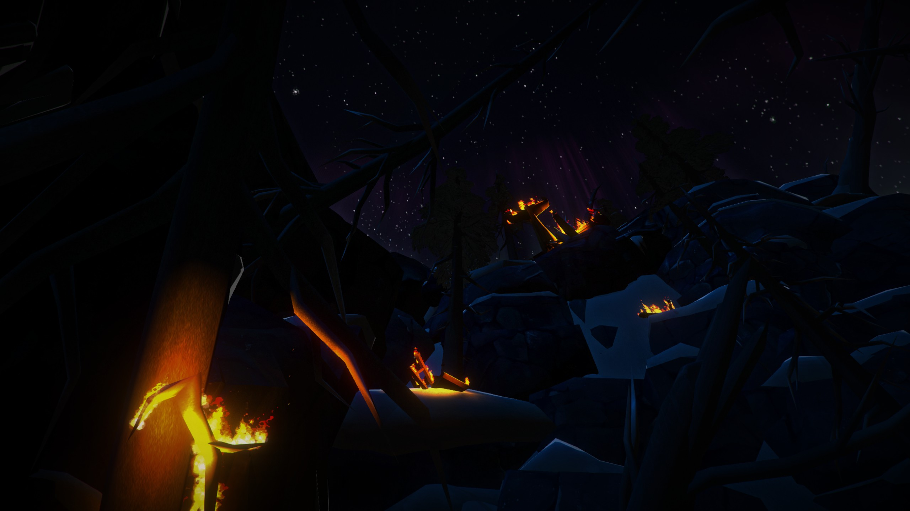

# Survival Of The Fittest

**Categories:** Episode 1, Pages with update history · **Source:** [Fandom](https://thelongdark.fandom.com/wiki/Survival_Of_The_Fittest)

**Contents**

- [Objectives](#objectives)
- [Day 1](#day-1)
- [Day 2](#day-2)
- [Day 3](#day-3)
- [Day 4](#day-4)
- [Day 5](#day-5)
- [Overview](#overview)
- [Day 1](#day-1-1)
- [Day 2](#day-2-1)
- [Day 3](#day-3-1)
- [Day 4](#day-4-1)
- [Day 5](#day-5-1)
- [Transcript](#transcript)
- [Differences from Redux Episode 1](#differences-from-redux-episode-1)
- [Plot Points and Gameplay Changes](#plot-points-and-gameplay-changes)
- [Game History](#game-history)

**Survival Of The Fittest**

_Survival\_Of\_The\_Fittest.jpg_

**Episode:** [Episode 1](./Episode%201%20-%20Do%20Not%20Go%20Gentle.md)

**Previous:** None

**Current:** Survival Of The Fittest

**Next:** [Echoes Of Astrid](./Echoes%20Of%20Astrid.md)

**Region:** [Mountain Town](./Mountain%20Town.md)

**Characters:** [Will Mackenzie](./Will%20Mackenzie.md) / [Astrid Greenwood](./Astrid%20Greenwood.md)

**Template:spoiler**{| style="margin:auto" | style="vertical-align:top; font-size:3em; color:#5d5980; padding-right:10px" |“ | **You've crashed in the Northern wilderness and are badly injured. Survive long enough for your hand to heal, so you can climb out.**

In-game description

| style="vertical-align:bottom; font-size:3em; color:#5d5980; padding-left:10px" |” |}**Survival Of The Fittest** was the first mission of the Predux [Episode 1: Do Not Go Gentle](./Episode%201%20-%20Do%20Not%20Go%20Gentle.md) of the [Wintermute](./Wintermute.md) story. It has since been replaced after the V1.47 Wintermute Redux version of the game, but is still playable to those that download versions V1.15, V1.30, or V1.37 of Steam version of _[The Long Dark](./The%20Long%20Dark.md)_ by using the [Time Capsule](./Time%20Capsule.md).

This episode has since been replaced by [Memories](./Memories.md).

## Objectives

### Day 1

- If you remain exposed you'll die. Find a cave to shelter from the elements.
- Start a fire so you don't freeze to death.
- You have a bleeding wound. Find or make a bandage and use it to stop the blood loss.

### Day 2

- Produce some water and drink it to stay hydrated.
- Find and eat some food to keep your strength.
- Treat the Risk of Infection before it develops into something more serious.

### Day 3

- Build a fire in the cave that will last the night (9 HRS).
- Get your body temperature up. Warm yourself by the fire for awhile.

### Day 4

- See if you're strong enough to climb out of the ravine.
- Explore the ravine.
- You need food to survive. Scavenge what you can and eat until you're full.

### Day 5

- Your hand feels stronger now. It's time to climb out of the ravine.

## Overview

This mission serves as a tutorial for the player, so do not worry too much about losing [Condition](./Condition.md), dying, or looting, as the real survival experience will begin in the next mission once you leave the ravine. This mission is heavily scripted, so just follow the mission objectives. Many items change in the ravine from day to day, so gather as much firewood as you can for day 3 until then.

### Day 1

The game will begin with the player character waking up from a plane crash with an [Aurora](./Aurora.md) in the sky. The burning wreckage of a crashed plane and the [Scrap Metal Shard](./Scrap%20Metal%20Shard.md) inside the player character's hand making it immediately obvious that they were in a crash.

YOU MUST MANUALLY MOVE THE CAMERA OVER THE SHARD IN YOUR HAND AND REMOVE IT TO CONTINUE.

Walk to the nearby cave and open the [First Aid Kit](./First%20Aid%20Kit.md) near the entrance to grab a [Bandage](./Bandage.md), then patch your hand up. You will need to start a fire, so gather some [Newsprint](./Newsprint.md) or use the [Scrap Metal Shard](./Scrap%20Metal%20Shard.md) to break down some [Cardboard Boxes](./Cardboard%20Box.md), grab some sticks, and then go into the cave. Start a [Campfire](./Campfire.md) and then the player will pass out.

### Day 2

The Maceknzie will awake and complain of being thirsty and hungry. Walk back to the base of the mountain side and loot the nearby [Plastic Container](./Plastic%20Container.md)/[Metal Container](./Metal%20Container.md) for an [Military-Grade MRE](./Military-Grade%20MRE.md) and [Antiseptic](./Antiseptic.md). Eat the MRE and then gather as much firewood as you can. Start a fire in the cave and then boil and drink some water. An [Infection Risk](./Infection%20Risk.md) will appear as a result of your cut hand so use the Antiseptic to treat it. Then the player character will fall asleep.

### Day 3

Start by gathering all the firewood you can, as you will need a fire that lasts you for 9 hours. If you gathered and saved firewood from the previous days, this will help immensely. Many [Sticks](./Stick.md) and [Cedar Firewood](./Cedar%20Firewood.md) will be on the ground so gather them and any other firewood you can. Only start a fire after breaking down several branches and [Crates](./Crate.md) (some crates hide items, such as 4 [Books](./Book.md) or [Water Purification Tablets](./Water%20Purification%20Tablets.md)), as time wasted after the fire has started will cause you to have to break down more items for fuel. After the fire is going, pass time warming up by boiling water. Then the player character will fall asleep.

### Day 4

Make your way over the new tree bridge and take [Astrid's Hardcase](./Astrid%27s%20Hardcase.md) (where a cutscene will player revealing the player character's name is [Will Mackenzie](./Will%20Mackenzie.md)). Grab [Mackenzie's Parka](./Mackenzie%27s%20Parka.md) (called Will's Park) and then harvest the [Deer Carcass](./Deer%20Carcass.md). Attempt to (unsuccessfully) climb the [Rock Climb](./Rock%20Climb.md) and then return to the cave with your newly acquired [Sprained Ankle](./Sprained%20Ankle.md). Make a fire, cook at least 2 [Venison (Raw)](./Venison%20%28Raw%29.md), and eat the 2 [Venison (Cooked)](./Venison%20%28Cooked%29.md). Then Mackenzie will automatically sleep.

### Day 5

Mackenzie will finally recover from his Plane Crash Injuries and can climb out of the ravine. The mission will end when you reach the crashed plane above, with a cutscene explaining how his plane crashed.

## Transcript

[Survival Of The Fittest/Transcript](./Survival%20Of%20The%20Fittest%20%E2%80%94%20Transcript.md)

## Differences from Redux Episode 1

Several plot points and locations have been replaced/altered since the Redux re-release of Episode 1:

### Plot Points and Gameplay Changes

- The intro cutscene to each Episode does not play when starting Episode 1.
- A voice calls out to Mackenzie when first waking up ("Mackenzie, don't let this new world break you"). This voice is not present in the Redux.
- The mission [Memories](./Memories.md) does not play since it did not exist in Predux, so the story continues in the ravine.
- The player must manually remove the [Scrap Metal Shard](./Scrap%20Metal%20Shard.md) from Mackenzie's hand by hovering over it. In Redux, this is automatically done.
- The credits of the developers will flash on screen in the upper left corner, and continues even into Day 2 if the player completes objectives fast enough.
- The player is stranded in the ravine below [Mackenzie's Crashed Plane](./Mackenzie%27s%20Crashed%20Plane.md) for 5 days, serving as a tutorial for the player. On Day 4, a blizzard knocks down a tree, but they are not allowed to leave until they finish healing from Plane Crash Injuries on Day 5. The mission [Memories](./Memories.md) serves as the tutorial for the player in the Redux, and drastically shortens the days spent in the ravine to just 2 (the tree falls on Day 2 letting you leave).
  - A unique [Affliction](./Afflictions.md), [Plane Crash Injuries](./Plane%20Crash%20Injuries.md), prevents the player from leaving the ravine or from sprinting until Day 5.
  - After completing the day's objectives and resting, the current day flashes on screen.
  - The [Rose Hip](./Rose%20Hip.md) bushes in the ravine cannot be harvested (resulting in the message "You don't need these yet) until Day 4.
  - The player is required to climb out of the ravine on Day 4, but is not strong enough yet. A unique [Rock Climb](./Rock%20Climb.md) animation plays where Mackenzie fails to climb up and [sprains his ankle](./Sprained%20Ankle.md) as part of the [First Aid](./First%20Aid.md) tutorial. This animation is still present on the first day [The Crash](./The%20Crash.md) in Redux if you attempt to leave the ravine on Day 1, though it no longer causes a Sprained Ankle.
  - [Mackenzie's Parka](./Mackenzie%27s%20Parka.md), [Astrid's Hardcase](./Astrid%27s%20Hardcase.md), and [Astrid's Backpack](./Astrid%27s%20Backpack.md) are found next to the [Rock Climb](./Rock%20Climb.md) in the ravine rather than beneath the Plane on the ridge above.
  - The with flashback with Will and Astrid plays after finding Astrid's Hardcase and is slightly longer than the Redux version (The cutscene is different from the Redux version, as a portion of it shows Mackenzie playing Solitaire, whereas in the Redux version this happens in-engine).
    - The flashback cutscene itself is split into two parts as before, one part in the [Jackrabbit Island](./Jackrabbit%20Island.md) and the second part (playing when the player reaches [Mackenzie's Crashed Plane](./Mackenzie%27s%20Crashed%20Plane.md)) showing the crash portion of the cutscene (in Redux, the second cutscene takes place after loading up the plane).
    - [Maureen's](./Characters.md#Maureen) voice is not heard on the phone call with Will in the Predux version. She also does not have a voice actor listed in the credits. In the Redux, she is fully voiced albeit briefly.
  - A unique [Carcass Harvesting](./Carcass%20Harvesting.md) animation plays with the Scrap Metal Knife when examining the [Deer Carcass](./Deer%20Carcass.md). Carcass Harvesting animations would not be introduced until Part 4 of the [Tales from the Far Territory](./Tales%20from%20the%20Far%20Territory.md).

- The game does not automatically stop the player and turn the camera to show context sensitive situations, such as redirecting the camera towards Mackenzie's Crashed Plane when approached.

## Game History

- UPDATE **1 August 2017 ([Update](./The%20Long%20Dark%20%E2%80%94%20Changelog.md#1.00)):**
  - Added to game.
- UPDATE **17 December 2018 ([Update](./The%20Long%20Dark%20%E2%80%94%20Changelog.md#1.41)):**
  - Removed from the game as part of the Redux edition.
