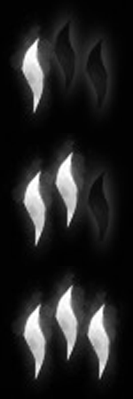
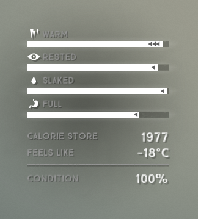
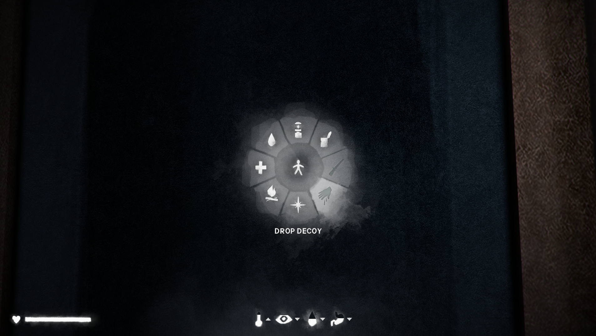

# Survival Overlay

**Contents**

- [Region and Location](#Region_and_Location)
- [Harvest Info](#Harvest_Info)
- [Afflictions](#Afflictions)
- [Needs and Condition](#Needs_and_Condition)
- [Warmth, Fatigue, Thirst, and Hunger](#Warmth%2C_Fatigue%2C_Thirst%2C_and_Hunger)
- [Condition](#Condition)
- [Suffocation Timer](#Suffocation_Timer)
- [Windshield and Scent](#Windshield_and_Scent)
- [Windshield](#Windshield)
- [Scent](#Scent)
- [Survival Indicators](#Survival_Indicators)
- [Weak Ice](#Weak_Ice)
- [Timberwolf Morale](#Timberwolf_Morale)
- [Chemical Hazard](#Chemical_Hazard)
- [The Darkwalker Distance](#The_Darkwalker_Distance)
- [Stamina, Weapon, and Movement Icons](#Stamina%2C_Weapon%2C_and_Movement_Icons)
- [Stamina](#Stamina)
- [Weapons and Tools](#Weapons_and_Tools)
- [Crouching](#Crouching)
- [Carrying Crash Survivor](#Carrying_Crash_Survivor)
- [Over Encumbered](#Over_Encumbered)
- [Steep Slope Warning](#Steep_Slope_Warning)
- [Time of Day](#Time_of_Day)
- [Time scale](#Time_scale)
- [Day vs. Night](#Day_vs._Night)
- [Light](#Light)
- [Gallery](#Gallery)

<figure>
[Missing image: Survival_Overlay_Breakdown.png]
<figcaption>XTHUMB The central hub of the survival Overlay, with all icon sections explained.</figcaption>
</figure>

  
*For the more detailed backpack menus, see <a href="./Survival%20Menu.md" class="wikilink" title="Survival Menu">Survival Menu</a>.*

The **Survival Overlay** is an interface that allows the player to quickly judge their situation with. It shows a copious amount of essential information in its entirety through the use of symbol and bars rather than using text to overly explain stats. This includes things like <a href="./Needs.md" class="wikilink" title="Needs">Needs</a>, <a href="./Condition.md" class="wikilink" title="Condition">Condition</a>, Wind Shield, temperature, Time of Day, and the player's current <a href="./Stamina.md" class="wikilink" title="Stamina">Stamina</a>.

Pressing Tab on PC will quickly show the current needs. Opening the <a href="./Radial%20Menu.md" class="wikilink" title="Radial Menu">Radial Menu</a> (holding SPACE) will show the entire Survival Overlay until let go. The Overlay can be disabled entirely in the Options menu by selecting OFF in the HUD section.

## Region and Location

The top left corner of the screen will show the current <a href="./Region.md" class="wikilink" title="Region">Region</a> or <a href="./Locations.md" class="wikilink" title="Location">Location</a> the player has walked into. Entering buildings, new Regions, or into outdoor Locations will tell the player the current area before the message slowly fades away.

## Harvest Info

<a href="./Harvesting.md" class="wikilink" title="Harvesting">Harvesting</a> objects will give a message and icon showing the <a href="./Materials.md" class="wikilink" title="Materials">Materials</a> harvested from the object, either in the game world or from the player's inventory.

## Afflictions

Affliction Risks and Afflictions will appear on the right side of the screen. They appear briefly, and can be missed if not payed attention to. Most Afflictions will appear in the Status menu of the <a href="./Survival%20Menu.md" class="wikilink" title="Survival Menu">Survival Menu</a> if it is opened.

## Needs and Condition

\[Missing image: Needs_Current.png\] The 4 Needs and the Condition Bar The bottom left side of the screen is where the center hub is visible. These, unlike the central hub, are always visible (unless changed in the options menu), and exist as a warning to the player. The NEEDS section can be set to be ALWAYS ON, or CONTEXTUAL in the Options menu in the HUD option, and the icon size can also be set to be small, medium, or large. If turned to CONTEXTUAL, Needs will not appear until when one of the player's Needs is nearly or entirely empty, in which the icon will appear on the screen as red until satisfied and then will disappear again.

From top to bottom, the information included is as follows:

### Warmth, Fatigue, Thirst, and Hunger

\[Missing image: UI_Long-Hunger.jpg\] The Fatigue bar when suffering from extreme hunger over long periods of time or Intestinal Parasites Here, the player can view their four major <a href="./Needs.md" class="wikilink" title="Needs">Needs</a> (<a href="./Warmth.md" class="wikilink" title="Warmth">Warmth</a>, <a href="./Fatigue.md" class="wikilink" title="Fatigue">Fatigue</a>, <a href="./Thirst.md" class="wikilink" title="Thirst">Thirst</a>, <a href="./Hunger.md" class="wikilink" title="Hunger">Hunger</a>). The survival of each need is indicated by the size and color of the respective need bar; the smaller and more red the bar is (and more drained the circle), the more severe the need. Fully diminished Needs begin to drain Condition.

### Condition

The <a href="./Condition.md" class="wikilink" title="Condition">Condition</a> bar is an overall measure of a survivor's overall health and well being. If this bar is fully depleted, the player will die. <a href="./Afflictions.md" class="wikilink" title="Afflictions">Afflictions</a> that temporarily increase the maximum Condition bar size will be shown as blue, while red will temporarily decrease the bar size.

The heart next to the Condition bar alerts the player of any Affliction Risks they have or Afflictions they are suffering from (shown as a yellow exclamation in a circle).

### Suffocation Timer

A timer appears just above the 4 Needs when suffering from <a href="./Suffocation.md" class="wikilink" title="Suffocation">Suffocation</a>, and will display the amount of time (in real world seconds) until the player dies. Leaving an area with unbreathable air or equipping a <a href="./Respirator.md" class="wikilink" title="Respirator">Respirator</a> with a functioning <a href="./Canister.md" class="wikilink" title="Canister">Canister</a> will reset the countdown and make it disappear.

## Windshield and Scent

These two icons appear in the top middle of the screen.

### Windshield

 Shown as an icon of a shield with wind blowing against its left side, the Windshield Icon will appear whenever you are currently shielded from the wind by an object (such as against a rock wall, inside a <a href="./Warm%20Cave.md" class="wikilink" title="Warm Cave">Warm Cave</a>, when pressed against the walls of a ruined building, while inside interior outdoor buildings such as a <a href="./Fishing%20Hut.md" class="wikilink" title="Fishing Hut">Fishing Hut</a>, or while inside a <a href="./Snow%20Shelter.md" class="wikilink" title="Snow Shelter">Snow Shelter</a>). This icon only appears when outdoors.

When shielded from the wind, the windchill effect of high winds on the player character is negated (increasing player Warmth) and <a href="./Campfire.md" class="wikilink" title="Campfires">Campfires</a> built will be protected from becoming <a href="./Fire.md#Windblown_campfire" class="wikilink" title="windblown campfires">windblown campfires</a>.

### Scent

<figure>

<figcaption>ScentMeter.png</figcaption>
</figure>

<a href="./Scent.md" class="wikilink" title="Scent">Scent</a> is a mechanic which increases the distance which <a href="./Wildlife.md" class="wikilink" title="predators">predators</a> can detect the survivor by smell. Scent is increased when the survivor is carrying meat and fresh guts, and is affected by wind speed and wind direction. There are 3 meters that increase as the player carries more odorous items. Being Windshielded will prevent the smell from spreading downstream.

## Survival Indicators

Several icons, typically appearing in the bottom center of the screen, will appear to warn the player of imminent danger.

### Weak Ice

<figure>
[Missing image: Weak_Ice_icon.png]
<figcaption>Weak_Ice_icon.png</figcaption>
</figure>

<a href="./Weak%20Ice.md" class="wikilink" title="Weak Ice">Weak Ice</a> will trigger the above icon as a danger warning to back away from the area. Failing to heed this warning will result in the player falling through the ice and taking Condition damage, wetting their clothes, and gaining <a href="./Hypothermia.md" class="wikilink" title="Hypothermia">Hypothermia</a>.

### Timberwolf Morale

<figure>
[Missing image: Timberwolf_Morale_Bar.jpg]
<figcaption>Timberwolf_Morale_Bar.jpg</figcaption>
</figure>

When a <a href="./Timberwolf.md" class="wikilink" title="Timberwolf">Timberwolf</a> pack has been alerted to the presence of the player, a special Morale meter appears in the bottom middle of the screen. Attacking the pack will cause the bar to gradually empty until the pack is entirely killed or scatters, in which it will dissapear.

### Chemical Hazard

<figure>
[Missing image: Chemical_Hazard_Hud.jpg]
<figcaption>The corners of the screen appear yellow when suffering from <a href="./Chemical%20Poisoning%20Risk.md" class="wikilink" title="Chemical Poisoning Risk">Chemical Poisoning Risk</a></figcaption>
</figure>

<a href="./Chemical%20Hazard.md" class="wikilink" title="Chemical Hazards">Chemical Hazards</a> are areas of land contaminated by toxic spilled chemicals that appear in the <a href="./Zone%20of%20Contamination.md" class="wikilink" title="Zone of Contamination">Zone of Contamination</a>. When not wearing a <a href="./Respirator.md" class="wikilink" title="Respirator">Respirator</a> with a functional <a href="./Canister.md" class="wikilink" title="Canister">Canister</a>, the 4 corners of the screen will gradually begin to fill up with a yellow overlay. Leaving a Chemical Hazard or equipping a Respirator will make the yellow film gradually dissipate.

### The Darkwalker Distance

<figure>
[Missing image: Darkwalker_Very_Bloody_Screen.jpg]
<figcaption>The bloody screen and distance meter</figcaption>
</figure>

Getting close to the Darkwalker in the <a href="./Escape%20the%20Darkwalker.md" class="wikilink" title="Escape the Darkwalker">Escape the Darkwalker</a> <a href="./Challenge.md" class="wikilink" title="Challenge">Challenge</a> will cause a distance meter to appear when near the creature, displaying the current distance the monster is to the player.

Two Afflictions unique to the Challenge, <a href="./Fear.md" class="wikilink" title="Fear">Fear</a> and <a href="./Anxiety.md" class="wikilink" title="Anxiety">Anxiety</a>, will also cause the screen to become more and more bloody the closer the player is to the Darkwalker. Walking farther away from the monster will cause the bloody screen to clear up and the distance meter to disappear.

## Stamina, Weapon, and Movement Icons

These icons appear in the bottom right corner of the screen, and are related to overall movement and Stamina.

### Stamina

<figure>

<figcaption>Sprint_icon.png</figcaption>
</figure>

<a href="./Stamina.md" class="wikilink" title="Stamina">Stamina</a> represents the player's ability to undertake several physically demanding tasks, and appears inside a draining circle similar to Needs. The image inside the bar changes depending on what physical task is being performed:

- Sprinting will show a man running (above photo). Sprint allows a player to run at a faster speed and is related to the weight of the player's worn <a href="./Clothing.md" class="wikilink" title="Clothing">Clothing</a>. Heavier clothing with the Sprint Penalty will cause the bar to lower, preventing the player from running for longer periods of time. Being fully <a href="./Fatigue.md" class="wikilink" title="Fatigued">Fatigued</a> or Over Encumbered will result in the player being unable to sprint anymore.
- <a href="./Rope%20Climbing.md" class="wikilink" title="Rope Climbing">Rope Climbing</a> will show a hand icon and is related to the player's current grip on the <a href="./Mountaineering%20Rope.md" class="wikilink" title="Mountaineering Rope">Mountaineering Rope</a>. The less grip that is present, the more likely the player will fall off the rope, potentially resulting in death.
- Weapons have their own bar that is directly tied to <a href="./Fatigue.md" class="wikilink" title="Fatigue">Fatigue</a>, and allows the player to aim their weapons until it is depleted:
  - The <a href="./Hunting%20Rifle.md" class="wikilink" title="Hunting Rifle">Hunting Rifle</a> and <a href="./Survival%20Bow.md" class="wikilink" title="Survival Bow">Survival Bow</a> will show a crosshair icon, and affects the accuracy of the projectile fired. If the <a href="./Warmth.md" class="wikilink" title="Warmth">Warmth</a> Need is depleted, the player will shiver as they aim.
  - Setting a <a href="./Bear%20Spear.md" class="wikilink" title="Bear Spear">Bear Spear</a> will have its own icon.
  - Aiming a <a href="./Revolver.md" class="wikilink" title="Revolver">Revolver</a> will prevent the player from moving, and shows an icon of the sprinting man inside a crossed out red circle.

Information related to this HUD is only visible when the player is actively using stamina, otherwise this bar is hidden.

### Weapons and Tools

Equipped weapons/tools will show an icon of said weapon, it's ammunition, or the fuel inside:

- A Hunting Rifle, Revolver, or <a href="./Distress%20Pistol.md" class="wikilink" title="Distress Pistol">Distress Pistol</a> will show the current amount of ammunition inside. A light icon will mean the ammo inside the gun is empty, while a bright icon means ammo is inside the gun.
- The amount of held <a href="./Stone.md" class="wikilink" title="Stones">Stones</a>, Flares, and <a href="./Noisemaker.md" class="wikilink" title="Noisemakers">Noisemakers</a> are displayed.
- An active <a href="./Flare.md" class="wikilink" title="Flare">Flare</a>, <a href="./Marine%20Flare.md" class="wikilink" title="Marine Flare">Marine Flare</a>, <a href="./Torch.md" class="wikilink" title="Torch">Torch</a>, or <a href="./Storm%20Lantern.md" class="wikilink" title="Storm Lantern">Storm Lantern</a> will show the amount of fuel left inside until the item is unusable (Storm Lanterns can be refilled).

### Crouching

An icon of a man crouching appears when the player is currently crouching. Standing up will make the icon appear.

### Carrying Crash Survivor

<figure>
[Missing image: Burdened_icon.png]
<figcaption>Burdened_icon.png</figcaption>
</figure>

An icon appears when carrying a <a href="./Crash%20Survivor.md" class="wikilink" title="Crash Survivor">Crash Survivor</a> in <a href="./Episode%203%20-%20Crossroads%20Elegy.md" class="wikilink" title="Episode 3: Crossroads Elegy">Episode 3: Crossroads Elegy</a>. When this icon appears, the player cannot Sprint, use weapons, or enter vehicles.

### Over Encumbered

<figure>

<figcaption>Weight_icon.png</figcaption>
</figure>

A weight icon related to the player's current <a href="./Encumbrance.md" class="wikilink" title="Encumbrance">Encumbrance</a> level will appear in the bottom right. If the player is currently under their Carry Weight, the weight will appear green. If they are Over Encumbered, a red weight icon will appear instead, and will not disappear until the player's Encumbrance goes below their max Carry Weight again.

### Steep Slope Warning

<figure>
[Missing image: Pente.jpg]
<figcaption>Pente.jpg</figcaption>
</figure>

Occasionally, the player will see a red slope when traveling the world. This is the Steep Slope Warning, and warns the player that walking over this area can result in a Sprain, such as a steep hill or rocky mountainside slope. If the player's Carry Weight is Over Encumbered and they are suffering from a <a href="./Sprain%20Risk.md" class="wikilink" title="Sprain Risk">Sprain Risk</a>, they are more likely to acquire a <a href="./Sprained%20Wrist.md" class="wikilink" title="Sprained Wrist">Sprained Wrist</a> or <a href="./Sprained%20Ankle.md" class="wikilink" title="Sprained Ankle">Sprained Ankle</a> when walking through these areas.

## Time of Day

\[Missing image: Nighttime_daytime_midnight_noon.jpg\] Midnight and Noon, the middle of night and the middle of day respectively The top right corner will show the Time of Day, represented by a sun and moon which rotates to give a rough idea as to the hour.

One day in '**The Long Dark**' is 24 hours long, split between 14.5 hours of daylight and 9.5 hours of darkness. [^1]

The day progresses as you play, as do other aspects of the game world. Temperature, daylight, and weather patterns may vary based on time of day. Cycles of the moon pass over the course of weeks; some animals may wander from prior territories; food <a href="./Decay.md" class="wikilink" title="decays">decays</a> and may cause illness if consumed after turning rancid; and clothes wear down from use or even just being kept in storage.

### Time scale

An in-game hour is 5 minutes, so 1 real-world hour is 12 in-game hours. Some activities speed up time (such as breaking furniture or sleeping), so 12 in-game hours can pass in seconds.

One in game minute is 3 seconds irl, 3x60(minutes)=180(seconds), 180x24(hours)= 4320 seconds, divide by 60 = 72 irl minutes per full day and night cycle (3 minutes per in game hour).

### Day vs. Night

\[Missing image: Nighttime_start_10pm.jpg\] 8:30 PM - Daytime ends, Nighttime begins The coldest temperatures are usually early in the morning, just before dawn. As the day progresses, temperatures usually start to warm; how warm it gets depends on the region and the weather. *Example of temperature in °c in interloper J8: AM 6h -24/-17. 8h -22/-16. 11h -17/13 PM 1h:-10/6. 2h: -9/1 3h: -8/5. 4h -7/9. 5h -8/9. 0h: -20 AM 5h -26 8h -24.*

In general, it's best to explore the outdoors during the day because it offers better visibility and wolves are less aggressive. However, bears also wake up and patrol. Auroras, which make predators even more aggressive, never occur during the day.

#### Light

To study, mend, craft items at workbenches, or recycle with tools indoor, most of the time light is needed. Daylight lasts from dawn (6:00 AM) through sundown (8:30 PM) both indoors and outdoors. If the sky isn't overcast, use of the <a href="./Magnifying%20Lens.md" class="wikilink" title="Magnifying lens">Magnifying lens</a> is permitted as soon as the first ray of the sun appear at 6:00 AM, as is any other activity that requires light. \[Missing image: Nighttime_end_6am.jpg\] 6:00 AM - Nighttime ends, Daytime starts As evening falls, outdoor temperatures start to drop and wolves are more active and alert, making it difficult to be outside as they will immediately attack instead of stalking the player. However, bears usually return to their dens and sleep. You’ll probably want to find shelter before it gets dark. Night time strips shelters of any natural interior light (except for <a href="./Ice%20Cave.md" class="wikilink" title="ice caves">ice caves</a> in the <a href="./Hushed%20River%20Valley.md" class="wikilink" title="Hushed River Valley">Hushed River Valley</a>), making navigation a challenge.

Being lost in heavy snow on a dark night can be extremely challenging. When traveling in the dark, light sources are a must as it's otherwise very difficult to navigate. Night travel comes at the risk of wolf attacks, as they can detect a player from longer distances before a player may notice them. There is also a small chance for the Aurora to occur if the weather is clear.

## Gallery

<table class="gallery">
<colgroup>
<col style="width: 33%" />
<col style="width: 33%" />
<col style="width: 33%" />
</colgroup>
<tbody>
<tr>
<td><figure>
[Missing image: Alpha_main_menu.jpg]
<figcaption>The first Survival Overlay in the Alpha game versions was inside the <a href="./Survival%20Menu.md" class="wikilink" title="Survival Menu">Survival Menu</a></figcaption>
</figure></td>
<td><figure>

<figcaption>0.264 (Desolation Point Update)</figcaption>
</figure></td>
<td><figure>

<figcaption>V1.00 overlay (Needs are in the middle of the screen)</figcaption>
</figure></td>
</tr>
</tbody>
</table>

**Lua execution error in Module:Navbox function navbox**

## Notes

[^1]: <https://youtu.be/TItx5JcAo3Q?si=tcEpgqn-xd26xQcO&t=547>
