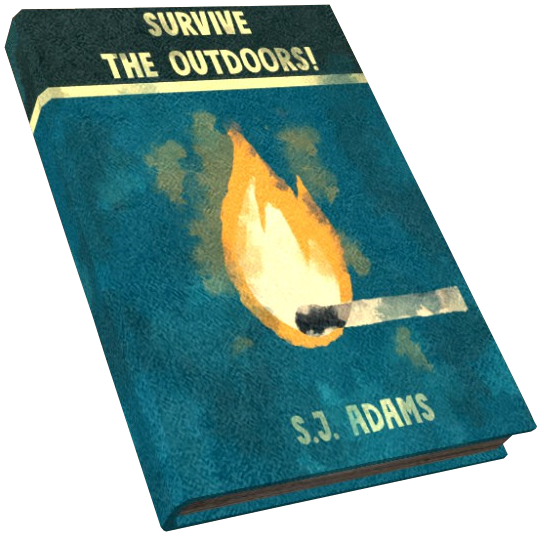
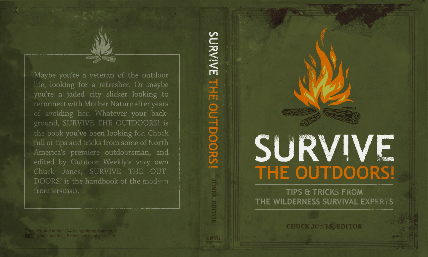

# Survive the Outdoors\!

**Categories:** Fire Starting, Pages with update history, Tools · **Source:** [Fandom](https://thelongdark.fandom.com/wiki/Survive_the_Outdoors!)

**Contents**

- [Research info](#research-info)
- [Fire Starting info](#fire-starting-info)
- [Trivia](#trivia)
- [Gallery](#gallery)
- [Update history](#update-history)

**Survive the Outdoors!**

[Survive the Outdoors! icon](../assets/Survive_the_Outdoors!_icon.png)

**Release:** [23 June 2016](./The%20Long%20Dark%20%E2%80%94%20Early%20Access%20Changelog.md#0.346)

**Wintermute:** No

**Properties**

**Item type:** [Fire Starting](./Fire%20Starting.md)[Tools](./Tools.md)

**Stackable:** No

**Examine:** Handbook with information on wilderness survival. Researching this will improve your Skill.

**Values**

**Weight:** 0.50 kg (1.1 lbs)

**Actions**

**Backpack:** Research, Drop

**Survive the Outdoors!** is a [Research Book](./Research%20Book.md) used to improve the [Fire Starting](./Fire%20Starting.md) skill. It can also be used as Fuel when starting a [Fire](./Fire.md).

<!-- #research_info -->
​

<!-- #Research_info -->
​

<!-- #Research_Info -->
​

<!-- #research-info -->
## Research info

_Survive the Outdoors!_ can be researched for 5 hours, which can be broken into multiple research sessions. 10 [Fire Starting skill points](./Fire%20Starting.md#Skill_levels) are awarded on completing the research.

Research can only be performed under the following conditions:

- There is light present to read
- [Warmth](./Warmth.md), [Fatigue](./Fatigue.md), [Thirst](./Thirst.md), and [Hunger](./Hunger.md) exceed 0%
- No negative [Afflictions](./Afflictions.md)

<!-- #fire_starting_info -->
​

<!-- #Fire_Starting_info -->
​

<!-- #Fire_starting_info -->
​

<!-- #Fire_Starting_Info -->
​

<!-- #fire-starting-info -->
## Fire Starting info

**Survive the Outdoors!**

**Type:** Fuel

**Statistics**

**Duration:** [Fire Starting](../assets/Fire_Starting.png) 18 minutes

**Start Chance:** [Firestart mod icon](../assets/Firestart_mod_icon.png) +35%

**Heat:** [Fire heat icon](../assets/Fire_heat_icon.png) +2°C (+3.6°F)

**Burn Density:** 0.6 hr/kg (0.27 hr/lb)

<!-- #Trivia -->
​

<!-- #trivia -->
## Trivia

- Reaching 0% in any Needs while researching will immediately end the research session and negate any progress for that research attempt.
- Attempting to burn a copy of _Survive the Outdoors!_ when it has not been fully read will give a confirmation warning before it can be burned.
- Once a copy of _Survive the Outdoors!_ is fully researched, it will no longer appear in the Tools section of the Backpack.

<!-- #Gallery -->
​

<!-- #gallery -->
## Gallery

<!-- #update_history -->
​

<!-- #Update_history -->
​

<!-- #Update_History -->
​

<!-- #update-history -->
## Update history

- UPDATE **23 June 2016 ([Update](./The%20Long%20Dark%20%E2%80%94%20Early%20Access%20Changelog.md#0.346)):**
  - Added to game.
