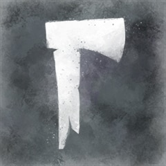

# Survive the Quiet Apocalypse

<table class="infobox">
<caption>Survive the Quiet Apocalypse</caption>
<colgroup>
<col style="width: 50%" />
<col style="width: 50%" />
</colgroup>
<tbody>
<tr>
<td colspan="2"><figure>

<figcaption>Survive_the_Quiet_Apocalypse_icon.png</figcaption>
</figure></td>
</tr>
<tr>
<td>
Description
</td>
<td>
Whatever the future brings, you will be ready.
</td>
</tr>
</tbody>
</table>

**Survive the Quiet Apocalypse** is the Platinum Trophy <a href="./The%20Long%20Dark%20%E2%80%94%20Achievements.md" class="wikilink" title="Achievement">Achievement</a> in *<a href="./The%20Long%20Dark.md" class="wikilink" title="The Long Dark">The Long Dark</a>* for the PlayStation 4/5 version of the game.

## Overview

It is acquired after unlocking all achievements for <a href="./Survival%20Mode.md" class="wikilink" title="Survival Mode">Survival Mode</a> and <a href="./Wintermute.md" class="wikilink" title="Wintermute">Wintermute</a> Episodes <a href="./Episode%201%20-%20Do%20Not%20Go%20Gentle.md" class="wikilink" title="Episode 1: Do Not Go Gentle">Episode 1: Do Not Go Gentle</a> and <a href="./Episode%202%20-%20Luminance%20Fugue.md" class="wikilink" title="Episode 2: Luminance Fugue">Episode 2: Luminance Fugue</a>.

Any achievements added in Episode 3, 4, 5, or <a href="./Tales%20from%20the%20Far%20Territory.md" class="wikilink" title="Tales from the Far Territory">Tales from the Far Territory</a> do not count for this achievement, as they were added after the Platinum Trophy was introduced.

## Game History

- UPDATE **1 August 2017 (<a href="./The%20Long%20Dark%20%E2%80%94%20Changelog.md#1.00" class="wikilink" title="Update">Update</a>):**
  - Added to game.

**Lua execution error in Module:Navbox function navbox**

