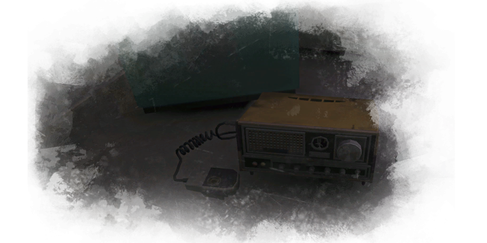
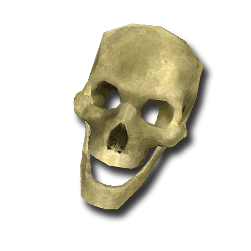
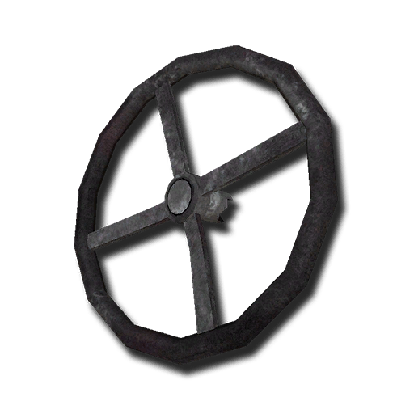
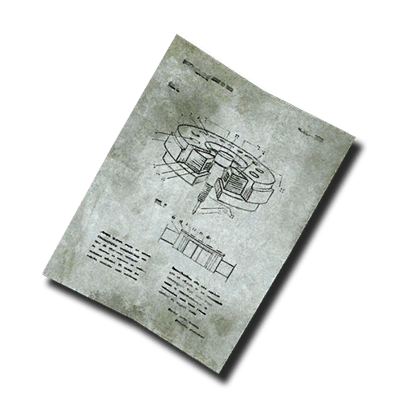
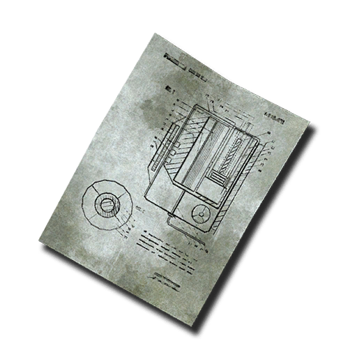
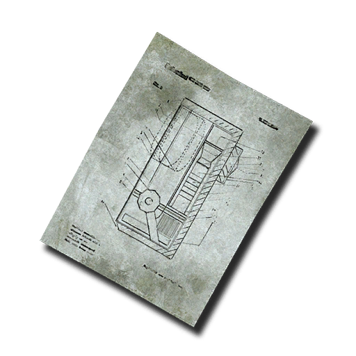
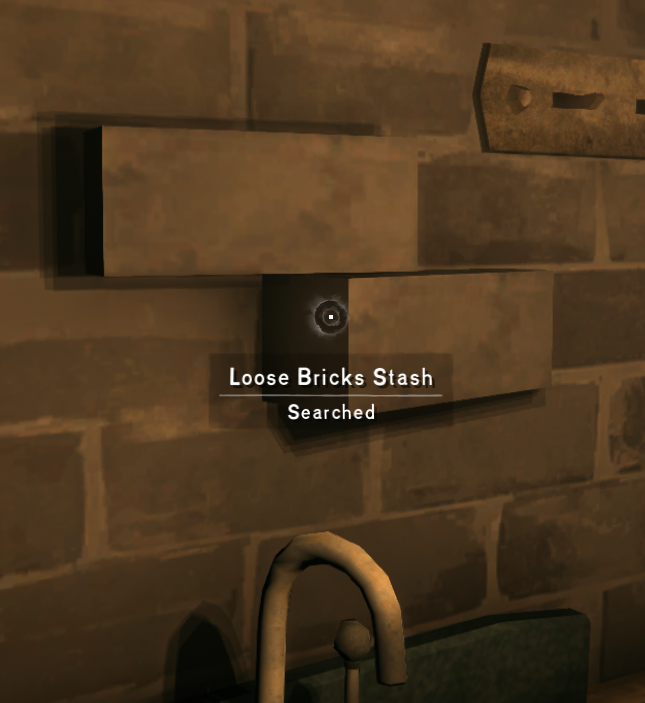

# Sutherland's Tale

**Contents**

- [Objectives](#Objectives)
- [Important Notes](#Important_Notes)
- [Walkthrough](#Walkthrough)
- [Arrival Time](#Arrival_Time)
- [Radio Locations](#Radio_Locations)
- [Starting Sutherland's Tale](#Starting_Sutherland%27s_Tale)
- [Complete Trades](#Complete_Trades)
- [Finding the Prepper Caches](#Finding_the_Prepper_Caches)
- [Special Request 1](#Special_Request_1)
- [Special Request 2](#Special_Request_2)
- [Special Request 3](#Special_Request_3)
- [Special Request 4](#Special_Request_4)
- [Special Request 5](#Special_Request_5)
- [Gaining Max Trust](#Gaining_Max_Trust)
- [Transcript](#Transcript)
- [Initial Contact](#Initial_Contact)
- [Trader Request 1](#Trader_Request_1)
- [Trader Request 2](#Trader_Request_2)
- [Trader Request 3](#Trader_Request_3)
- [Trader Request 4](#Trader_Request_4)
- [Trader Request 5](#Trader_Request_5)
- [Basic Trader Dialogue](#Basic_Trader_Dialogue)
- [Start Trade](#Start_Trade)
- [Complete Trade](#Complete_Trade)
- [Cancel Trade](#Cancel_Trade)
- [Greeting the Trader](#Greeting_the_Trader)
- [End Call](#End_Call)
- [Idle Chatter](#Idle_Chatter)
- [Conversations](#Conversations)
- [High Trust Conversations](#High_Trust_Conversations)
- [Lost Trust Conversations](#Lost_Trust_Conversations)
- [Collectibles](#Collectibles)
- [Tools](#Tools)
- [Collectibles](#Collectibles_2)
- [Gallery](#Gallery)

<table class="infobox">
<caption>Sutherland's Tale</caption>
<colgroup>
<col style="width: 50%" />
<col style="width: 50%" />
</colgroup>
<tbody>
<tr>
<td colspan="2"><figure>

<figcaption>Trader_Journal_Background.png</figcaption>
</figure></td>
</tr>
<tr>
<td colspan="2" class="section">
<strong>Missions</strong>
</td>
</tr>
<tr>
<td>
Previous
</td>
<td>
<a href="./Last%20Horizon.md" class="wikilink" title="Last Horizon">Last Horizon</a>
</td>
</tr>
<tr>
<td>
Current
</td>
<td>
Sutherland's Tale
</td>
</tr>
</tbody>
</table>

<table style="width:100%;">
<colgroup>
<col style="width: 16%" />
<col style="width: 16%" />
<col style="width: 16%" />
<col style="width: 16%" />
<col style="width: 16%" />
<col style="width: 16%" />
</colgroup>
<tbody>
<tr>
<td width="40px"><figure>
[Missing image: Ptarmigan_icon.png]
<figcaption>Ptarmigan_icon.png</figcaption>
</figure></td>
<td>
<strong>DLC-Exclusive content.</strong> 

This content requires the <a href="./Tales%20from%20the%20Far%20Territory.md" class="wikilink" title="Tales from the Far Territory">Tales from the Far Territory</a> addon to be installed before it can be seen or used in regular gameplay.

</td>
<td>
|}{| style="margin:auto"
</td>
<td style="vertical-align: top; font-size: 3em; color: #5d5980; padding-right: 10px">
“
</td>
<td>
We all get to to tell our own stories, right? This is mine.

&#10;

Sutherland the Trader

</td>
<td style="vertical-align: bottom; font-size: 3em; color: #5d5980; padding-left: 10px">
”
</td>
</tr>
</tbody>
</table>

**Sutherland's Tale** is the fourth and final <a href="./Tales.md" class="wikilink" title="Tale">Tale</a> released for the <a href="./Tales%20from%20the%20Far%20Territory.md" class="wikilink" title="Tales from the Far Territory">Tales from the Far Territory</a> addon in <a href="./Survival%20Mode.md" class="wikilink" title="Survival Mode">Survival Mode</a>. Completing this Tale is not needed to unlock the <a href="./R%C3%BCdiger%27s%20Dream.md" class="wikilink" title="Rüdiger&#39;s Dream">Rüdiger's Dream</a> Achievement.

  

*SPOILER WARNING*\
*This section may contain spoilers from the <a href="./Wintermute.md" class="wikilink" title="story">story</a> of The Long Dark.*

## Objectives

The objectives for this Tale do not show up in the Journal menu, so it is considered more of a hidden side mission. The following objectives are needed to complete this Tale:

- Wait for the <a href="./Trader.md" class="wikilink" title="Trader">Trader</a> to become available, then contact the Trader and begin trading with him.
- Continue building Trust with the Trader by successfully trading with him (it does not matter what/how much you trade).
  - Place the items he requests in his <a href="./Trade%20Drop%20Box.md" class="wikilink" title="Trade Drop Box">Trade Drop Box</a> on the pier behind <a href="./Misanthrope%27s%20Homestead.md" class="wikilink" title="Misanthrope&#39;s Homestead">Misanthrope's Homestead</a> in <a href="./Coastal%20Highway.md" class="wikilink" title="Coastal Highway">Coastal Highway</a>.
  - Once this is done, call him over the radio to confirm the trade. Then retrieve your items to start another trade.
    - Angering Sutherland will lower his Trust, delaying the questline: Calling him more than 2 times a night or canceling an active trade too many times will lower his opinion of you.
    - There is currently no way to track his Trust level, so always be courteous to him by not pinging him too often during the day and be prepared to go through with a trade you committed to.
    - After a certain amount of trades are completed, Sutherland will ask a favor of you.
- Complete Special Request 1
- Complete Special Request 2
- Complete Special Request 3
- Complete Special Request 4
- Complete Special Request 5
- Continue trading until max Trust is reached (if needed)

## Important Notes

- The option to enable the Trader on your survival save must be enabled, otherwise you cannot start this Tale.
- Unlike the other 3 Tales, the <a href="./Handheld%20Shortwave%20Radio.md" class="wikilink" title="Handheld Shortwave Radio">Handheld Shortwave Radio</a> does not need to be acquired and <a href="./Transmitters.md" class="wikilink" title="Transmitters">Transmitters</a> do not need to be repaired to complete this Tale.
- Playing on <a href="./Interloper.md" class="wikilink" title="Interloper">Interloper</a>/<a href="./Misery.md" class="wikilink" title="Misery">Misery</a> will make it difficult to distinguish between the 3 stocked <a href="./Prepper%20Cache.md" class="wikilink" title="Prepper&#39;s Cache">Prepper's Cache</a> since they always spawn as Abandoned. Players will need to pay close attention to the layouts of the caches, and take detailed notes about them[^1].
  - The Stockpile Cache, needed for Special Request 1, can be identified as it is the only one which contains a corpse[^2]. It also contains the recipe for <a href="./Prepper%27s%20Pie.md" class="wikilink" title="Prepper&#39;s Pie">Prepper's Pie</a>.
  - The Hunting Cache, needed for Special Request 2, can be identified as it is the only one with an L-shaped layout[^3].
  - The Conspiracy Cache, needed for Special Request 3, can be identified as it is the only one that has a corridor with red-painted walls[^4].
- Because the location of the 3 special caches is random, you will have to check each cache one by one until you find all three stocked ones. The location of the Prepper's Abandoned Cache involved in Special Requests 4 and 5 is always fixed in Pleasant Valley near the rope climb to Timberwolf Mountain.
  - NOTE that <u>you must accept the Special Request trade</u> in order for the Loose Bricks Stash to be accessible in its respective Prepper Cache as the Tale progresses. You cannot loot Brick Stashes ahead of time.
- Just finishing Sutherland's last special request is not enough to unlock the <a href="./Goods%20and%20Services.md" class="wikilink" title="Goods and Services">Goods and Services</a> achievement (Gain maximum trust with the trader).
- Completing this Tale will involve a lot of travelling. Ensure you have good warm clothes for travelling. Prioritize light, calorie-dense foods and keep <a href="./Scent.md" class="wikilink" title="Scent">Scent</a> low to minimize encounters with dangerous wildlife. <a href="./Tin%20of%20Coffee.md" class="wikilink" title="Coffee">Coffee</a> can help with fatigue management.
  - Most of the caches can be easily accessed within a day's walk from <a href="./Coastal%20Highway.md" class="wikilink" title="Coastal Highway">Coastal Highway</a>, though it may be a long day of walking to the caches at <a href="./Blackrock.md" class="wikilink" title="Blackrock">Blackrock</a>, <a href="./Hushed%20River%20Valley.md" class="wikilink" title="Hushed River Valley">Hushed River Valley</a>, and <a href="./Ash%20Canyon.md" class="wikilink" title="Ash Canyon">Ash Canyon</a>.
  - Be careful when crossing <a href="./Raven%20Falls%20Trestle.md" class="wikilink" title="Raven Falls Trestle">Raven Falls Trestle</a>, as you may have to do so multiple times.

## Walkthrough

### Arrival Time

The player has no way of know this at first, but Sutherland eventually reveals that his radio has not been working since the start of a new survival game, and that he has been spending all this time repairing it. Below is a time table showing how long the player must survive before he repairs his radio and can be contacted.

| Game Mode | Days Survived |
|----|----|
| <a href="./Pilgrim.md" class="wikilink" title="Pilgrim">Pilgrim</a> | 15 |
| <a href="./Voyageur.md" class="wikilink" title="Voyageur">Voyageur</a> | 20 |
| <a href="./Stalker.md" class="wikilink" title="Stalker">Stalker</a> | 30 |
| <a href="./Interloper.md" class="wikilink" title="Interloper">Interloper</a>/<a href="./Misery.md" class="wikilink" title="Misery">Misery</a> | 40 |

Trader Arrival Date

### Radio Locations

\[Missing image: Trader's_Radio.jpg\]The Trader can only be contacted by special yellow <a href="./Radio.md" class="wikilink" title="Radios">Radios</a> with a microphone and portable antenna, which can be found at fixed locations on <a href="./Great%20Bear%20Island.md" class="wikilink" title="Great Bear Island">Great Bear Island</a> (and cannot moved with <a href="./Safehouse%20Customization.md" class="wikilink" title="Safehouse Customization">Safehouse Customization</a>).

- The Radio must be powered during an active <a href="./Aurora.md" class="wikilink" title="Aurora">Aurora</a> (or <a href="./Glimmer%20Fog.md" class="wikilink" title="Glimmer Fog">Glimmer Fog</a> in the Far Territory). These radios will not appear if The Trader is disabled.
- If the message "Trader Unavailable" appears when using the Radio, this means that The Trader is currently performing a trade or the minimum arrival date has not passed yet. A good way to tell if Sutherland is around is to listen for him shouting when the Radio is powered.

| Region | Location |
|----|----|
| <a href="./Blackrock.md" class="wikilink" title="Blackrock">Blackrock</a> | <a href="./Blackrock%20Prison.md" class="wikilink" title="Blackrock Prison">Blackrock Prison</a> (Guard Barracks) |
| <a href="./Bleak%20Inlet.md" class="wikilink" title="Bleak Inlet">Bleak Inlet</a> | <a href="./Last%20Resort%20Cannery.md" class="wikilink" title="Last Resort Cannery">Last Resort Cannery</a> (White Trailer) |
| <a href="./Broken%20Railroad.md" class="wikilink" title="Broken Railroad">Broken Railroad</a> | <a href="./Maintenance%20Yard.md" class="wikilink" title="Maintenance Yard">Maintenance Yard</a> (Outdoor Office) |
| <a href="./Coastal%20Highway.md" class="wikilink" title="Coastal Highway">Coastal Highway</a> | <a href="./Quonset%20Garage.md" class="wikilink" title="Quonset Garage">Quonset Garage</a> |
| <a href="./Forsaken%20Airfield.md" class="wikilink" title="Forsaken Airfield">Forsaken Airfield</a> | <a href="./Terminal.md" class="wikilink" title="Terminal">Terminal</a> |
| <a href="./Mountain%20Town.md" class="wikilink" title="Mountain Town">Mountain Town</a> | <a href="./Milton%20Post%20Office.md" class="wikilink" title="Milton Post Office">Milton Post Office</a> |
| <a href="./Mystery%20Lake%20%28region%29.md" class="wikilink" title="Mystery Lake">Mystery Lake</a> | <a href="./Camp%20Office.md" class="wikilink" title="Camp Office">Camp Office</a> |
| <a href="./Pleasant%20Valley.md" class="wikilink" title="Pleasant Valley">Pleasant Valley</a> | <a href="./Community%20Hall.md" class="wikilink" title="Community Hall">Community Hall</a> |
| <a href="./Transfer%20Pass.md" class="wikilink" title="Transfer Pass">Transfer Pass</a> | <a href="./Vacant%20Depot.md" class="wikilink" title="Vacant Depot">Vacant Depot</a> |
| <a href="./Zone%20of%20Contamination.md" class="wikilink" title="Zone of Contamination">Zone of Contamination</a> | <a href="./Idle%20Camp.md" class="wikilink" title="Idle Camp">Idle Camp</a> (Mess Hall) |

Trader Radio locations

### Starting Sutherland's Tale

After the arrival time is met and the Aurora/Glimmer Fog powers the Radios, a voice will be heard on the radio. Talking to the man on the radio will allow you to begin trading with him where he offers to trade things with you. He requests that you drop everything off at the <a href="./Trade%20Drop%20Box.md" class="wikilink" title="Trade Drop Box">Trade Drop Box</a> at the pier near <a href="./Misanthrope%27s%20Homestead.md" class="wikilink" title="Misanthrope&#39;s Homestead">Misanthrope's Homestead</a> in <a href="./Coastal%20Highway.md" class="wikilink" title="Coastal Highway">Coastal Highway</a>.

### Complete Trades

At this point, simply complete around 5 trades with him. It does not matter how much you trade for, or what the quality of items are. Consider just trading for 1 item 5 times to speed up this questline. If multiple items are requested in a trade, make sure to fully satisfy each trade request. Partially completed trades do not gain as much Trust as fully completed ones.

Once enough trades are made, a special blue Conversation will appear.

### Finding the Prepper Caches

The Trader will want to know where his brother Wyatt is since he has not heard from him since the lights started appearing in the sky, and mentions a series of <a href="./Prepper%20Cache.md" class="wikilink" title="Prepper Caches">Prepper Caches</a> across the island belonging to Wyatt's old crew. After listening to the special conversation, a new Trade item will appear in the Trade menu called "Special Request".

The first 3 Special Requests involve finding 3 themed Prepper Caches distributed across the Lower Great Bear. You only need to consider the 9 Prepper Caches in the Lower Great Bear, 6 of which are empty. In 3 of them (Stockpile, Hunter, and Conspiracy) you will find a large amount of loot (except on Interloper and above), as well as a Loose Bricks Stash that is only accessible after you've accepted the respective trade offer. Inside the Loose Bricks Stash you will find a Documents Stash which you need to trade to Sutherland (meaning that you must obtain the stashes in order, and you must return to Coastal Highway after every step). The fixed location of each of the 9 Prepper Caches is listed here: <a href="./Prepper%20Cache.md" class="wikilink" title="Prepper Caches">Prepper Caches</a>.

### Special Request 1

The first cache the player must find is the Stockpile themed bunker. On Interloper this cache can be identified as the one with a corpse and Prepper's Pie recipe. Look around the walls until you find a <a href="./Loose%20Bricks%20Stash.md" class="wikilink" title="Loose Bricks Stash">Loose Bricks Stash</a> and obtain the <a href="./Document%20Stash%201.md" class="wikilink" title="Document Stash 1">Document Stash 1</a> (<a href="./Wyatt%27s%20Lost%20Papers%201.md" class="wikilink" title="Wyatt&#39;s Lost Papers 1">Wyatt's Lost Papers 1</a> and <a href="./Bunker%20Schematic%20Fragment%201.md" class="wikilink" title="Bunker Schematic Fragment 1">Bunker Schematic Fragment 1</a> are found inside). Return the Document Stash 1 to the Trader by placing it in the Trade Drop Box, thus fulfilling his Special Request trade. Then talk to him on the radio after obtaining your reward (<a href="./Mackinaw%20Jacket.md" class="wikilink" title="Mackinaw Jacket">Mackinaw Jacket</a>).

### Special Request 2

The Trader will want to know more of where his brother went, and mentions finding the Hunter cache on the island next.

The second cache the player must find is the Hunter themed bunker. On Interloper this cache will have the L-shaped layout. Look around the walls until you find a <a href="./Loose%20Bricks%20Stash.md" class="wikilink" title="Loose Bricks Stash">Loose Bricks Stash</a> and obtain the <a href="./Document%20Stash%202.md" class="wikilink" title="Document Stash 2">Document Stash 2</a> (<a href="./Wyatt%27s%20Lost%20Papers%202.md" class="wikilink" title="Wyatt&#39;s Lost Papers 2">Wyatt's Lost Papers 2</a> and <a href="./Bunker%20Schematic%20Fragment%202.md" class="wikilink" title="Bunker Schematic Fragment 2">Bunker Schematic Fragment 2</a> are found inside). Return the Document Stash 2 to the Trader by placing it in the Trade Drop Box, thus fulfilling his Special Request trade. Then talk to him on the radio after obtaining your reward (3x <a href="./Arrowhead.md" class="wikilink" title="Arrowheads">Arrowheads</a>).

### Special Request 3

The Trader will want to know more of where his brother went, and mentions searching for the Conspiracy cache on the island next.

The third cache the player must find is the Conspiracy themed bunker. On Interloper this cache can be identified by having distinct red corridor walls and a radiation sign on the wall. Look around them until you find a <a href="./Loose%20Bricks%20Stash.md" class="wikilink" title="Loose Bricks Stash">Loose Bricks Stash</a> and obtain the <a href="./Document%20Stash%203.md" class="wikilink" title="Document Stash 3">Document Stash 3</a> (<a href="./Wyatt%27s%20Lost%20Papers%203.md" class="wikilink" title="Wyatt&#39;s Lost Papers 3">Wyatt's Lost Papers 3</a> and <a href="./Bunker%20Schematic%20Fragment%203.md" class="wikilink" title="Bunker Schematic Fragment 3">Bunker Schematic Fragment 3</a> are found inside). Return the Document Stash 3 to the Trader by placing it in the Trade Drop Box, thus fulfilling his Special Request trade. Then talk to him on the radio after obtaining your reward (<a href="./Improvised%20Knife.md" class="wikilink" title="Improvised Knife">Improvised Knife</a>).

### Special Request 4

After reading all the information you've found and sent to him, the Trader will mention a 4th bunker not related to his brother's 3 crewmates. He will tell you to find Tom Joplin's <a href="./Prepper%27s%20Abandoned%20Cache.md" class="wikilink" title="Prepper&#39;s Abandoned Cache">Prepper's Abandoned Cache</a> in <a href="./Pleasant%20Valley.md" class="wikilink" title="Pleasant Valley">Pleasant Valley</a>.

For the last 2 requests it is shortest to utilize the Abandoned Mine shortcut connecting Coastal Highway to Pleasant Valley.

Head there and look at the wall near the Mattress to find a semi bricked up wall (a hole can be found that barely lets you peer into a hidden room). Tear the wall down and head inside, where you will find <a href="./A%20Skeleton%20And%20Note.md" class="wikilink" title="A Skeleton And Note">A Skeleton And Note</a> on the floor. Picking up "A Skeleton And Note" will add the note <a href="./Sutherland%27s%20Note.md" class="wikilink" title="Sutherland&#39;s Note">Sutherland's Note</a> to your inventory, revealing that Sutherland bricked up the wall to leave his brother to rest after a fire killed him.

Return "A Skeleton And Note" to the Trader by placing it in the Trade Drop Box, thus fulfilling his Special Request trade. Then talk to him on the radio after obtaining your reward (<a href="./Hockey%20Jersey.md" class="wikilink" title="Hockey Jersey">Hockey Jersey</a>).

### Special Request 5

Sutherland finally remembers that his brother has been dead for many decades now, and requests that the player return him back to the Abandoned Prepper's Cache, then to seal it up so that he may be at rest. He mentions the failsafe made into the bunker from all the notes you have found and to bring back evidence that you properly laid Wyatt to rest. Return to the Trade Drop Box to find that a <a href="./Metal%20Container.md" class="wikilink" title="Metal Container">Metal Container</a> has been placed next to the Box, and that the "A Skeleton And Note" has been returned as "<a href="./Wyatt%27s%20Skeleton.md" class="wikilink" title="Wyatt&#39;s Skeleton">Wyatt's Skeleton</a>". Take Wyatt's Skeleton from the Trade Drop Box and bring a <a href="./Wires.md" class="wikilink" title="Wire Bundle">Wire Bundle</a> with you for later. Make your way back to Joplin's Cache in Pleasant Valley and head into the hidden room you previously opened.

**WARNING:** Loot/Harvest anything you want from inside Joplin's Cache BEFORE finishing the next step, as this Cache will be **<u>PERMENANTLY INACCESSIBLE ONCE YOU LEAVE!</u>** (This includes losing access to the <a href="./Work%20Bench.md" class="wikilink" title="Work Bench">Work Bench</a>).

A panel on the wall can be interacted in the hidden room stating "Set demolition charge and place Wyatt's bones". Interacting with it will display the message "Rigging..." and places Wyatt's Skeleton back onto the floor. **<u>Once you leave the Cache</u>**, an explosion occurs as the hatch is shut and locked behind you. The screen will be black, with the Survivor lying on the ground and slowly waking up. The entrance to the Cache is now destroyed and the bunker's <a href="./Broken%20Hatch%20Wheel.md" class="wikilink" title="Broken Hatch Wheel">Broken Hatch Wheel</a> is lying in the snow.

Return the Broken Hatch Wheel to the Trader by placing it in the Trade Drop Box, thus fulfilling his Special Request trade. Then talk to him on the radio after obtaining your reward (<a href="./Heavy%20Hammer.md" class="wikilink" title="Heavy Hammer">Heavy Hammer</a>). Sutherland is relieved that his brother is at rest again, and mentions how unbelievable it is how he forgot about his death.

Sutherland mentions that he will continue to stay around to trade with you, at least for now. As a reward for helping him, most future services now include a discount when trading with Sutherland.

### Gaining Max Trust

From this point onwards, the Tale ends but the player can continue to trade to gain max Trust with Sutherland. Gaining max Trust will unlock the <a href="./Goods%20and%20Services.md" class="wikilink" title="Goods and Services">Goods and Services</a> achievement, but no new dialogue is unlocked with Sutherland.

## Transcript

### Initial Contact

*As the Survivor scours the Island for resources to survive, they come across yellow Radios with a microphone and antenna near them. They do nothing, even when powered, so the Survivor ignores them, seeing how most electronics don't work correctly anymore ever since their plane crashed. One night however, they pass by a powered Radio and hear a voice.*

*The Trader has several voice lines the first time he speaks, revealing that he has spent all this time repairing his own Radio. (Note that these voice lines are all randomized and can be spoken in any order)*

Trader:

- "What... in the hell..." (subtitles read "What...the hell...")
- "Anyone? Hello?"
- "Anyone out there? This thing just lit up tonight."
- "Anyone home? hehe"
- "It's workin' ...why now?"
- "Wait...is it working?"
- "Oh shit...it's workin'!"
- "Hello? Hello? It just turned itself on..."
- "Been hackin' at this thing for hours...since it chirped...wait...is it...?"
- "Is this thing on? Lemme just..."
- "Hmph...this stupid knob here...hmm" (subtitles read "Hmph...this knob here...hmm")
- "Talking to myself, hehe."
- "Come in. Is this really...happenin'? How'd I manage...?"
- "It works! Don't be a stranger, come in."
- "...one...last, there! Dang it worked. How did it?"
- "Mayday. Mayday. Am I even broadcasting?"
- "Who's there? Anyone? Anybody?"
- "This thing on? Stupid radio, never worked before...why now?"
- "Phew. Finally fixed...uh...is it on? Hello?"
- "This damn thing...lemme just..."
- "Come in. Is this really...happenin'? How did I manage...?"
- "Can't seem to get this contraption to...hmm"
- "Just give it another go...somethin's different this time...seems to have some juice ..."

*After finally getting over the shock that there is in fact another voice alive in this world, the Survivor picks up the microphone to talk to the person on the radio. The man on the radio slowly realizes that someone else is on his frequency.*

Trader: "Wha... what the hell? Someone there? Hey...uh...hello? Uh...radio check...uh...go ahead? You better say somethin' or getting' this damn thing fixed was all a waste of time. Come in. I say again. Come in."

*Floating text appears overhead*

- Who are you?

Trader: "Well, uh, hmm. I'm just, uh, a fella on the radio for now. Been on my own. The lights...they fried everthin'. Or haven't you noticed? Hmph. What, you been living in a hole in the ground out there? You're on the island...right?"

- Survivors?

Trader: "I...haven't come across any. Well, until now. Hmph. It's taken a long time, a damn long time to get this contraption working. The radio, I mean. Your radio seems to work...just fine. Hmph. Still there? Hello?"

- Intentions?

Trader: "Things are gettin' a little...thin out here in the dark. I've got some stuff to trade. NOT MUCH, mind you, but maybe you have some interest. Maybe...we can work out a deal. If you can keep your word, that is. Trust don't come so easy no more. Not since the lights showed up... But there's you, there's me, and there's the ice. Well, speak up."

- How?

Trader: "There's...a place. A little island off Coastal Highway. A dock. An old storage box of mine. We can use that to trade. You keep your distance, and I'll do the same. Got it?"

*From this point on, the option to Trade is opened up.*

### Trader Request 1

*After completing 5 trades (it does not matter what or how much is requested), two special blue Conversation topics appears.*

- Help?

Trader: "All this driftin' on the water...makes my mind go places. And thanks to my leg, well, there's no way I could manage it. I've got something that needs doing. And you're gonna do it for me. Got it? But I'll make it worth your while, don't doubt it."

- What's the job?

Trader: "Find my brother. Wyatt. He hasn't checked in since it all went dark. He runs with this group of preppers. Bad guys, his crew, but they look up to him. There were always three that followed Wyatt around. Stockpiles, hunters, conspiracy nuts. Maybe you know the type? Hehe. Their old bunkers would be a good place to start lookin' for him. One of the guys had half-a-brain, unlike the other two who were caught up in mounting heads on the wall or scribbling crazy theories. I'd start with him, the half-a-brain survivalist. Bring me any signs of Wyatt you can find. Somethin' squirreled away out of sight. A loose brick, you get the idea. Those idiots thought they were so damn clever. Ya do that, and I'll start sharing my best stuff with you. And if you don't...well, good luck, pal."

*The survivor then signals a trade to Sutherland, "Special Request, search for signs of Wyatt." The survivor scours the island, looking for <a href="./Prepper%20Cache.md" class="wikilink" title="Prepper Caches">Prepper Caches</a> until they find the "Stockpile" Themed bunker. Looking inside, they find something inside some <a href="./Loose%20Bricks%20Stash.md" class="wikilink" title="Loose Bricks Stash">Loose Bricks Stash</a> in the wall to find <a href="./Document%20Stash%201.md" class="wikilink" title="Document Stash 1">Document Stash 1</a>. Placing this item in the <a href="./Trade%20Drop%20Box.md" class="wikilink" title="Trade Drop Box">Trade Drop Box</a>. The survivor radios Sutherland to confirm the trade, and receives a <a href="./Mackinaw%20Jacket.md" class="wikilink" title="Mackinaw Jacket">Mackinaw Jacket</a>. After a few hours, the survivor speaks to Sutherland again.*

### Trader Request 2

- Wyatt's Documents?

Trader: "You found some of my brother's old papers. He was always writing. Drawing up new plans, new designs. In the old days his crew saw him as some kind of half-assed, end-of-the-world poet. I guess Wyatt's dead-brain buddy must have had some reason for keeping them. The schematics, sure, they'd need those for any repairs. But the other papers? Anyway. That don't tell us where they went. But those guys were useless without Wyatt...weren't they? Keep looking. If I were you I'd try the trophy hunter next. Wyatt always kept some of his guns with him."

*The survivor then signals a trade to Sutherland, "Special Request, search for signs of Wyatt." The survivor scours the island again until they find the "Hunter" Themed bunker. Looking inside, they find something inside some <a href="./Loose%20Bricks%20Stash.md" class="wikilink" title="Loose Bricks Stash">Loose Bricks Stash</a> in the wall to find <a href="./Document%20Stash%202.md" class="wikilink" title="Document Stash 2">Document Stash 2</a>. Placing this item in the <a href="./Trade%20Drop%20Box.md" class="wikilink" title="Trade Drop Box">Trade Drop Box</a>. The survivor radios Sutherland to confirm the trade, and receives 3 <a href="./Arrowhead.md" class="wikilink" title="Arrowheads">Arrowheads</a>. After a few hours, the survivor speaks to Sutherland again.*

### Trader Request 3

- Outsider?

Trader: "These papers you found...it looks like Wyatt's handwriting but... Those schematics show he did it. How the bunkers work, how they keep people safe inside. Explosives. Not really Wyatt's style, but his crew were pushing for it. And pushing him. Maniacs, all of them. I...I remember there was some big problem they ran into with the hatches. They were yellin', screamin' about it. When was that...? I can't seem to keep track of things right now. Things are fadin' in and out. Like an old radio... Don't matter. Now there's one more bunker to check. The conspiracy nut. I'm not sure why Wyatt kept him around, but he did."

*The survivor then signals a trade to Sutherland, "Special Request, search for signs of Wyatt." The survivor scours the island again until they find the "Conspiracy" Themed bunker. Looking inside, they find something inside some <a href="./Loose%20Bricks%20Stash.md" class="wikilink" title="Loose Bricks Stash">Loose Bricks Stash</a> in the wall to find <a href="./Document%20Stash%203.md" class="wikilink" title="Document Stash 3">Document Stash 3</a>. Placing this item in the <a href="./Trade%20Drop%20Box.md" class="wikilink" title="Trade Drop Box">Trade Drop Box</a>. The survivor radios Sutherland to confirm the trade, and receives an <a href="./Improvised%20Knife.md" class="wikilink" title="Improvised Knife">Improvised Knife</a>. After a few hours, the survivor speaks to Sutherland again.*

### Trader Request 4

- Meeting?

Trader: "I...I do remember they were planning some big meetup. But when was it...? Has it already happened. Maybe so... Underground was where he saw us all livin'. That was Wyatt. All he could see were bombs in the sky. Mushroom clouds. The end of the goddamn world. It wasn't my deal, could never be. I need to see the horizon, the sun. I mean without that, I say go ahead and drop your bombs. Get it over with. So no, no, I could not walk that road with him. Never his fellow traveler... Just a Misanthrope, like they said."

- Another bunker?

Trader: "There's one more bunker you can check. One of old man Joplin's in Pleasant Valley. On the way to Timberwolf. He wasn't in their crew, but Wyatt set up his prepper caches. Th...there might be something there. It's like an itch I can't scratch. Not sure why I can't get it out of my head now. Let me know what you find."

*The survivor then signals a trade to Sutherland, "Special Request, search for signs of Wyatt." The survivor heads to <a href="./Pleasant%20Valley.md" class="wikilink" title="Pleasant Valley">Pleasant Valley</a> and finds the <a href="./Prepper%27s%20Abandoned%20Cache.md" class="wikilink" title="Prepper&#39;s Abandoned Cache">Prepper's Abandoned Cache</a>, where they find <a href="./Wyatt%27s%20Skeleton.md" class="wikilink" title="Wyatt&#39;s Skeleton">Wyatt's Skeleton</a>. Placing this item in the <a href="./Trade%20Drop%20Box.md" class="wikilink" title="Trade Drop Box">Trade Drop Box</a>. The survivor radios Sutherland to confirm the trade, and receives a <a href="./Hockey%20Jersey.md" class="wikilink" title="Hockey Jersey">Hockey Jersey</a>. After a few hours, the survivor speaks to Sutherland again.*

### Trader Request 5

- End of the road?

Trader: "I guess I knew, but I didn't know I knew it. That don't make any sense, I get it. This stuff with my brother...I can't keep it straight. But...he's gone now. I know that. They turned on him, the bastards. Never did get the chance to ask him why. That's how I found em', all burned up. Just bones and ash. Sea and wind and tides I understand. But people? The lights...I...I... Is it yesterday, or today, or tomorrow? God, I sound crazy. It's just flashes in my head like an old movie. Me, my brother, and all the rest. But...now I remember.

- One last thing?

Trader: "Yeah. Joplin's bunker, in Pleasant Valley. Take him back, my brother. I...I mean what's left of him. His remains. Go back, put him back to rest, and then seal it up. The whole damn thing. Blow the hatch, just like in those old schematics. You read em', right? Bring some wire, look for an exposed switch, and you tie that sucker off. It should do the job when you close up the hatch. Let me know when you get the job done, I mean a piece of the hatch is good enough. Just something I can keep on my boat. And we'll be all square, you and me."

*The survivor then signals a trade to Sutherland, "Special Request, Destroy the Abandoned Prepper Cache." The survivor heads to <a href="./Pleasant%20Valley.md" class="wikilink" title="Pleasant Valley">Pleasant Valley</a> and finds the Prepper's Abandoned Cache again, places Wyatt's remains inside, and destroys the hatch, taking the <a href="./Broken%20Hatch%20Wheel.md" class="wikilink" title="Broken Hatch Wheel">Broken Hatch Wheel</a>. Placing this item in the <a href="./Trade%20Drop%20Box.md" class="wikilink" title="Trade Drop Box">Trade Drop Box</a>. The survivor radios Sutherland to confirm the trade, and receives a <a href="./Heavy%20Hammer.md" class="wikilink" title="Heavy Hammer">Heavy Hammer</a>. After a few hours, the survivor speaks to Sutherland again.*

- Your brother?

Trader: "You're back. Well, if anything in this new world makes sense, it's leavin' him there to rest. Brain fog's clearin' a bit, thanks to you. Who would believe any of this shit? Don't matter. I'll be around. For now."

*This completes Sutherland's Tale*

## Basic Trader Dialogue

This is a list of all voice lines the Trader generally gives when interacting with him

### Start Trade

- Trade

Trader:

- "This is what I've scrounged up today."
- "This is my stash."
- "Here it is."
- "Let's deal."
- "This is all I've found."
- "Here's what I got."
- "Here's my best stuff right now."
- "Here's what I got on board."
- "Let's see what I got."
- "Some good stuff, some bad stuff..."
- "It's not much, but its what I got."
- "It all depends on what you need."
- "Like it or not, this is all I have."
- "Up for another trade?"
- "I'm up for it."
- "Let me go over it with you..."

### Complete Trade

- Signal Trader to Complete Trade

*What sounds like Morse code plays before the Trader speaks*

Trader:

- "You'll see your gear in the box, waitin' for you."
- "Dropping off the stuff now."
- "I heard you, I'm on it."
- "Stuff'll be there soon."
- "Got it. On my way."
- "Movin' out."
- "It'll be there."
- "On it."
- "Yep, heading out."
- "Message received, I'm on my way."
- "Roger that, I'm on it."

### Cancel Trade

- Cancel active trade

Trader:

- "Suit yourself."
- "Hmph. Ok."
- "Whatever you say."
- "Fine then."
- "Up to you."
- "Got it."
- "Sure, why not."
- "I can wait just fine."
- "I...understand."
- "Sure, champ...sure."
- "Next time then."

### Greeting the Trader

*When picking up the Radio after first meeting him, the Trader has these voice lines*

Trader:

- "I thought it was you."
- "You're back."
- "Hey, what's the story?"
- "Still alive? Well, damn."
- "Well, well, my pal on the radio."
- "What's the latest?"
- "Got more for me?"
- "Can't say I missed you. Hehe."
- "Back for more, huh?"
- "Bargain or bail, friend, I ain't got all day."

*If angered by being called repeatedly on the same night (calling more than 3 times), Sutherland reuses the previous voice lines but his tone changes to a negative one.*

### End Call

*Choosing this option always ends the call with the Trader*

- End Call

Trader:

- "That's enough for now."
- "Time to call it a day."
- "Heading out."
- "That'll do it."
- "Time to buzz off."
- "Yep, heading out."
- "That's fine, I guess."
- "Right..."
- "I'm done."
- "Right, see you on the other side."
- "Yep, heading out."
- "Ok then."
- "See you, I guess."

*If angered by being called repeatedly on the same night (calling more than 3 times), Sutherland reuses the previous voice lines but his tone changes to a negative one.*

### Idle Chatter

*These lines play after the player first meets the Trader. He will voice these lines trying to get the player's attention once the Radio is powered again and he is ready to start a new trade again. He always sounds angry with low trust, even if the player has not angered him (his voice lines eventually sound more friendly the more you complete his Tale).*

Trader:

- "Hear me out there?"
- "Come in. Are. You. There."
- "Are you there?" (subtitles read "You there?")
- "Pick up, if you can hear me."
- "What's your deal, pick up."
- "Up for a trade?"
- "You there? Hello?"
- "What's your deal, pick up."
- "Pick. It. Up."
- "Pick up already."
- "Come in, repeat, come in."
- "Damn it, are you there?"
- "Hello? Hello?!"

## Conversations

*Selecting the "Conversations" option allows the player to chat with the Trader about things. These lines appear when first meeting him*

- Great Bear?

Trader: "We're really out on the edge of it all, ain't we? Some people do well with it, others go a little crazy... Still others go out in the world lookin' for crazy...maybe that's you?"

- Alone out here?

Trader: "Who ain't alone in this life? Suits me fine. I'm still breathin', and that's good enough for me. We all get to to tell our own stories, right? This is mine."

- Identity?

Trader: "Just a survivor. Like you, I guess. But I think you might not be from around here...hmm. You sound... a bit different. Like those folks who wandered into town last week... Nah, that's wrong...it was...a long time ago, wasn't it?"

- Name?

Trader: "Everyone gets a name, right? I had a name...Sutherland. Yeah, that's it. Sutherland. Phew. I...I need to wake up. Loopy tonight. What was it...you said?"

- Locals?

Trader: "I know the coastal regions best...but I've been around most of the island. Everyone's gone, best as I can tell. Somethin' big happened. Historical-like I guess. One for the books, my brother used to say."

- Mainlanders?

Trader: "Well, most folks try and avoid em'. Look, I try to keep an even keel and an open mind. But I can't stand a backstabber. Or a liar."

- Radios?

Trader: "An old system. Meant to keep folks connected. Whatever that means. I never had much use for them, even out at sea. Just throw me overboard. That's how I... This one time... Bah, I lost it again. Never mind."

- Travel?

Trader: "I don't...walk too good at all anymore thanks to this driftwood I call my leg. But out here on my boat, I do just fine."

- Trust you?

Trader: "World's a cold place. Trust comes slowly. You keep your word, I'll keep mine. Don't know what it was like for you before, but that's how I deal. Straight up. Too much for you?"

- Where?

Trader: "I had to get to sea. As soon as the lights showed up. Or a bit after...there was a storm and I couldn't get offshore. Can't really tell you why...but what's it to you, anyhow? What are they sayin', the others?"

- Supplies?

Trader: "I have my ways, even from my boat. Stuff's just floating out here. Containers. Even some empty, driftin' ships. Gotta find it first."

- The island?

Trader: "What, you a Mainlander? I thought so. My brother always said about Mainlanders, you can't really know one until you... How'd the rest go? Or was that pa who used to... Bah. Get on with it."

- The Misanthrope?

Trader: "Where'd you hear that? I'd keep it to yourself if I were you. Who you been talkin' to?"

- The shore?

Trader: "I get in there when the tides tell me. Wind and sail is all I got to work with here."

- Weather?

Trader: "Colder n' hell out here on the water....but I manage. Better than you, I bet. I drift out too far sometimes...darker, deeper waters. Not sure...why I do that..."

- Your leg?

Trader: "Nosy type, huh? I don't think I....was it before...or after? Damn it! Just let me think for a second."

### High Trust Conversations

*After completing Sutherland's 1st special trade request, these conversations appear*

- Coastal Highway?

Trader: "Born there, but I won't be dyin' there. Nope. I think everyone left. Or was that before...? I saw folks on the shore, and I heard them over the water. But not for a while I think. I hear other stuff though...not sure what or why it comes and goes."

- Escape?

Trader: "No chance I would make the crossing. It'd just be me and the fish. Hmph. Nibblin' on my toes 'til there's nothin' left. Not a bad way to go. Better than a wolf's belly."

- Anyone else?

Trader: "Nah, it's just been you on the radio. Do the wolves count? Hehe. I got this story I tell myself, where everybody went. Maybe I'll share it, maybe not. Hmph."

- Get around?

Trader: "I don't mind my boat. All that water. It's better this way. Hmph."

- Hurt your leg?

Trader: "Old injury. Heavy cables came loose on our ship. Hit me like a bullwhip. Nearly took it clean off. Locks up on me in the winter...or...was it after I came back...Wyatt was in a mood...maybe that was it. Yeah, yeah. You see now? Do you get it? My brother...I think it was him...no..."

- Lights?

Trader: "They're kinda pretty but...the mind wanders a bit. Where is everyone? Can't they see the lights? Can't you? I see them in the water, the night sky...following me around or somethin'. Like they've always been there. Or I have."

- Lonely?

Trader: "Alone don't mean you're lonely. At least that's how I manage it. I got the wind, the water, and my wits...don't I?"

- Meet?

Trader: "No need, and I'm fine with it that way. It's a big enough island, ain't it. My boat's built for one. Me. Get the picture?"

- Misanthrope's Homestead?

Trader: "So I guess you heard of me. Our pa's place, until he passed. And my brother never much liked it. Too out in the open, he always said. But I don't have any use for the place anymore. You're welcome to it. Out here suits me just fine."

- Storms?

Trader: "Weather keeps me close to shore, yeah. But I manage. It's a tough little boat. I got no plans to leave it behind...not anymore."

- The Sea?

Trader: "Name an ocean and I've been there. North, south, wherever. Lots of us leave the island, not many of us come back. I did."

- Where is everyone?

Trader: "What do you mean? I don't follow... You mean other than me? Lookin' for greener pastures, buddy? Hehe."

- Your boat?

Trader: "It's my brother's old sloop. Small enough to tool around the coast, but wouldn't stand a chance in the open ocean. I would know. I've been out there before, in the big ships."

### Lost Trust Conversations

*If the player angers Sutherland in any way (repeatedly calling, canceling trades), these conversations appear*

- Angry?

Trader: "What's it to you? You and your friends got something else to say? Wait...I mean...that was those other guys. Never mind..."

- Canceled trades?

Trader: "Look, if you keep backin' out of a deal, I ain't gonna think too highly of you. Got it?"

- Contact?

Trader: "You keep squawking me on this damn radio over and over tonight. Once, maybe twice, is plenty. Get with the program."

- Lost Trust?

Trader: "Well, you keep blowing' me off or pinging me on this damn radio over and over. What'd you expect?"

- Bothered?

Trader: "Not sure what you mean? I forget things sometimes...best to leave it alone. What were we talking about?"

## Collectibles

### Tools

-  <a href="./A%20Skeleton%20And%20Note.md" class="wikilink" title="A Skeleton And Note">A Skeleton And Note</a>
-  <a href="./Broken%20Hatch%20Wheel.md" class="wikilink" title="Broken Hatch Wheel">Broken Hatch Wheel</a>
-  <a href="./Document%20Stash%201.md" class="wikilink" title="Document Stash 1">Document Stash 1</a>
-  <a href="./Document%20Stash%202.md" class="wikilink" title="Document Stash 2">Document Stash 2</a>
-  <a href="./Document%20Stash%203.md" class="wikilink" title="Document Stash 3">Document Stash 3</a>
-  <a href="./Wyatt%27s%20Skeleton.md" class="wikilink" title="Wyatt&#39;s Skeleton">Wyatt's Skeleton</a>

### Collectibles

-  <a href="./Sutherland%27s%20Note.md" class="wikilink" title="Sutherland&#39;s Note">Sutherland's Note</a>
-  <a href="./Wyatt%27s%20Lost%20Papers%201.md" class="wikilink" title="Wyatt&#39;s Lost Papers 1">Wyatt's Lost Papers 1</a>
-  <a href="./Wyatt%27s%20Lost%20Papers%202.md" class="wikilink" title="Wyatt&#39;s Lost Papers 2">Wyatt's Lost Papers 2</a>
-  <a href="./Wyatt%27s%20Lost%20Papers%203.md" class="wikilink" title="Wyatt&#39;s Lost Papers 3">Wyatt's Lost Papers 3</a>
-  <a href="./Bunker%20Schematic%20Fragment%201.md" class="wikilink" title="Bunker Schematic Fragment 1">Bunker Schematic Fragment 1</a>
-  <a href="./Bunker%20Schematic%20Fragment%202.md" class="wikilink" title="Bunker Schematic Fragment 2">Bunker Schematic Fragment 2</a>
-  <a href="./Bunker%20Schematic%20Fragment%203.md" class="wikilink" title="Bunker Schematic Fragment 3">Bunker Schematic Fragment 3</a>

## Gallery

<table class="gallery">
<colgroup>
<col style="width: 25%" />
<col style="width: 25%" />
<col style="width: 25%" />
<col style="width: 25%" />
</colgroup>
<tbody>
<tr>
<td><figure>

<figcaption>Example of loose bricks that quest items can be found in.</figcaption>
</figure></td>
<td><figure>
[Missing image: Prepper_Cache_Destroyed_2.jpg]
<figcaption>The Survivor waking up after destroying the Prepper's Abandoned Cache</figcaption>
</figure></td>
<td><figure>
[Missing image: Prepper_Cache_Destroyed.jpg]
<figcaption>The destroyed Cache</figcaption>
</figure></td>
<td><figure>
[Missing image: Prepper's_Abandoned_Cache_hidden_room_2.jpg]
<figcaption>The hidden wall in Prepper's Abandoned Cache</figcaption>
</figure></td>
</tr>
<tr>
<td><figure>
[Missing image: Prepper's_Abandoned_Cache_hidden_room.jpg]
<figcaption>Ditto, unsealed</figcaption>
</figure></td>
<td></td>
<td></td>
<td></td>
</tr>
</tbody>
</table>

**Lua execution error in Module:Navbox function navbox**

## Notes

[^1]:

[^2]: Bashrobe, 2025. Trader Guide - The Long Dark. <https://youtu.be/J7b_xItDkdg?si=MOU_hzZ7JtnMMEtu&t=631>

[^3]:

[^4]:
