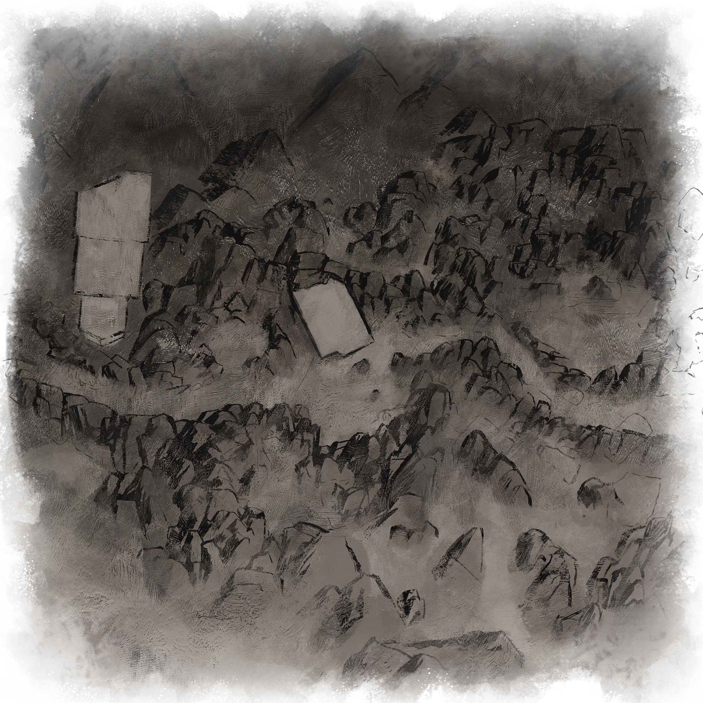

# Suzuki Environs

<table class="infobox">
<caption>Suzuki Environs</caption>
<colgroup>
<col style="width: 50%" />
<col style="width: 50%" />
</colgroup>
<tbody>
<tr>
<td colspan="2"><figure>

<figcaption>No_picture.png</figcaption>
</figure></td>
</tr>
<tr>
<td colspan="2" class="section">
<strong>Location on <a href="./Great%20Bear%20Island.md" class="wikilink" title="Great Bear Island">Great Bear Island</a></strong>
</td>
</tr>
<tr>
<td colspan="2"><figure>

<figcaption>No_picture.png</figcaption>
</figure></td>
</tr>
<tr>
<td colspan="2"><figure>

<figcaption>Suzuki_Region_In-Game_Map.png</figcaption>
</figure></td>
</tr>
<tr>
<td colspan="2" class="section">
<strong>Details</strong>
</td>
</tr>
<tr>
<td>
Description
</td>
<td>
A mountain region housing the <a href="./Suzuki%20Radio%20Telescope.md" class="wikilink" title="Suzuki Radio Telescope">Suzuki Radio Telescope</a> and a small parking lot.
</td>
</tr>
<tr>
<td>
Date Added
</td>
<td>
31 March 2026
</td>
</tr>
</tbody>
</table>

The **Suzuki Enviorns** is a <a href="./Wintermute.md" class="wikilink" title="Wintermute">Wintermute</a>-exclusive region, which consists solely of the <a href="./Suzuki%20Radio%20Telescope.md" class="wikilink" title="Suzuki Radio Telescope">Suzuki Radio Telescope</a>. It can be accessed by the nearby <a href="./Blackrock%20Foothills.md" class="wikilink" title="Blackrock Foothills">Blackrock Foothills</a>, and eventually leads out to the <a href="./Suzuki%20Geothermal%20Region.md" class="wikilink" title="Suzuki Geothermal Region">Suzuki Geothermal Region</a>.

The region is situated along the peak of Mt. Franklin, at an elevation of 2,196 meters (7,204 feet) above sea level.

## Overview

The area consists of two spaces; a flat gated parking lot surrounded by rocky clearing, and a lowered, hilly area used to access the Geothermal Region, which is filled with bits of rusted piping and industrial scrap off to the side, and is divided from the rest of the region by a massive barbed wire fence.

A white <a href="./Truck.md" class="wikilink" title="truck">truck</a> can be found in the parking lot, with <a href="./Shopping%20List.md" class="wikilink" title="crumpled note">crumpled note</a> inside the glove box describing it as "Dr. Atwood's truck."

## Trivia

- Mt. Franklin's peak is 2,196 meters above sea level, which is ironically exactly 1 meter *taller* than the [Golden Hinde](https://en.wikipedia.org/wiki/Golden_Hinde_(mountain)), the tallest peak on Vancouver Island, a major inspiration for Great Bear Island.

**Lua execution error in Module:Navbox function navbox**

