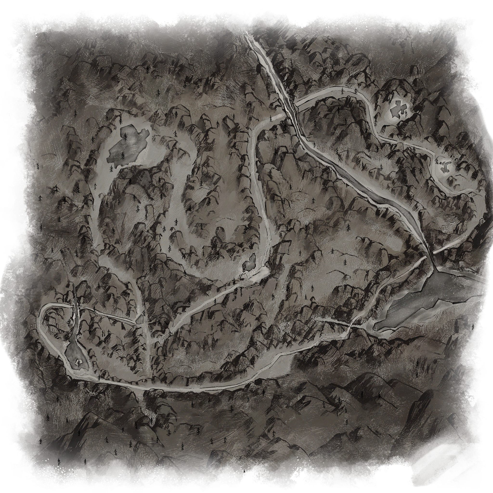

# Suzuki Geothermal Region

**Contents**

- [Overview](#overview)
- [Episode 5](#episode-5)
- [Locations](#locations)
- [First Broken Bridge](#first-broken-bridge)
- [Geothermal Substation One](#geothermal-substation-one)
- [Geothermal Substation Two](#geothermal-substation-two)
- [Second Broken Bridge](#second-broken-bridge)
- [Geothermal Substation Three](#geothermal-substation-three)
- [Rope Bridge](#rope-bridge)
- [Trivia](#trivia)

**Suzuki Geothermal Region**

| Property | Details |
| --- | --- |
|  |  / *No\_picture.png* |
| **Location on [Great Bear Island](./Great%20Bear%20Island.md)** |  |
|  |  / *No\_picture.png* |
|  |  / *Suzuki\_Geothermal\_Region\_In-Game\_Map.png* |
| **Details** |  |
| Description | A mountain region with several Geothermal Substations that deliver power to the [Suzuki Radio Telescope](./Suzuki%20Radio%20Telescope.md) facility. |
| Date Added | 31 March 2026 |

The **Suzuki Geothermal Region** is a [Wintermute](./Wintermute.md)-exclusive region, which consists 3 Geothermal Substations and some nearby mountains. It is accessed by the [Suzuki Environs](./Suzuki%20Environs.md).

## Overview

The Suzuki Geothermal Region is one of the most barest maps in all of [Episode 5: The Light At The End Of All Things](./Episode%205%20-%20The%20Light%20At%20The%20End%20Of%20All%20Things.md), featuring very little vegetation. It features a primary road that loops across the region, which occasionally blocked by avalanches and broken bridges, forcing the player to take alternative routes. A massive, hissing steam pipe directs the player towards Geothermal Substation Two during the primary mission. This region is also, utterly, full of [Wolves](./Wolf.md), with altered AI in order to be twice as challenging.

Each of the Substations have very similar floorplans, with the downside of having certain areas becoming blocked with steam once the Substation is activated. Ventilation shafts can be used to navigate around these plooms.

## Episode 5

[Will Mackenzie](./Will%20Mackenzie.md) goes through here with a time limit of three hours to activate the Substations in order to give [Jace](./Jace.md) and [Atwood](./Atwood.md) a fighting chance at recovering the data collected at the [Suzuki Radio Telescope](./Suzuki%20Radio%20Telescope.md). After activating Geothermal Substation Two, [Glimmer Fog](./Glimmer%20Fog.md) will cover the region. After crossing the final bridge, Mackenzie will have to face off against a [Cougar](./Cougar.md).

## Locations

#### **First Broken Bridge**

#### **Geothermal Substation One**

A [revolver](./Revolver.md), with [ammo](./Revolver%20Ammunition.md), can be found here.

#### **Geothermal Substation Two**

A second [shotgun](./Shotgun.md) can be found here, alongside [ammo](./Shotgun%20Ammunition.md).

#### **Second Broken Bridge**

Despite it being marked as Broken, this bridge can still be crossed by walking along the Steam Pipe following it. A supply crate containing a second revolver, aswell as mixed ammo, can be found near the pipe.

#### **Geothermal Substation Three**

#### **Rope Bridge**

## Trivia

- Mackenzie will make a direct reference to H.P Lovecraft's 1931 novella [At the Mountains of Madness](https://en.wikipedia.org/wiki/At_the_Mountains_of_Madness) after crossing the second bridge.
- It is suggested, due to the comically bad accuracy of the shotgun, that you crouch down and wait for the wolves to get within a short range before firing. This will hopefully kill them, if not, resort to the revolver found in Substation One.

**Lua execution error in Module:Navbox function navbox**
