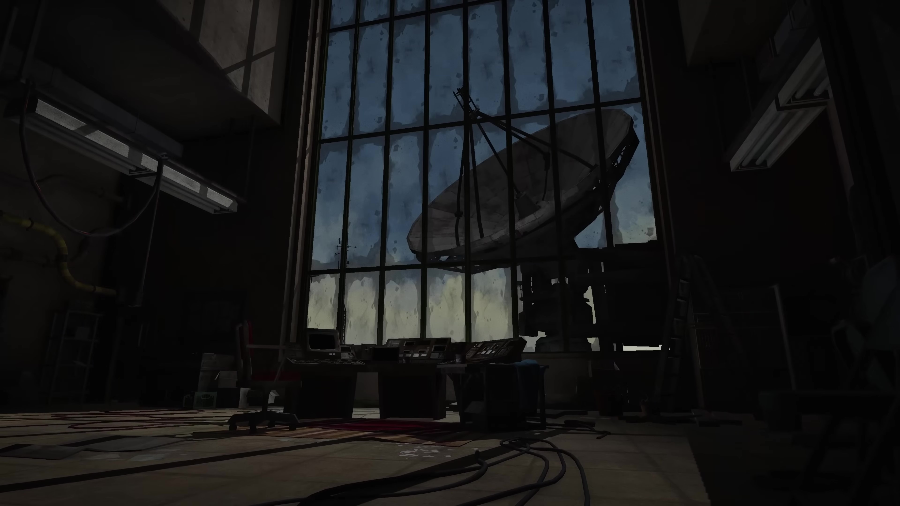
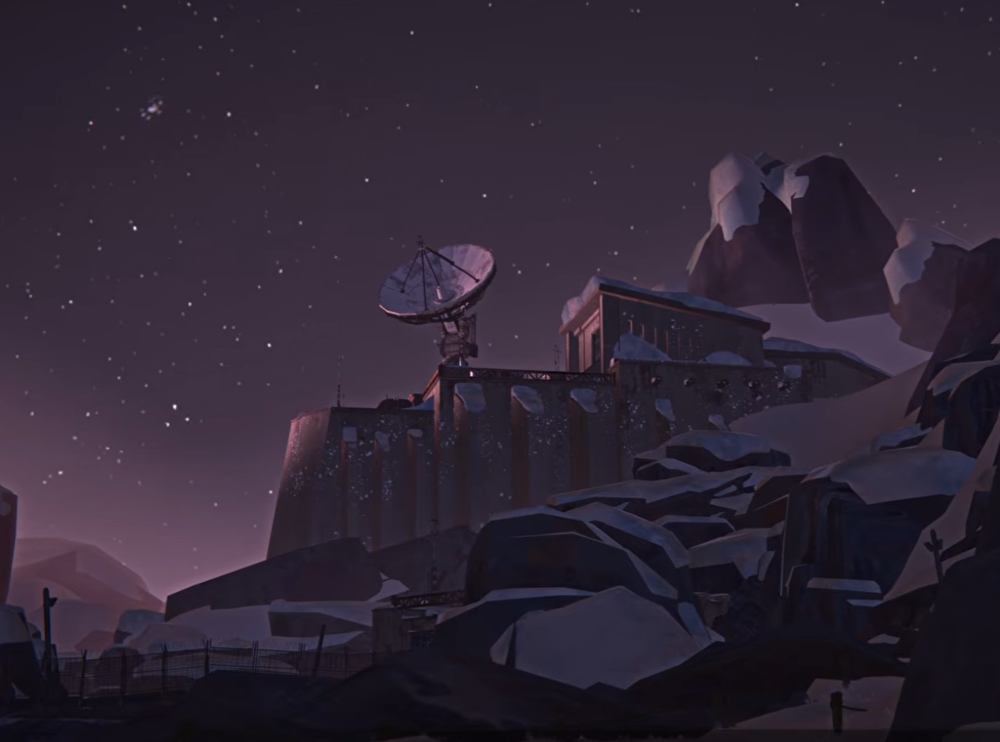

# Suzuki Radio Telescope

**Source:** [Fandom](https://thelongdark.fandom.com/wiki/Suzuki_Radio_Telescope)

**Contents**

- [Layout](#layout)
- [Lower Suzuki](#lower-suzuki)
- [Upper Suzuki](#upper-suzuki)
- [The Bunker](#the-bunker)
- [History](#history)
- [Episode 4](#episode-4)
- [Episode 5](#episode-5)
- [Trivia](#trivia)
- [Gallery](#gallery)

**Suzuki Radio Telescope**

_Suzuki\_Radio\_Telescope.jpg_

**Location on [Great Bear Island](./Great%20Bear%20Island.md)**

_No\_picture.png_

**Details**

**Description:** A government research facility with a powered space radio dish

**Connecting Regions:** [Suzuki Geothermal Region](./Suzuki%20Geothermal%20Region.md) / [Blackrock Foothills](./Blackrock%20Foothills.md)

**Characters:** [Jace](./Jace.md) / [Atwood](./Atwood.md)

**Locations:** Lower Suzuki / Upper Suzuki / The Bunker

> “**The Suzuki Radio Telescope. It's an old government facility, so there's all kinds of supplies there... food, medical equipment, vehicles. Radios. They could hunker down for weeks, months. It'd make a hell of a base of operations for all manner of evil shit they might get up to.**”
>
> — [Jace](./Jace.md) to [Will Mackenzie](./Will%20Mackenzie.md) in Episode 4

The **Suzuki Radio Telescope** is a location within the [Suzuki Environs](./Suzuki%20Environs.md) near [Perseverance Mills](./Perseverance%20Mills.md) mentioned by [Jace](./Jace.md) in [Episode 4: Fury, Then Silence](./Episode%204%20-%20Fury%2C%20Then%20Silence.md), and primarily featured in [Episode 5: The Light At The End of All Things](./Episode%205%20-%20The%20Light%20At%20The%20End%20Of%20All%20Things.md). Jace's thesis professor, [Dr. Atwood](./Atwood.md), lives within the facility. It is an old government radio telescope stated to be shielded by electromagnetic storms with it's own power supply, and is possibly been unaffected by the recent [First Flare](./First%20Flare.md) solar storm, though this is found to be innaccurate in Episode 5.

## Layout

#### **Lower Suzuki**

Home to the facility's Control Room, Dr. Atwood's Study, the Barracks, a Kitchen &amp; attached Cafeteria, a Washroom, Showers, and a supply room. Lower Suzuki is also home to numerous utility corridors, offices, winding hallways, and multiple rooms full of vintage Data Storage systems from the 1980s, including a winding hallway leading to Upper Suzuki, and a possible internal entrance to the Bunker.

#### **Upper Suzuki**

Upper Suzuki is where the Tuner Control station is located, aswell as housing the massive radio telescope and it's related equipment. The primary control station is situated in a massive hall, with a large window overlooking the telescope itself.

#### The Bunker

A series of Cold-War era storage rooms, dormitories, and related services deep below the Radio Telescope. Jace describes it as being full of medical supplies, food, vehicles, and radios.[¹](#fn1) It only appears during the final cutscenes of shown in Part 4 of Episode 5, with it's interior being rather cramped, full of ventilation shafts, pipework, and a mostly steel and concrete construction.[²](#fn2)

## History

The Suzuki Radio Telescope was built sometime in the mid 20th century, though it wasn't initially a Radio Telescope. Originally, it was built as an observation post, with the express purpose of monitoring foreign satellite communictions during the Cold War, it's position chosen both for the secluded and isolated nature of [Great Bear Island](./Great%20Bear%20Island.md), but also thanks to the clarity provided by it's elevated position.[³](#fn3) Because of this, most of the base's facilites were deep underground, in magnetically shielded dorms and store rooms, some three to four floors below the above-ground portions. Most of the communications intercepted during this era were from the major players; the United States, the Soviet Union, and some from China.

It's unknown exactly when the Canadian Government moved out, but shortly after the site was no longer being used for monitoring, it was quickly repurposed and rechristened the Suzuki Radio Telescope some twenty or more years before the events of the game.[⁴](#fn4)

The Geothermal Plant seen in the [Suzuki Geothermal Region](./Suzuki%20Geothermal%20Region.md) was a rather costly project undertaken by Suzuki, with three large Substations being constructed alongside the Plant itself. The Plant was operated by multiple smaller crews, who operated within the Substations themselves, and while it was quite successful, it ended up axed due to operating costs several years prior to Wintermute, with only a small feeder line being left open and providing Suzuki with some background power.[⁵](#fn5)

## Episode 4

During their third telephone call, Jace explains that the Suzuki Radio Telescope is around 15-20 clicks from [Blackrock](./Blackrock.md) itself, and that it is an "old government facility" with supplies ranging from food, to vehicles, and even radios. She warns [Will Mackenzie](./Will%20Mackenzie.md) that [Mathis](./Mathis.md) and his [Convicts](./Convicts.md) will most likely attempt to overtake the facility and use it as their main base of operations for the island should they escape [Blackrock Prison](./Blackrock%20Prison.md),[⁶](#fn6) before going on to explain that Suzuki's electromagnetic radiation shielding may have spared it from the electronic-frying effects of the [Aurora](./Aurora.md).

## Episode 5

After escaping the Unstable Mine in the [Blackrock Foothills](./Blackrock%20Foothills.md), Jace and Mackenzie are let in by Atwood who is, for the moment, untrusting of Mackenzie. She tells Jace that the facility is locked in a kind of maintenance mode, and was unable to pull any data from the telescope before the Aurora's power surge fried much of the facility's equipment. She states that, without heading out to the Substations to fully activate the Geothermal systems, they're unable to fully activate the remaining equipment, alongside that the small amount of data she was able to secure was concerning.

Mackenzie relays the message of Wintermute, much to the shock and quiet horror of Atwood.

The following morning, Mackenzie heads to Atwood's Study to learn that there is a somewhat risky way to try and retrieve the data within the facility's memory buffers. Despite Mackenzie's protests, Atwood enlists him in helping with her plan, which envolves returning full power to the facility's geothermal plant, which would allow Atwood to fire up the mainframes and pull the remaining data from the [First Flare](./First%20Flare.md) out of the memory buffers. The only issue being Mackenzie has a short period to do so, as not only will a heightened, massive Aurora arrive that night and most likely wipe the memory buffers of all data, but if Mackenzie takes too long turning on each of the substations, the pressure buildup would most likely cause a horrific explosion. And, to add insult to injury, the wolves in the region are even more ferocious.

Thankfully, Mackenzie is armed with a number of high-quality gear, such as a [Combat Pants](./Combat%20Pants.md), [Military Coats](./Military%20Coat.md), and the new Episode 5-exclusives: the [Shotgun](./Shotgun.md) and [Military Stims](./Military%20Stim.md). After returning from his excursion, and with the power back in, Mackenzie assists Jace in ensuring the data is moved from the buffers into Dr. Atwood's study by moving the Telescope dish using the tuners. Despite the challenges, the Tuner Control room's equipment catching fire, and one of the tuners even electrocuting Mackenzie, the data is successfully pulled from the buffers. But, before it can be processed, Suzuki's remaining equipment is overloaded and completely shuts down.

Atwood goes on to explain what the Aurora exactly is, before letting Mackenzie head to [Perseverance Mills](./Perseverance%20Mills.md) to try and find [Astrid](./Astrid%20Greenwood.md).

## Trivia

- The Facility itself is most likely named after [David Suzuki](https://en.wikipedia.org/wiki/David_Suzuki), a renowned Canadian environmental activist, geneticist, and world-famous science broadcaster.
- According to the [Shopping List](./Shopping%20List.md) note, Atwood and Jace share a P.O box at an unknown Post Office, with the code to it being 1859. The only three possible locations for this P.O box include [Milton](./Milton%20Post%20Office.md), [Perseverance Mills](./Co-op.md), and the elusive and currently unseen Port Mary.
- The Kitchen within Lower Suzuki most likely contains the highest concentration of consumable food and drink in the entirety of Wintermute.
- There are 18 beds within the Lower Suzuki Barracks.

## Gallery

_Suzuki, as seen from the Unstable Mine exit._

_Suzuki seen from an alternative angle during the final cutscene. The Tuner Control Hall's window can be seen across from the Radio Telescope._

_The entrance into the Bunker below Suzuki, marked as "G406."_

## Notes

---

2. [https://youtu.be/cewVQSRhfxY?t=1841](https://youtu.be/cewVQSRhfxY?t=1841)[↩︎](#fnref2)
3. [https://youtu.be/Mv1kQlPK7xE?t=15908](https://youtu.be/Mv1kQlPK7xE?t=15908)[↩︎](#fnref3)
4. The last time Atwood saw Jeremiah was 20+ years ago, and she was working at the Telescope, not the base. [https://youtu.be/Mv1kQlPK7xE?t=15611](https://youtu.be/Mv1kQlPK7xE?t=15611)[↩︎](#fnref4)
5. [https://youtu.be/Mv1kQlPK7xE?t=7616](https://youtu.be/Mv1kQlPK7xE?t=7616)[↩︎](#fnref5)
6. [https://youtu.be/mgcdR12Xnds?t=14174](https://youtu.be/mgcdR12Xnds?t=14174)[↩︎](#fnref6)
