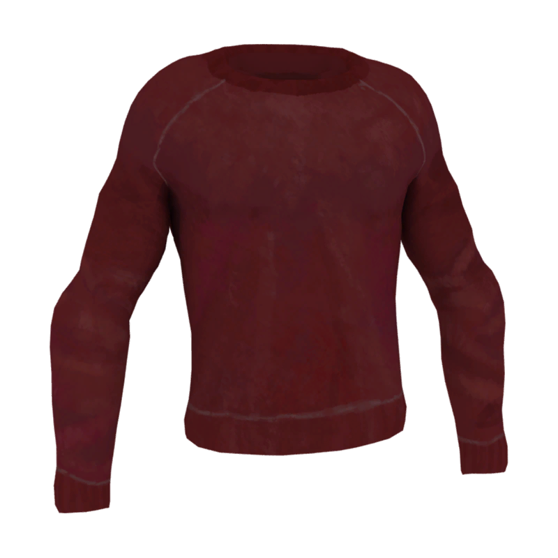
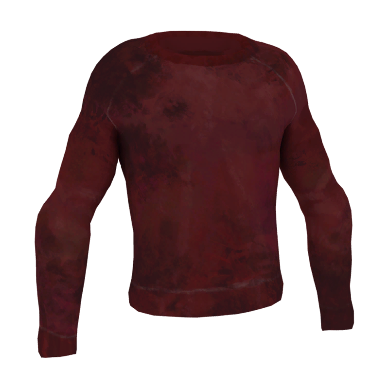

# Sweatshirt

<table class="infobox">
<caption>Sweatshirt</caption>
<colgroup>
<col style="width: 50%" />
<col style="width: 50%" />
</colgroup>
<tbody>
<tr>
<td colspan="2"><figure>

<figcaption>Sweatshirt_icon.png</figcaption>
</figure></td>
</tr>
<tr>
<td colspan="2" class="section">
<strong>General</strong>
</td>
</tr>
<tr>
<td>
Item Type
</td>
<td>
Clothing|-
</td>
</tr>
<tr>
<td>
Clothing Slot
</td>
<td>
Inner torso
</td>
</tr>
<tr>
<td colspan="2" class="section">
<strong>Statistics</strong>
</td>
</tr>
<tr>
<td>
Weight
</td>
<td>
0.25 kg(0.55 lbs)
</td>
</tr>
<tr>
<td>
Warmth bonus
</td>
<td>
0.5 °C(0.9 °F)
</td>
</tr>
<tr>
<td>
Windproof bonus
</td>
<td>
1.0 °C(1.8 °F)
</td>
</tr>
<tr>
<td>
Waterproof bonus
</td>
<td>
10%
</td>
</tr>
<tr>
<td>
Protection
</td>
<td>
2%
</td>
</tr>
<tr>
<td>
Mobility
</td>
<td>
0%
</td>
</tr>
<tr>
<td>
Harvest
</td>
<td>
1 × <a href="./Cloth.md" class="wikilink" title="Cloth">Cloth</a> 
10 minutes
</td>
</tr>
<tr>
<td>
Repair
</td>
<td>
1 × <a href="./Cloth.md" class="wikilink" title="Cloth">Cloth</a> 
30 minutes 
35% condition
</td>
</tr>
</tbody>
</table>

<table>
<colgroup>
<col style="width: 33%" />
<col style="width: 33%" />
<col style="width: 33%" />
</colgroup>
<tbody>
<tr>
<td style="vertical-align: top; font-size: 3em; color: #5d5980; padding-right: 10px">
“
</td>
<td>
Crew-neck sweater made of heavy cotton. Will take the edge off on a windy day, but not very warm.

&#10;

In-game description

</td>
<td style="vertical-align: bottom; font-size: 3em; color: #5d5980; padding-left: 10px">
”
</td>
</tr>
</tbody>
</table>

The **Sweatshirt** is a type of <a href="./Clothing.md" class="wikilink" title="clothing">clothing</a> in *<a href="./The%20Long%20Dark.md" class="wikilink" title="The Long Dark">The Long Dark</a>*.

## Overview

A common starting item, the **sweatshirt** has similar, but slightly better stats than the <a href="./Hoodie.md" class="wikilink" title="Hoodie">Hoodie</a> due to its slightly better wind-proof bonus. However, it is still not very warm, and its wind-proofing is useless if anything is worn over it. As a result, it should be replaced as soon as possible with something warmer.

- UPDATE **19 December 2016 (<a href="./The%20Long%20Dark%20%E2%80%94%20Early%20Access%20Changelog.md#0.386" class="wikilink" title="Update">Update</a>):**
  - Added to game

== Gallery ==

<table class="gallery">
<colgroup>
<col style="width: 25%" />
<col style="width: 25%" />
<col style="width: 25%" />
<col style="width: 25%" />
</colgroup>
<tbody>
<tr>
<td><figure>

<figcaption>Clothing model</figcaption>
</figure></td>
<td><figure>

<figcaption>Clothing model damaged</figcaption>
</figure></td>
<td><figure>
[Missing image: Sweatshirt_Front.jpg]
<figcaption>The front of a sweatshirt at 100% condition.</figcaption>
</figure></td>
<td><figure>
[Missing image: Sweatshirt1%_Front.jpg]
<figcaption>The front of a sweatshirt at 1% condition.</figcaption>
</figure></td>
</tr>
<tr>
<td><figure>
[Missing image: Sweatshirt1%_Back.jpg]
<figcaption>The back of a sweatshirt at 1% condition.</figcaption>
</figure></td>
<td><figure>
[Missing image: Sweatshirt_Back.jpg]
<figcaption>The back of a sweatshirt at 100% condition.</figcaption>
</figure></td>
<td><figure>
[Missing image: Sweatshirt1%_PaperDoll_Male.jpg]
<figcaption>The sweatshirt at 1% condition on the male paper doll model.</figcaption>
</figure></td>
<td><figure>
[Missing image: Sweatshirt_PaperDoll_Male.jpg]
<figcaption>The sweatshirt at 100% condition on the male paper doll model.</figcaption>
</figure></td>
</tr>
<tr>
<td><figure>
[Missing image: Sweatshirt1%_RockThrow_Male.jpg]
<figcaption>The male in-game model wearing a 1% condition sweatshirt, aiming a rock.</figcaption>
</figure></td>
<td><figure>
[Missing image: Sweatshirt_RockThrow_Male.jpg]
<figcaption>The male in-game model wearing a sweatshirt, aiming a rock</figcaption>
</figure></td>
<td><figure>
[Missing image: Sweatshirt1%_Revolver_Male.jpg]
<figcaption>The male in-game model wearing a 1% condition sweatshirt, aiming a revolver.</figcaption>
</figure></td>
<td><figure>
[Missing image: Sweatshirt_Revolver_Male.jpg]
<figcaption>The male in-game model wearing a sweatshirt, aiming a revolver.</figcaption>
</figure></td>
</tr>
<tr>
<td><figure>
[Missing image: Sweatshirt1%_Rifle_Male.jpg]
<figcaption>The male in-game model wearing a 1% condition sweatshirt, holding a rifle.</figcaption>
</figure></td>
<td><figure>
[Missing image: Sweatshirt_Rifle_Male.jpg]
<figcaption>The male in-game model wearing a sweatshirt, holding a rifle.</figcaption>
</figure></td>
<td></td>
<td></td>
</tr>
</tbody>
</table>

**Lua execution error in Module:Navbox function navbox** <a href="ru:%D0%A1%D0%B2%D0%B8%D1%82%D1%88%D0%BE%D1%82" class="wikilink" title="ru:Свитшот">ru:Свитшот</a>

