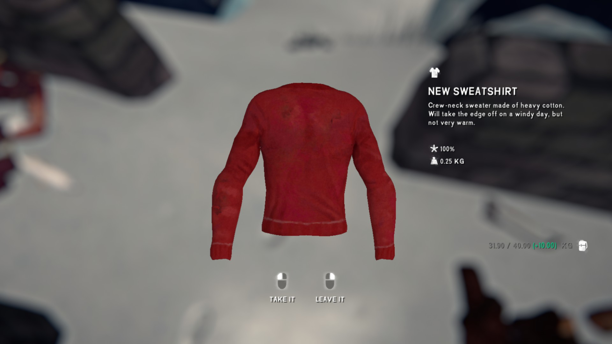
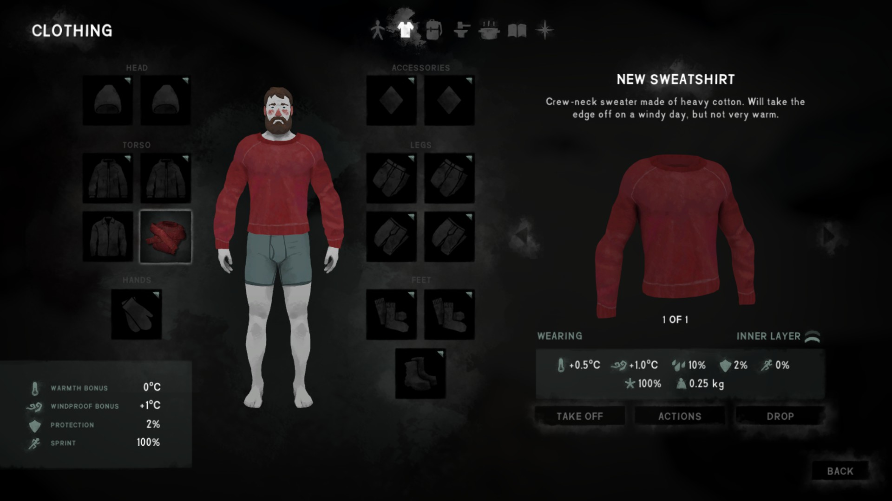
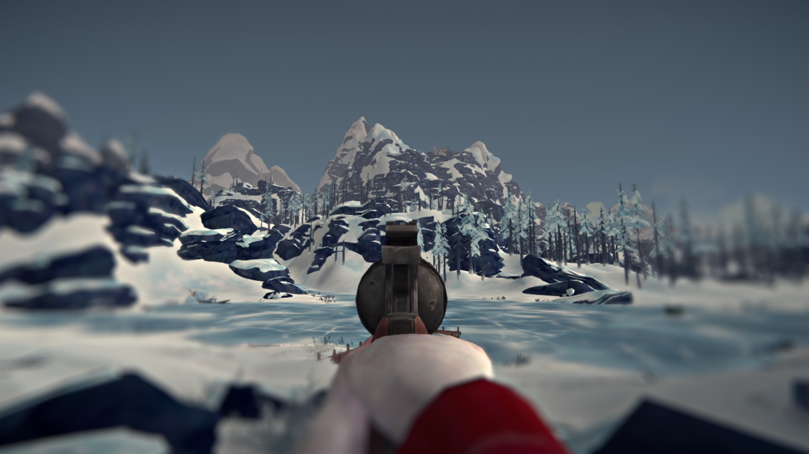

# Sweatshirt

**Sweatshirt**

| Property | Details |
| --- | --- |
|  |  / *Sweatshirt\_icon.png* |
| **General** |  |
| Item Type | Clothing\|- |
| Clothing Slot | Inner torso |
| **Statistics** |  |
| Weight | 0.25 kg(0.55 lbs) |
| Warmth bonus | 0.5 °C(0.9 °F) |
| Windproof bonus | 1.0 °C(1.8 °F) |
| Waterproof bonus | 10% |
| Protection | 2% |
| Mobility | 0% |
| Harvest | 1 × [Cloth](./Cloth.md) / 10 minutes |
| Repair | 1 × [Cloth](./Cloth.md) / 30 minutes / 35% condition |

> “**Crew-neck sweater made of heavy cotton. Will take the edge off on a windy day, but not very warm.**”
>
> — In-game description

The **Sweatshirt** is a type of [clothing](./Clothing.md) in *[The Long Dark](./The%20Long%20Dark.md)*.

## Overview

A common starting item, the **sweatshirt** has similar, but slightly better stats than the [Hoodie](./Hoodie.md) due to its slightly better wind-proof bonus. However, it is still not very warm, and its wind-proofing is useless if anything is worn over it. As a result, it should be replaced as soon as possible with something warmer.

- UPDATE **19 December 2016 ([Update](./The%20Long%20Dark%20%E2%80%94%20Early%20Access%20Changelog.md#0.386)):**
  - Added to game

== Gallery ==

| Column 1 | Column 2 | Column 3 | Column 4 |
| --- | --- | --- | --- |
|  / *Clothing model* |  / *Clothing model damaged* |  / *The front of a sweatshirt at 100% condition.* |  / *The front of a sweatshirt at 1% condition.* |
|  / *The back of a sweatshirt at 1% condition.* |  / *The back of a sweatshirt at 100% condition.* |  / *The sweatshirt at 1% condition on the male paper doll model.* |  / *The sweatshirt at 100% condition on the male paper doll model.* |
|  / *The male in-game model wearing a 1% condition sweatshirt, aiming a rock.* |  / *The male in-game model wearing a sweatshirt, aiming a rock* |  / *The male in-game model wearing a 1% condition sweatshirt, aiming a revolver.* |  / *The male in-game model wearing a sweatshirt, aiming a revolver.* |
|  / *The male in-game model wearing a 1% condition sweatshirt, holding a rifle.* |  / *The male in-game model wearing a sweatshirt, holding a rifle.* |  |  |

**Lua execution error in Module:Navbox function navbox** [ru:Свитшот](ru:%D0%A1%D0%B2%D0%B8%D1%82%D1%88%D0%BE%D1%82)
