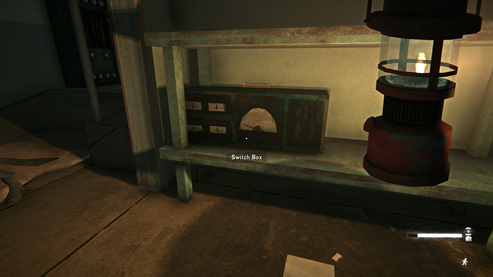

# Switch Box

**Categories:** Interactable Objects, Story items · **Source:** [Fandom](https://thelongdark.fandom.com/wiki/Switch_Box)

**Switch Box**

| Property | Details |
| --- | --- |
|  |  / _SwitchBox.jpg_ |
| **General** |  |
| Item Type | Item |
| Wintermute | Yes\|- |
| Harvest | 30 minutes 2 x [Scrap Metal](./Scrap%20Metal.md) |

A **Switch Box** is a harvestable item from in many industrial areas of the Island. It can be harvested with a [Hacksaw](./Hacksaw.md). They provide 2 Scrap Metal in 30 minutes. They share the same model as a large [Broken Metal Control Box](./Broken%20Metal%20Control%20Box.md).

| Object | Scrap Metal | Time | Calories | Condition (of Hacksaw) |
| --- | --- | --- | --- | --- |
| Switch Box | 2 | 30 minutes |  | -5% |
