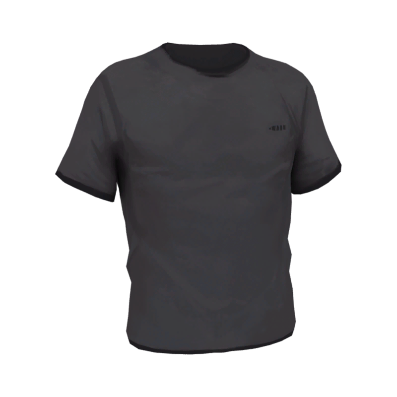

# T\-Shirt

**Categories:** Clothing, Pages with update history · **Source:** [Fandom](https://thelongdark.fandom.com/wiki/T-Shirt)

**T-Shirt**

_T-Shirt\_icon.png_

**General**

**Item Type:** Clothing\|-

**Renewable:** Yes (rare [Beachcombing](./Beachcombing.md))

**Clothing Slot:** Inner torso

**Statistics**

**Weight:** 0.25 kg(0.55 lbs)

**Warmth bonus:** 0.5 °C(0.9 °F)

**Windproof bonus:** 0.0 °C(0 °F)

**Waterproof bonus:** 0%

**Protection:** 0%

**Mobility:** 0%

**Harvest:** 1 × [Cloth](./Cloth.md) / 10 minutes

**Repair:** 1 × [Cloth](./Cloth.md) / 30 minutes / 35% condition

> “**Short-sleeved cotton t-shirt. Doesn't offer much warmth, particularly when wet.**”
>
> — In-game description

The **T-Shirt** is a type of [clothing](./Clothing.md) item in _[The Long Dark](./The%20Long%20Dark.md)_.

## Overview

The shirt is the worst inner torso clothing in the game. It offers a small amount of warmth, and nothing else. It should be replaced and harvested for [Cloth](./Cloth.md) as soon as possible, as every other inner torso clothing outclasses it in some way.

_Clothing model icon_

_Clothing model icon damaged_

## Update history

- UPDATE **19 December 2016 ([Update](./The%20Long%20Dark%20%E2%80%94%20Early%20Access%20Changelog.md#0.386)):**
  - Added to game
