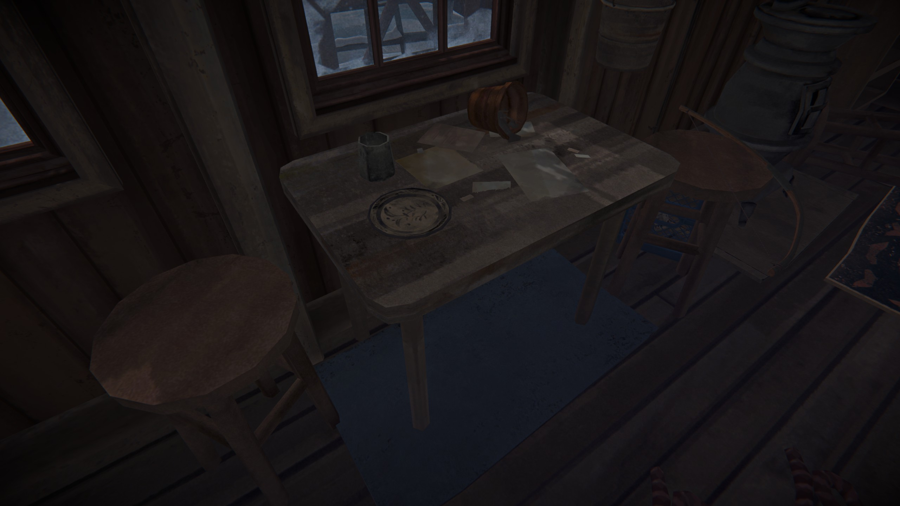
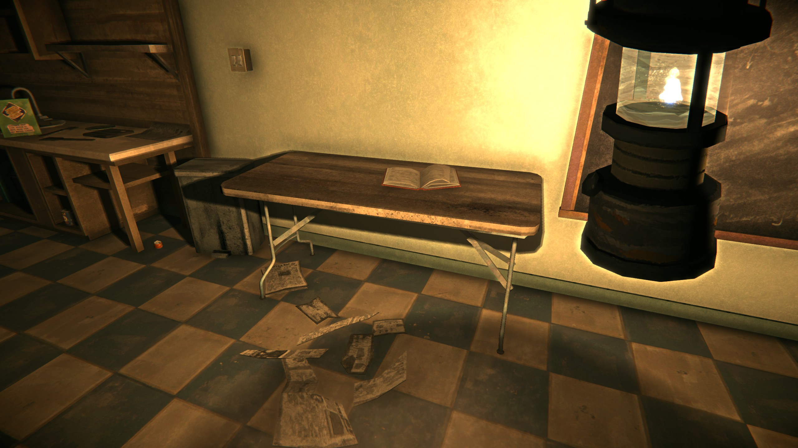
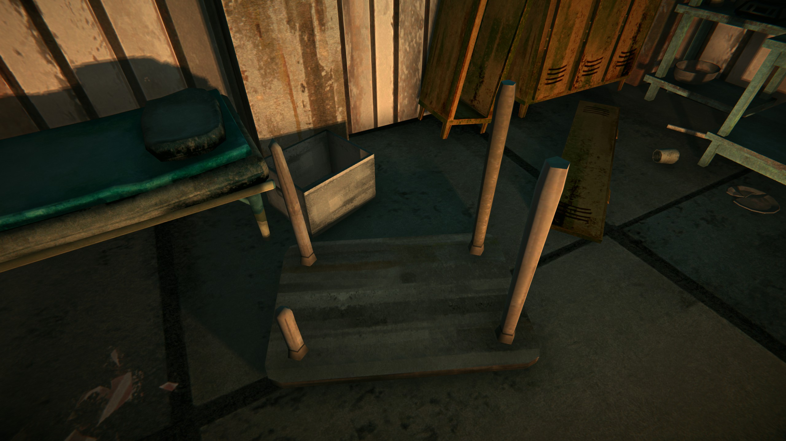
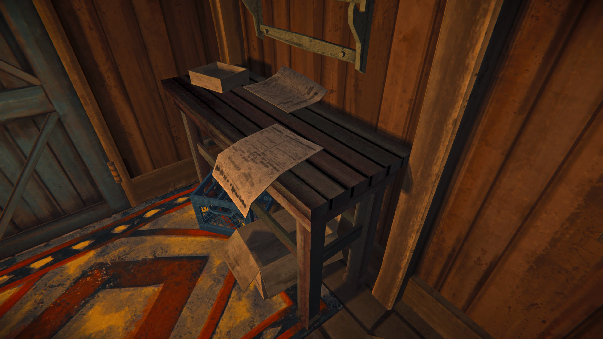
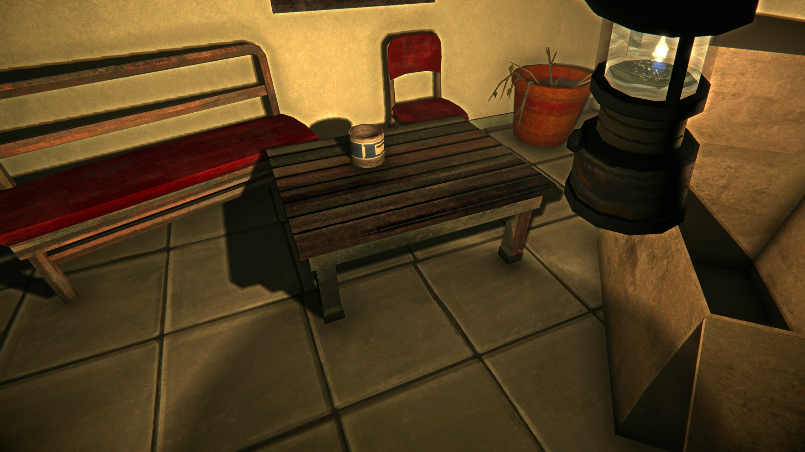

# Table

**Categories:** Interactable Objects, Story items · **Source:** [Fandom](https://thelongdark.fandom.com/wiki/Table)

**Contents**

- [Small/Broken/Recreation Table](#smallbrokenrecreation-table)
- [Coffee Table](#coffee-table)
- [Nightstand Table](#nightstand-table)
- [Medium Table](#medium-table)
- [Dining Table](#dining-table)
- [Large Table](#large-table)

**Table**

      

250px\]\]

**General**

**Item Type:** Item

Wintermute

Yes

**Statistics**

**Harvest:** [Reclaimed Wood](./Reclaimed%20Wood.md)

**Tables** are wooden furniture that can be harvested with a [Hatchet](./Hatchet.md) to receive [Reclaimed Wood](./Reclaimed%20Wood.md).

## Small/Broken/Recreation Table

Can be easily identified as a very small wooden table or a very thin table. Sometimes they are an upturned table with one shortened/missing table leg. All 3 versions give 3 Reclaimed Wood.

| Reclaimed Wood | Time | Calories | Condition of Tool |
| --- | --- | --- | --- |
| 3 | 38 minutes | 112 | -2% Hatchet |
| 3 | 49 minutes | 146 | -3% Improvised Hatchet |
| 3 | 56 minutes | 169 | -0.5% Heavy Hammer |

## Coffee Table

The coffee table is a wooden piece of furniture which is used primarily as a source of reclaimed wood. When a coffee table is broken down, it yields Reclaimed Wood. Coffee tables are distinguishable from normal tables due to the difference in height.

| Reclaimed Wood | Time | Calories | Condition of Tool |
| --- | --- | --- | --- |
| 4 | 1 hour 30 minutes |  | -2% Hatchet |
| 4 |  |  | -3% Improvised Hatchet |
| 4 |  |  | -0.5% Heavy Hammer |

## Nightstand Table

The Nightstand Table are larger, more square wooden furniture primarily found near beds in homes.

| Reclaimed Wood | Time | Calories | Condition of Tool |
| --- | --- | --- | --- |
| 3 | 38 minutes | 112 | -2% Hatchet |
| 3 | 49 minutes | 146 | -3% Improvised Hatchet |
| 3 | 56 minutes | 169 | -0.5% Heavy Hammer |

## Medium Table

A rare rare variant that gives 5 Reclaimed Wood.

| Reclaimed Wood | Time | Calories | Condition of Tool |
| --- | --- | --- | --- |
| 5 | 1 hour 30 minutes | 270 | -2% Hatchet |
| 5 | 1 hour 57 minutes | 351 | -3% Improvised Hatchet |
| 5 | 2 hours 15 minutes | 405 | -0.5% Heavy Hammer |

## Dining Table

The dining table is a wooden piece of furniture normally found in the kitchens or dinner rooms of abandoned houses. They provide a [Tinder Plug](./Tinder%20Plug.md) as well as Reclaimed Wood.

| Reclaimed Wood/Tinder Plug | Time | Calories | Condition of Tool |
| --- | --- | --- | --- |
| 6/1 | 1 hour 30 minutes | 270 | -2% Hatchet |
| 6/1 | 1 hour 57 minutes | 351 | -3% Improvised Hatchet |
| 6/1 | 2 hours 15 minutes | 405 | -0.5% Heavy Hammer |

## Large Table

Tables yield 6 reclaimed wood, require a Hatchet to harvest, and take 1.5 hour to harvest and burn 270 calories

| Reclaimed Wood | Time | Calories | Condition of Tool |
| --- | --- | --- | --- |
| 6 | 1 hour 30 minutes | 270 | -2% Hatchet |
| 6 |  |  | -3% Improvised Hatchet |
| 6 |  |  | -0.5% Heavy Hammer |
