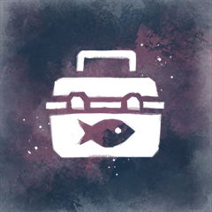

# Tackle Box

**Categories:** Achievements · **Source:** [Fandom](https://thelongdark.fandom.com/wiki/Tackle_Box)

**Tackle Box**

_Tackle\_Box\_icon.png_

**Description:** Craft a full set of 3 Fishing Lures (single game).

**Tackle Box** is an [achievement](./The%20Long%20Dark%20%E2%80%94%20Achievements.md) in _[The Long Dark](./The%20Long%20Dark.md)_.

## Guide

The player only needs to craft any 3 of these Fishing Lures at a [Work Bench](./Work%20Bench.md) to unlock this Achievement.

-  [Fishing Lure (Acorns)](./Fishing%20Lure%20%28Acorns%29.md)
-  [Fishing Lure (Revolver Shell Casing)](./Fishing%20Lure%20%28Revolver%20Shell%20Casing%29.md)
-  [Fishing Lure (Wire Bundle)](./Fishing%20Lure%20%28Wire%20Bundle%29.md)
-  [Simple Fishing Lure](./Simple%20Fishing%20Lure.md)
