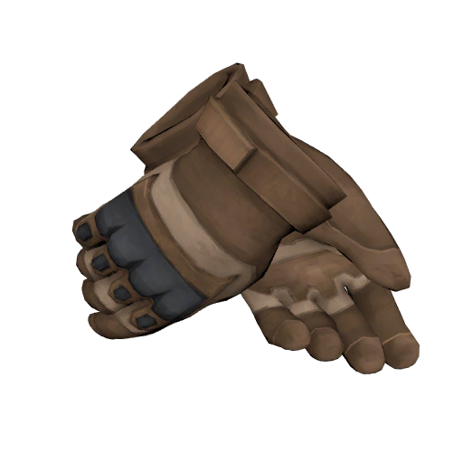

# Tactical Gloves

**Tactical Gloves**

| Property | Details |
| --- | --- |
|  |  / *Tactical\_Gloves\_icon.png* |
| **General** |  |
| Item Type | Clothing\|- |
| **Statistics** |  |
| Weight | 0.75 kg(1.65 lbs) |
| Warmth bonus | 1.5 °C(2.7 °F) |
| Windproof bonus | 3.0 °C(5.4 °F) |
| Waterproof bonus | 50% |
| Protection | 7% |
| Mobility | -1% |
| Harvest | 1 × [Cured Leather](./Cured%20Leather.md) / 10 minutes |
| Repair | 1 × [Cured Leather](./Cured%20Leather.md) / 30 minutes / 25% condition |

| Column 1 | Column 2 | Column 3 |
| --- | --- | --- |
|  / *Ptarmigan\_icon.png* | **DLC-Exclusive content.** / This content requires the [Tales from the Far Territory](./Tales%20from%20the%20Far%20Territory.md) addon to be installed before it can be seen or used in regular gameplay. | \|} / > “**Reinforced gloves in the tactical style. Highly-protective, at the cost of warmth.**” / > / > — In-game description / **Tactical Gloves** are unique [Clothing](./Clothing.md) found only during the [Last Horizon](./Last%20Horizon.md) Tale in [Sundered Pass](./Sundered%20Pass.md). It is found in the [Last Lonely House](./Last%20Lonely%20House.md), under the bed in the locked bedroom (unlocked with [An Old House Key](./An%20Old%20House%20Key.md)). They originally belonged to [The Foreman](./The%20Foreman.md). / ## Overview / Tactical Gloves are warm and best-in-slot windproofing, waterproofing and protection but are slightly (0.5°C) colder than similar late-game gloves: [Rabbitskin Mitts](./Rabbitskin%20Mitts.md) or [Gauntlets](./Gauntlets.md). Tactical Gloves also provide more total "[Feels Like](./Feels%20Like.md)" temperature increase (warmth + windproof) for a total of 4.5°C, where as Rabbitskin Mitts and Gauntlets provide only 4°C. / Because of their very high windproofing, these Tactical Gloves typically provide more benefit outdoors than indoors (or sheltering inside vehicles/caves) where windproofing is irrelevant. / A small but not negligeable benefit is the lessened mobility restriction the Tactical gloves provide in comparison to Rabbitskin Mitts (+4%) and even Gauntlets (+2%). They are also 0.25kg lighter than either of those options. / However Tactical Gloves decay their condition slightly faster and repair less condition per action than Gauntlets and Rabbitskin Mitts. / ## Gallery / \| Column 1 \| Column 2 \| / \| --- \| --- \| / \|  / *3d model* \|  / *3d model damaged* \| / ## Update history / - UPDATE **24 June 2024 ([Update](./The%20Long%20Dark%20%E2%80%94%20Changelog.md#2.28)):** / - Added to game. / **Lua execution error in Module:Navbox function navbox** [ru:Тактические перчатки](ru:%D0%A2%D0%B0%D0%BA%D1%82%D0%B8%D1%87%D0%B5%D1%81%D0%BA%D0%B8%D0%B5_%D0%BF%D0%B5%D1%80%D1%87%D0%B0%D1%82%D0%BA%D0%B8) |
| “ | **Reinforced gloves in the tactical style. Highly-protective, at the cost of warmth.** / In-game description | ” |
|  / *3d model* |  / *3d model damaged* |  |
