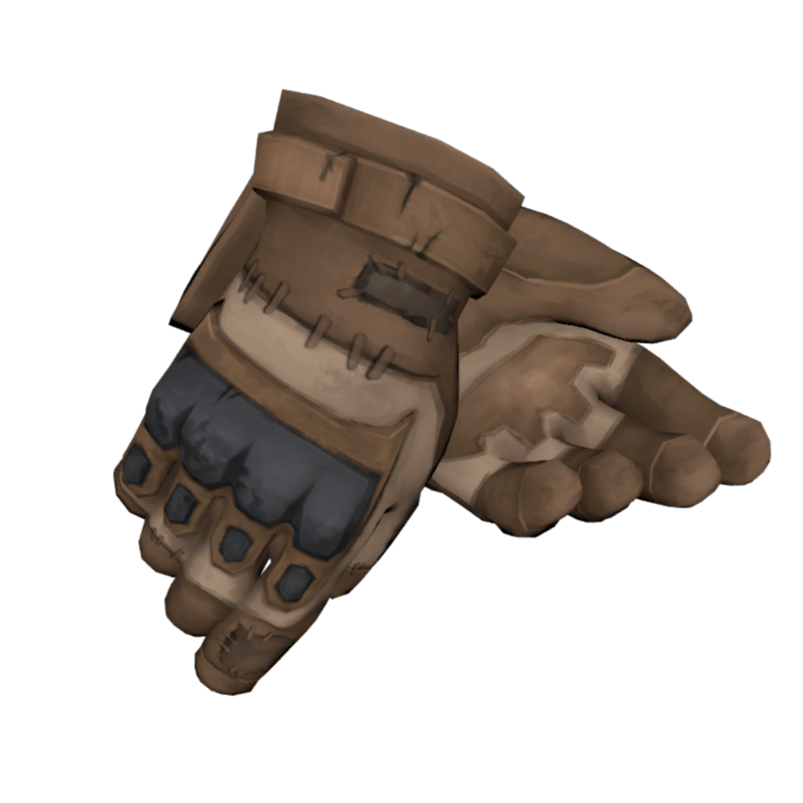

# Tactical Gloves

**Categories:** Clothing, DLC Content, Pages with update history, Story items · **Source:** [Fandom](https://thelongdark.fandom.com/wiki/Tactical_Gloves)

**Tactical Gloves**

[Tactical Gloves icon](../assets/Tactical_Gloves_icon.png)

**General**

**Item Type:** Clothing

**Statistics**

**Weight:** [Weight icon](../assets/Weight_icon.png)0.75 kg(1.65 lbs)

**Warmth bonus:** [Temp icon](../assets/Temp_icon.png)1.5 °C(2.7 °F)

**Windproof bonus:** [Windproofness icon](../assets/Windproofness_icon.png)3.0 °C(5.4 °F)

**Waterproof bonus:** [Waterproofness icon](../assets/Waterproofness_icon.png)50%

**Protection:** [Protection icon](../assets/Protection_icon.png)7%

**Mobility:** [Mobility icon](../assets/Mobility_icon.png)-1%

**Harvest:** 1 × [Cured Leather](./Cured%20Leather.md) 10 minutes

**Repair:** 1 × [Cured Leather](./Cured%20Leather.md) 30 minutes 25% condition

**DLC-Exclusive content.**

This content requires the [Tales from the Far Territory](./Tales%20from%20the%20Far%20Territory.md) addon to be installed before it can be seen or used in regular gameplay.

> “**Reinforced gloves in the tactical style. Highly-protective, at the cost of warmth.**”
>
> — In-game description

**Tactical Gloves** are unique [Clothing](./Clothing.md) found only during the [Last Horizon](./Last%20Horizon.md) Tale in [Sundered Pass](./Sundered%20Pass.md). It is found in the [Last Lonely House](./Last%20Lonely%20House.md), under the bed in the locked bedroom (unlocked with [An Old House Key](./An%20Old%20House%20Key.md)). They originally belonged to [The Foreman](./The%20Foreman.md).

## Overview

Tactical Gloves are warm and best-in-slot windproofing, waterproofing and protection but are slightly (0.5°C) colder than similar late-game gloves: [Rabbitskin Mitts](./Rabbitskin%20Mitts.md) or [Gauntlets](./Gauntlets.md). Tactical Gloves also provide more total "[Feels Like](./Feels%20Like.md)" temperature increase (warmth + windproof) for a total of 4.5°C, where as Rabbitskin Mitts and Gauntlets provide only 4°C.

Because of their very high windproofing, these Tactical Gloves typically provide more benefit outdoors than indoors (or sheltering inside vehicles/caves) where windproofing is irrelevant.

A small but not negligeable benefit is the lessened mobility restriction the Tactical gloves provide in comparison to Rabbitskin Mitts (+4%) and even Gauntlets (+2%). They are also 0.25kg lighter than either of those options.

However Tactical Gloves decay their condition slightly faster and repair less condition per action than Gauntlets and Rabbitskin Mitts.

## Gallery

## Update history

- UPDATE **24 June 2024 ([Update](./The%20Long%20Dark%20%E2%80%94%20Changelog.md#2.28)):**
  - Added to game.
