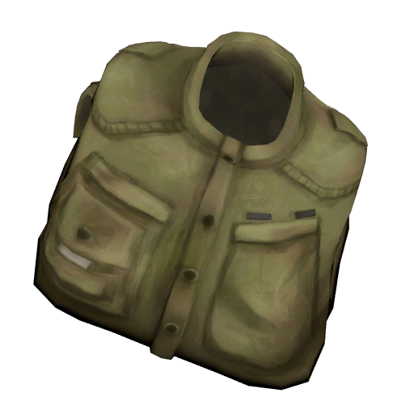
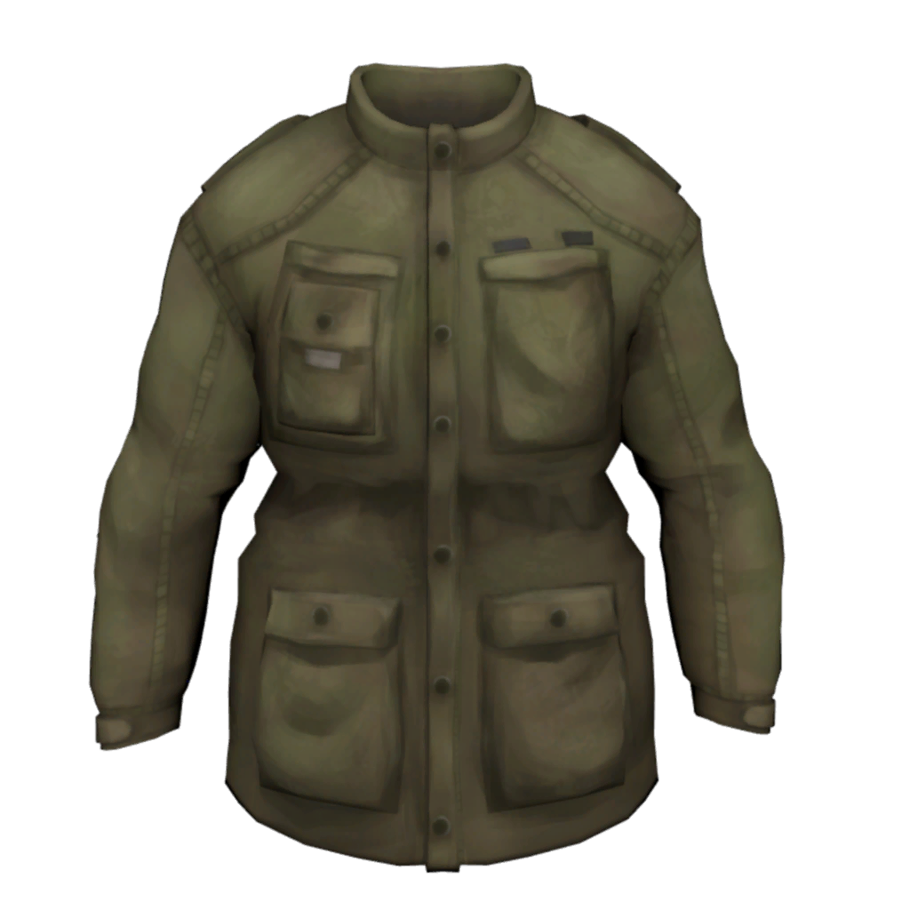
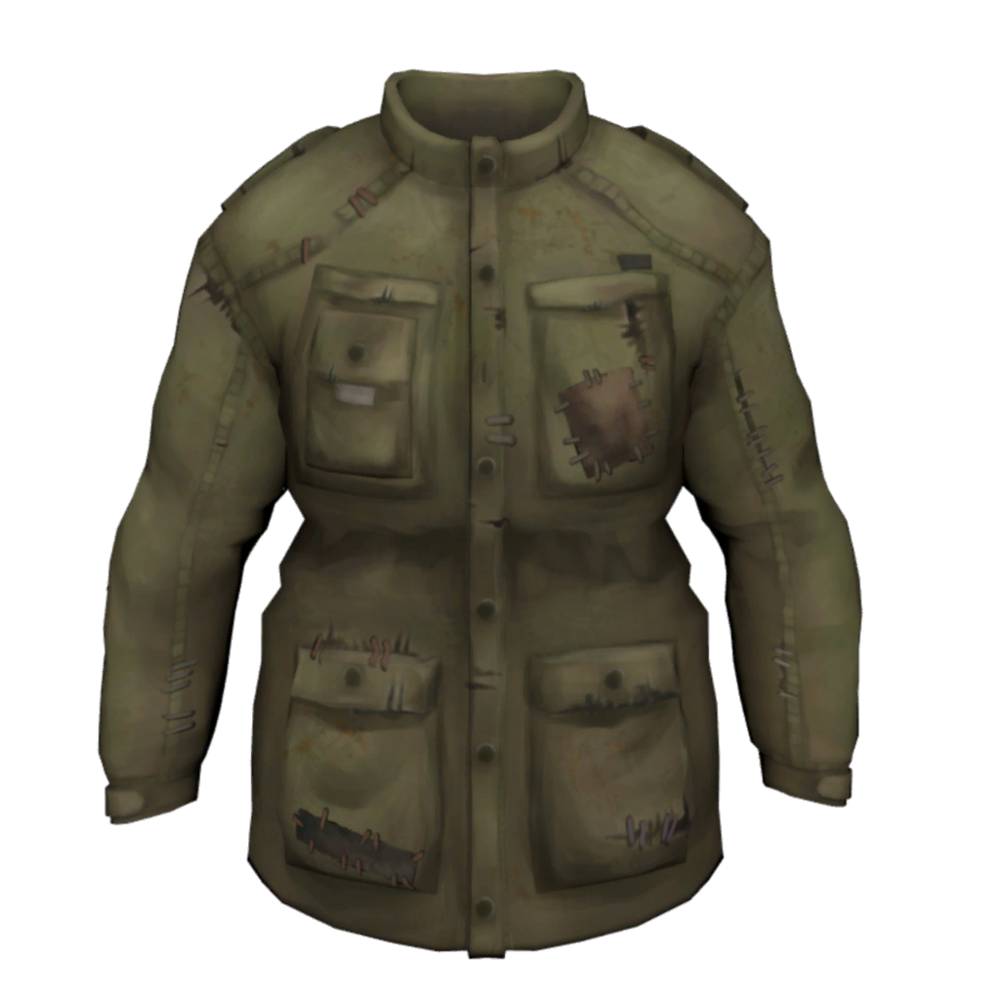

# Tactical Jacket

**Categories:** Clothing, DLC Content, Pages with update history · **Source:** [Fandom](https://thelongdark.fandom.com/wiki/Tactical_Jacket)

**Tactical Jacket**

_Tactical\_Jacket\_icon.png_

**General**

**Item Type:** Clothing

**Clothing Slot:** Outer torso

**Statistics**

**Weight:** 2.00 kg(4.4 lbs)

**Warmth bonus:** 2.0 °C(3.6 °F)

**Windproof bonus:** 4.0 °C(7.2 °F)

**Waterproof bonus:** 50%

**Protection:** 15%

**Mobility:** -4%

**Harvest:** 2 × [Cloth](./Cloth.md) / 20 minutes

**Repair:** 2 × [Cloth](./Cloth.md) / 180 minutes / 30% condition

_Ptarmigan\_icon.png_

**DLC-Exclusive content.** / This content requires the [Tales from the Far Territory](./Tales%20from%20the%20Far%20Territory.md) addon to be installed before it can be seen or used in regular gameplay.

 / > “**Durable jacket made from treated heavy canvas. Favoured by adventurous types who have to improvise.**” / > / > — In-game description / The **Tactical Jacket** is a unique [Clothing](./Clothing.md) item, found only during the end of the [Last Horizon](./Last%20Horizon.md) Tale, in a hidden room in [Bunker Omega](./Bunker%20Omega.md) in [Forsaken Airfield](./Forsaken%20Airfield.md). It originally belonged to [The Foreman](./The%20Foreman.md).

## Overview

Its warmth and windproofing are mediocre for a item of its weight and rarity. The real strength of this item is the protection it provides, which is the highest of nearly any other torso item, and by far the highest among cloth torso items. The only other torso clothing which that offers more protection is the [Moose-Hide Cloak](./Moose-Hide%20Cloak.md).

Because of its very high protection and durability, plus the ability to repair it with cloth which is substantially easier to gather than cured hides, this item is a great choice for players that get into struggles often and want to be protected with easily repairable clothes after the fact.

Tactical Jacket does not spawn on [Interloper](./Interloper.md) or [Misery modes](./Misery.md).

_Clothing model_

_Clothing model damaged_

_The Tactical Jacket_

## Update history

- UPDATE **24 June 2024 ([Update](./The%20Long%20Dark%20%E2%80%94%20Changelog.md#2.28)):**
  - Added to game.
