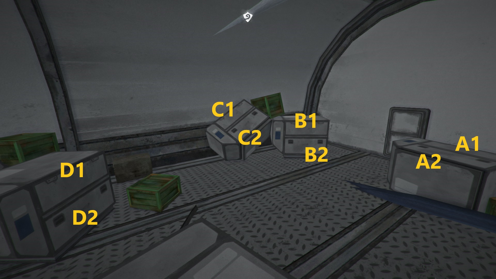
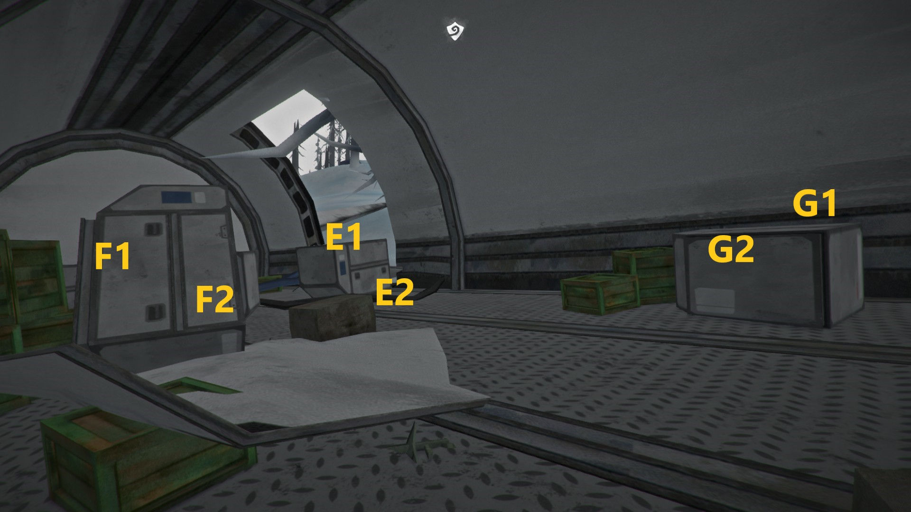
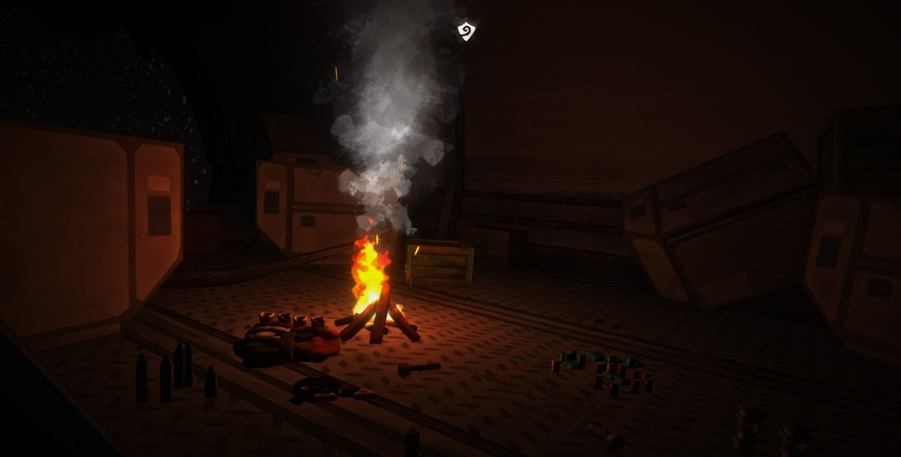
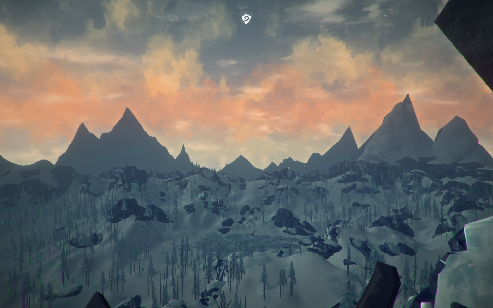

# Tail Section

**Categories:** Locations, Locations in Timberwolf Mountain, Outdoor locations, Sheltered locations · **Source:** [Fandom](https://thelongdark.fandom.com/wiki/Tail_Section)

**Contents**

- [Overview](#overview)
- [Loot](#loot)
- [Cargo containers](#cargo-containers)
- [Gallery](#gallery)

**Tail Section**

[Tail section2](../assets/Tail_section2.jpg)

**Location**

[Tail Section Location](../assets/Tail_Section_Location.png)

**Region:** [Timberwolf Mountain](./Timberwolf%20Mountain.md)

**Type:** Outdoors

## Overview

At the end of a long series of rope climbs into the upper reaches of Timberwolf Mountain is the Summit, on which rests the Tail Section--one of the larger plane sections scattered across the mountain in a recent crash. The Tail Section is shielded from the wind, so you can start a fire there, which is essential because it gets extremely cold at this altitude, particularly in the morning or when the wind is blowing hard. It contains a number of [Cargo Containers](./Cargo%20Container.md) that can supply you with nearly every kind of item found elsewhere in the game. The wooden crates scattered among the containers also may contain a rope and other loot. Emptying the containers results in well over 100kg of material so it takes quite a few days to loot it completely since the rappel up to the Summit drains around half your [Fatigue](./Fatigue.md), and many rests are required.

There is a [corpse](./Frozen%20Corpse.md) underneath the plane's floor that you can reach by walking towards the abyss (take care). It can be reached via outside the plane or by slowly climbing down from the interior of the plane. Normally, the corpse holds one [Military-Grade MRE](./Military-Grade%20MRE.md), and sometimes, some other random loot such as 1 [Rifle Ammunition](./Rifle%20Ammunition.md), [Flare Shell](./Flare%20Shell.md) or [Advanced Guns Guns Guns!](./Advanced%20Guns%20Guns%20Guns!.md). With careful maneuvering, the player can climb back up to the summit by walking to the right of the plane and back onto flat land. Otherwise, the player has only one way to leave: down. The way back is a bit treacherous and you might fall from &gt;3 m (if you are not careful enough), so make sure you remove your clothes, as they might be damaged in the fall.

## Loot

- One of many locations currently known to have the [Distress Pistol](./Distress%20Pistol.md)
- Several metal containers (random loot)
- Possible spawn point for the [Insulated Flask](./Insulated%20Flask.md)
- Possible spawn point for the [Firestriker](./Firestriker.md) in Interloper
- [Emergency Stim](./Emergency%20Stim.md) may spawn on the ground
- A [Hacksaw](./Hacksaw.md) may spawn behind cargo container B or G
- Several [Reclaimed Wood](./Reclaimed%20Wood.md) are scattered beneath the metal pieces inside, and a box of [Wood Matches](./Wood%20Matches.md) is located underneath a piece of metal in front of cargo container F
- As of version 2.03, [Crampons](./Crampons.md) can be found by a corpse

### Cargo containers

Loot in containers has been updated, please correct if you notice a discrepancy!

Be aware that opening a container with a hacksaw that has very low durability may result in ruining the container, rendering the loot unavailable if the hacksaw breaks whilst opening. Cargo container A (Not spawned in Interloper)

- Door 1: [balaclavas](./Balaclava.md), [wool toques](./Wool%20Toque.md), [wool longjohns](./Wool%20Longjohns.md), and [wool scarfs](./Wool%20Scarf.md)
- Door 2: [Wood Matches](./Wood%20Matches.md) and [Accelerant](./Accelerant.md)

Box behind this container contains a [Rope ](./Mountaineering%20Rope.md) and [Scrap Metal](./Scrap%20Metal.md) in Interloper.

Cargo container B

- Door 1: [Airline Food - Chicken](./Airline%20Food%20-%20Chicken.md), [Airline Food - Vegetarian](./Airline%20Food%20-%20Vegetarian.md) and [MREs](./Military-Grade%20MRE.md)
  - In interloper it contains only 1-2 [pinnacle peaches](./Pinnacle%20Peaches.md), 0-1 [dog food](./Dog%20Food.md) and 1-2 [pork and beans](./Pork%20and%20Beans.md)
- Door 2: [summit sodas](./Summit%20Soda.md) and [water bottles](./Water%20%28Potable%29.md)
  - In Interloper it contains only 2-5 summit sodas

The box behind B may contain accelerant in Interloper.

Cargo container C

- Door 1: [Go! Energy Drink](./Go!%20Energy%20Drink.md), [summit sodas](./Summit%20Soda.md), [orange sodas](./Orange%20Soda.md), and [Stacy's grape sodas](./Stacy%27s%20Grape%20Soda.md)
  - In Interloper it contains only 1 [fleece mittens](./Fleece%20Mittens.md), 1 [ski jacket](./Ski%20Jacket.md), 0-1 [sport vest](./Sport%20Vest.md), 0-1 [wool ear wrap](./Wool%20Ear%20Wrap.md), 1 [toque](./Wool%20Toque.md)
- Door 2: [storm lanterns](./Storm%20Lantern.md), [quality tools](./Quality%20Tools.md), and [firestrikers](./Firestriker.md)
  - In Interloper it contains only 1 [leather shoes](./Leather%20Shoes.md), 1 [running shoes](./Running%20Shoes.md), 1 [trail boots](./Trail%20Boots.md) , 1 [wool socks](./Wool%20Socks.md), [work boots](./Work%20Boots.md)

Cargo Container D

- Door 1: [tins of coffee](./Tin%20of%20Coffee.md) and [boxes of tea](./Herbal%20Tea.md)
- Door 2: [Maple Syrup](./Maple%20Syrup.md), [peanut butter](./Peanut%20Butter.md) and [salty crackers](./Salty%20Crackers.md)
  - In Interloper it contains only this: 2-4 salty crackers

The 4 boxes near D contain nothing in Interloper, but contain 4 [Pinnacle Peaches](./Pinnacle%20Peaches.md) and a [Can Opener](./Can%20Opener.md) on lower difficulties.

 Cargo Container E (Not spawned in Interloper)

- Door 1: [heavy hammers](./Heavy%20Hammer.md), [hatchets](./Hatchet.md), [hunting knives](./Hunting%20Knife.md), and [hacksaws](./Hacksaw.md)
- Door 2: [Cured Wolf Pelt](./Cured%20Wolf%20Pelt.md), [Cured Deer Hide](./Cured%20Deer%20Hide.md), [Cured Rabbit Pelt](./Cured%20Rabbit%20Pelt.md), and [cured leather](./Cured%20Leather.md)

Cargo Container F (Not spawned in Interloper)

- Door 1: [expedition parkas](./Expedition%20Parka.md), [fisherman's sweaters](./Fisherman%27s%20Sweater.md), [Fleece Cowl](./Fleece%20Cowl.md), [wool mittens](./Wool%20Mittens.md) and [thick wool sweaters](./Thick%20Wool%20Sweater.md)
- Door 2: [Combat Pants](./Combat%20Pants.md), [snow pants](./Snow%20Pants.md), [climbing socks](./Climbing%20Socks.md), [wool socks](./Wool%20Socks.md) and [insulated boots](./Insulated%20Boots.md)

Cargo container G

- Door 1: a [hunting rifle](./Hunting%20Rifle.md), [firearm cleaning kits](./Cleaning.md), [boxes of ammunition](./Rifle%20Ammunition.md), [Flare Shell](./Flare%20Shell.md) and [Frontier Shooting Guide](./Frontier%20Shooting%20Guide.md)
  - In Interloper it contains only this: [cured leather](./Cured%20Leather.md), [cured wolf pelt](./Cured%20Wolf%20Pelt.md), [cured deer hide](./Cured%20Deer%20Hide.md), [cured gut](./Cured%20Gut.md), [cured rabbit pelt](./Cured%20Rabbit%20Pelt.md).
- Door 2: [antibiotics](./Antibiotics.md), [antiseptics](./Antiseptic.md), [bandages](./Bandage.md), [emergency stims](./Emergency%20Stim.md) and [painkillers](./Painkillers.md)

The boxes near G contain nothing in Interloper.

## Gallery

_The Tail Section during an [aurora](./Aurora.md)_

