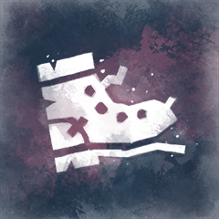
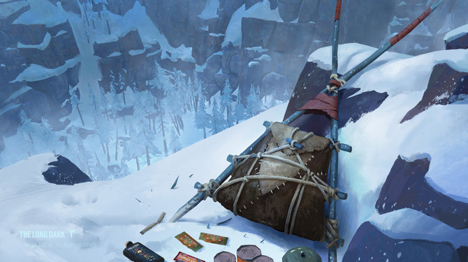
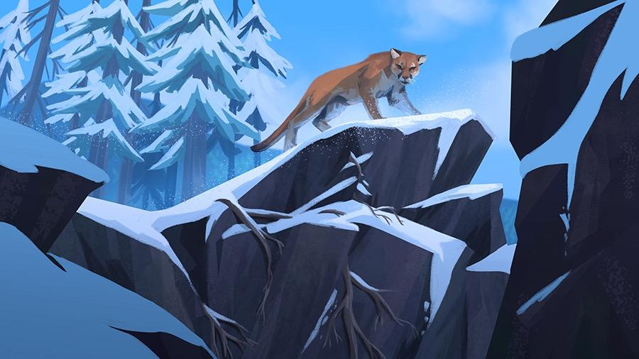

# Tales from the Far Territory

**Categories:** DLC Content · **Source:** [Fandom](https://thelongdark.fandom.com/wiki/Tales_from_the_Far_Territory)

**Contents**

- [Overview](#overview)
- [Part One: Forsaken Airfield](#part-one-forsaken-airfield)
- [Paid Update](#paid-update)
- [Free Update](#free-update)
- [Miscellaneous Update](#miscellaneous-update)
- [Part Two: Signal Void](#part-two-signal-void)
- [Paid Update](#paid-update-1)
- [Free Update](#free-update-1)
- [Miscellaneous Update](#miscellaneous-update-1)
- [Part Three: Frontier Comforts](#part-three-frontier-comforts)
- [Paid Update](#paid-update-2)
- [Free Update](#free-update-2)
- [Part Four: Buried Echoes](#part-four-buried-echoes)
- [Paid Update](#paid-update-3)
- [Free Update](#free-update-3)
- [Miscellaneous Update](#miscellaneous-update-2)
- [Part Five: Last Horizon](#part-five-last-horizon)
- [Paid Update](#paid-update-4)
- [Free Update](#free-update-4)
- [Miscellaneous Update](#miscellaneous-update-3)
- [Part Six: Broken Silence](#part-six-broken-silence)
- [Paid Update](#paid-update-5)
- [Free Update](#free-update-5)
- [Miscellaneous Update](#miscellaneous-update-4)
- [Development](#development)
- [Achievements](#achievements)
- [Trivia](#trivia)
- [Gallery](#gallery)
- [Official Art](#official-art)
- [References](#references)

_Tales\_from\_the\_far\_territory\_title.jpg_

> “__ Experience three unique regions, each with their own narrative objectives, and find your way through deep, twisting valleys littered with landmarks, landmarks that offer clues to unlocking the secrets of the land. Explore new items and gameplay mechanics that will challenge you to adapt to survive, and encounter new wildlife that inhabits these harsh and unforgiving territories. __”

**_Tales from the Far Territory_** is [downloadable content](./The%20Long%20Dark.md#Downloadable_Addon_Content) for _[The Long Dark](./The%20Long%20Dark.md)_. It is the first expansion to the [Survival Mode](./Survival%20Mode.md) portion of the game, being released in 6 parts starting from December 5, 2022 and fully concluding on December 2, 2024.

## Overview

> “**Deep along the spine of Great Bear tracks a steep mountain range that bisects the island. This is the Far Range, an imposing wall of rock that stands vigilant over Great Bear's priceless resource riches. Over the decades, many have tried, few have succeeded to crack open the wealth within these rocks. And mysteries abound. Dark stories told around campfires, about abandoned mines and remote airfields that hold many secrets. Now, with the aurora blazing across the sky, is the Far Territory ready to surrender its stories? Will you survive long enough to wrest any truths from the rocky grasp of this old, dark territory?**”
>
> — Developer Diary, October 2022

_Tales from the Far Territory_ is a paid expansion pass for _The Long Dark_'s Survival Mode. It introduces new regions, wildlife, plants, improved mechanics, and system overhauls. The expansion also introduces [Tales](./Tales.md)—objective-based narratives quests similar to the storyline quests of [Wintermute](./Wintermute.md) and are played within a standard Survival game. There are three primary Tales following the story of Dr. Rüdiger and a fourth mini-Tale focusing on the Trader.

The expansion was delivered as a two-year campaign with major updates released on an average of every four months. These updates were cumulative and included free content for all players who owned _The Long Dark_ or _The Long Dark: Survival Mode Edition_.

Any content exclusive to the paid expansion is labeled as such below, and a full list can be found in :Category:DLC Content.

Purchasing the DLC also enables players to install [The Long Development](./The%20Long%20Development.md), an unofficial, fan-made pc mod which adds several regions to the eastern part of Great Bear Island.

## Part One: Forsaken Airfield

Released December 5, 2022

### Paid Update

- 3 new Regions
  - [Forsaken Airfield](./Forsaken%20Airfield.md)
  - [Far Range Branch Line](./Far%20Range%20Branch%20Line.md)
  - [Transfer Pass](./Transfer%20Pass.md)
- New Weapons and Tools
  - [Vaughn's Rifle](./Vaughn%27s%20Rifle.md)
  - [Barb's Rifle](./Barb%27s%20Rifle.md)
  - [Curator's Rifle](./Curator%27s%20Rifle.md)
  - [Woodwright's Bow](./Woodwright%27s%20Bow.md)
  - [Spelunker's Lantern](./Spelunker%27s%20Lantern.md)
- [Glimmer Fog](./Glimmer%20Fog.md): a weather phenomena that serves as a daytime version of the [Aurora](./Aurora.md)
- 1 new Affliction: [Insomnia](./Insomnia.md)
- New soundtracks

### Free Update

- Global resource overhaul for all Gear, Harvestables and Clothing
  - Loot and resource refresh
  - Starting spawn point refresh
- [Memento Notes](./Mementos.md): scraps of paper found under visors of vehicles and elsewhere, leading to hidden supply caches
- [Improvised Crampons](./Improvised%20Crampons.md)
- [Doe](./Deer.md) - a female deer

### Miscellaneous Update

- Survival and WINTERMUTE split into separate gaming editions
- Save system overhaul, resulting in a save wipe for survival mode
- Temporarily removed prepper cache bunkers

## Part Two: Signal Void

Released March 30th, 2023

### Paid Update

- The First [Tale](./Tales.md): [Signal Void](./Signal%20Void.md) and 1 unique [Badge](./Badges.md)
- [Handheld Shortwave Radio](./Handheld%20Shortwave%20Radio.md) and [Supply Cache](./Supply%20Cache.md) Gameplay
- [Transmitters](./Transmitters.md) ([Replacement Fuse](./Replacement%20Fuse.md), [Wire Bundle](./Wires.md))
- 2 new food items: [Canned Corn](./Canned%20Corn.md) and [Canned Ham](./Canned%20Ham.md)
- New Clothing
  - [Hockey Jersey](./Hockey%20Jersey.md)
  - [Flight Jacket](./Flight%20Jacket.md)
  - [Aviator Cap](./Aviator%20Cap.md)
  - [Technical Balaclava](./Technical%20Balaclava.md)
  - [Security Chief's Rifle Holster](./Security%20Chief%27s%20Rifle%20Holster.md)

### Free Update

- [Fire-Hardened Arrows](./Fire%20Hardened%20Arrow.md)
- Enhanced [Prepper Cache](./Prepper%20Cache.md) Bunkers
- Enhanced [Beachcombing](./Beachcombing.md)
- [Plane Crashes](./Plane%20Crashes.md)
- [Acorns](./Acorns.md) and [Oak Trees](./Oak%20Tree.md), as well as introducing [Acorn Grounds](./Acorn%20Grounds.md) to make [Acorn Coffee](./Cup%20of%20Acorn%20Coffee.md)

### Miscellaneous Update

- Returned Prepper Caches from previous update's removal
- [Weak Ice](./Weak%20Ice.md) now displays cracks when walked over as part of the updated Beachcombing mechanic

## Part Three: Frontier Comforts

Released June 21, 2023

### Paid Update

- [Ptarmigan](./Ptarmigan.md), a new passive wildlife bird which gathers in flocks near high ground. Acts as a source of [food](./Ptarmigan%20%28Raw%29.md) and its [feathers](./Ptarmigan%20Down.md) can be used to make tools
- 1 new Clothing item: [Improvised Insulation](./Improvised%20Insulation.md)
- New Weapons and Tools
  - [Hunter's Revolver](./Hunter%27s%20Revolver.md)
  - [Forester's Revolver](./Forester%27s%20Revolver.md)
  - [Warden's Revolver](./Warden%27s%20Revolver.md)
  - [Sport Bow](./Sport%20Bow.md)
  - [Miner's Flashlight](./Miner%27s%20Flashlight.md)
  - [Improvised Down Bedroll](./Improvised%20Down%20Bedroll.md)
  - [Gold Nugget](./Gold%20Nugget.md): an item already introduced in Wintermute Episode 4 but now added to Survival Mode.

- [Frontier Cooking Recipes](./Cooking.md#Frontier_Cooking_Recipes): A new cooking mechanic that combines ingredients and foods to create homecooked meals with helpful Affliction boosting/removing effects
  - [Skillet](./Cooking%20Skillet.md) pan for cooking new recipes
  - 24 cooking recipes (15 starting recipes and an additional 9 found on [Recipe Cards](./Recipe%20Cards.md) while exploring)
  - 7 new ingredients used for cooking recipes:
    - [Broth](./Broth.md)
    - [Carrot](./Carrot.md)
    - [Cooking Oil](./Cooking%20Oil.md)
    - [Old Mill Flour](./Old%20Mill%20Flour.md)
    - [Potato](./Potato.md)
    - [Running River Oats](./Running%20River%20Oats.md)
    - [Salt](./Salt.md)

- 4 new Afflictions related to consuming Frontier Cooking Recipes:
  - [Burdened](./Burdened.md)
  - [Unburdened](./Unburdened.md)
  - [Nourished](./Nourished.md)
  - [Gorged](./Gorged.md)

### Free Update

- [Burdock](./Burdock.md) plants. Can be dug up for their [Roots](./Burdock%20Root.md), then can be [prepared and eaten raw](./Prepared%20Burdock.md) or be made into [Burdock Tea](./Burdock%20Tea.md)
- Enhanced [Ice Fishing](./Ice%20Fishing.md) mechanic overhaul
  - [Free-Form Ice Fishing Holes](./Ice%20Fishing.md#Free-Form_Ice_Fishing_Holes): Allows you to create your own fishing locations in regions that have sufficiently deep bodies of water via the Survival Menu
  - [Fishing Tip-Up](./Fishing%20Tip-Up.md) - a tool for trapping fish passively like a [Snare](./Snare.md)
  - [Fishing Bait](./Fishing%20Bait.md)
  - 4 [Fishing Lures](./Fishing%20Lure%20%28disambiguation%29.md):
    - [Fishing Lure (Acorns)](./Fishing%20Lure%20%28Acorns%29.md)
    - [Fishing Lure (Wire Bundle)](./Fishing%20Lure%20%28Wire%20Bundle%29.md)
    - [Fishing Lure (Revolver Shell Casing)](./Fishing%20Lure%20%28Revolver%20Shell%20Casing%29.md)
    - [Simple Fishing Lure](./Simple%20Fishing%20Lure.md)
  - 4 new species of Rare Fish:
    - [Burbot](./Burbot%20%28Raw%29.md)
    - [Goldeye](./Goldeye%20%28Raw%29.md)
    - [Red Irish Lord](./Red%20Irish%20Lord%20%28Raw%29.md)
    - [Rockfish](./Rockfish%20%28Raw%29.md)

## Part Four: Buried Echoes

Released December 5th, 2023

### Paid Update

- 1 new Region: [Zone of Contamination](./Zone%20of%20Contamination.md) (previously named Industrial Mine)
- The Second [Tale](./Tales.md): [Buried Echoes](./Buried%20Echoes.md) and 1 unique [Badge](./Badges.md)
- [Poisoned Wolves](./Poisoned%20Wolf.md): a starved, desperate variant of Wolves living around the [toxic pools](./Chemical%20Hazard.md) in the Zone of Contamination
- 1 new Affliction: [Chemical Poisoning](./Chemical%20Poisoning.md)
- New Clothing
  - [Hardhat](./Hardhat.md)
  - [Miner's Jacket](./Miner%27s%20Jacket.md)
  - [Miner's Pants](./Miner%27s%20Pants.md)
  - [Chemical Boots](./Chemical%20Boots.md)
  - [Foreman's Tool Belt](./Foreman%27s%20Tool%20Belt.md)
- 1 New Tool
  - [Travois](./Travois.md) (a type of sled for carrying gear)

- New First Aid items
  - [Respirator](./Respirator.md): a facemask that uses consumable air Canisters to avoid [Suffocation](./Suffocation.md) and Chemical Poisoning in toxic air environments
  - [Canister](./Canister.md)
- New soundtracks

### Free Update

- 1 new Affliction: [Scurvy](./Scurvy.md)
- [Insulated Flask](./Insulated%20Flask.md) (better known as a Thermos) for keeping soups, broth and drinks [Warm](./Warming%20Up.md)
- New first-person animations:
  - Equipped Clothing now properly appears on the hands and arms of Survivors (replacing the former default system where Survivor's hands were bare and the sleeves wore either [Mackenzie's Shirt](./Mackenzie%27s%20Shirt.md)/[Mackenzie's Sweater](./Mackenzie%27s%20Sweater.md) or [Astrid's Sweater](./Astrid%27s%20Sweater.md), no matter what Clothing was worn)
  - Carcass Harvesting Overhaul: harvesting carcasses and meat quarters now shows the survivor harvesting the body by hand and visually involves the tool selected.
  - Brand new Hunting Rifle, Revolver, and Distress Pistol animations

### Miscellaneous Update

- Carcasses now become weathered over time and possess 3 states of being (fresh, ravaged, frozen)

## Part Five: Last Horizon

Released June 24th 2024

### Paid Update

- One new Region: [Sundered Pass](./Sundered%20Pass.md) (formally named Mountain Pass)
- The Third and final main [Tale](./Tales.md): [Last Horizon](./Last%20Horizon.md) and 1 unique [Badge](./Badges.md)
- [Cougar](./Cougar.md): a territorial big cat and Great Bear Island's "alpha predator" which stalks regions the survivor inhabits for too long.
  - New Affliction: [Severe Lacerations](./Severe%20Lacerations.md); acquired from a Cougar [Struggle](./Struggle.md)

- New Tools:
  - [Cougar Claw Knife](./Cougar%20Claw%20Knife.md)

- New Food and Drink:
  - [Cougar Meat (Raw)](./Cougar%20Meat%20%28Raw%29.md)
  - [Cougar Meat (Cooked)](./Cougar%20Meat%20%28Cooked%29.md)
  - [Cougar Quarter](./Cougar%20Quarter.md)
- New Materials:
  - [Cougar Claw](./Cougar%20Claw.md)
  - [Fresh Cougar Hide](./Fresh%20Cougar%20Hide.md)
  - [Cured Cougar Hide](./Cured%20Cougar%20Hide.md)

- New Clothes:
  - [Tactical Jacket](./Tactical%20Jacket.md)
  - [Tactical Gloves](./Tactical%20Gloves.md)
  - [Cougar Hide Wrap](./Cougar%20Hide%20Wrap.md)

- New [Feats](./Feats.md):
  - Settled Mind
  - Celestial Navigator
  - Big Cat Killer

### Free Update

- [Misery](./Misery.md) - a new Experience mode even harder than [Interloper](./Interloper.md), complete with 6 new Afflictions that gradually appear over time and make the survivor's experience permanently harder
  - New Afflictions:
    - [Diminished Form](./Diminished%20Form.md)
    - [Sour Stomach](./Sour%20Stomach.md)
    - [Frigid Bones](./Frigid%20Bones.md)
    - [Rheumatic Joints](./Rheumatic%20Joints.md)
    - [Haunted Mind](./Haunted%20Mind.md)
    - [Broken Body](./Broken%20Body.md)
- [Cheat Death](./Cheat%20Death.md) System - the first ever change to permadeath in Survival Mode that allows a survivor to have "3 extra lives" to cheat death, but this will also make the game harder with each death
  - New Afflictions:
    - [Cheated Death Penalty](./Cheated%20Death%20Penalty.md)
    - [Weakened State](./Weakened%20State.md)

### Miscellaneous Update

- _Tales from the Far Territory_ officially released for Nintendo Switch (Parts 1-5) (August 1st, 2024)
- Added an option to make Cougars and [Scurvy](./Scurvy.md) optional content when starting a Survival Mode Experience (except Misery)
- Removed Cougar shortly after launch due to negative player feedback so that it could be reworked

## Part Six: Broken Silence

Released December 2, 2024

### Paid Update

- "[Cougar 2.0](./Cougar.md)" Redux - returned the big cat after being removed from Part 5, now completely revamped and deadlier than ever.
- [Camera](./Camera.md) - an in game camera system for players to take their own photos. Includes 3 different colour filters:
  - [FastFilm-500](./FastFilm-500.md)
  - [FastFilm-500BW](./FastFilm-500BW.md)
  - [FastFilm-500SPA](./FastFilm-500SPA.md)
  - Added a Photo Album tab to the Journal [Survival Menu](./Survival%20Menu.md) that allows you to view and annotate your taken photographs.
- [Sutherland's Tale](./Sutherland%27s%20Tale.md) - A fourth tale featuring the Trader's story.
- [Trader](./Trader.md) - A mysterious man named Sutherland that sells goods and info over the radio to the player, but for a price.
  - Added a Trading tab to the Journal [Survival Menu](./Survival%20Menu.md) to keep track of active trades.
  - Added SEVERAL new items related to the Trader:
  - New Tools
    - [Survival Knife](./Survival%20Knife.md)
    - [Bunker Rifle](./Bunker%20Rifle.md)
    - [Bushcraft Bow](./Bushcraft%20Bow.md)
    - [Manufactured Arrow](./Manufactured%20Arrow.md)
    - [Broken Manufactured Arrow](./Broken%20Manufactured%20Arrow.md)
    - [Insulated Flask](./Insulated%20Flask.md) (unique sticker variant)
  - New First Aid
    - [Caffeine Pills](./Caffeine%20Pills.md)
    - [Vitamin-C Pills](./Vitamin-C%20Pills.md)
    - [Heat Pack](./Heat%20Pack.md)
  - New Clothes
    - [T-Shirt (GBI)](./T-Shirt%20%28GBI%29.md)
    - [T-Shirt (CM)](./T-Shirt%20%28CM%29.md)
    - [T-Shirt (Snappy)](./T-Shirt%20%28Snappy%29.md)
    - [Patterned Wool Socks (Moose)](./Patterned%20Wool%20Socks%20%28Moose%29.md)
    - [Patterned Wool Socks (Plaid)](./Patterned%20Wool%20Socks%20%28Plaid%29.md)
    - [Patterned Wool Socks (Dots)](./Patterned%20Wool%20Socks%20%28Dots%29.md)
    - [Patterned Wool Mittens (Brown)](./Patterned%20Wool%20Mittens%20%28Brown%29.md)
    - [Patterned Wool Mittens (Burgundy)](./Patterned%20Wool%20Mittens%20%28Burgundy%29.md)
    - [Patterned Wool Mittens (Blue)](./Patterned%20Wool%20Mittens%20%28Blue%29.md)
    - [Wolfskin Hat](./Wolfskin%20Hat.md)
    - [Wolfskin Pants](./Wolfskin%20Pants.md)
  - New Food and Drink
    - [Cereal](./Cereal.md)
    - [Dried Apples](./Dried%20Apples.md)
    - [Canned Pineapple](./Canned%20Pineapple.md)
    - [Pickles](./Pickles.md)
    - [Pemmican Bar](./Pemmican%20Bar.md)
    - [Porter's Soup](./Porter%27s%20Soup.md)
    - [Vagabond Soup](./Vagabond%20Soup.md)
    - [Last Resort Soup](./Last%20Resort%20Soup.md)
- [Meat Curing Box](./Meat%20Curing%20Box.md) and [Salt Deposits](./Salt%20Deposit.md) - Mine new salt deposits along the coastline and create a special box to preserve your animal meat for long periods of time
  - New Food and Drink
  - [Cured Meat](./Cured%20Meat.md)
  - [Cured Fish](./Cured%20Meat.md)
  - [Animal Fat](./Animal%20Fat.md)

### Free Update

- [Safehouse Customization](./Safehouse%20Customization.md) - customize almost any interior with the ability to move, rearrange, destroy, or craft furniture and containers to let survivors create their perfect safe house
  - Includes over 800 items that can be moved, broken down, and in some cases, built using this system. There are over 120 interior scenes that can be turned into Safehouses, along with several specific "exterior interiors" like the Mountaineer's Hut in Timberwolf Mountain, and the Lookout Towers.
  - Added a [Decorations](./Decorations.md) tab to the [Survival Menu](./Survival%20Menu.md) to categorize the new Safe House items
  - [Woodworking Tools](./Woodworking%20Tools.md)
  - Added over 30 new craftable Safehouse Decorations.
- Global Wildlife Refresh: an overhaul of wildlife spawn points and patrol paths to remove some of the predictability from their behavior
  - Establish new patterns for hunting and travel through the world to avoid, or seek out, wildlife. Every wildlife spawn region in the game has been refreshed. Expect to encounter predators like Bears, Wolves, and now Cougars, in new and dangerous places. Find prey animals like Deer, Rabbits, and Ptarmigan have made homes in new locations. Wildlife populations have been rebalanced across the entire game world. Even Timberwolf spawns have been refreshed, so that they don’t always appear where they used to.

### Miscellaneous Update

- Added 19 new [Achievements](./The%20Long%20Dark%20%E2%80%94%20Achievements.md) related to the _Tales from the Far Territory_, being a mix of free and paid achievements.
- The game no longer has 25 save slots. Saving is now measured in percentage of space on save files.
- Train box cars and Car/Truck engines received new models. [Camp Office](./Camp%20Office.md) now has paint on the walls upstairs.
- The Big Cat Killer Feat was discontinued with the new Cougar version, and is now a legacy Feat.

## Development

With the progress of Episode 4 and writing for episode 5 coming to a close, Raphael van Lierop posted the Dev Diary on March 18, 2021 talking about the future of _The Long Dark_ and linking to a survey asking a series of questions, including if players would be willing to pay for DLC.[¹](#fn1) The results of the survey showed a favourable view towards paid content and development began with a dedicated team. [²](#fn2) To streamline the process of adding updates, the game was planned to be split into two editions, _Survival Edition_ and _Wintermute_.[³](#fn3)

The name for the expansion pass was revealed as _Tales from the Far Territory_ on October 20, 2022 in the Dev Diary, also announcing free and paid contents, save compatibility issues and the subsequent save wipes, with a general release date for December 2022 and Xbox, PlayStation and Switch planned for early 2023.[⁴](#fn4)

Raphael von Lierop also announced stepping down as lead developer of _The Long Dark_, handing the reigns to Katie Sorrell as Project Lead, who would continue the work on _Wintermute_ and _Tales from the Far Territory_, officially taking over as the voice for _The Long Dark_ on Hinterland's official YouTube channel on March 30, 2023 in the "Tales from the Far Territory Part Two Update Video".[⁵](#fn5)[⁶](#fn6)

_Tales_ was officially released on December 5, 2022 on Steam and Epic store for Windows. Technical issues arose for Mac and its release date was delayed from December 5, 2022 to February 15, 2023.

PlayStation and Xbox was announced for March 15, 2023[⁷](#fn7) but was delayed and officially released on March 30, 2023 with Updates One and Two simultaneously. Update Two for PC was also released on March 30, 2023.

The Switch was initially announced for March 2023 but was delayed, with Parts One to Four later being released together on August 1, 2024[⁸](#fn8). Parts Five to Six was later released on March 10, 2025[⁹](#fn9)

_Tales_ was initially disabled for Interloper in order to maintain gameplay balance and the belief it would be too difficult and offer little reward for players, but after receiving heavy criticism, Raphael announced its future inclusion in the Dev Diary on April 14, 2023[¹⁰](#fn10) with it being officially enabled on April 20, 2023.[¹¹](#fn11) _Signal Void_ for Interloper mode was in turn modified to include less loot for bunkers and appropriate loot for the Trackable Hidden Caches.

The Cougar was met with heavy criticism at Part Four's launch, with many players expressing their disappointment with how it was implemented. This included how it did not act as a typical wildlife in the game and rather than roam and interact with the world and player, its appearance was limited to the moment it attacked the player after a timer countdown. The Cougar was promptly removed from the game to be reworked and then rereleased later for Part Six on December 2, 2024 to a relatively more favourable reception.

## Achievements

-  [Too Greedily, too Deep](./Too%20Greedily%2C%20too%20Deep.md)
-  [To the Teeth](./To%20the%20Teeth.md)
-  [Tasting Menu](./Tasting%20Menu.md)
-  [Rüdiger's Dream](./R%C3%BCdiger%27s%20Dream.md)
-  [Something Warm to Drink](./Something%20Warm%20to%20Drink.md)
-  [Quick Draw](./Quick%20Draw.md)
-  [Exposure](./Exposure.md)
-  [Shutterbug](./Shutterbug.md)
-  [On the Lookout](./On%20the%20Lookout.md)
-  [Ends of the Earth](./Ends%20of%20the%20Earth.md)
-  [Goods and Services](./Goods%20and%20Services.md)
-  [Tough Enough](./Tough%20Enough.md)

## Trivia

- The promotional image used for the _Tales From the Far Territory_ is actually concept art for the [Final Approach](./Final%20Approach.md) helicopter crash site.
- The [Zone of Contamination](./Zone%20of%20Contamination.md) was formerly teased as the _Industrial Mine_, but was renamed during its debut.
- [Sundered Pass](./Sundered%20Pass.md) was formerly teased as _Mountain Pass_, but was renamed during its debut.
- Base Customization was originally exclusive to this DLC before it was made available for all players as part of free update.

## Gallery

### Official Art

_Title Card_

_Teaser for the Handheld Shortwave Radio_

_Travois Concept_

_Ditto_

_Zone of Contamination Concept art (formerly named Industrial Mine)_

_Concept art of a [Poisoned Wolf](./Poisoned%20Wolf.md)_

_Miner Clothing_

_Cougar Concept Art_

_Sundered Pass_

_Sundered Pass Weather Station_

_Cougar Concept_

_Safe House Customization Concept Art_

### References

## Notes

---

1. [March 2021 Dev Diary](https://www.thelongdark.com/news/dev-diary-march-2021/)[↩︎](#fnref1)
2. [Survey Results](https://twitter.com/RaphLife/status/1379128297670418432?s=20)[↩︎](#fnref2)
3. [April 2022 Dev Diary](https://www.thelongdark.com/promoted/dev-diary-april-2022/)[↩︎](#fnref3)
4. [October 2022 Dev Diary](https://www.thelongdark.com/news/dev-diary-october-2022/)[↩︎](#fnref4)
5. [YouTube - Tales Update One](https://www.youtube.com/watch?v=GHM3vOcqvT8)[↩︎](#fnref5)
6. [YouTube - Tales Update Two](https://www.youtube.com/watch?v=AV0rCaNjyQs&t)[↩︎](#fnref6)
7. [February 2023 Dev Diary](https://www.thelongdark.com/news/dev-update-february-2023/)[↩︎](#fnref7)
8. [Switch Launch Trailer](https://www.youtube.com/watch?v=cR7f0UAEQw4)[↩︎](#fnref8)
9. [Switch Updates Five to Six](https://hinterlandforums.com/forums/topic/46883-switch-tales-from-the-far-territory-part-five-six-now-live/)[↩︎](#fnref9)
10. [April 2023 Dev Diary](https://www.thelongdark.com/news/dev-diary-april-2023/)[↩︎](#fnref10)
11. [Hotfix - Tales Enabled for Interloper](https://hinterlandforums.com/forums/topic/43286-the-long-dark-updated-to-v215/)[↩︎](#fnref11)
