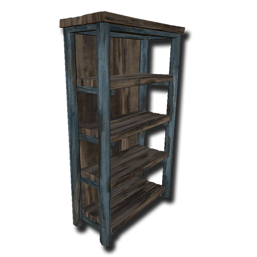

# Tall Rustic Shelf

**Contents**

- [Overview](#overview)
- [Harvesting](#harvesting)
- [Crafting](#crafting)
- [Update History](#update-history)

**Tall Rustic Shelf**

| Property | Details |
| --- | --- |
|  |  / *Tall\_Rustic\_Shelf\_icon.png* |
| Release | [TFTFT Part 6 Broken Silence](./The%20Long%20Dark%20%E2%80%94%20Changelog.md#2.33) |
| **Values** |  |
| Weight | 5.00 kg (11 lbs) |
| **Actions** |  |
| Backpack | Drop, Place |

The **Tall Rustic Shelf** is a [Decorations](./Decorations.md) item that can be [Crafted](./Crafting.md) as part of the [Safehouse Customization](./Safehouse%20Customization.md) feature.

## Overview

A makeshift wooden display shelf, a Wide Display Shelf can be crafted at a [Furniture Workbench](./Furniture%20Workbench.md), but requires [Woodworking Tools](./Woodworking%20Tools.md).

The shelf contains 4 wide shelves for displaying items.

Progress for Crafting this item will be stored in the Furniture Workbench's container inventory, rather than the player's inventory. Once crafted, the item can be automatically placed in the Safehouse. Canceling this prompt will force the item back into the Furniture Workbench's container inventory. The shelf can only be placed on a wide, clear space on the floor or a flat surface when in Customization Mode.

Despite having a Backpack carry weight value, the shelf cannot be picked up and placed back into the player's inventory once crafted, and so it cannot be carried from one base to another. The only option is to move or destroy it (destroying the shelf will yield no resources, so consider the material cost/time investment before creating this item).

## Harvesting

The Tall Rustic Shelf can be harvested with a [Hatchet](./Hatchet.md) in 2 hours for 7 [Cedar Firewood](./Cedar%20Firewood.md).

## Crafting

**Tall Rustic Shelf**

| Property | Details |
| --- | --- |
|  | - |
|  | - |
|  | 480 minutes (8 hour 0 minutes) |
| **Requirements** |  |
| Facility | **Template:iconlink** |
| Tool | **Template:iconlink** |
| **Materials** |  |
| **Template:iconlink plain** |  |
| Item | [Cedar Firewood](./Cedar%20Firewood.md) |
| Quantity | 10 |

## Update History

**Template:update history****Lua execution error in Module:Navbox function navbox** [ru:Высокая полка в деревенском стиле](ru:%D0%92%D1%8B%D1%81%D0%BE%D0%BA%D0%B0%D1%8F_%D0%BF%D0%BE%D0%BB%D0%BA%D0%B0_%D0%B2_%D0%B4%D0%B5%D1%80%D0%B5%D0%B2%D0%B5%D0%BD%D1%81%D0%BA%D0%BE%D0%BC_%D1%81%D1%82%D0%B8%D0%BB%D0%B5)
