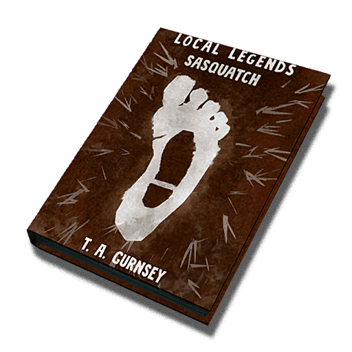
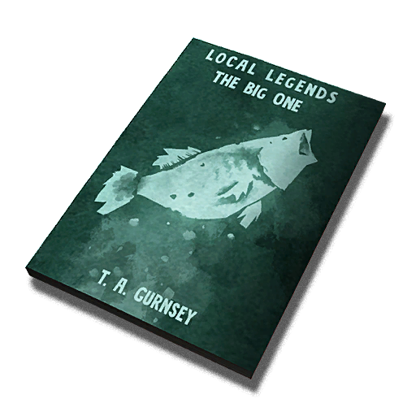
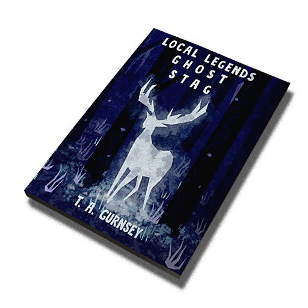
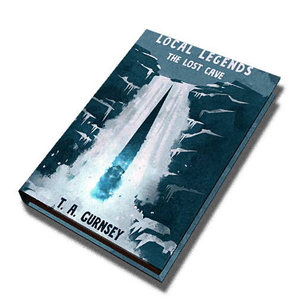

# Tall Tales

**Contents**

- [Overview](#Overview)
- [Tasks](#Tasks)
- [Location of the books](#Location_of_the_books)
- [Rewards](#Rewards)
- [Trivia](#Trivia)
- [Achievements](#Achievements)

**Spoiler Warning:***This page may contain spoilers from the <a href="./Wintermute.md" class="wikilink" title="story">story</a> of The Long Dark.*

<table class="infobox">
<caption>Tall Tales</caption>
<colgroup>
<col style="width: 33%" />
<col style="width: 33%" />
<col style="width: 33%" />
</colgroup>
<tbody>
<tr>
<td colspan="2">
[[File:

<table class="gallery">
<colgroup>
<col style="width: 25%" />
<col style="width: 25%" />
<col style="width: 25%" />
<col style="width: 25%" />
</colgroup>
<tbody>
<tr>
<td><figure>

<figcaption>Sasquatch</figcaption>
</figure></td>
<td><figure>

<figcaption>The Big One</figcaption>
</figure></td>
<td><figure>

<figcaption>Ghost Stag</figcaption>
</figure></td>
<td><figure>

<figcaption>Lost Cave</figcaption>
</figure></td>
</tr>
</tbody>
</table></td>
<td>
250px]]
</td>
</tr>
<tr>
<td>
Episode
</td>
<td>
<a href="./Episode%203%20-%20Crossroads%20Elegy.md" class="wikilink" title="Episode 3">Episode 3</a>|-
</td>
<td>
<strong>Missions</strong>
</td>
</tr>
<tr>
<td>
Current
</td>
<td>
Tall Tales
</td>
<td></td>
</tr>
<tr>
<td>
Region
</td>
<td>
<a href="./Pleasant%20Valley.md" class="wikilink" title="Pleasant Valley">Pleasant Valley</a>
</td>
<td></td>
</tr>
</tbody>
</table>

|  |  |  |
|----|----|----|
| “ | Books describing odd or mysterious events in Pleasant Valley. Investigate to find out more about the life and character of people in the Region. | ” |

**Tall Tales** is a side mission in <a href="./Episode%203%20-%20Crossroads%20Elegy.md" class="wikilink" title="Episode 3">Episode 3</a> of the <a href="./Wintermute.md" class="wikilink" title="story">story</a>, as well as an <a href="./Tall%20Tales%20%28Achievement%29.md" class="wikilink" title="Achievement">Achievement</a> of the same name which is earned upon completing the mission.

## Overview

This mission can be started by finding any of the Local Legends books, including *The Big One*, *The Lost Cave*, *Ghost Stag*, and *Sasquatch*. When any one of these books is picked up, the journal will update to include a new task, and the legend to investigate will be marked on the map. Each legend the player investigates will reward the player with an item or crafting blueprint.

## Tasks

- Locals tell of a Sasquatch...
  - Search for the Sasquatch cave near <a href="./Thomson%27s%20Crossing.md" class="wikilink" title="Thomson&#39;s Crossing">Thomson's Crossing</a>
  - Investigate the cave
- Locals tell of a magical pond...
  - Go to <a href="./Pensive%20Pond.md" class="wikilink" title="Pensive Pond">Pensive Pond</a> and bring some fishing tackle
  - Catch a <a href="./Big%20Bass%20%28Raw%29.md" class="wikilink" title="giant fish">giant fish</a>
- Locals tell of a ghostly stag...
  - Go to the ghost stag's clearing
  - hide in the <a href="./Snow%20Shelter.md" class="wikilink" title="Snow Shelter">Snow Shelter</a> and watch for the <a href="./Ghost%20Stag.md" class="wikilink" title="stag">stag</a>
- Locals tell of a hidden glowing cave...
  - Go to the <a href="./Misty%20Falls%20Cave.md" class="wikilink" title="Misty Falls Cave">Misty Falls Cave</a>.
  - Investigate the cave

## Location of the books

- <a href="./Local%20Legends%20-%20Sasquatch.md" class="wikilink" title="Local Legends - Sasquatch">Local Legends - Sasquatch</a> can be found in the bathroom of <a href="./Community%20Hall.md" class="wikilink" title="Community Hall">Community Hall</a>.
- <a href="./Local%20Legends%20-%20The%20Big%20One.md" class="wikilink" title="Local Legends - The Big One">Local Legends - The Big One</a> can be found in the second bunker of <a href="./Joplin%27s%20Bunker%20Raid.md" class="wikilink" title="Joplin&#39;s Bunker Raid">Joplin's Bunker Raid</a>.
- <a href="./Local%20Legends%20-%20Ghost%20Stag.md" class="wikilink" title="Local Legends - Ghost Stag">Local Legends - Ghost Stag</a> can be found in the <a href="./Draft%20Dodger%27s%20Cabin.md" class="wikilink" title="Draft Dodger&#39;s Cabin">Draft Dodger's Cabin</a>.
- <a href="./Local%20Legends%20-%20The%20Lost%20Cave.md" class="wikilink" title="Local Legends - The Lost Cave">Local Legends - The Lost Cave</a> can be found in the Rural Store in <a href="./Thomson%27s%20Crossing.md" class="wikilink" title="Thomson&#39;s Crossing">Thomson's Crossing</a>.

## Rewards

- The *Sasquatch* mission rewards the player with a <a href="./Wolfskin%20Coat.md" class="wikilink" title="Wolfskin Coat">Wolfskin Coat</a>.
- *The Big One* mission rewards the player with a large 15kg fish (<a href="./Big%20Bass%20%28Raw%29.md" class="wikilink" title="Big Bass (Raw)">Big Bass (Raw)</a>), which may be useful for the <a href="./Coming%20Storm.md" class="wikilink" title="Coming Storm">Coming Storm</a> mission. The fish is 3750 calories raw, or 4313 calories when cooked, because Astrid has lvl 2 cooking earning extra 15% calories (plus 0.37L of <a href="./Lantern%20Fuel.md" class="wikilink" title="Lamp Fuel">Lamp Fuel</a>) .
- The *Ghost Stag* mission rewards the player with the <a href="./Deerskin%20Boots.md" class="wikilink" title="Deerskin Boots">Deerskin Boots</a> and <a href="./Deerskin%20Pants.md" class="wikilink" title="Deerskin Pants">Deerskin Pants</a> crafting blueprints. A pair of <a href="./Rabbitskin%20Mitts.md" class="wikilink" title="Rabbitskin Mitts">Rabbitskin Mitts</a> is also next to the snow shelter.
- *The Lost Cave* Mission rewards the player with a <a href="./Moose-Hide%20Satchel.md" class="wikilink" title="Moose-Hide Satchel">Moose-Hide Satchel</a>, enabling the player to carry an extra 5kg.

## Trivia

- The <a href="./Ghost%20Stag.md" class="wikilink" title="Ghost Stag">Ghost Stag</a> cannot be killed.

## Achievements

-  <a href="./Tall%20Tales%20%28Achievement%29.md" class="wikilink" title="Tall Tales (Achievement)">Tall Tales (Achievement)</a>

**Lua execution error in Module:Navbox function navbox**

