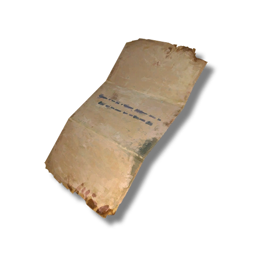

# Tearful Letter

**Tearful Letter**

| Property | Details |
| --- | --- |
|  |  / *Tearful\_Letter\_icon.png* |
| Wintermute | [Episode 1](./Episode%201%20-%20Do%20Not%20Go%20Gentle.md) |
| **Properties** |  |
| Item type | [Collectibles](./Collectibles.md)\|- |
| Stackable | No |
| Examine | Handwritten letter. Blotchy ink suggests whoever wrote it did so while crying. |
| **Values** |  |
| Weight | 0.00 kg (0 lbs) |
| **Actions** |  |
| Backpack | Examine |
| On ground | Take It, Read Text, Leave It |

**Tearful Letter** is a [Collectible](./Collectibles.md) item found in [Episode 1](./Episode%201%20-%20Do%20Not%20Go%20Gentle.md) of the [Wintermute](./Wintermute.md) inside the abandoned Milton house next to the [Bank Manager's House](./Bank%20Manager%27s%20House.md).

## Transcript

*The following text is transcribed from **Tearful Letter***

**I don't want to do this but I don't have a choice. I just can't stay in Milton anymore. It's just too...empty, and sad. I know I promised to stick with you through thick and thin, but I never signed up for this. I'm sorry. I'll send food when I get to the mainland. I hear they have more there. Love, N.**

**Lua execution error in Module:Navbox function navbox**

[ru:Закапанное слезами письмо](ru:%D0%97%D0%B0%D0%BA%D0%B0%D0%BF%D0%B0%D0%BD%D0%BD%D0%BE%D0%B5_%D1%81%D0%BB%D0%B5%D0%B7%D0%B0%D0%BC%D0%B8_%D0%BF%D0%B8%D1%81%D1%8C%D0%BC%D0%BE)
