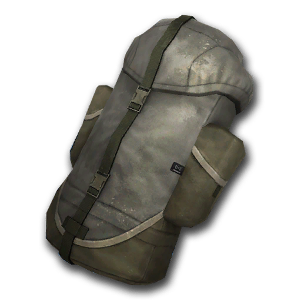

# Technical Backpack

<table class="infobox">
<caption>Technical Backpack</caption>
<colgroup>
<col style="width: 50%" />
<col style="width: 50%" />
</colgroup>
<tbody>
<tr>
<td colspan="2"><figure>

<figcaption>Technical_Backpack_icon.png</figcaption>
</figure></td>
</tr>
<tr>
<td>
Release
</td>
<td>
<a href="./The%20Long%20Dark%20%E2%80%94%20Changelog.md#1.89" class="wikilink" title="9 December 2020">9 December 2020</a>
</td>
</tr>
<tr>
<td>
Wintermute
</td>
<td>
No
</td>
</tr>
<tr>
<td colspan="2" class="section">
<strong>Properties</strong>
</td>
</tr>
<tr>
<td>
Item type
</td>
<td>
<a href="./Collectibles.md" class="wikilink" title="Collectibles">Collectibles</a>|-
</td>
</tr>
<tr>
<td>
Stackable
</td>
<td>
No
</td>
</tr>
<tr>
<td>
Examine
</td>
<td>
A sturdier Backpack with all the bells and whistles. You can carry more gear before becoming Encumbered.
</td>
</tr>
<tr>
<td colspan="2" class="section">
<strong>Values</strong>
</td>
</tr>
<tr>
<td>
Weight
</td>
<td>
0.00 kg (0 lbs)
</td>
</tr>
<tr>
<td colspan="2" class="section">
<strong>Actions</strong>
</td>
</tr>
<tr>
<td>
Backpack
</td>
<td>
Examine
</td>
</tr>
<tr>
<td>
On ground
</td>
<td>
Take It, Read Text, Leave It
</td>
</tr>
<tr>
<td colspan="2" class="section">
<strong>Advanced data</strong>
</td>
</tr>
<tr>
<td>
Item key
</td>
<td>
GAMEPLAY_TechnicalBackpack
</td>
</tr>
</tbody>
</table>

The **Technical Backpack** is a collectible item available in <a href="./Survival%20Mode.md" class="wikilink" title="Survival Mode">Survival Mode</a>.

## Overview

When collected it provides a permanent +5kg (11lbs) increase to <a href="./Encumbrance.md" class="wikilink" title="Carry Capacity">Carry Capacity</a>. This benefit stacks the effects of a worn <a href="./Moose-Hide%20Satchel.md" class="wikilink" title="Moose-Hide Satchel">Moose-Hide Satchel</a> and <a href="./Well%20Fed.md" class="wikilink" title="Well Fed">Well Fed</a> benefit, allowing the player to carry up to 45kg (99lbs) without becoming encumbered, a total increase of 50%. The Technical Backpack is classified as a <a href="./Collectibles.md" class="wikilink" title="Collectible">Collectible</a>, not clothing; this means it has no weight, no durability and cannot be un-equipped once picked up.

## Location

The Technical Backpack is unique to the <a href="./Gold%20Mine.md" class="wikilink" title="Gold Mine">Gold Mine</a> of the <a href="./Ash%20Canyon.md" class="wikilink" title="Ash Canyon">Ash Canyon</a> region. The trek to the mine is long and the region near-wilderness, making its low temperatures (-25°C (-13°F)), predators, and maze-like geography dangerous.

The Technical Backpack can be found alongside their sister item, the <a href="./Crampons.md" class="wikilink" title="Crampons">Crampons</a> and a nearby <a href="./Notebook%20Page%20%28Survival%202%29.md" class="wikilink" title="Note">Note</a>.

## Update history

- HOTFIX **28 Apr 2021 (<a href="./The%20Long%20Dark%20%E2%80%94%20Changelog.md#1.94" class="wikilink" title="Update">Update</a>):**
  - \[UI\] Fixed an issue that caused the Technical Pack’s item description to disappear after a transition to a new area.

<!-- -->

- UPDATE **9 December 2020 (<a href="./The%20Long%20Dark%20%E2%80%94%20Changelog.md#1.89" class="wikilink" title="Update">Update</a>):**
  - New Gear Items: Crampons and the Technical Backpack

== Trivia ==

- "Technical backpack" is a broad term for any type of carry pack with pockets and/or harnesses specialized for sizes of equipment.
- It is implied prior to acquiring the technical backpack that the player is wearing a conventional backpack or rucksack like those found scattered about Great Bear Island near frozen corpses. This is shown explicitly in official artwork of <a href="./Will%20Mackenzie.md" class="wikilink" title="Will Mackenzie">Will Mackenzie</a> for <a href="./Episode%202%20-%20Luminance%20Fugue.md" class="wikilink" title="Wintermute: Episode 2">Wintermute: Episode 2</a>. However, these containers cannot be picked up, and acquiring the technical backpack does not produce the player's old backpack.
- Acquiring the technical backpack changes the sound played when a player opens their inventory. Instead of a normal ruffling sound, a clip and unzip noise are heard. Additionally, the icon for the backpack will change to one resembling the in game picture for the technical backpack, and the inventory will be renamed from Backpack to Technical Backpack.

<table class="gallery">
<colgroup>
<col style="width: 100%" />
</colgroup>
<tbody>
<tr>
<td><figure>
[Missing image: TechnicalBackpack.jpg]
<figcaption><strong>Technical Backpack inventory display &amp; icon change</strong></figcaption>
</figure></td>
</tr>
</tbody>
</table>

**Lua execution error in Module:Navbox function navbox**

<a href="ru:%D0%A3%D0%BB%D1%83%D1%87%D1%88%D0%B5%D0%BD%D0%BD%D1%8B%D0%B9_%D1%80%D1%8E%D0%BA%D0%B7%D0%B0%D0%BA" class="wikilink" title="ru:Улучшенный рюкзак">ru:Улучшенный рюкзак</a>

