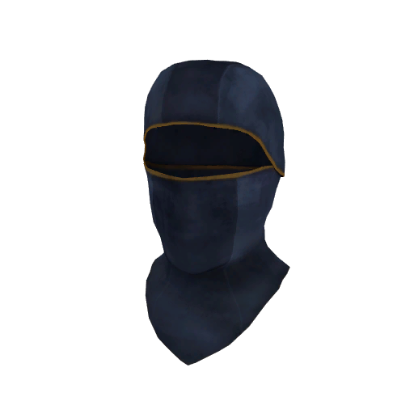
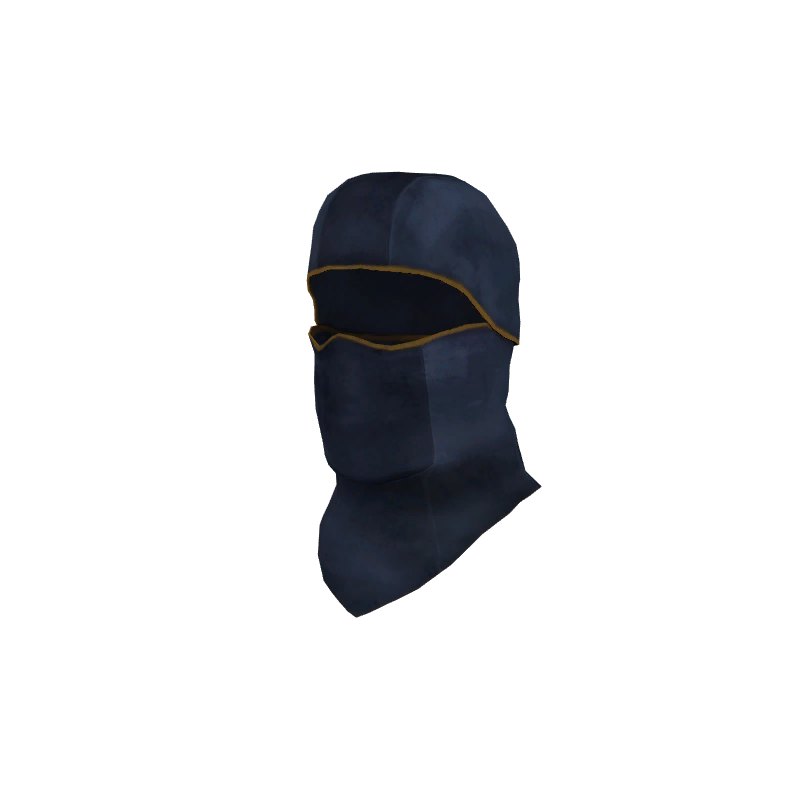
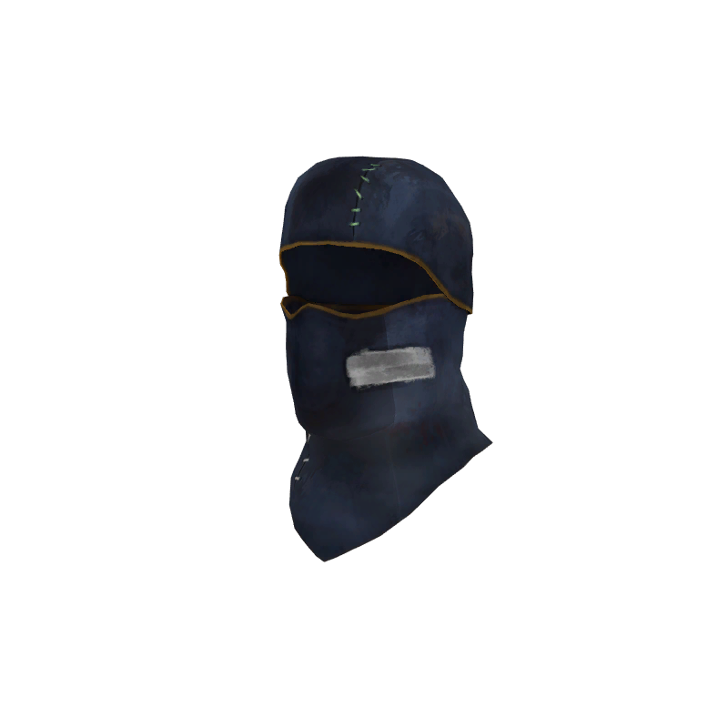

# Technical Balaclava

**Technical Balaclava**

| Property | Details |
| --- | --- |
|  |  / *Technical\_Balaclava\_icon.png* |
| **General** |  |
| Item Type | Clothing\|- |
| Clothing Slot |  |
| **Statistics** |  |
| Weight | 0.20 kg(0.44 lbs) |
| Warmth bonus | 2.0 °C(3.6 °F) |
| Windproof bonus | 2.0 °C(3.6 °F) |
| Waterproof bonus | 50% |
| Protection | 5% |
| Mobility | 0% |
| Harvest | 1 × [Cloth](./Cloth.md) / 10 minutes |
| Repair | 1 × [Cloth](./Cloth.md) / 30 minutes / 75% condition |

| Column 1 | Column 2 | Column 3 |
| --- | --- | --- |
|  / *Ptarmigan\_icon.png* | **DLC-Exclusive content.** / This content requires the [Tales from the Far Territory](./Tales%20from%20the%20Far%20Territory.md) addon to be installed before it can be seen or used in regular gameplay. | \|} / > “**Tougher, with better resistance against wind and water than a standard Balaclava.**” / **Technical Balaclava** is a type of clothing in The Long Dark. It is part of the *[Tales from the Far Territory](./Tales%20from%20the%20Far%20Territory.md)* DLC. / ## Overview / Only 1 Technical Balaclava can be worn at a time, specifically in the inner head slot. It is a direct upgrade to the [Balaclava](./Balaclava.md) in terms of clothing stats. / That means it only provides Windproof bonus if no other hat is worn in the outer hat slot; this usually means it's Windproof bonus over other headwear like the [Wool Toque](./Wool%20Toque.md) or [Rabbitskin Hat](./Rabbitskin%20Hat.md) is wasted. The Technical Balaclava weighs 0.05kg less than a regular Balaclava or Wool Toque and decays much slower, retaining it's stats for longer and costing less [Cloth](./Cloth.md) to repair over time. / ## Locations / - Inside some [Supply Caches](./Supply%20Cache.md) / - Inside [Bunker Omega](./Bunker%20Omega.md), in a cabinet in the bunk quarters / Unlike the Balaclava, the Technical Balaclava is available on [Interloper](./Interloper.md) inside Bunker Omega; it will not spawn inside any Transponder Caches on Interloper. This makes it unique and irreplaceable if destroyed. / \| Column 1 \| Column 2 \| / \| --- \| --- \| / \|  / *Model icon* \|  / *Model icon damaged* \| / ## Update history / - UPDATE **30 March 2023 ([Update](./The%20Long%20Dark%20%E2%80%94%20Changelog.md#2.10)):** / - Added to game. / **Lua execution error in Module:Navbox function navbox** [ru:Техническая балаклава](ru:%D0%A2%D0%B5%D1%85%D0%BD%D0%B8%D1%87%D0%B5%D1%81%D0%BA%D0%B0%D1%8F_%D0%B1%D0%B0%D0%BB%D0%B0%D0%BA%D0%BB%D0%B0%D0%B2%D0%B0) |
| “ | **Tougher, with better resistance against wind and water than a standard Balaclava.** | ” |
|  / *Model icon* |  / *Model icon damaged* |  |
