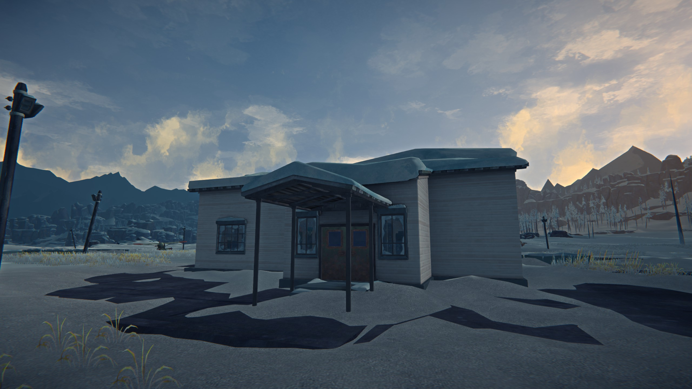
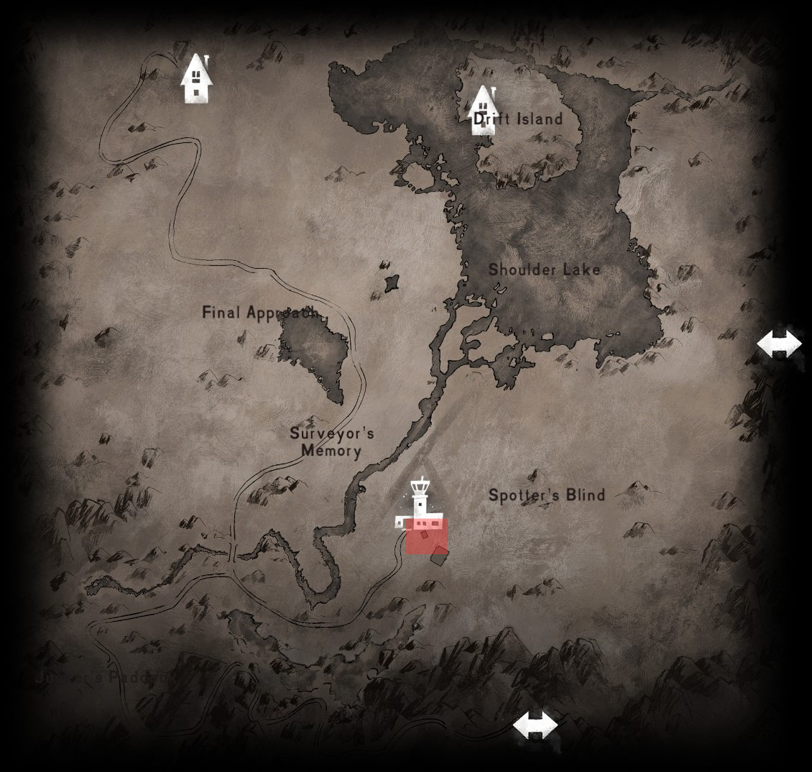

# Terminal

**Categories:** Locations, Locations in Forsaken Airfield, Outdoor locations · **Source:** [Fandom](https://thelongdark.fandom.com/wiki/Terminal)

**Terminal**

_Terminal.jpg_

**Location**

_Terminal\_Location.png_

**Region:** [Forsaken Airfield](./Forsaken%20Airfield.md)

**Description:** An air baggage claims building next to the [Control Tower](./Control%20Tower.md)

**General**

Has no shelter / The **Terminal** is an abandoned air baggage claims terminal building located within Airfield 31 in the [Forsaken Airfield](./Forsaken%20Airfield.md) [Region](./Region.md), between the outdoor vehicle garage and the Air [Control Tower](./Control%20Tower.md). A logo on the front desk displays the services of North Charters. / The inside contains a lobby, a bathroom with 2 [Toilets](./Toilet.md), and a back room which, unsurprisingly, contains suitcases with clothing items. The building also contains shelves of wooden [Crates](./Crate.md), a broken down vending machine, and several [Metal Chairs](./Metal%20Chair.md). There is no loading screen for this building. / A Rabbit Grove is located outside between the Air Control Tower and the Terminal.

## Gallery

_The inside of the Terminal_
