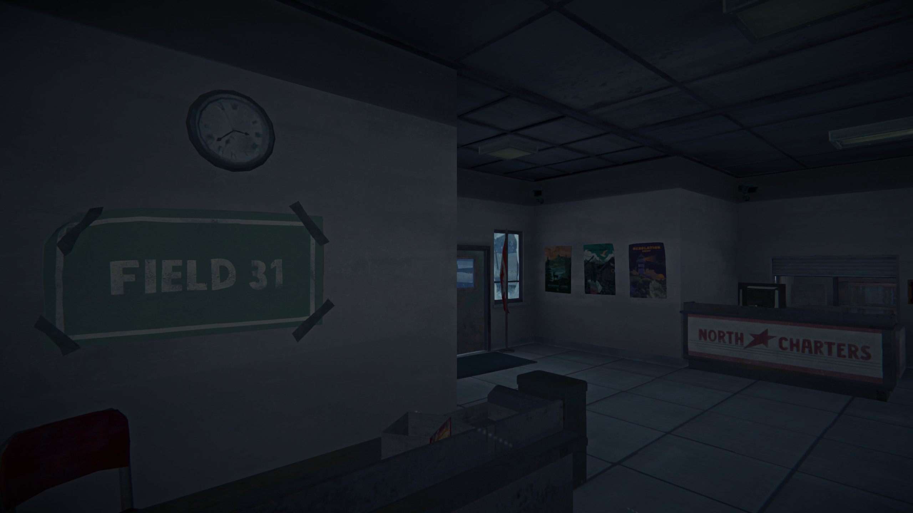

# Terminal

**Terminal**

| Property | Details |
| --- | --- |
|  |  / *Terminal.jpg* |
| **Location** |  |
|  |  / *Terminal\_Location.png* |
| Region | [Forsaken Airfield](./Forsaken%20Airfield.md)\|- |
| Description | An air baggage claims building next to the [Control Tower](./Control%20Tower.md) |
| **General** |  |
|  | Has no shelter\|} / The **Terminal** is an abandoned air baggage claims terminal building located within Airfield 31 in the [Forsaken Airfield](./Forsaken%20Airfield.md) [Region](./Region.md), between the outdoor vehicle garage and the Air [Control Tower](./Control%20Tower.md). A logo on the front desk displays the services of North Charters. / The inside contains a lobby, a bathroom with 2 [Toilets](./Toilet.md), and a back room which, unsurprisingly, contains suitcases with clothing items. The building also contains shelves of wooden [Crates](./Crate.md), a broken down vending machine, and several [Metal Chairs](./Metal%20Chair.md). There is no loading screen for this building. / A Rabbit Grove is located outside between the Air Control Tower and the Terminal. / ## Gallery / \| Column 1 \| / \| --- \| / \|  / *The inside of the Terminal* \| / **Lua execution error in Module:Navbox function navbox** [ru:Терминал](ru:%D0%A2%D0%B5%D1%80%D0%BC%D0%B8%D0%BD%D0%B0%D0%BB) |
|  |  / *The inside of the Terminal* |
