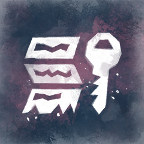

# Thanks for the Memories

<table class="infobox">
<caption>Thanks for the Memories</caption>
<colgroup>
<col style="width: 50%" />
<col style="width: 50%" />
</colgroup>
<tbody>
<tr>
<td colspan="2"><figure>

<figcaption>Thanks_for_the_Memories_icon.png</figcaption>
</figure></td>
</tr>
<tr>
<td colspan="2"></td>
</tr>
<tr>
<td>
Description
</td>
<td>
Collect 12 Mementos – one from each Lower Great Bear Island Region (single game).
</td>
</tr>
</tbody>
</table>

**Thanks for the Memories** is an <a href="./The%20Long%20Dark%20%E2%80%94%20Achievements.md" class="wikilink" title="achievement">achievement</a> in *<a href="./The%20Long%20Dark.md" class="wikilink" title="The Long Dark">The Long Dark</a>*.

## Guide

\[Warning : This achievement is unobtainable if you don't have at least one memento to collect in each region of your save.\]

This achievement is easiest to unlock when playing on <a href="./Pilgrim.md" class="wikilink" title="Pilgrim">Pilgrim</a>.

The player needs to only locate 1 <a href="./Mementos.md" class="wikilink" title="Mementos">Mementos</a> from each of the following regions in Lower Great Bear (they do not need to collect any stashed items revealed by the Memento):

- <a href="./Mystery%20Lake%20%28region%29.md" class="wikilink" title="Mystery Lake">Mystery Lake</a>
- <a href="./Coastal%20Highway.md" class="wikilink" title="Coastal Highway">Coastal Highway</a>
- <a href="./Pleasant%20Valley.md" class="wikilink" title="Pleasant Valley">Pleasant Valley</a>
- <a href="./Desolation%20Point.md" class="wikilink" title="Desolation Point">Desolation Point</a>
- <a href="./Timberwolf%20Mountain.md" class="wikilink" title="Timberwolf Mountain">Timberwolf Mountain</a>
- <a href="./Forlorn%20Muskeg.md" class="wikilink" title="Forlorn Muskeg">Forlorn Muskeg</a>
- <a href="./Broken%20Railroad.md" class="wikilink" title="Broken Railroad">Broken Railroad</a>
- <a href="./Mountain%20Town.md" class="wikilink" title="Mountain Town">Mountain Town</a>
- <a href="./Hushed%20River%20Valley.md" class="wikilink" title="Hushed River Valley">Hushed River Valley</a>
- <a href="./Bleak%20Inlet.md" class="wikilink" title="Bleak Inlet">Bleak Inlet</a>
- <a href="./Ash%20Canyon.md" class="wikilink" title="Ash Canyon">Ash Canyon</a>
- <a href="./Blackrock.md" class="wikilink" title="Blackrock">Blackrock</a>

Mementos are tracked in the Collections section of the <a href="./Journal.md" class="wikilink" title="Journal">Journal</a>.**Lua execution error in Module:Navbox function navbox**

