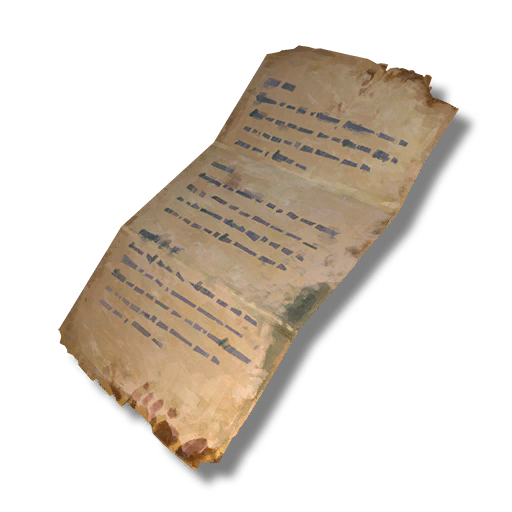

# Thankyou Letter

**Categories:** Collectibles, Pages with update history · **Source:** [Fandom](https://thelongdark.fandom.com/wiki/Thankyou_Letter)

**Thankyou Letter**

| Property | Details |
| --- | --- |
|  |  / _Thankyou\_Letter\_icon.png_ |
| Release | [22 October 2019](./The%20Long%20Dark%20%E2%80%94%20Changelog.md#1.60) |
| Wintermute | [Episode 3](./Episode%203%20-%20Crossroads%20Elegy.md) - [Church Artifact](./Church%20Artifact%20%28mission%29.md) |
| **Properties** |  |
| Item type | [Collectibles](./Collectibles.md)\|- |
| Stackable | No |
| Examine | A letter from Father Thomas thanking the anonymous returner of the Artifact. |
| **Values** |  |
| Weight | 0.00 kg (0 lbs) |
| **Actions** |  |
| Backpack | Examine |
| On ground | Take It, Read Text, Leave It |
| **Advanced data** |  |
| Item key | GAMEPLAY\_ChurchThankyouLetter |

**Thankyou Letter** is a [Collectible](./Collectibles.md) item found in [Episode 3](./Episode%203%20-%20Crossroads%20Elegy.md) of the [Wintermute](./Wintermute.md) story mode as a part of the [Church Artifact](./Church%20Artifact%20%28mission%29.md) side mission.

During the course of the mission, [Astrid Greenwood](./Astrid%20Greenwood.md) receives the _Thankyou Letter_ alongside a [Rabbitskin Hat](./Rabbitskin%20Hat.md) after returning the [Church Artifact](./Church%20Artifact.md) to the [Thomson's Crossing](./Thomson%27s%20Crossing.md) church.

## Transcript

_The following text is transcribed from **Thankyou Letter**_

**I can only thank you for what you have done for us, and for letting God's light shine through you. Whoever you are, I sense that you have endured worse than a storm or two in order to return this humble treasure of ours. We will never forget you. -- Fr. Thomas.**

## Update history

- UPDATE **22 October 2019 ([Update](./The%20Long%20Dark%20%E2%80%94%20Changelog.md#1.60)):**
  - Added to game.
