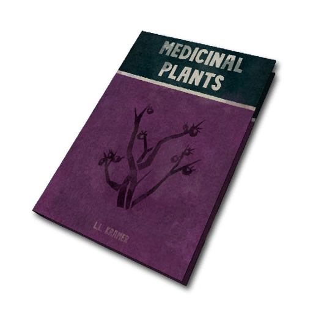

# The Basics of Survival

**Contents**

- [Official description](#Official_description)
- [Overview](#Overview)
- [Survival lessons](#Survival_lessons)
- [Mending clothing](#Mending_clothing)
- [Preparing natural medicine](#Preparing_natural_medicine)
- [Reishi Mushrooms](#Reishi_Mushrooms)
- [Old Man's Beard Lichen](#Old_Man%27s_Beard_Lichen)
- [Rose Hips](#Rose_Hips)
- [Snaring a rabbit](#Snaring_a_rabbit)
- [Rewards](#Rewards)
- [Update History](#Update_History)

<table class="infobox">
<caption>The Basics of Survival</caption>
<colgroup>
<col style="width: 50%" />
<col style="width: 50%" />
</colgroup>
<tbody>
<tr>
<td colspan="2"><figure>

<figcaption>One of the skill books that will start the mission</figcaption>
</figure></td>
</tr>
<tr>
<td>
Episode
</td>
<td>
<a href="./Episode%201%20-%20Do%20Not%20Go%20Gentle.md" class="wikilink" title="Episode 1">Episode 1</a>|-
</td>
</tr>
<tr>
<td>
Current
</td>
<td>
The Basics of Survival
</td>
</tr>
<tr>
<td>
Next
</td>
<td>
<a href="./Survival%20School.md" class="wikilink" title="Survival School">Survival School</a>
</td>
</tr>
<tr>
<td>
Region
</td>
<td>
<a href="./Mountain%20Town.md" class="wikilink" title="Mountain Town">Mountain Town</a>
</td>
</tr>
</tbody>
</table>

**Spoiler Warning:***This page may contain spoilers from the <a href="./Wintermute.md" class="wikilink" title="story">story</a> of The Long Dark.*

**The Basics of Survival** is a side mission started in <a href="./Episode%201%20-%20Do%20Not%20Go%20Gentle.md" class="wikilink" title="Episode 1">Episode 1</a> of the <a href="./Wintermute.md" class="wikilink" title="story">story</a>. In the mission, the survivor must snare a rabbit, harvest and prepare some natural remedies, and mend some clothing. The mission can be completed in either <a href="./Episode%201%20-%20Do%20Not%20Go%20Gentle.md" class="wikilink" title="Episode 1">Episode 1</a> or <a href="./Episode%202%20-%20Luminance%20Fugue.md" class="wikilink" title="Episode 2">Episode 2</a>; if the research book used to trigger the first mission is not collected in <a href="./Episode%201%20-%20Do%20Not%20Go%20Gentle.md" class="wikilink" title="Episode 1">Episode 1</a>, it will need to be found in in <a href="./Episode%202%20-%20Luminance%20Fugue.md" class="wikilink" title="Episode 2">Episode 2</a> to start the quest.

A sequel, <a href="./Survival%20School.md" class="wikilink" title="Survival School">Survival School</a>, is a side mission available starting in <a href="./Episode%202%20-%20Luminance%20Fugue.md" class="wikilink" title="Episode 2">Episode 2</a> of the story.

## Official description

|  |  |  |
|----|----|----|
| “ | Enduring the Quiet Apocalypse will require survival skills. Find the collectibles that can teach you important survival lessons. | ” |

## Overview

To start the mission, the survivor has to find one of the corresponding research books scattered around <a href="./Milton.md" class="wikilink" title="Milton">Milton</a>:

- <a href="./A%20Sewing%20Primer.md" class="wikilink" title="A Sewing Primer">A Sewing Primer</a>
- <a href="./Medicinal%20Plants%20of%20Great%20Bear.md" class="wikilink" title="Medicinal Plants of Great Bear">Medicinal Plants of Great Bear</a>
- <a href="./Field%20Dressing%20Your%20Kill%2C%20Vol.%20I.md" class="wikilink" title="Field Dressing Your Kill, Vol. I">Field Dressing Your Kill, Vol. I</a>

Each found book adds a new task to the mission tracker.

## Survival lessons

### Mending clothing

 This mission objective can be started after finding the <a href="./Collectibles.md" class="wikilink" title="Collectible">Collectible</a> <a href="./A%20Sewing%20Primer.md" class="wikilink" title="A Sewing Primer">A Sewing Primer</a>, which is located on the second floor of <a href="./Milton%20House%20%28Grey%20Mother%27s%29.md" class="wikilink" title="Milton House (Grey Mother&#39;s)">Milton House (Grey Mother's)</a> where <a href="./Grey%20Mother.md" class="wikilink" title="Grey Mother">Grey Mother</a> is located.

A <a href="./Sewing%20Kit.md" class="wikilink" title="Sewing Kit">Sewing Kit</a> and <a href="./Cloth.md" class="wikilink" title="Cloth">Cloth</a> are required to complete this objective, as well as a piece of damaged <a href="./Clothing.md" class="wikilink" title="clothing">clothing</a>. All three can be found by scavenging houses within the town of <a href="./Milton.md" class="wikilink" title="Milton">Milton</a>.

### Preparing natural medicine

 This mission objective can be started after finding the <a href="./Collectibles.md" class="wikilink" title="collectible">collectible</a> <a href="./Medicinal%20Plants%20of%20Great%20Bear.md" class="wikilink" title="Medicinal Plants of Great Bear">Medicinal Plants of Great Bear</a>, which is located in the <a href="./Milton%20Post%20Office.md" class="wikilink" title="Milton Post Office">Milton Post Office</a> within the town of <a href="./Milton.md" class="wikilink" title="Milton">Milton</a>. To complete the objective, the Mackenzie must prepare the following medicine:

- \(3\) <a href="./Reishi%20Tea.md" class="wikilink" title="Reishi Tea">Reishi Tea</a>
- \(3\) <a href="./Old%20Man%27s%20Beard%20Wound%20Dressing.md" class="wikilink" title="Old Man&#39;s Beard Wound Dressing">Old Man's Beard Wound Dressing</a>
- \(3\) <a href="./Rose%20Hip%20Tea.md" class="wikilink" title="Rose Hip Tea">Rose Hip Tea</a>

To complete this objective, all natural medicine must be contained within the survivor's inventory at the same time; if the survivor consumes or drops any of the natural medicine that they have prepared, they will have to reacquire it before the objective is completed.[^1]

#### Reishi Mushrooms

<a href="./Reishi%20Mushroom.md" class="wikilink" title="Reishi Mushroom">Reishi Mushrooms</a> can be found located in the <a href="./Wood%20Lot.md" class="wikilink" title="Wood Lot">Wood Lot</a> between <a href="./St.%20Christopher%27s%20Church.md" class="wikilink" title="St. Christopher&#39;s Church">St. Christopher's Church</a> and the town of Milton

A total of 6 <a href="./Reishi%20Mushroom.md" class="wikilink" title="Reishi Mushroom">Reishi Mushrooms</a> are required to craft 3 <a href="./Prepared%20Reishi%20Mushrooms.md" class="wikilink" title="Prepared Reishi Mushrooms">Prepared Reishi Mushrooms</a>. The prepared mushrooms can be brewed into <a href="./Reishi%20Tea.md" class="wikilink" title="Reishi Tea">Reishi Tea</a> along with 0.75 liters of <a href="./Water%20%28Potable%29.md" class="wikilink" title="Water (Potable)">Water (Potable)</a> at a <a href="./Fire.md" class="wikilink" title="fire">fire</a>.

#### Old Man's Beard Lichen

<a href="./Old%20Man%27s%20Beard%20Lichen.md" class="wikilink" title="Old Man&#39;s Beard Lichen">Old Man's Beard Lichen</a> can be found located near the pond at the <a href="./Radio%20Tower.md" class="wikilink" title="Radio Tower">Radio Tower</a> behind Grey Mother's House.

A total of 9 <a href="./Old%20Man%27s%20Beard%20Lichen.md" class="wikilink" title="Old Man&#39;s Beard Lichen">Old Man's Beard Lichen</a> are required to craft 3 <a href="./Old%20Man%27s%20Beard%20Wound%20Dressing.md" class="wikilink" title="Old Man&#39;s Beard Wound Dressing">Old Man's Beard Wound Dressings</a>. The dressings can be directly crafted by the survivor without the use of a fire.

#### Rose Hips

<a href="./Rose%20Hip.md" class="wikilink" title="Rose hip">Rose hips</a> can be found located near the pond at the <a href="./Radio%20Tower.md" class="wikilink" title="Radio Tower">Radio Tower</a> behind Grey Mother's House.

A total of 72 <a href="./Rose%20Hip.md" class="wikilink" title="Rose Hip">Rose Hips</a> are required to craft 3 <a href="./Prepared%20Rose%20Hips.md" class="wikilink" title="Prepared Rose hips">Prepared Rose hips</a>. The prepared rose hips can be brewed into <a href="./Rose%20Hip%20Tea.md" class="wikilink" title="Rose Hip Tea">Rose Hip Tea</a> along with 0.75 liters of <a href="./Water%20%28Potable%29.md" class="wikilink" title="Water (Potable)">Water (Potable)</a> at a <a href="./Fire.md" class="wikilink" title="fire">fire</a>.

### Snaring a rabbit

 This mission objective can be started after finding the <a href="./Collectibles.md" class="wikilink" title="collectible">collectible</a> <a href="./Field%20Dressing%20Your%20Kill%2C%20Vol.%20I.md" class="wikilink" title="Field Dressing Your Kill, Vol. I">Field Dressing Your Kill, Vol. I</a>, which is located at the <a href="./Work%20Bench.md" class="wikilink" title="Work Bench">Work Bench</a> in the shed outside <a href="./Paradise%20Meadows%20Farm.md" class="wikilink" title="Paradise Meadows Farm">Paradise Meadows Farm</a>. A <a href="./Snare.md" class="wikilink" title="snare">snare</a> is also on the work bench near the book, and can be used by the survivor to complete the mission objective. Alternatively, it can be found in <a href="./Episode%202%20-%20Luminance%20Fugue.md" class="wikilink" title="Episode 2">Episode 2</a> on the first floor of the <a href="./Hunting%20Lodge.md" class="wikilink" title="Hunting Lodge">Hunting Lodge</a> in the <a href="./Broken%20Railroad.md" class="wikilink" title="Broken Railroad">Broken Railroad</a> region.

There are <a href="./Rabbit.md" class="wikilink" title="rabbit">rabbits</a> located around the <a href="./Paradise%20Meadows%20Farm.md" class="wikilink" title="Paradise Meadows Farm">Paradise Meadows Farm</a> area for the survivor to snare; alternatively, there are rabbits located near the pond at the <a href="./Radio%20Tower.md" class="wikilink" title="Radio Tower">Radio Tower</a> behind Grey Mother's House.

It is not necessary to go and harvest the Snare, as the mission will complete[^2] the moment a Snare checks for a rabbit catch and succeeds (more on <a href="./Snare.md#Snare_Mechanics" class="wikilink" title="Snare Mechanics">Snare Mechanics</a> here).

## Rewards

- Blueprints to create <a href="./Snare.md" class="wikilink" title="Snare">Snare</a>
- Blueprints to create <a href="./Rabbitskin%20Hat.md" class="wikilink" title="Rabbitskin Hat">Rabbitskin Hat</a>
- Blueprints to create <a href="./Rabbitskin%20Mitts.md" class="wikilink" title="Rabbitskin Mitts">Rabbitskin Mitts</a>

## Update History

\* UPDATE **17 December 2018 (<a href="./The%20Long%20Dark%20%E2%80%94%20Changelog.md#1.41" class="wikilink" title="Update">Update</a>):**

- Added to game.
- UPDATE **6 May 2019 (<a href="./The%20Long%20Dark%20%E2%80%94%20Changelog.md#1.48" class="wikilink" title="Update">Update</a>):**
  - \[WINTERMUTE\] Updated description for the side mission “Basics of Survival: Find and harvest some medicinal flora native to Great Bear Island."

==References== **Lua execution error in Module:Navbox function navbox**

## Notes

[^1]: <https://hinterlandforums.com/forums/topic/21818-the-long-dark-updated-to-v141-43925-%E2%80%93-redux/page/5/?tab=comments#comment-149487> Raphael van Lierop, 18 December 2018

[^2]: At least on my playthrough, the trap was placed in the rabbit grove near Alans cave in Mystery lake.
