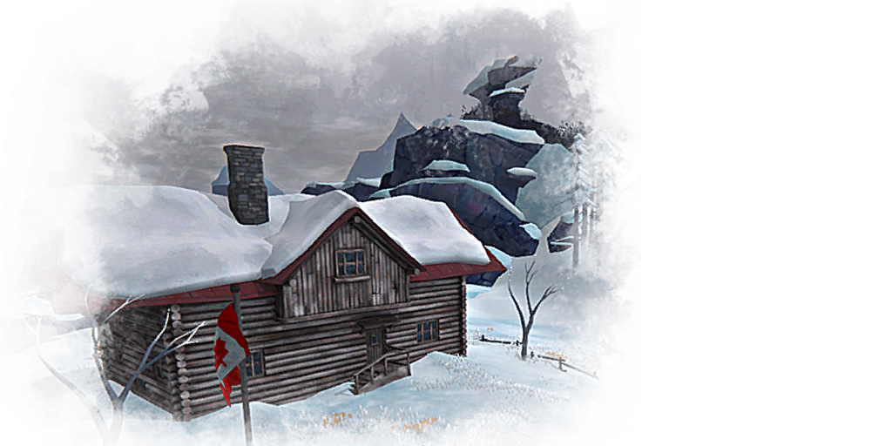

# The Best Defense/Transcript

**Contents**

- [Transcript](#Transcript)
- [Retrieve the legendary spear from the Hunting Lodge.](#Retrieve_the_legendary_spear_from_the_Hunting_Lodge.)
- [Repair the broken spear at the forge.](#Repair_the_broken_spear_at_the_forge.)
- [Get back to Jeremiah](#Get_back_to_Jeremiah)

<table class="infobox">
<caption>The Best Defense/Transcript</caption>
<colgroup>
<col style="width: 50%" />
<col style="width: 50%" />
</colgroup>
<tbody>
<tr>
<td colspan="2"><figure>

<figcaption>Missions_story_ep2_The_Best_Defense.png</figcaption>
</figure></td>
</tr>
<tr>
<td>
Episode
</td>
<td>
<a href="./Episode%202%20-%20Luminance%20Fugue.md" class="wikilink" title="Episode 2">Episode 2</a>|-
</td>
</tr>
<tr>
<td>
Previous
</td>
<td>
<a href="./The%20Wounded%20Trapper%20%E2%80%94%20Transcript.md" class="wikilink" title="The Wounded Trapper/Transcript">The Wounded Trapper/Transcript</a>
</td>
</tr>
<tr>
<td>
Current
</td>
<td>
The Best Defense/Transcript
</td>
</tr>
<tr>
<td>
Next
</td>
<td>
<a href="./Signal%20to%20Noise%20%E2%80%94%20Transcript.md" class="wikilink" title="Signal to Noise/Transcript">Signal to Noise/Transcript</a>
</td>
</tr>
<tr>
<td>
Region
</td>
<td>
<a href="./Mystery%20Lake%20%28disambiguation%29.md" class="wikilink" title="Mystery Lake">Mystery Lake</a> <a href="./Forlorn%20Muskeg.md" class="wikilink" title="Forlorn Muskeg">Forlorn Muskeg</a> 
<a href="./Broken%20Railroad.md" class="wikilink" title="Broken Railroad">Broken Railroad</a>
</td>
</tr>
<tr>
<td>
Characters
</td>
<td>
<a href="./Will%20Mackenzie.md" class="wikilink" title="Will Mackenzie">Will Mackenzie</a> <a href="./Jeremiah.md" class="wikilink" title="Jeremiah">Jeremiah</a> 
<a href="./Old%20Bear.md" class="wikilink" title="Old Bear">Old Bear</a> 
<a href="./Methuselah.md" class="wikilink" title="Methuselah">Methuselah</a>
</td>
</tr>
</tbody>
</table>

This is the mission transcript for mission 2 <a href="./The%20Best%20Defense.md" class="wikilink" title="The Best Defense">The Best Defense</a> of <a href="./Episode%202%20-%20Luminance%20Fugue.md" class="wikilink" title="Episode 2: Luminance Fugue">Episode 2: Luminance Fugue</a>.

## Transcript

CHAPTER TWO

THE BEST DEFENSE

## Retrieve the <a href="./Broken%20Bear%20Spear.md" class="wikilink" title="legendary spear">legendary spear</a> from the <a href="./Hunting%20Lodge.md" class="wikilink" title="Hunting Lodge">Hunting Lodge</a>.

*Mackenzie leaves the <a href="./Trapper%27s%20Homestead.md" class="wikilink" title="Trapper&#39;s Homestead">Trapper's Homestead</a> and heads south, entering <a href="./Forlorn%20Muskeg.md" class="wikilink" title="Forlorn Muskeg">Forlorn Muskeg</a>. He passes through the region without any eventful encounters, aside from a scripted Wolf feeding on a Deer Carcass in the middle of the tracks. He passes through the region into <a href="./Broken%20Railroad.md" class="wikilink" title="Broken Railroad">Broken Railroad</a>, and navigates around a <a href="./Landslide.md" class="wikilink" title="Landslide">Landslide</a>, before passing a <a href="./Locomotive%20Engine.md" class="wikilink" title="Locomotive Engine">Locomotive Engine</a> and walks up a <a href="./Train%20Shuttle.md" class="wikilink" title="Train Shuttle">Train Shuttle</a> blocking his way forward, then walks into a broken window. Entering the vehicle, he walks to the grated door and the <a href="./Old%20Bear.md" class="wikilink" title="Old Bear">Old Bear</a> appears around a tree. It spots Mackenzie, and walks up to the grated door as the pilot slowly backs away from it.*

Mackenzie: "Oh...shi..."

*The Old Bear sniffs the air and stands on its hind legs, roaring and pressing its entire body through its front legs onto the door. It then pushes the Shuttle over, causing its sole occupant to tumble with it and get knocked out.*

***Note** that if the game is currently day, it will turn to night time when Mackenzie wakes up for the next scene.*

*Mackenzie wakes up outside of the Shuttle with much time having passed, and immediately stares at the sky.*

Mackenzie: "Look...at the lights."

*The sky is filled with the <a href="./Aurora.md" class="wikilink" title="Aurora">Aurora</a>, and a nearby lamppost is functioning, bathing the pilot in a white artificial light. Mackenzie steps forward and sees an active campfire*

Mackenzie: "Is that a campfire?"

*He walks to it and recognizes the familiar man sitting beside it (minus his walking stick), and warms himself by the fire. The hum of the Aurora filling the air.*

Mackenzie: "Y...you again?"

<a href="./Methuselah.md" class="wikilink" title="Methuselah">Methuselah</a>: "How goes the war, my friend?"

Mackenzie: "Uhh...war?"

Methuselah: "The war between man and nature, of course. The lights in the sky. You and the bear. The cold. Hunger. The old fights, returning."

Mackenzie: "Did you...scare the bear away?"

Methuselah: "There was no bear when I found you. Perhaps it isn't yet time for your paths to cross?"

Mackenzie: "Listen old man, I'm not sure..."

Methuselah: "You still believe that things are going back...to the way they were?"

Mackenzie: "The lights in the sky..."

Methuselah: "Remember...I said they were a reckoning."

Mackenzie: "They're...powering the lights around us?"

Methuselah: "Now you see."

Mackenzie: "This...can't be. It doesn't make sense."

Methuselah: "It doesn't make sense. And yet, it has happened."

*Dialogue options appear*

**White Options**

- AURORA

Mackenzie: "So...this is some kind of reoccurring aurora borealis?"

Methuselah: "Possibly."

Mackenzie: "And it's...affecting the electricity? The power?"

Methuselah: "And everything dependent on it. Animating it. Or destroying it. Perhaps both."

Mackenzie: "And, you...knew this was coming?"

Methuselah: "No. But it was only a mater of time. This has all happened before."

- WILDLIFE

Mackenzie: "I've had a lot of trouble with wildlife lately. Is it always this dangerous around here?"

Methuselah: "I've seen many strange things, of course. But the birds and beasts? Their rhythms are their own."

Mackenzie: "Meaning?"

Methuselah: "The patterns of nature have been interrupted. Broken. Even those who once knew how to read them are now confused."

Mackenzie: "What do you think is spooking the wildlife?"

Methuselah: "I can't say for sure. But...the lights in the sky may hold the answer."

Mackenzie: "So...you think the aurora is...influencing the wildlife too?"

Methuselah: "There is much in nature we cannot understand. Would it be so strange?"

*After warming himself by the fire and finishing his conversation with the strange old man, Mackenzie turns his attention to a powered truck and more powered lights, heading down the path to a large <a href="./Maintenance%20Yard.md" class="wikilink" title="Maintenance Yard">Maintenance Yard</a>. Several glowing Wolves who become unusually aggressive block his path in the yard, and Mackenzie evades or kills them. The front and back door of the Maintenance Shed is locked, but an office building is open, with the message "THEY HATE THE LIGHT" written above the bed, illumined by an artificial light. Entering the Shed, the overhead lights hum with electricity and several wires burn and smoke on the floors, with Mackenzie avoiding them. A dead <a href="./Forest%20Talkers.md" class="wikilink" title="Forest Talker">Forest Talker</a> lies a room close to the bathroom, with a message (<a href="./Forest%20Talker%20Flyer.md" class="wikilink" title="Forest Talker Flyer">Forest Talker Flyer</a>) directing fellow activists to the <a href="./Hunting%20Lodge.md" class="wikilink" title="Hunting Lodge">Hunting Lodge</a>.*

*Mackenzie leaves the Shed, and travels behind it as he follows a trail of lampposts into the mountain. He passes through a gate and continues to follow the lamps, as Wolves avoid the artificial light. He eventually spots the Lodge*

Mackenzie: "Wow...this must have been really nice, once upon a time."

*He enters the Lodge*

Mackenzie: "Now...to find that spear."

*The Lodge appears messy, with many food supplies scattered and left behind by the Forest Talkers. If Mackenzie enters the basement then he will find a <a href="./Flashlight.md" class="wikilink" title="Flashlight">Flashlight</a>, but will also hear a ringing phone coming from upstairs. Mackenzie picks up the Flashlight, causing a cutscene to occur as he slowly looks it over, cracked lens and all. Returning upstairs as the phone continues to ring and opening the <a href="./Phone%20Box.md" class="wikilink" title="Phone Box">Phone Box</a>, the ringing stops before he can answer the caller.*

*By this point, dawn breaks and the lights in the sky begin to fade. Cars and lightbulbs go out, along with the Flashlight's battery. Mackenzie eventually finds the Bear Spear, placed on a mantle above a Fireplace in the kitchen. He takes it into his hands, and notices the shattered spearhead.*

Mackenzie: "Damn...looks like one little detail got missed in the trapper's "legend" of the old bear: The spear didn't survive the fight. Must be something I can use to fix it at the old machine shed."

## Repair the broken spear at the <a href="./Forge.md" class="wikilink" title="forge">forge</a>.

*Mackenzie then travels back to the Maintenance Shed, <a href="./Broken%20Bear%20Spear.md" class="wikilink" title="Broken Bear Spear">Broken Bear Spear</a> in tow, and manages finds several pieces of <a href="./Scrap%20Metal.md" class="wikilink" title="Scrap Metal">Scrap Metal</a>, a <a href="./Heavy%20Hammer.md" class="wikilink" title="Heavy Hammer">Heavy Hammer</a>, and enough wood to forge a new <a href="./Spear%20Head.md" class="wikilink" title="Spear Head">Spear Head</a>. Mackenzie then lights the <a href="./Furnace.md" class="wikilink" title="Furnace">Furnace</a>.*

Mackenzie: "That should do it."

*The screen fades to black, then fades back in with the Furnace hot enough to begin forging.*

Mackenzie: "Let's do this."

*Mackenzie then interacts with the Forge. After the player selects the Spear Head and 1.5 hours pass, Mackenzie crafts a Spear Head with materials on hand and inserts it into the Broken Bear Spear offscreen.*

Mackenzie: "Guess I can add "blacksmith" to my growing list of skills."

*Mackenzie holds up the <a href="./Bear%20Spear.md" class="wikilink" title="Bear Spear">Bear Spear</a>, showing off its restored glory, then puts it away.*

Mackenzie: "Let's hope I don't have to put this spear to the test."

## Get back to Jeremiah

*Mackenzie then leaves the Maintenance Shed, choosing to craft a set of improvised tools or to just leave. He passes by the spot that Methuselah was the night before, but he is long gone by now and the campfire burned out. The return trip to <a href="./Trapper%27s%20Homestead.md" class="wikilink" title="Trapper&#39;s Homestead">Trapper's Homestead</a> is uneventful, as Mackenzie passes through Broken Railroad and the Muskeg with no trouble, until he reaches the transition to Mystery Lake and spots the Old Bear in the nearby mountain.*

*The bear growls, then lowers its ears in fear, as if sensing the danger of the Bear Spear.*

Mackenzie: "Ahhh...not feeling so cocky now, huh?"

*The Old Bear begins walking away from Mackenzie*

Mackenzie: "And all it took was for me to go all full-on Grizzly Adams."

*The Old Bear begins to fully walk away, disinterested in Mackenzie.*

Mackenzie: "I'd better get out of here before he comes back."

*Mackenzie then enters Mystery Lake, and enters the Homestead. Jeremiah is waiting on the cot with a map next to him, looking at Mackenzie as he approaches.*

Jeremiah: "Did you find it?"

Mackenzie: "The legend might be bunk, but the spear is real."

Jeremiah: "Then maybe the legend is also real. Let's hope so, for your sake."

Mackenzie: "Yeah...the bear is definitely tracking me. You have any luck with the radio?"

Jeremiah: "I did! Did you see the lights in the night sky, the aurora? Well, when that flared up, the radio came to life. It just lit up, and started spitting out noise, but it was all gibberish. Bits and pieces of things...music...talking. I think it needs more range...a more powerful signal. If we could find a way to boost the signal strength when the aurora's active...we might be able to get a message out."

Mackenzie: "Let me guess. You have an "idea"."

*The Trapper smiles and lets out a light chuckle.*

Jeremiah: "You're starting to get it, Mackenzie. I was digging through some old geological surveys maps..."

Mackenzie: "Those look like military insignia stamped on there."

Jeremiah: "Focus, Mackenzie. This survey shows a series of radio transponder towers that cross back and forth across Great Bear."

Mackenzie: "Now why would those be there?"

Jeremiah: "Good question. But for another time. We can use these."

Mackenzie: "How?"

Jeremiah: "Each tower has some electronics that'd serve like a signal booster, to make sure the message gets to the next relay."

Mackenzie: "Ok."

Jeremiah: "Well...you get me two, maybe three of those, I might just be able to rig us up our own signal booster."

Mackenzie: "You might, huh? And I guess I need to do this while Old Bear decides if I'm going to become the next chapter in his legend?"

Jeremiah: "Don't be silly. Spence's bear would be long gone by now. That was...150 years ago."

Mackenzie: "Hmph. Maybe he has...I don't know...genetic memory."

Jeremiah: "Ridiculous idea. But, there's definitely a bear out there. And he's definitely interested in you. You'll just have to take your chances."

Mackenzie: "Says the guy safely inside the wooden cabin."

Jeremiah: "Damn it. You think I \*want\* to be in here? I need to get a message out and this might be the only way."

Mackenzie: "What message? What does this have to do with me contacting my friend?"

Jeremiah: "There's more at stake here than you and your friend. Please, Mackenzie. Get me those boosters. I'll fix the radio, and the first call we'll make will be to Perseverance Mills, I promise."

Mackenzie: "Ok. I'm on it. I'll be back with the transponder parts."

Jeremiah: "Watch your back, Mackenzie."

Mackenzie: "What do I have to worry about? I have a legendary 150 year old demon bear hungry for my blood. Bullets don't stop him, but I'm armed with basically a medieval weapon which I'm sure will do the trick. I'm stuck in this winter wasteland while lights in the sky make the power flicker and electronics explode, and the only people I seem to meet are all slightly crazy. And this is all after I crashed my plane deep in the wilderness and somehow lost my my ex-wife along the way, and I'd really kind of like to find her back."

*Jeremiah smirks and smiles at Mackenzie's sarcasm*

Jeremiah: "Don't forget about the wolves."

Mackenzie: "Hmph. Let's get on with it."

*The screen fades to black.*

The story continues in <a href="./Signal%20to%20Noise%20%E2%80%94%20Transcript.md" class="wikilink" title="Signal to Noise/Transcript">Signal to Noise/Transcript</a>. **Lua execution error in Module:Navbox function navbox**

